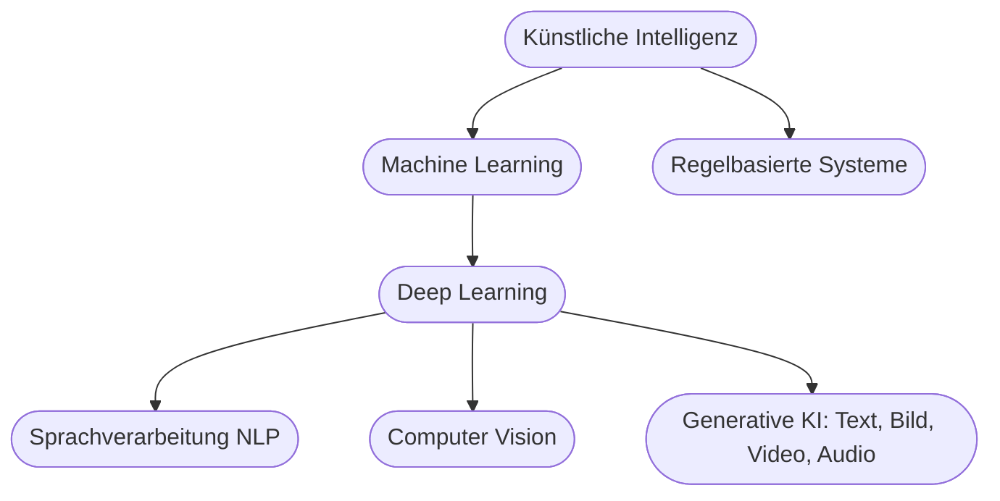
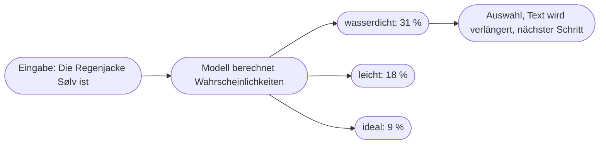

# Kapitel 1 – Was ist Künstliche Intelligenz?

{{ progress(1) }}

<div class="lernziele" markdown>
<h3>Was du in diesem Kapitel lernst</h3>

- Was mit **Künstlicher Intelligenz (KI)** gemeint ist und wie sie sich von klassischer Software unterscheidet
- Welche **Teilgebiete** die KI hat (Machine Learning, Deep Learning, NLP, Computer Vision, generative KI) und wo sie dir im Marketing begegnen
- Wie ein **Sprachmodell** entsteht: Vortraining, Feinabstimmung und warum es einen **Wissensstand** hat
- Was **Token** sind und warum ein Sprachmodell mit **Wahrscheinlichkeiten** statt mit Wissen arbeitet
- Was das **Kontextfenster** ist und warum lange Chats irgendwann „vergessen"
- Welche Folgen diese Funktionsweise für deine **Prompts** und deine Prüfpflicht hat
</div>

---

## So gehst du vor

1. Lies die Kapitelinhalte und präge dir die zentralen Begriffe ein: Training, Token, Wahrscheinlichkeit, Kontextfenster.
2. Bearbeite die **Kurzübungen** – mindestens eine davon setzt du direkt in einem KI-Werkzeug um (ChatGPT, Claude, Gemini oder Microsoft Copilot).
3. Arbeite die **Workshop-Aufgabe** durch. Sie verknüpft das Gelernte mit dem Fallunternehmen Fjordlicht oder mit einem Unternehmen deiner Wahl.

---

## 1.1 Was ist Künstliche Intelligenz?

**Künstliche Intelligenz** ist ein Teilgebiet der Informatik, das sich mit Systemen beschäftigt, die Aufgaben lösen, für die man normalerweise **menschliche Intelligenz** voraussetzt: Sprache verstehen und erzeugen, Muster erkennen, Bilder einordnen, Entscheidungen vorbereiten.

Entscheidend ist der Nebensatz **„für die man menschliche Intelligenz voraussetzt"**. KI muss nicht denken wie ein Mensch – sie muss ein Ergebnis liefern, das wir sonst nur von Menschen erwarten. Ein Newsletter-Tool, das jeden Dienstag um 9 Uhr verschickt, ist keine KI, weil jeder Schritt fest vorgegeben ist. Ein System, das aus Tausenden Öffnungen **selbst lernt**, zu welcher Uhrzeit welche Abonnentin am ehesten liest, ist KI.

### Der entscheidende Unterschied: Regeln oder Lernen

| Klassische Software | KI-System |
|---|---|
| Folgt fest programmierten **Regeln** („wenn … dann …") | **Lernt Muster** aus Daten und Beispielen |
| Verhalten ist vollständig vorhersehbar | Verhalten ist **statistisch**, nicht immer identisch |
| Jemand beschreibt jeden Fall vorab | Jemand stellt **Daten** und ein Lernverfahren bereit |
| Fehler = Programmierfehler | Fehler = ungünstige Daten, Grenzfall oder Zufall |
| Beispiel: Rabattcode-Regel im Shop, Versandplanung | Beispiel: Produktempfehlungen, Spam-Filter, ChatGPT |

!!! info "Merksatz"
    Klassische Software wird **programmiert**, KI wird **trainiert**. Statt „Sag dem Computer genau, was er tun soll" heißt es bei KI: „Zeig dem Computer sehr viele Beispiele, damit er das Muster selbst findet."

Eine feste, allgemein akzeptierte Definition gibt es nicht. KI ist ein **bewegliches Ziel**: Sobald etwas zuverlässig funktioniert – Rechtschreibkorrektur, Übersetzung, Gesichtserkennung im Handy –, gilt es nicht mehr als „echte" KI. Dieses Phänomen heißt **KI-Effekt**. Für die Praxis genügt die Leitfrage: **Lernt das System aus Daten, oder folgt es festen Regeln?**

Ebenso nüchtern ist die Unterscheidung zwischen **schwacher KI** (löst eine bestimmte Klasse von Aufgaben) und **starker KI** (allgemeine, menschenähnliche Intelligenz). Alle heutigen Systeme sind schwache KI – auch ChatGPT, so breit es einsetzbar wirkt. Starke KI ist eine Forschungsvision, kein Werkzeug, das du im Marketing einsetzt.

---

## 1.2 Die Teilgebiete der KI

KI ist ein Oberbegriff. Darunter liegen mehrere ineinander verschachtelte Teilgebiete:



| Teilgebiet | Worum es geht | Beispiel im Marketing | Im Kurs |
|---|---|---|---|
| Machine Learning (ML) | Systeme lernen Muster aus Daten | Kaufwahrscheinlichkeit, Versandzeit-Optimierung | Grundlage |
| Deep Learning | ML mit vielschichtigen neuronalen Netzen | Basis fast aller heutigen KI-Werkzeuge | Grundlage |
| Sprachverarbeitung (NLP) | Sprache verstehen und erzeugen | Sentiment-Analyse von Bewertungen, Chatbots | Kap. 19, 27 |
| Computer Vision | Bilder und Videos verstehen | automatische Bildverschlagwortung im Shop | Kap. 29 |
| Generative KI | neue Inhalte erzeugen | Newsletter-Entwurf, Kampagnenmotiv, Jingle | der Kern dieses Kurses |

Wichtig ist die **Verschachtelung**: Deep Learning ist ein Teil von Machine Learning, Machine Learning ein Teil von KI. Sprachverarbeitung und Computer Vision sind **Anwendungsfelder**, die heute meist mit Deep Learning umgesetzt werden. Generative KI ist der Bereich, der seit dem Start von ChatGPT Ende 2022 die öffentliche Debatte bestimmt – und der für Marketing die größte Veränderung bringt.

**Einordnung der Werkzeuge dieses Kurses:** **ChatGPT**, **Claude**, **Gemini** und **Microsoft Copilot** basieren auf **großen Sprachmodellen** (Large Language Models, kurz LLMs) und gehören zur generativen KI. Bildwerkzeuge wie ChatGPT Images, Midjourney oder Adobe Firefly sind ebenfalls generative KI, arbeiten aber mit anderen Modelltypen (Kap. 29). Die folgenden Abschnitte erklären, wie ein Sprachmodell funktioniert – denn daraus folgt fast alles, was du später beim Prompten beachten musst.

---

## 1.3 Wie ein Sprachmodell entsteht: Training

Ein Sprachmodell entsteht in zwei großen Phasen.

**Phase 1 – Vortraining.** Das Modell bekommt riesige Mengen Text: Webseiten, Bücher, Artikel, Code, Foren. Seine einzige Aufgabe: immer wieder das **nächste Textstück vorhersagen**. Bei jedem Fehler werden Milliarden interner Zahlenwerte (Parameter) minimal angepasst. Nach sehr vielen Durchläufen hat das Modell statistische Zusammenhänge der Sprache verinnerlicht – Grammatik, Stil, Faktenmuster, typische Argumentationen. Es hat dabei aber **keine Datenbank** angelegt, in der es später nachschlägt.

**Phase 2 – Feinabstimmung.** Ein reines Vorhersagemodell würde auf „Schreib mir einen Slogan" vielleicht mit einer weiteren Frage weiterschreiben. Deshalb wird es anschließend mit Beispieldialogen und menschlichen Bewertungen nachtrainiert: Welche Antwort ist hilfreich, welche höflich, welche schädlich? Erst dadurch wird aus dem Textvorhersager ein **Assistent**, der Aufträge ausführt.

| Phase | Was passiert | Folge für dich |
|---|---|---|
| Vortraining | Vorhersage des nächsten Textstücks auf riesigen Textmengen | breites Sprach- und Allgemeinwissen, aber kein Wissen über **dein** Unternehmen |
| Feinabstimmung | Training auf Dialoge, Hilfsbereitschaft, Sicherheitsregeln | das Modell befolgt Aufträge – und will dabei hilfreich wirken, auch wenn es etwas nicht weiß |
| Nach dem Training | Parameter werden „eingefroren" | **Wissensstand**: Ereignisse danach kennt das Modell nur über Websuche oder deine Eingaben |

!!! warning "Typische Falle"
    „ChatGPT kennt doch unsere Produkte, ich habe es gefragt." Wenn Fjordlicht im Trainingsmaterial kaum vorkam, erzeugt das Modell trotzdem eine flüssige Beschreibung der Regenjacke „Sølv" – zusammengesetzt aus dem, was über Regenjacken **allgemein wahrscheinlich** ist. Klingt richtig, ist es aber nur zufällig. Produktfakten, Preise und Nachhaltigkeitsaussagen gibst du immer selbst mit.

Zwei Begriffe ordnen diese Phasen ein: Das Training ist abgeschlossen, bevor du das Werkzeug benutzt. Was du im Chat eingibst, verändert das Modell **nicht** – es fließt nur in die aktuelle Antwort ein. Ob Anbieter Eingaben später für künftiges Training verwenden, ist eine Frage der Tarif- und Datenschutzeinstellungen (Kap. 2 und 4).

---

## 1.4 Token und Wahrscheinlichkeit

Sprachmodelle verarbeiten keine Wörter, sondern **Token** – Textbausteine, die ein ganzes Wort, ein Wortteil oder ein Satzzeichen sein können. Häufige englische Wörter sind oft ein einzelnes Token, lange deutsche Komposita werden zerlegt. Aus „Nachhaltigkeitsbericht" werden so mehrere Token, etwa „Nach", „haltig", „keits", „bericht" (die genaue Zerlegung hängt vom Modell ab). Faustregel: Ein deutscher Text braucht spürbar mehr Token als ein gleich langer englischer.

Die Antwort entsteht **Token für Token**. Bei jedem Schritt berechnet das Modell für alle möglichen nächsten Token eine Wahrscheinlichkeit und wählt eines davon aus. Dann beginnt die Rechnung mit dem verlängerten Text von vorn.



Die Prozentwerte sind illustrativ, das Prinzip ist real. Daraus folgen drei Eigenschaften, die du im Marketing-Alltag ständig erlebst:

| Eigenschaft | Woher sie kommt | Was du beobachtest |
|---|---|---|
| **Variation** | Das Modell wählt nicht immer das wahrscheinlichste Token, sondern zieht mit etwas Zufall | Derselbe Prompt liefert jedes Mal andere Slogans – gut fürs Brainstorming, schlecht für Konsistenz |
| **Durchschnittlichkeit** | Ohne genaue Vorgaben gewinnt das statistisch Übliche | Texte klingen glatt und austauschbar („Entdecke jetzt …", „perfekter Begleiter") |
| **Plausibilität statt Wahrheit** | Bewertet wird, was **sprachlich passt**, nicht was stimmt | Erfundene Zahlen, Zertifikate oder Studien, vorgetragen mit voller Überzeugung (Kap. 2) |

!!! info "Merksatz"
    Ein Sprachmodell weiß nicht, was stimmt – es berechnet, was **wahrscheinlich als Nächstes kommt**. Je genauer dein Prompt, desto stärker verschiebst du die Wahrscheinlichkeiten in Richtung dessen, was **du** brauchst.

Daraus ergibt sich auch, warum Rechnen und Zählen Schwachstellen sind: „Schreibe genau 50 Wörter" ist für ein System, das in Token denkt, keine triviale Aufgabe. Moderne Werkzeuge gleichen das teilweise aus, indem sie intern Hilfsprogramme aufrufen (etwa die Datenanalyse in ChatGPT, Kap. 20). Längenvorgaben solltest du trotzdem nachprüfen.

---

## 1.5 Das Kontextfenster: das Arbeitsgedächtnis

Alles, was ein Sprachmodell bei einer Antwort berücksichtigen kann, muss in sein **Kontextfenster** passen. Dazu gehören: deine aktuelle Nachricht, der bisherige Chatverlauf, hochgeladene Dateien, Ergebnisse einer Websuche und versteckte Grundanweisungen des Werkzeugs (etwa benutzerdefinierte Anweisungen oder Projektvorgaben). Die Größe wird in Token gemessen und ist je nach Modell und Tarif sehr unterschiedlich – heute oft Hunderttausende Token, also Platz für ganze Bücher.

Groß heißt aber nicht unbegrenzt und nicht gleichmäßig. In der Praxis begegnen dir drei Effekte:

- **Verdrängung:** Wird ein Chat sehr lang, kürzen oder verdichten viele Werkzeuge ältere Teile. Die Stilregel aus der ersten Nachricht ist dann womöglich nicht mehr vollständig da.
- **Ungleiche Aufmerksamkeit:** Informationen am Anfang und am Ende werden oft besser berücksichtigt als solche in der Mitte langer Eingaben („Lost in the middle", Kap. 9).
- **Kein Gedächtnis über Chats hinweg** – es sei denn, das Werkzeug hat eine Speicherfunktion (Memory, Projekte). Dann wird gespeicherte Information gezielt wieder ins Kontextfenster geladen (Kap. 7).

| Situation | Was im Kontextfenster steht | Konsequenz |
|---|---|---|
| Neuer Chat, kurzer Prompt | nur dein Prompt und Grundanweisungen | Modell füllt Lücken mit Allgemeinwissen |
| Prompt mit Styleguide und Produktdaten | dein Material in voller Länge | Ergebnis nah an Marke und Fakten |
| Chat nach zwei Stunden Hin und Her | viel Verlauf, frühe Vorgaben evtl. verdichtet | Ton driftet, Regeln werden ignoriert |
| Projekt bzw. Assistent mit Wissensdateien | relevante Ausschnitte aus Dateien werden geladen | konsistenter, aber nur so gut wie die Dateien (Kap. 23) |

!!! tip "Praxisregel: lieber neu anfangen"
    Wenn ein Chat ausfranst, fasse die gültigen Vorgaben zusammen („Fasse alle Vorgaben, auf die wir uns geeinigt haben, als Liste zusammen") und starte mit dieser Liste einen **neuen Chat**. Das ist fast immer schneller, als ein verwirrtes Gespräch zu reparieren.

---

## 1.6 Was das für deine Prompts bedeutet

Aus Training, Token und Kontextfenster folgt eine einfache Haltung: Das Modell ist ein sprachlich sehr gewandter Mitarbeiter **ohne Firmenwissen**, der keine Rückfragen stellt, wenn du ihn nicht dazu aufforderst, und der Lücken mit dem Wahrscheinlichsten füllt. Deine Aufgabe ist, das Kontextfenster mit dem zu füllen, was er wissen muss.

!!! example "Erste praktische Erfahrung"
    Öffne ChatGPT (oder ein anderes Werkzeug) und gib ein:

    ```text
    Schreibe einen Instagram-Text für eine neue Regenjacke.
    ```

    Starte einen **neuen Chat** und gib dann ein:

    ```text
    Du schreibst für Fjordlicht, eine Marke für nachhaltige Outdoor-Bekleidung
    aus Münster. Markenstimme: ruhig, ehrlich, leicht nordisch-trocken,
    Du-Ansprache, keine Superlative.
    Schreibe einen Instagram-Text (maximal 60 Wörter) für die Regenjacke „Sølv".
    Fakten: Wassersäule 20.000 mm, 390 g, Obermaterial zu 100 % aus recyceltem
    Polyamid. Erfinde keine weiteren Eigenschaften oder Nachhaltigkeitsaussagen.
    ```

    Vergleiche beide Ergebnisse. Die erste Fassung ist sprachlich sauber, aber austauschbar – und enthält vermutlich Eigenschaften, die niemand geprüft hat. Die zweite ist näher an Marke und Fakten, weil du die Wahrscheinlichkeiten mit Kontext verschoben hast. Wie du solche Prompts systematisch aufbaust, lernst du mit dem P.R.O.M.P.T.-Framework in Kapitel 5.

| Funktionsweise | Folge | Was du tust |
|---|---|---|
| Training endet zu einem Stichtag | aktuelles Wissen fehlt | aktuelle Infos mitgeben oder Websuche nutzen und prüfen |
| Kein Wissen über dein Unternehmen | Lücken werden plausibel gefüllt | Fakten, Styleguide und Beispiele in den Prompt |
| Wahrscheinlichkeit statt Wahrheit | überzeugend formulierte Fehler | jede Zahl, jeden Claim, jede Quelle prüfen |
| Zufall bei der Auswahl | Variation zwischen Durchläufen | Varianten nutzen, für Konsistenz Vorgaben fixieren |
| Begrenztes Kontextfenster | Vorgaben gehen in langen Chats verloren | Vorgaben bündeln, neu starten, Projekte nutzen |

!!! warning "Verantwortung von Anfang an"
    KI liefert **Entwürfe**, keine geprüften Inhalte. Fakten, Markenstimme, rechtliche Zulässigkeit und Freigabe bleiben beim Menschen. Diese Haltung zieht sich durch den ganzen Kurs – von den Grenzen generativer KI im nächsten Kapitel bis zum Rechtsrahmen in Kapitel 4 und 39.

---

## Zusammenfassung

- KI löst Aufgaben, die man sonst menschlicher Intelligenz zuschreibt – der Kern ist **Lernen aus Daten statt fester Regeln**. Alle heutigen Systeme sind schwache KI.
- Die Teilgebiete sind verschachtelt: **Deep Learning** liegt in **Machine Learning**, das in **KI**. ChatGPT, Claude, Gemini und Copilot sind **generative KI** auf Basis großer Sprachmodelle.
- Ein Sprachmodell entsteht durch **Vortraining** (nächstes Textstück vorhersagen) und **Feinabstimmung** (Assistentenverhalten). Danach hat es einen festen **Wissensstand**.
- Es verarbeitet **Token** und wählt Schritt für Schritt das nächste Token nach **Wahrscheinlichkeit** – daher Variation, Durchschnittlichkeit und plausible Fehler.
- Das **Kontextfenster** ist das Arbeitsgedächtnis: Nur was dort steht, fließt in die Antwort ein. Lange Chats verlieren Vorgaben.
- Gute Prompts füllen das Kontextfenster gezielt mit Fakten, Markenstimme und Regeln – geprüft wird das Ergebnis trotzdem immer.

---

## Kurzübungen

{{ task(file="tasks/k01_01.yaml") }}

{{ task(file="tasks/k01_02.yaml") }}

{{ task(file="tasks/k01_03.yaml") }}

---

## Workshop

{{ task(file="tasks/workshop_k01.yaml") }}
