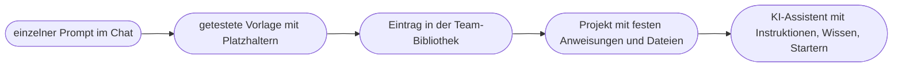

# Kapitel 10 – Prompt-Bibliothek aufbauen und pflegen

{{ progress(10) }}

<div class="lernziele" markdown>
<h3>Was du in diesem Kapitel lernst</h3>

- Warum eine **Prompt-Bibliothek** aus Einzelerfolgen ein Arbeitsmittel für das ganze Team macht
- Wie ein vollständiger Eintrag aussieht – mit **Platzhaltern**, **Metadaten** und Testfällen
- Wie du die Bibliothek **strukturierst** und benennst, damit man Prompts in Sekunden findet
- Welche **Ablageorte** sich eignen – von Notion und SharePoint bis zu Textbaustein-Werkzeugen
- Wie **Versionierung**, Pflege und **Governance** verhindern, dass die Bibliothek verwildert
- Wann ein Prompt aus der Bibliothek zum **KI-Assistenten** wird (Kap. 23 ff.)
</div>

---

## 10.1 Vom guten Prompt zum gemeinsamen Arbeitsmittel

In den Kapiteln 5 bis 9 sind gute Prompts entstanden – mit P.R.O.M.P.T. gebaut, mit Techniken verfeinert, mit Testfällen geprüft und von Fehlern befreit. Ohne Ablage gehen sie wieder verloren: in einem Chatverlauf, den niemand mehr findet, in einer Notiz auf dem Desktop, im Kopf einer Kollegin, die gerade im Urlaub ist.

Bei der Fjordlicht GmbH sieht das vor Einführung einer Bibliothek typisch aus: Fünf Personen im Marketing schreiben jede Woche Newsletter-Teaser, Instagram-Captions und LinkedIn-Posts. Jede Person hat ihre eigene Art zu prompten. Die Ergebnisse klingen unterschiedlich, die Markenstimme schwankt, und als einmal eine unbelegte Nachhaltigkeitsaussage durchrutschte, konnte niemand nachvollziehen, mit welchem Prompt sie entstanden war.

Eine **Prompt-Bibliothek** löst gleich mehrere Probleme:

| Problem ohne Bibliothek | Nutzen mit Bibliothek |
|---|---|
| Jede Person fängt bei null an | bewährte Prompts sind sofort verfügbar |
| Ergebnisse schwanken je nach Person | gleiche Vorlage, gleiche Qualitätsstufe, einheitliche Markenstimme |
| Fehler sind nicht nachvollziehbar | Version und Stand jedes Prompts sind dokumentiert |
| Wissen geht mit Personen verloren | Know-how bleibt im Team |
| Neue Kolleginnen brauchen Wochen | Einarbeitung mit geprüften Vorlagen |

!!! info "Merksatz"
    Ein Prompt, den nur du bedienen kannst, ist eine **Notiz**. Ein Prompt, den eine andere Person ohne Rückfrage nutzen und prüfen kann, ist eine **Vorlage**. Die Bibliothek sammelt nur Vorlagen.

---

## 10.2 Anatomie eines Eintrags: Platzhalter und Metadaten

Ein Bibliothekseintrag besteht aus zwei Teilen: dem **Prompt-Text** mit Platzhaltern und den **Metadaten**, die erklären, wofür er gedacht ist und wie man ihn prüft.

**Platzhalter** kennzeichnen alles, was bei jeder Nutzung neu eingesetzt wird. Bewährt haben sich eckige Klammern mit sprechendem Inhalt und, wo hilfreich, einem Beispiel:

```text
Persona: Du schreibst Social-Media-Texte für die Outdoor-Marke Fjordlicht.
Request: Schreibe eine Instagram-Caption für [Produktname, z. B. Fleece Skog].
Output: 50 bis 80 Wörter, danach 3 bis 5 Hashtags, kein Emoji am Anfang.
Modifier:
- Nutze nur Angaben aus [Produktinfos].
- Nachhaltigkeitsaussagen nur wörtlich aus [Claim-Liste].
- Fehlt eine Angabe, schreibe [FEHLT] statt zu raten.
Purpose: [Anlass, z. B. Produktlaunch, Saisonstart]; Zielgruppe:
naturverbundene Stadtmenschen 25-45; Ziel: Klick in den Shop.
Tone: ruhig, ehrlich, Du-Ansprache, keine Superlative.
```

Die eckige Klammer hat zwei Vorteile: Sie fällt auf, wenn du vergisst, sie zu ersetzen, und sie ist mit allen gängigen Werkzeugen verträglich. Platzhalter sollten **eindeutig benannt** sein – „[Text]" ist schlechter als „[Produktinfos aus dem Datenblatt]".

Die **Metadaten** machen aus dem Prompt einen Eintrag, den andere verstehen:

| Feld | Inhalt | Beispiel |
|---|---|---|
| ID und Name | eindeutige Kennung und sprechender Titel | TXT-IG-003 Instagram-Caption Produkt |
| Zweck | wofür, wann einsetzen, wann nicht | Produktposts im Feed, nicht für Stories |
| Kanal / Kategorie | Einordnung für die Suche | Social Media › Instagram |
| Prompt-Text | vollständig, mit Platzhaltern | siehe oben |
| Benötigter Input | was vorher bereitliegen muss | Produktdatenblatt, Claim-Liste |
| Getestet mit | Werkzeug und Stand | ChatGPT, Oktober 2026; Gegenprobe in Claude |
| Beispielergebnis | eine Ausgabe, die als gut gilt | freigegebene Caption zu „Sølv" |
| Prüfpunkte | worauf bei jedem Ergebnis zu achten ist | Länge, Claims nur aus Liste, keine Superlative |
| Testfälle | Fälle für Änderungen (Kap. 8) | Normalfall, Lückenfall, Grenzfall |
| Datenklasse | was eingegeben werden darf (Kap. 4) | grün: keine personenbezogenen Daten |
| Version, Stand, Verantwortlich | Pflegeinformationen | v4, 15.10.2026, Content-Team |

!!! tip "Das Beispielergebnis ist Pflicht"
    Das wichtigste Metadatum ist das **Beispielergebnis**. Es zeigt in Sekunden, was die Vorlage leisten soll – besser als jede Beschreibung. Gleichzeitig ist es der Maßstab: Liefert der Prompt nach einem Modellwechsel deutlich andere Ergebnisse, merkst du es beim Vergleich sofort.

---

## 10.3 Struktur und Benennung

Eine Bibliothek mit fünfzig Einträgen ohne Ordnung ist kaum besser als keine. Bewährt haben sich drei Ordnungsprinzipien, die du kombinieren kannst:

- **Nach Kanal oder Textsorte:** Newsletter, Instagram, LinkedIn, Blog, Webshop. Intuitiv für Teams, die nach Kanälen organisiert sind.
- **Nach Aufgabe:** Ideen entwickeln, Entwurf schreiben, Überarbeiten, Prüfen, Analysieren. Gut, weil viele Prompts kanalübergreifend funktionieren – ein Claim-Check-Prompt gilt für alle Texte.
- **Nach Funnel-Phase:** Aufmerksamkeit, Interesse, Kauf, Bindung (Kap. 3). Hilfreich, wenn ihr Kampagnen entlang der Customer Journey plant.

Für Fjordlicht bietet sich eine Kombination an: Hauptkategorie nach Aufgabe, Unterkategorie nach Kanal. Dazu eine einfache **Benennungskonvention**, etwa `[Bereich]-[Kanal]-[Nummer] Kurztitel`:

```text
TXT-NL-001  Newsletter-Einleitung Wochenthema
TXT-IG-003  Instagram-Caption Produkt
TXT-LI-002  LinkedIn-Post Fjordlicht Business
PRF-ALL-001 Claim-Check für alle Texte
IDE-ALL-004 Themenideen aus Saisonanlass
ANA-NL-001  Auswertung Newsletter-Kennzahlen
```

!!! warning "Typische Falle"
    Die Bibliothek wird zur Müllhalde, wenn jede Person jeden halbwegs gelungenen Prompt hineinkippt. Fünf Varianten der Instagram-Caption, keine davon getestet, verwirren mehr, als sie helfen. Regel: **Pro Aufgabe eine freigegebene Vorlage.** Varianten und Experimente gehören in einen getrennten Bereich „Entwürfe".

---

## 10.4 Ablageorte

Die beste Ablage ist die, die dein Team ohnehin täglich öffnet. Eine perfekte Datenbank, die niemand nutzt, verliert gegen eine schlichte Tabelle im gemeinsamen Laufwerk.

| Ablageort | Stärken | Schwächen | Passt für |
|---|---|---|---|
| **Notion** oder ähnliche Wikis | Datenbank mit Filtern, Tags, Vorlagen, gut durchsuchbar | eigenes Werkzeug, Datenschutzprüfung nötig | Teams, die Notion schon nutzen |
| **SharePoint-Liste / OneNote** | im Microsoft-365-Umfeld vorhanden, Rechteverwaltung | Listen weniger komfortabel für lange Texte | Unternehmen mit Microsoft 365 |
| **Google Sheets / Excel** | schnell eingerichtet, filterbar, jede Person kann es bedienen | lange Prompts in Zellen unübersichtlich, Versionen nur rudimentär | Start und kleine Teams |
| **Textbaustein-Werkzeuge** (z. B. TextExpander, Espanso, Textersetzung im Betriebssystem) | Prompt per Kürzel direkt in jedes Chatfenster einfügen | keine Metadaten, Pflege pro Gerät oder Konto | häufig genutzte Kurz-Prompts |
| **Projekte und Assistenten** im KI-Werkzeug | Vorgaben wirken automatisch | an ein Werkzeug gebunden, schwer vergleichbar | ausgereifte, oft genutzte Abläufe (Kap. 23) |

In der Praxis bewährt sich eine **Zweiteilung**: Eine zentrale, durchsuchbare Bibliothek mit allen Metadaten ist die verbindliche Quelle. Für die zehn meistgenutzten Prompts gibt es zusätzlich Kürzel in einem Textbaustein-Werkzeug oder eine Schnellzugriffsliste.

!!! example "Startpunkt für Fjordlicht"
    Das Team startet mit einer gemeinsamen Tabelle mit den Spalten aus Abschnitt 10.2 und einer Zeile pro Vorlage. Lange Prompt-Texte und Beispielergebnisse stehen in einem verlinkten Dokument. Nach drei Monaten wird entschieden, ob ein Umzug in eine Datenbank lohnt. Das Kriterium dafür ist nicht die Anzahl der Einträge, sondern ob Prompts gefunden und genutzt werden.

---

## 10.5 Versionierung und Pflege

Prompts altern. Modelle werden ausgetauscht, die Markenstimme entwickelt sich weiter, eine Claim-Liste wird aktualisiert, ein Kanal ändert seine Logik. Eine Bibliothek ohne Pflege enthält nach einem Jahr Vorlagen, die niemand mehr versteht.

**Versionierung** heißt: Jede Änderung an einer freigegebenen Vorlage bekommt eine neue Versionsnummer, ein Datum und einen Satz zur Begründung. Die Vorgängerversion bleibt erhalten.

```text
TXT-IG-003 Instagram-Caption Produkt
v1  02.09.2026  Erstfassung aus Workshop
v2  16.09.2026  Regel [FEHLT] ergänzt, Lückenfall erfand Material
v3  08.10.2026  Hashtags auf 3-5 begrenzt, Testfälle unverändert bestanden
v4  15.10.2026  Gegenprobe nach Modellwechsel in ChatGPT, keine Änderung nötig
```

Zur Pflege gehören drei Routinen:

1. **Änderung nur mit Test.** Vor jeder neuen Version laufen die hinterlegten Testfälle (Kap. 8). Besteht die neue Version nicht mindestens so gut wie die alte, bleibt die alte.
2. **Regelmäßiger Durchgang.** Einmal im Quartal und nach jedem größeren Modellwechsel prüft die verantwortliche Person, ob die Vorlagen noch funktionieren und noch gebraucht werden.
3. **Ausmisten.** Vorlagen, die seit Monaten niemand nutzt, werden archiviert, nicht gelöscht.

!!! tip "Rückmeldekanal einrichten"
    Gib jeder Vorlage einen einfachen Weg für Rückmeldungen – eine Kommentarspalte oder einen gemeinsamen Kanal. Wer einen Fehler bemerkt, trägt Symptom und Beispiel ein (Kap. 9). Die verantwortliche Person entscheidet, ob daraus eine neue Version wird.

---

## 10.6 Teamnutzung und Governance

Sobald mehrere Personen mit derselben Bibliothek arbeiten, braucht es Regeln. **Governance** klingt groß, heißt aber im Kern: Wer darf was, und wer ist wofür verantwortlich?

| Rolle | Aufgabe |
|---|---|
| **Verantwortliche Person** (eine pro Bibliothek) | Struktur, Freigaben, Quartalsdurchgang |
| **Eigentümerin einer Vorlage** | Pflege, Tests, Bearbeitung von Rückmeldungen |
| **Nutzende** | Vorlagen anwenden, Ergebnisse prüfen, Fehler melden |
| **Fachstellen** (z. B. Produktmanagement, Rechtsabteilung) | Freigabe von Claim-Listen und kritischen Vorlagen |

Dazu kommen Regeln, die sich aus der KI-Richtlinie des Unternehmens ableiten (Kap. 4):

- **Keine vertraulichen Inhalte in Vorlagen.** Kundennamen, Preiskalkulationen, interne Zahlen oder personenbezogene Daten haben in einem Prompt-Text nichts zu suchen – nur Platzhalter.
- **Datenklasse je Vorlage.** Jeder Eintrag sagt, welche Daten beim Ausfüllen eingegeben werden dürfen. Eine Vorlage zur Auswertung von Newsletter-Kennzahlen darf aggregierte Zahlen enthalten, aber keine Abonnentenliste.
- **Freigabe vor Veröffentlichung.** Eine Vorlage ersetzt nicht die inhaltliche Prüfung der Ergebnisse. Wer veröffentlicht, prüft – besonders Claims und Fakten.
- **Werkzeugbindung dokumentieren.** Wenn eine Vorlage nur in einem bestimmten Werkzeug getestet ist, steht das im Eintrag.

!!! info "Merksatz"
    Die Bibliothek ist so gut wie ihre Pflege. **Eine verantwortliche Person, eine freigegebene Vorlage pro Aufgabe, Änderungen nur mit Test** – mehr Governance braucht ein kleines Marketingteam am Anfang nicht.

---

## 10.7 Von der Bibliothek zum Assistenten

Manche Vorlagen werden so oft genutzt, dass das Kopieren selbst lästig wird. Andere brauchen jedes Mal dasselbe Begleitmaterial – Styleguide, Claim-Liste, Produktdaten. Das sind Kandidaten für den nächsten Schritt: einen **KI-Assistenten** wie ein Custom GPT bzw. ChatGPT-Plugin, ein Projekt in ChatGPT oder Claude, ein Gemini Gem oder einen Copilot Agent (Kap. 23).



Die Bibliothek ist dafür die ideale Vorarbeit: Persona, Tone und Modifier werden zu den **Instruktionen** des Assistenten, das Begleitmaterial zur **Wissensbasis**, häufige Requests zu **Konversationsstartern**, und die Testfälle prüfen den Assistenten genauso wie vorher die Vorlage. Genau so entsteht in Kapitel 26 der Content-Assistent von Fjordlicht. Die Bibliothek bleibt trotzdem bestehen – als Dokumentation, als Quelle für seltenere Aufgaben und als werkzeugunabhängige Sicherung, falls ein Anbieter seine Funktionen umbaut.

---

## Zusammenfassung

- Eine **Prompt-Bibliothek** macht aus Einzelerfolgen ein Teamwerkzeug: einheitliche Qualität, nachvollziehbare Ergebnisse, schnellere Einarbeitung.
- Ein Eintrag besteht aus dem Prompt mit **eindeutigen Platzhaltern** in eckigen Klammern und **Metadaten** – Zweck, Input, Beispielergebnis, Prüfpunkte, Testfälle, Datenklasse, Version.
- **Struktur und Benennung** nach Aufgabe und Kanal machen Vorlagen auffindbar; pro Aufgabe gibt es eine freigegebene Vorlage.
- Der **Ablageort** richtet sich nach dem, was das Team täglich nutzt; bewährt ist eine zentrale Bibliothek plus Schnellzugriff.
- **Versionierung** mit Datum und Begründung, Tests vor jeder Änderung und ein Quartalsdurchgang halten die Bibliothek aktuell.
- **Governance** regelt Verantwortung, Freigaben und Daten; häufig genutzte Vorlagen sind die Basis für **KI-Assistenten** (Kap. 23 ff.).

---

## Kurzübungen

{{ task(file="tasks/k10_01.yaml") }}

{{ task(file="tasks/k10_02.yaml") }}

{{ task(file="tasks/k10_03.yaml") }}

---

## Workshop

{{ task(file="tasks/workshop_k10.yaml") }}
