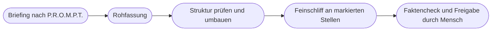

# Kapitel 11 – Kollaboratives Schreiben: vom ChatGPT Canvas zu Schreibblöcken

{{ progress(11) }}

<div class="lernziele" markdown>
<h3>Was du in diesem Kapitel lernst</h3>

- Warum der **Chatverlauf** für längere Texte ein schlechter Arbeitsort ist
- Das **Arbeitsprinzip Canvas**: ein gemeinsames Dokument neben dem Chat, gezielte Überarbeitung markierter Stellen
- Was sich im **Mai 2026** geändert hat: Canvas entfernt, **Schreibblöcke** direkt in der Antwort
- Welche **Alternativen** dasselbe Prinzip bieten: Claude Artifacts, Gemini Canvas, Microsoft Copilot Pages
- Den Dreischritt **Rohfassung → Struktur → Feinschliff** mit passenden Prompts für jede Phase
- Wie du **gezielt** überarbeiten lässt, ohne dass die KI den ganzen Text glattbügelt
</div>

---

## 11.1 Das Problem: Schreiben im Chatverlauf

Bis hierher hast du Prompts geschrieben, Ergebnisse gelesen und nachgeschärft (Kap. 5–9). Für eine Betreffzeile oder einen Instagram-Text reicht das. Bei einem Blogartikel mit 1.200 Wörtern oder einem Newsletter mit fünf Modulen zeigt der normale Chat seine Schwächen:

- **Jede Korrektur erzeugt eine komplette Neufassung.** Du bittest um einen anderen Einstieg und bekommst den ganzen Text neu – mit Änderungen an Stellen, die du nicht angefasst haben wolltest.
- **Versionen verteilen sich über den Verlauf.** Nach zwanzig Runden weißt du nicht mehr, in welcher Antwort der gute zweite Absatz stand.
- **Unbemerkte Drift.** Ein Produktname wird umgeschrieben, ein belegter Fakt wird „schöner" formuliert und dabei falsch, ein Superlativ schleicht sich ein.
- **Kontextverlust.** In langen Chats geraten frühe Vorgaben aus dem Blick (Kap. 9).

Der Kern des Problems: Im Chat ist der **Gesprächsverlauf** das Arbeitsobjekt. Beim Schreiben willst du aber an einem **Dokument** arbeiten, das schrittweise besser wird.

!!! info "Merksatz"
    Ein Chat ist ein Gespräch über einen Text. Für ernsthafte Textarbeit brauchst du einen Ort, an dem der Text selbst liegt – und an dem du einzelne Stellen ändern kannst, ohne den Rest neu würfeln zu lassen.

---

## 11.2 Das Arbeitsprinzip Canvas

OpenAI hat 2024 mit **Canvas** eine Antwort auf dieses Problem eingeführt: einen **Seitenleisten-Editor** neben dem Chat. Der Text stand dort als Dokument, das du selbst bearbeiten oder von der KI bearbeiten lassen konntest. Die wichtigsten Arbeitsweisen:

| Funktion | Was sie tat | Wozu sie im Marketing taugte |
|---|---|---|
| Dokument neben dem Chat | Text liegt getrennt vom Gesprächsverlauf | eine Fassung, an der alle Änderungen landen |
| Markieren und überarbeiten | nur die markierte Passage wird geändert | Einstieg schärfen, ohne den Rest anzufassen |
| Länge anpassen | Text schrittweise kürzen oder erweitern | Newsletter-Modul auf feste Zeichenzahl bringen |
| Lesestufe anpassen | einfacher oder fachlicher formulieren | B2C-Fassung und B2B-Fassung desselben Inhalts |
| Feinschliff | Grammatik, Klarheit, Konsistenz prüfen | letzter Durchgang vor der Freigabe |
| Versionen | zu früheren Ständen zurückspringen | missglückte Überarbeitung rückgängig machen |

Das eigentliche Lernziel dieses Kapitels ist nicht die Bedienung eines bestimmten Knopfes, sondern dieses **Arbeitsprinzip**: Du und die KI arbeitet an **einem gemeinsamen Dokument**, Änderungen erfolgen **gezielt an markierten Stellen**, und du behältst die Kontrolle über jede Version.

---

## 11.3 Stand Oktober 2026: Canvas entfernt, Schreibblöcke da

Werkzeuge ändern sich schnell, und Canvas ist ein gutes Beispiel dafür. Am **28. Mai 2026** hat OpenAI Canvas aus den aktuellen Modellen in ChatGPT entfernt. Bezahlnutzer konnten Canvas übergangsweise noch über Legacy-Modelle aufrufen. Ersatz sind **Schreibblöcke** (englisch *writing blocks*) und Code-Blöcke, die direkt in der Antwort erscheinen.

| Arbeitsprinzip | Früher in Canvas | Heute mit Schreibblöcken |
|---|---|---|
| Text als eigenes Objekt | Dokument in der Seitenleiste | abgesetzter Schreibblock in der Antwort |
| Gezielte Überarbeitung | Passage markieren, Anweisung geben | Passage im Schreibblock markieren, Anweisung geben |
| Konzentriertes Arbeiten | breite Seitenleiste | Vollbild-Editor |
| Überblick bei langen Texten | Scrollen im Dokument | Gliederung für lange Texte |
| Weitergabe | Kopieren | Speichern und Download |

Ob und wie die Schreibblöcke in deinem Konto erscheinen, kann je nach Tarif und Modell variieren; manchmal entsteht ein Schreibblock automatisch, manchmal hilft eine ausdrückliche Bitte im Prompt. Für dich heißt das: Die Oberfläche ist eine andere, das Vorgehen bleibt gleich. Wenn du in Anleitungen oder älteren Schulungsunterlagen noch „öffne Canvas" liest, übersetzt du das in „lass den Text als Schreibblock ausgeben und arbeite dort weiter".

```text
Schreibe den folgenden Newsletter-Text als eigenen Schreibblock,
damit ich einzelne Absätze markieren und gezielt überarbeiten kann.
Ändere zunächst nichts am Inhalt.
Text: [Rohfassung einfügen]
```

!!! warning "Typische Falle"
    Anleitungen, Videos und auch KI-Antworten selbst (Trainingsstichtag, Kap. 1) beschreiben oft noch den alten Stand. Wenn ein Knopf nicht da ist, liegt das selten an dir. Prüfe den aktuellen Stand in der Hilfe des Anbieters und hänge dein Vorgehen nicht an eine einzelne Funktion – sondern an das Prinzip.

---

## 11.4 Dasselbe Prinzip in anderen Werkzeugen

Das Prinzip „Dokument neben dem Gespräch" gibt es in allen großen Werkzeugen, jeweils unter eigenem Namen. Die genaue Bedienung ändert sich laufend; die folgende Übersicht nennt den Kern (Stand: Oktober 2026).

| Werkzeug | Funktion | Kern |
|---|---|---|
| ChatGPT | Schreibblöcke | Text als bearbeitbarer Block in der Antwort, Vollbild, Gliederung, Download |
| Claude | Artifacts | längere Inhalte erscheinen als eigenes Objekt neben dem Chat und werden dort fortgeschrieben |
| Gemini | Canvas | Arbeitsfläche für Texte (und Code), Passagen lassen sich gezielt überarbeiten |
| Microsoft Copilot | Pages | Antworten in eine Seite übernehmen, gemeinsam weiterbearbeiten und teilen |

Für die Werkzeugwahl im Team zählen dabei weniger die Komfortfunktionen als die Fragen aus Kapitel 4: Welcher Tarif ist freigegeben, welche Daten dürfen hinein, wo landen die Dokumente? Ein Newsletter-Entwurf mit Produktneuheiten vor dem Launch ist vertraulich – auch wenn er „nur Text" ist.

!!! tip "Unabhängig vom Werkzeug arbeiten"
    Wenn dein Werkzeug gar keine Dokumentfunktion hat, kannst du das Prinzip nachbauen: Halte die aktuelle Fassung in einem eigenen Dokument (Word, Google Docs), kopiere nur die Passage in den Chat, die geändert werden soll, und übernimm das Ergebnis von Hand. Das ist umständlicher, aber genauso kontrolliert.

---

## 11.5 Der Dreischritt: Rohfassung → Struktur → Feinschliff

Gute Texte entstehen auch mit KI nicht in einem Durchgang. Bewährt hat sich ein Dreischritt, in dem jede Phase eine eigene Aufgabe und einen eigenen Prompt hat.



**Phase 1 – Rohfassung.** Grundlage ist ein vollständiges Briefing nach dem P.R.O.M.P.T.-Framework (Kap. 5): **P**ersona, **R**equest, **O**utput, **M**odifier, **P**urpose, **T**one. In dieser Phase geht es um Inhalt und Vollständigkeit, nicht um schöne Sätze.

```text
Persona: Du bist Texterin im Marketingteam der Fjordlicht GmbH,
einer Marke für nachhaltige Outdoor-Bekleidung aus Münster.
Request: Schreibe eine Rohfassung für einen Blogbeitrag im Blog
"Draußen-Notizen" zum Thema "Regenjacke richtig pflegen".
Output: ca. 700 Wörter, Zwischenüberschriften, als Schreibblock.
Modifier: Nutze nur die Pflegehinweise unten. Keine Superlative,
keine Nachhaltigkeitsaussagen außer den belegten. Fehlende Angaben
als [FEHLT] markieren.
Purpose: Kundinnen und Kunden sollen ihre Jacke "Sølv" länger nutzen;
Zielgruppe naturverbundene Stadtmenschen 25-45.
Tone: ruhig, ehrlich, leicht nordisch-trocken, Du-Ansprache.
Pflegehinweise: [Hinweise aus dem Produktdatenblatt einfügen]
```

**Phase 2 – Struktur.** Jetzt schaust du auf das Ganze: Stimmt die Reihenfolge? Fehlt ein Abschnitt? Ist der Einstieg zu lang? Lass die KI zuerst **analysieren**, bevor sie umbaut.

```text
Prüfe die Struktur des Textes im Schreibblock. Gib mir zuerst nur
eine Gliederung mit einem Satz pro Abschnitt und markiere, wo sich
Inhalte doppeln oder die Reihenfolge für Leser unlogisch ist.
Ändere den Text noch nicht.
```

**Phase 3 – Feinschliff.** Erst wenn Inhalt und Aufbau stehen, geht es an einzelne Formulierungen – und zwar Passage für Passage, nicht für den ganzen Text auf einmal.

| Phase | Leitfrage | Was du von der KI willst | Was du selbst tust |
|---|---|---|---|
| Rohfassung | Ist alles drin? | vollständigen Entwurf auf Basis deines Materials | Material und Briefing liefern, Lücken schließen |
| Struktur | Trägt der Aufbau? | Analyse, Umbauvorschläge, Gliederung | entscheiden, was bleibt und was fliegt |
| Feinschliff | Sitzt jeder Satz? | gezielte Varianten für markierte Stellen | auswählen, Markenstimme prüfen |
| Freigabe | Stimmt alles? | allenfalls Prüfliste abarbeiten | Fakten, Claims und Produktnamen prüfen |

!!! warning "Typische Falle"
    Wer schon in der Rohfassung an Formulierungen feilt, poliert Sätze, die in Phase 2 gestrichen werden. Umgekehrt zerstört ein später Strukturumbau den Feinschliff. Halte die Reihenfolge ein – sie spart mehr Zeit, als sie kostet.

---

## 11.6 Gezielt überarbeiten statt glattbügeln

Die größte Stärke des Arbeitens im Dokument ist zugleich die häufigste Fehlerquelle: Eine allgemeine Anweisung wie „mach den Text besser" lädt die KI ein, **alles** zu verändern. Das Ergebnis klingt flüssiger, aber austauschbarer – und oft sind dabei Fakten, Produktnamen oder die Markenstimme verloren gegangen.

Die Lösung: Markiere die Stelle, benenne die Abweichung und setze eine klare Grenze.

| Statt … | … besser | Warum |
|---|---|---|
| „Mach den Text besser." | „Der Einstieg ist zu allgemein. Beginne mit einer konkreten Situation im Regen." | benennt das Problem statt einer Wertung |
| „Kürzer bitte." | „Kürze diesen Absatz auf maximal 60 Wörter. Die Pflegetemperatur bleibt erhalten." | Zielgröße und Schutz für den Kerninhalt |
| „Klingt zu werblich." | „Streiche alle Superlative und Ausrufezeichen in dieser Passage. Sonst nichts ändern." | eindeutig prüfbar |
| „Schreib das um." | „Gib mir drei Varianten für diesen Satz, jeweils mit anderem Bild." | du wählst aus, statt zu übernehmen |

Bewährte Schutzformeln, die du an fast jede Überarbeitung anhängen kannst:

```text
Ändere ausschließlich die markierte Passage.
Produktnamen, Zahlen und Nachhaltigkeitsaussagen bleiben wortgleich.
Liste nach der Überarbeitung in Stichpunkten auf, was du geändert hast.
```

Die letzte Zeile ist besonders wertvoll: Eine **Änderungsliste** macht sichtbar, was die KI angefasst hat, und du musst nicht Satz für Satz vergleichen. Prüfen musst du trotzdem – die Liste ist eine Hilfe, kein Beweis.

!!! example "Vorher/Nachher bei Fjordlicht"
    **Vorher (Rohfassung):** „Die Sølv ist die perfekte Jacke für jedes Wetter und schützt die Umwelt wie keine andere."

    **Anweisung:** „Überarbeite diesen Satz in Fjordlicht-Markenstimme: keine Superlative, keine unbelegten Umweltaussagen. Belegt ist nur: Obermaterial zu 100 Prozent aus recyceltem Polyamid."

    **Nachher:** „Die Sølv hält dich trocken, wenn es ernst wird. Ihr Obermaterial besteht zu 100 Prozent aus recyceltem Polyamid."

    Der zweite Satz ist weniger laut, aber prüfbar – und damit genau das, was eine Marke ohne Greenwashing braucht. Mehr zur Markenstimme in Kapitel 7, zu belegbaren Claims im Praxisbeispiel Content-Assistent (Kap. 26).

!!! info "Merksatz"
    Je enger die Anweisung, desto kontrollierbarer das Ergebnis. Markieren, Problem benennen, Grenze setzen, Änderungsliste verlangen – das ist kollaboratives Schreiben, unabhängig davon, wie die Funktion gerade heißt.

---

## Zusammenfassung

- Im **Chatverlauf** verteilen sich Versionen, jede Korrektur schreibt den ganzen Text neu, und Fakten driften unbemerkt.
- Das **Arbeitsprinzip Canvas** – ein Dokument neben dem Chat, gezielte Überarbeitung markierter Stellen, Versionen – ist das eigentliche Lernziel.
- Seit dem **28.05.2026** ist Canvas aus den aktuellen ChatGPT-Modellen entfernt; Ersatz sind **Schreibblöcke** mit Markieren, Vollbild-Editor, Gliederung und Download.
- Vergleichbar arbeiten **Claude Artifacts**, **Gemini Canvas** und **Microsoft Copilot Pages**; entscheidend für die Wahl sind Freigabe und Datenschutz (Kap. 4).
- Der Dreischritt **Rohfassung → Struktur → Feinschliff** trennt Inhalt, Aufbau und Formulierung; die Rohfassung startet mit einem Briefing nach **P.R.O.M.P.T.** (Kap. 5).
- Überarbeite **gezielt**: Stelle markieren, Problem benennen, Grenze setzen, Änderungsliste verlangen – und Fakten immer selbst prüfen.

---

## Kurzübungen

{{ task(file="tasks/k11_01.yaml") }}

{{ task(file="tasks/k11_02.yaml") }}

{{ task(file="tasks/k11_03.yaml") }}

---

## Workshop

{{ task(file="tasks/workshop_k11.yaml") }}
