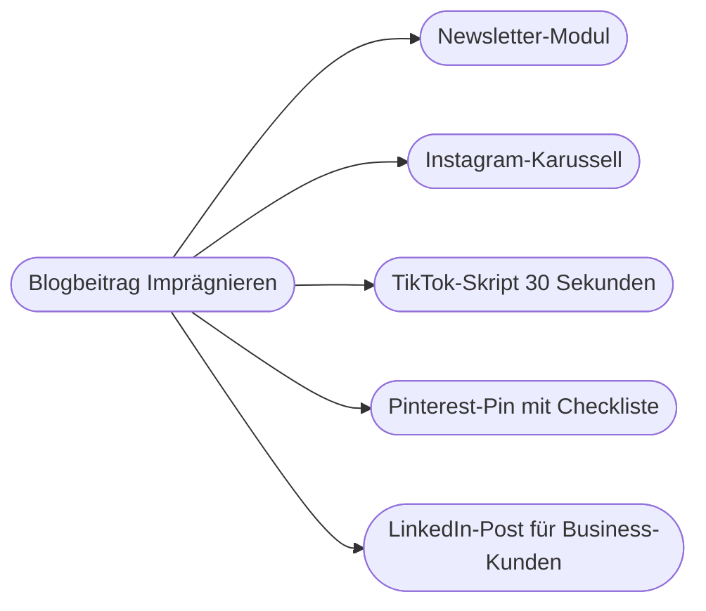

# Kapitel 12 – Redaktionsplanung & Brainstorming mit KI

{{ progress(12) }}

<div class="lernziele" markdown>
<h3>Was du in diesem Kapitel lernst</h3>

- Wofür KI im Brainstorming taugt – und warum ihre Ideen ohne Steuerung zum **Durchschnitt** tendieren
- Wie du klassische **Kreativtechniken** (SCAMPER, Perspektivwechsel, 6-3-5 digital, Ideen-Fächer) mit KI umsetzt
- Wie du Themen in **Content-Pillars** und **Themencluster** ordnest
- Wie ein **Redaktionskalender** mit saisonalen Anlässen entsteht – und welche Angaben du immer prüfen musst
- Wie du aus einem Inhalt per **Content-Recycling** viele machst
- Wie du Ideen mit einem **Bewertungsraster** auswählst, statt nach Bauchgefühl
</div>

---

## 12.1 KI als Ideenpartner: Breite ja, Originalität nicht automatisch

Brainstorming ist eine der Aufgaben, bei denen generative KI am schnellsten Nutzen stiftet. In einer Minute liefert sie dreißig Themenideen, zehn Blickwinkel und fünf Formate – mehr, als ein Team in einer halben Stunde an der Flipchart sammelt. Gleichzeitig steckt darin die zentrale Schwäche: Ein Sprachmodell erzeugt die **wahrscheinlichste** Fortsetzung (Kap. 1). Fragst du nach „Content-Ideen für eine Outdoor-Marke im Herbst", bekommst du genau die Ideen, die alle Outdoor-Marken im Herbst haben: Laub, Packliste, Schichtenprinzip, Herbstwanderwege.

| KI kann im Brainstorming gut | KI kann im Brainstorming schlecht |
|---|---|
| in kurzer Zeit viele Varianten erzeugen | wissen, was eure Community wirklich bewegt |
| bekannte Muster und Formate durchspielen | einschätzen, was bei euch schon gelaufen ist |
| Perspektiven einnehmen, die im Team fehlen | aktuelle Trends ohne Websuche kennen |
| Ideen sortieren, clustern, zusammenfassen | entscheiden, was zur Strategie passt |

Daraus folgt die Arbeitsteilung: Die KI liefert **Menge und Struktur**, das Team liefert **Wissen, Auswahl und Mut zur ungewöhnlichen Idee**.

Auch ein Brainstorming-Prompt folgt dem P.R.O.M.P.T.-Framework (Kap. 5). Besonders wichtig sind hier zwei Bausteine: **Purpose** (Wozu brauchen wir die Ideen, für wen?) und **Modifier** (Was ist schon gelaufen, was ist tabu, welche Ideen wollen wir ausdrücklich nicht?). Persona und Tone treten dagegen eher in den Hintergrund – beim Sammeln zählt die Breite, nicht der fertige Satz.

!!! info "Merksatz"
    Ohne Kontext liefert KI die Ideen der ganzen Branche. Je mehr du über Marke, Zielgruppe, bisherige Inhalte und No-Gos mitgibst, desto eher entstehen Ideen, die nur zu euch passen.

---

## 12.2 Kreativtechniken mit KI

Klassische Kreativtechniken geben dem Brainstorming eine Richtung. Mit KI werden sie schneller – und sie zwingen das Modell weg vom Naheliegenden.

### SCAMPER

SCAMPER ist eine Checkliste mit sieben Denkrichtungen, um ein bestehendes Produkt, Format oder Thema abzuwandeln. Am Beispiel des Fjordlicht-Newsletters:

| Buchstabe | Frage | Idee für Fjordlicht |
|---|---|---|
| **S**ubstitute (ersetzen) | Was lässt sich austauschen? | Produktvorstellung ersetzt durch Kundengeschichte aus dem Münsterland |
| **C**ombine (kombinieren) | Was lässt sich verbinden? | Pflegetipp plus Reparaturservice in einem Modul |
| **A**dapt (anpassen) | Was lässt sich von anderswo übernehmen? | Wetterbericht-Format: „Die Woche draußen" |
| **M**odify (verändern) | Was lässt sich vergrößern, verkleinern? | Newsletter nur mit einem einzigen Thema |
| **P**ut to other uses (umnutzen) | Wofür noch? | Packlisten als druckbare Leadmagnete (Kap. 15) |
| **E**liminate (weglassen) | Was fällt weg? | keine Rabatte, stattdessen Pflegeanleitung |
| **R**everse (umkehren) | Was, wenn es andersherum wäre? | Leser schicken Fotos, Fjordlicht kommentiert |

```text
Wende die SCAMPER-Methode auf den Newsletter der Fjordlicht GmbH an.
Kontext: nachhaltige Outdoor-Bekleidung, ca. 38.000 Abonnenten,
Markenstimme ruhig, ehrlich, nordisch-trocken, keine Superlative.
Bisher: monatlich, Produktneuheiten plus ein Blogteaser.
Liefere je Buchstabe zwei Ideen in einer Tabelle mit den Spalten
Buchstabe, Idee, Aufwand (gering/mittel/hoch), Risiko für die Marke.
```

### Perspektivwechsel

Lass die KI das Thema aus Sicht verschiedener Personen betrachten: einer Mutter mit zwei Kindern, eines skeptischen Försters, einer B2B-Einkäuferin, eines Neulings ohne Ausrüstung. Jede Perspektive erzeugt andere Fragen – und Fragen sind die besten Content-Ideen. Wie du solche Perspektiven später zu belastbaren Kundenavataren ausbaust, zeigt Kapitel 18.

### 6-3-5 digital

Die klassische 6-3-5-Methode: sechs Personen, je drei Ideen, fünf Weitergaben, bei denen die Ideen der anderen weiterentwickelt werden. Digital ersetzt die KI einige Runden: Das Team sammelt in Runde 1 eigene Ideen, die KI entwickelt jede in Runde 2 weiter, das Team wählt und verfeinert in Runde 3. So bleiben die Ausgangsideen menschlich, und die KI arbeitet als Verstärker statt als Quelle.

### Ideen-Fächer

Statt nach „Ideen" zu fragen, gibst du **Dimensionen** vor, die kombiniert werden: Zielgruppe × Format × Anlass. Das erzwingt Vielfalt.

```text
Erzeuge einen Ideen-Fächer für Fjordlicht-Inhalte im November.
Dimension 1 Zielgruppe: Stadtmenschen 25-45, Familien, B2B-Kunden.
Dimension 2 Format: Kurzvideo, Blogbeitrag, Newsletter-Modul, Karussell.
Dimension 3 Anlass: erster Frost, Novembergrau, Vorweihnachtszeit.
Kombiniere so, dass jede Zielgruppe und jedes Format mindestens zweimal
vorkommt. 12 Ideen, je eine Zeile, plus ein Satz, warum sie zur Marke passt.
```

!!! tip "Die naheliegenden Ideen ausschließen"
    Ein einfacher Trick: Bitte zuerst um die zehn naheliegendsten Ideen – und dann um zehn Ideen, die **ausdrücklich keine** davon sind. Die zweite Liste ist fast immer interessanter. Mehr zu solchen Prompt-Hacks in Kapitel 7.

---

## 12.3 Content-Pillars und Themencluster

Einzelne Ideen ergeben noch keine Strategie. Damit Inhalte über Monate ein erkennbares Profil bilden, ordnest du sie in **Content-Pillars** (Themensäulen): drei bis fünf dauerhafte Themenbereiche, die zur Marke passen und die Zielgruppe interessieren. Unter jeder Säule liegen **Themencluster** – Gruppen verwandter Einzelthemen, die sich gegenseitig verlinken und ergänzen (wichtig auch für SEO, Kap. 21).

| Content-Pillar | Wozu er dient | Beispiel-Cluster | Anteil (Richtwert) |
|---|---|---|---|
| Draußen sein | Inspiration, Reichweite | Mikroabenteuer im Münsterland, Wandern mit Kindern | 35 % |
| Ausrüstung verstehen | Kompetenz, Kaufentscheidung | Schichtenprinzip, Materialkunde, Größenberatung | 25 % |
| Länger nutzen | Markenwert, Nachhaltigkeit belegbar machen | Pflege, Reparatur, Second-Hand | 20 % |
| Hinter den Kulissen | Vertrauen, Nähe | Team, Lieferkette, Produktentwicklung | 10 % |
| Fjordlicht Business | B2B-Leads | Firmenbekleidung, Teamausstattung | 10 % |

Die Pillars selbst sind eine strategische Entscheidung und gehören nicht in die Hand der KI allein. Sinnvoll ist aber, dir von ihr Vorschläge machen zu lassen und diese mit dem Team gegen Markenwerte und Ziele zu prüfen. Achte darauf, dass jeder Pillar ein eigenes Ziel hat – ein Pillar, der nur „dazugehört", wird im Alltag als Erstes vernachlässigt.

KI hilft hier auf zwei Wegen: Sie kann aus einer ungeordneten Ideenliste Cluster bilden, und sie kann bestehende Inhalte (etwa eine Liste aller Blogtitel) den Säulen zuordnen und Lücken sichtbar machen.

```text
Hier ist eine Liste unserer 40 letzten Blogtitel: [Liste einfügen]
Ordne jeden Titel genau einem dieser Content-Pillars zu: [Pillars].
Gib danach eine Tabelle mit der Anzahl je Pillar aus und nenne die drei
größten Lücken im Vergleich zu diesen Zielanteilen: [Anteile].
Wenn ein Titel nicht eindeutig passt, markiere ihn mit [UNKLAR].
```

---

## 12.4 Der Redaktionskalender mit saisonalen Anlässen

Ein **Redaktionskalender** legt fest, wann welcher Inhalt auf welchem Kanal erscheint, wer verantwortlich ist und welchen Status er hat. KI erstellt in Sekunden eine Rohfassung – inklusive saisonaler Anlässe wie Frühlingsanfang, Ferienbeginn, Black Friday oder Tag des Waldes.

| Spalte | Inhalt | Beispiel |
|---|---|---|
| Datum | Veröffentlichung | 07.11.2026 |
| Kanal | wo | Newsletter |
| Pillar | welche Säule | Länger nutzen |
| Thema/Arbeitstitel | worum es geht | „Imprägnieren in 10 Minuten" |
| Anlass | warum jetzt | Beginn der Regenzeit |
| Verantwortlich | wer | Lea |
| Status | Idee, in Arbeit, Freigabe, veröffentlicht | Idee |

!!! warning "Typische Falle"
    KI erfindet gern **Aktionstage** und verschiebt **Datumsangaben**. Ein „Internationaler Tag der Regenjacke" klingt plausibel, existiert aber vielleicht nicht; Feiertage und Schulferien unterscheiden sich je Bundesland und Jahr. Jeder Anlass im Kalender wird gegen eine verlässliche Quelle geprüft – Websuche mit Quellenangabe hilft, ersetzt aber nicht den Blick auf die offizielle Seite.

Zwei weitere Grenzen: Die KI kennt eure **Kapazität** nicht (fünf Personen können nicht täglich auf sieben Kanälen veröffentlichen), und sie kennt eure **Termine** nicht (Produktlaunch, Messe, Sale). Beides gibst du im Prompt vor.

```text
Erstelle einen Redaktionskalender für Fjordlicht für November 2026
als Tabelle mit den Spalten Datum, Kanal, Pillar, Arbeitstitel, Anlass.
Kapazität: 2 Blogbeiträge, 2 Newsletter, 12 Instagram-Posts,
4 LinkedIn-Posts im Monat.
Feste Termine: [Launch Fleece Skog am 12.11.], [kein Black-Friday-Rabatt].
Verteile die Pillars nach diesen Anteilen: [Anteile].
Markiere jeden Anlass, dessen Datum du nicht sicher kennst, mit [PRÜFEN].
```

---

## 12.5 Content-Recycling: ein Inhalt, viele Formate

Ein gut recherchierter Inhalt ist zu wertvoll für einen einzigen Einsatz. Beim **Content-Recycling** (auch *Repurposing*) wird ein Kerninhalt in mehrere Formate und Kanäle übersetzt – und genau hier ist KI besonders stark, weil sie Umformulieren, Kürzen und Umstrukturieren schnell erledigt.



Plane Recycling möglichst **schon bei der Themenwahl** mit: Ein Inhalt, der sich in fünf Formate übersetzen lässt, ist mehr wert als einer, der nur als Blogbeitrag funktioniert. Deshalb steht Wiederverwertbarkeit auch im Bewertungsraster in Abschnitt 12.6. Umgekehrt funktioniert Recycling auch rückwärts: Eine Frage, die in den Instagram-Kommentaren immer wieder auftaucht, kann der Ausgangspunkt für einen Blogbeitrag sein.

Wichtig: Recycling heißt **übersetzen**, nicht kopieren. Jeder Kanal hat eigene Logiken (Kap. 14), und eine B2B-Einkäuferin auf LinkedIn interessiert sich für andere Aspekte als eine Familie auf Pinterest.

!!! example "Recycling-Prompt"
    ```text
    Hier ist unser Blogbeitrag: [Text einfügen]
    Erstelle daraus drei Ableitungen:
    1. Newsletter-Modul, max. 80 Wörter, ein Link zum Beitrag.
    2. Gliederung für ein Instagram-Karussell mit 6 Slides, je max. 15 Wörter.
    3. LinkedIn-Post für Fjordlicht Business: Was bedeutet das Thema für
       Firmen, die Arbeitskleidung länger nutzen wollen?
    Übernimm nur Fakten aus dem Beitrag. Markenstimme: [Kurzbeschreibung].
    ```

---

## 12.6 Ideen bewerten statt sammeln

Das eigentliche Nadelöhr ist selten die Zahl der Ideen, sondern die **Auswahl**. Ein einfaches Bewertungsraster macht Entscheidungen nachvollziehbar und verhindert, dass die lauteste Idee gewinnt.

| Kriterium | Frage | Gewicht |
|---|---|---|
| Zielgruppenrelevanz | Löst die Idee ein echtes Problem der Zielgruppe? | 3 |
| Markenpassung | Passt sie zu Stimme und Werten, ohne Greenwashing? | 3 |
| Aufwand | Ist sie mit unseren Ressourcen umsetzbar? | 2 |
| Wiederverwertbarkeit | Lässt sie sich in mehrere Formate übersetzen? | 1 |
| Ziel-Beitrag | Zahlt sie auf ein messbares Ziel ein (Leads, Newsletter-Anmeldungen)? | 2 |

KI kann eine lange Ideenliste nach diesem Raster **vorbewerten** und begründen. Das spart Zeit – aber die Bewertung beruht nur auf dem, was im Prompt steht. Wie gut ein Thema tatsächlich funktioniert, zeigen erst eure Daten (Kap. 20) und Tests (Kap. 16).

!!! warning "Typische Falle"
    Die KI bewertet ihre eigenen Ideen gern wohlwollend und vergibt auffällig ähnliche Punktzahlen. Verlange deshalb eine **erzwungene Rangfolge** („keine zwei Ideen dürfen dieselbe Gesamtpunktzahl haben") und lass für die drei bestbewerteten Ideen ausdrücklich die stärksten Gegenargumente nennen.

---

## Zusammenfassung

- KI liefert im Brainstorming **Menge und Struktur**; ohne Kontext produziert sie die Durchschnittsideen der Branche.
- Kreativtechniken wie **SCAMPER**, **Perspektivwechsel**, **6-3-5 digital** und der **Ideen-Fächer** lenken das Modell weg vom Naheliegenden.
- **Content-Pillars** und **Themencluster** geben Inhalten ein dauerhaftes Profil; KI hilft beim Zuordnen und beim Finden von Lücken.
- Ein **Redaktionskalender** braucht Kapazität und feste Termine im Prompt; jeder Anlass und jedes Datum wird geprüft.
- **Content-Recycling** übersetzt einen Kerninhalt kanalgerecht, statt ihn zu kopieren.
- Ideen werden mit einem gewichteten **Bewertungsraster** ausgewählt; die KI darf vorsortieren, die Entscheidung trifft das Team.

---

## Kurzübungen

{{ task(file="tasks/k12_01.yaml") }}

{{ task(file="tasks/k12_02.yaml") }}

{{ task(file="tasks/k12_03.yaml") }}

---

## Workshop

{{ task(file="tasks/workshop_k12.yaml") }}
