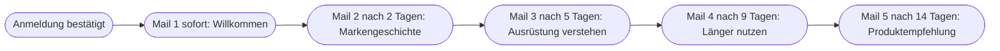

# Kapitel 13 – E-Mail-Marketing mit KI

{{ progress(13) }}

<div class="lernziele" markdown>
<h3>Was du in diesem Kapitel lernst</h3>

- Aus welchen **Bausteinen** eine Marketing-E-Mail besteht und bei welchen KI am meisten hilft
- Wie du **Betreffzeilen** und **Preheader** als Paar entwickelst und gezielt Varianten erzeugst
- Wie du einen **Newsletter** modular aufbaust und per Briefing erstellen lässt
- Wie **Willkommens-** und **Nurture-Sequenzen** geplant und geschrieben werden
- Wie **Personalisierung mit Platzhaltern** funktioniert – ohne echte Kundendaten im Prompt
- Was hinter **Spam-Triggern** steckt und welche **rechtlichen Basics** du kennen musst
</div>

---

## 13.1 Die Anatomie einer Marketing-E-Mail

E-Mail ist für viele Unternehmen der Kanal mit dem direktesten Draht zur Kundschaft: Die Adressen gehören euch, kein Algorithmus entscheidet über die Reichweite, und Abonnenten haben sich bewusst angemeldet. Fjordlicht erreicht so rund 38.000 Menschen. Umso wichtiger ist, dass jede Mail ihren Platz im Postfach verdient.

| Baustein | Funktion | Wie KI hilft |
|---|---|---|
| Absendername | Vertrauen, Wiedererkennung | kaum – das ist eine feste Entscheidung |
| Betreffzeile | Öffnung auslösen | Varianten erzeugen, nach Muster formulieren |
| Preheader | Betreff ergänzen, Neugier verstärken | passend zum Betreff formulieren |
| Einstieg / Header | Thema setzen | Einstiegsvarianten, Bildidee |
| Inhaltsmodule | informieren, inspirieren, verkaufen | Texte aus Briefing oder Blogbeitrag ableiten |
| Call-to-Action (CTA) | Klick auslösen | Formulierungen testen, auf Ziel zuspitzen |
| Footer | Pflichtangaben, Abmeldelink | keine Hilfe nötig, aus Vorlage übernehmen |

Die Arbeitsteilung ist klar: KI schreibt Entwürfe für die **Textbausteine**, du entscheidest über **Ziel, Struktur und Freigabe**. Alles, was rechtlich oder technisch festgelegt ist – Absender, Footer, Abmeldelink –, kommt aus der Vorlage eures Newsletter-Tools und wird nicht von der KI erzeugt.

---

## 13.2 Betreffzeilen und Preheader

Betreffzeile und **Preheader** (die Vorschauzeile, die im Postfach neben oder unter dem Betreff erscheint) sind ein Paar. Der Preheader wiederholt den Betreff nicht, sondern **ergänzt** ihn. Wird kein Preheader gesetzt, zeigen viele Postfächer den ersten Text der Mail an – oft „Mail im Browser ansehen".

Wie viele Zeichen sichtbar sind, hängt von Postfach und Gerät ab; auf dem Smartphone wird oft schon nach wenigen Dutzend Zeichen abgeschnitten. Faustregel: Das Wichtigste gehört an den Anfang.

```text
Persona: Du bist E-Mail-Marketing-Spezialistin bei Fjordlicht.
Request: Formuliere 8 Paare aus Betreffzeile und Preheader für den
Newsletter "Regenzeit: So bleibt deine Jacke dicht".
Output: Tabelle mit den Spalten Betreff, Preheader, Ansatz.
Betreff max. 45 Zeichen, Preheader max. 90 Zeichen.
Modifier: Je 2 Paare mit den Ansätzen Nutzen, Frage, Neugier, Konkretheit.
Keine Superlative, keine Ausrufezeichen, keine Emojis, kein Rabatt.
Der Preheader wiederholt den Betreff nicht.
Purpose: Abonnenten sollen den Pflegeleitfaden lesen und ihre Jacke länger nutzen.
Tone: ruhig, ehrlich, nordisch-trocken, Du-Ansprache.
```

Der Prompt folgt dem P.R.O.M.P.T.-Framework (Kap. 5). Besonders wirkungsvoll ist der Modifier mit **unterschiedlichen Ansätzen**: Er verhindert, dass du acht Varianten desselben Gedankens bekommst – und liefert dir zugleich Material für einen sauberen A/B-Test (Kap. 16).

| Ansatz | Betreff | Preheader |
|---|---|---|
| Nutzen | Deine Jacke hält länger, als du denkst | Zehn Minuten Pflege im Herbst reichen. So geht's. |
| Frage | Perlt der Regen noch ab? | Wenn nicht, liegt es selten an der Jacke. |
| Konkretheit | Imprägnieren in 3 Schritten | Was du brauchst, was du lassen kannst. |

!!! warning "Typische Falle"
    KI-Betreffzeilen tendieren zu Clickbait: „Das hast du garantiert noch nicht gewusst", „Letzte Chance". Das bringt kurzfristig Öffnungen, kostet aber Vertrauen – und passt nicht zu einer Marke, die ehrlich und ruhig klingen will. Verbiete solche Muster ausdrücklich im Modifier.

---

## 13.3 Den Newsletter modular aufbauen

Ein Newsletter ist kein langer Text, sondern eine **Abfolge von Modulen**. Fjordlichts Monatsnewsletter hat ein festes Raster: Einstieg mit Jahreszeit, ein Hauptthema (meist aus dem Blog), ein Produktmodul, ein Modul „Länger nutzen", ein kurzer Ausblick. Wer dieses Raster im Prompt vorgibt, bekommt einen Entwurf, der ins Template passt.

```text
Erstelle einen Newsletter-Entwurf nach diesem festen Raster:
1. Einstieg (max. 50 Wörter, Bezug zur Jahreszeit)
2. Hauptthema (max. 120 Wörter, Teaser für diesen Blogbeitrag: [Text])
3. Produktmodul (max. 60 Wörter, Produkt: [Name], Fakten: [Datenblatt])
4. Länger nutzen (max. 60 Wörter, Pflege- oder Reparaturtipp)
5. Ausblick (1 Satz)
Jedes Modul bekommt eine Zwischenüberschrift und einen CTA-Text
(max. 4 Wörter). Übernimm nur Fakten aus dem mitgelieferten Material.
Fehlende Angaben als [FEHLT].
```

Für längere Newsletter lohnt sich das Arbeiten im Dokument mit gezielter Überarbeitung einzelner Module (Kap. 11). Den Hauptinhalt leitest du am besten aus einem bestehenden Blogbeitrag ab (Content-Recycling, Kap. 12) – so muss nur eine Quelle geprüft werden.

!!! tip "Ein Ziel pro Mail"
    Lege für jede Mail ein **Hauptziel** fest und nenne es im Purpose: Blogbeitrag lesen, Produkt ansehen, Reparaturservice buchen. Fünf gleichrangige CTAs führen dazu, dass keiner geklickt wird. Die KI ordnet Module sinnvoller, wenn sie weiß, worauf alles hinauslaufen soll.

---

## 13.4 Willkommens- und Nurture-Sequenzen

Eine **Sequenz** ist eine Reihe automatisierter Mails, die durch ein Ereignis ausgelöst wird – etwa die Anmeldung zum Newsletter oder den Download eines Leadmagneten (Kap. 15). Die **Willkommenssequenz** begrüßt neue Abonnenten und stellt die Marke vor. Eine **Nurture-Sequenz** („nähren") begleitet Interessenten über Wochen mit hilfreichen Inhalten, bis sie bereit für einen Kauf oder ein Gespräch sind – typisch im B2B-Bereich, etwa für Fjordlicht Business.



| Mail | Ziel | Inhalt | CTA |
|---|---|---|---|
| 1 – Willkommen | Erwartung setzen | was kommt, wie oft, wer schreibt | Blog entdecken |
| 2 – Markengeschichte | Vertrauen | warum es Fjordlicht gibt, Münster, Team | Über uns |
| 3 – Ausrüstung verstehen | Kompetenz | Schichtenprinzip in drei Sätzen | Ratgeber lesen |
| 4 – Länger nutzen | Werte belegen | Pflege und Reparaturservice | Service ansehen |
| 5 – Empfehlung | erster Kauf | passendes Einstiegsprodukt | Produkt ansehen |

KI ist bei Sequenzen besonders hilfreich, weil sie **Zusammenhang** über mehrere Mails halten kann – vorausgesetzt, du lässt zuerst die Struktur und dann die einzelnen Mails erstellen (Prompt-Ketten, Kap. 6). Schreibe nicht alle fünf Mails in einem einzigen Prompt: Die späteren Mails werden dann oft kürzer und schwächer.

!!! example "Prompt-Kette für eine Sequenz"
    ```text
    Schritt 1: Entwirf den Plan einer Willkommenssequenz mit 5 Mails für
    Fjordlicht als Tabelle: Mail, Abstand in Tagen, Ziel, Kernbotschaft, CTA.
    Jede Kernbotschaft kommt nur einmal vor.

    Schritt 2 (je Mail einzeln): Schreibe Mail [Nummer] gemäß Plan.
    Betreff, Preheader, Text max. 150 Wörter, ein CTA.
    Greife höchstens einen Gedanken aus der vorherigen Mail auf.
    ```

---

## 13.5 Personalisierung mit Platzhaltern

Personalisierung reicht von der Anrede mit Vornamen bis zu Inhalten, die sich nach Interessen oder Kaufhistorie unterscheiden. Technisch erledigt das euer Newsletter-Tool über **Platzhalter** (auch Merge-Tags), die beim Versand durch Daten aus der Abonnentenliste ersetzt werden. Die Schreibweise unterscheidet sich je Tool – Mailchimp etwa nutzt `*|FNAME|*`, andere Tools eigene Formate.

Für die Arbeit mit KI gilt eine klare Regel: **Die KI schreibt die Vorlage, das Tool personalisiert.** Echte Namen, E-Mail-Adressen oder Kaufhistorien gehören nicht in den Prompt eines Consumer-KI-Werkzeugs (DSGVO, Kap. 4). Im Prompt arbeitest du mit neutralen Platzhaltern in eckigen Klammern und ersetzt sie danach durch die Syntax deines Tools.

```text
Schreibe einen Newsletter-Einstieg mit diesen Platzhaltern:
[Vorname], [zuletzt gekaufte Produktkategorie].
Liefere zwei Fassungen:
A) für Abonnenten mit bekanntem Vornamen und Kaufhistorie,
B) Fallback ohne Vornamen und ohne Kaufhistorie.
Beide Fassungen müssen ohne die Platzhalter natürlich klingen.
```

| Stufe | Beispiel | Risiko |
|---|---|---|
| Anrede | „Hallo [Vorname]," | leeres Feld ergibt „Hallo ," – Fallback nötig |
| Segment | eigene Fassung für Familien und für B2B | Segmente müssen sauber gepflegt sein |
| Verhalten | Pflegetipp passend zur gekauften Jacke | wirkt schnell überwachend, sparsam einsetzen |

!!! warning "Typische Falle"
    Der häufigste Personalisierungsfehler ist kein KI-Fehler, sondern ein Datenfehler: fehlende Vornamen, Vornamen in Großbuchstaben, „Herr Familie Müller". Lege für jeden Platzhalter einen **Fallback** fest und sende vor jedem Versand eine Testmail mit leeren und auffälligen Datensätzen.

---

## 13.6 Spam-Trigger und rechtliche Basics

Ob eine Mail im Posteingang landet, entscheiden Spamfilter heute vor allem anhand der **Absenderreputation**, der technischen **Authentifizierung** (SPF, DKIM, DMARC) und des **Verhaltens der Empfänger** (Öffnungen, Beschwerden, Abmeldungen). Große Postfachanbieter wie Gmail und Yahoo verlangen von Massenversendern seit 2024 unter anderem Authentifizierung und eine einfache Abmeldung mit einem Klick. Einzelne „Spam-Wörter" spielen eine kleinere Rolle als oft behauptet – trotzdem gibt es Muster, die du vermeiden solltest.

| Spam-Signal | Beispiel | Besser |
|---|---|---|
| Großbuchstaben, viele Satzzeichen | „GRATIS!!!" | sachlicher Betreff |
| Übertriebene Versprechen | „Garantiert 100 % wasserdicht für immer" | belegbare Aussage |
| Nur ein großes Bild, kaum Text | Grafik-Newsletter | ausgewogenes Verhältnis von Text und Bild |
| Linkverkürzer, viele Links | fünf bit.ly-Links | wenige, klare Links auf die eigene Domain |
| Irreführender Betreff | „Re: Deine Bestellung" ohne Bestellung | Betreff, der zum Inhalt passt |

Du kannst die KI bitten, einen Entwurf auf solche Muster zu prüfen. Die technische Zustellbarkeit prüft sie nicht – das erledigen euer Newsletter-Tool und die IT.

**Rechtliche Basics in Kürze:** Werbe-Mails dürfen in Deutschland grundsätzlich nur mit **vorheriger ausdrücklicher Einwilligung** verschickt werden (§ 7 UWG, DSGVO). Das **Double-Opt-in-Verfahren** – Anmeldung plus Bestätigungsklick – ist der übliche Weg, die Einwilligung nachzuweisen. Für Bestandskunden gibt es eine eng begrenzte Ausnahme für ähnliche Produkte (§ 7 Abs. 3 UWG). Jede Mail braucht ein **Impressum** und einen funktionierenden **Abmeldelink**. Und: Auch ein KI-geschriebener Text darf nicht irreführen (UWG) – eine erfundene Nachhaltigkeitsaussage ist ein Rechtsrisiko, nicht nur ein Stilproblem.

!!! info "Hinweis"
    Dieser Abschnitt gibt eine Orientierung und ersetzt keine Rechtsberatung. Bei Unsicherheiten, etwa zur Bestandskundenausnahme oder zu Gewinnspielen, frag eure Rechtsabteilung oder eine Anwältin. Den rechtlichen Rahmen für KI-Inhalte vertieft Kapitel 39.

!!! info "Merksatz"
    Die KI schreibt die Texte, das Newsletter-Tool personalisiert und versendet, der Mensch verantwortet Ziel, Daten und Freigabe. Wer diese drei Rollen sauber trennt, gewinnt Tempo, ohne Datenschutz und Vertrauen zu riskieren.

---

## Zusammenfassung

- Eine Marketing-E-Mail besteht aus festen Bausteinen; KI hilft vor allem bei **Betreff, Preheader, Modulen und CTAs**, nicht bei Absender und Pflichtangaben.
- **Betreff und Preheader** sind ein Paar; Varianten mit unterschiedlichen Ansätzen liefern Material für A/B-Tests (Kap. 16).
- Ein **modularer Newsletter** mit festem Raster und einem Hauptziel pro Mail lässt sich per P.R.O.M.P.T.-Briefing (Kap. 5) zuverlässig erstellen.
- **Sequenzen** entstehen per Prompt-Kette: erst der Plan, dann jede Mail einzeln.
- **Personalisierung** übernimmt das Tool; im Prompt stehen nur Platzhalter in eckigen Klammern, keine echten Kundendaten, und jeder Platzhalter braucht einen Fallback.
- Zustellbarkeit hängt vor allem an Reputation, Authentifizierung und Empfängerverhalten; rechtlich gelten **Einwilligung**, **Double-Opt-in**, Impressum und Abmeldelink.

---

## Kurzübungen

{{ task(file="tasks/k13_01.yaml") }}

{{ task(file="tasks/k13_02.yaml") }}

{{ task(file="tasks/k13_03.yaml") }}

---

## Workshop

{{ task(file="tasks/workshop_k13.yaml") }}
