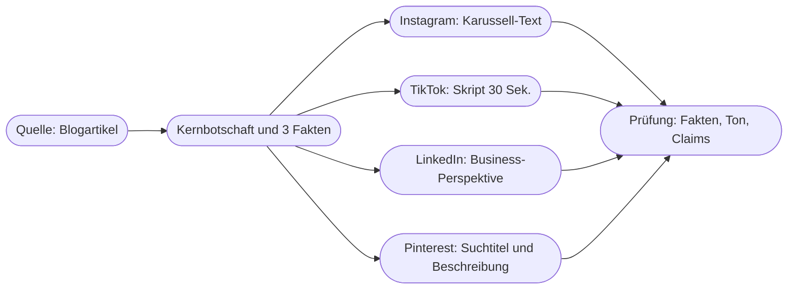

# Kapitel 14 – Social-Media-Texte mit KI

{{ progress(14) }}

<div class="lernziele" markdown>
<h3>Was du in diesem Kapitel lernst</h3>

- Wie sich die **Plattformlogiken** von Instagram, TikTok, LinkedIn und Pinterest unterscheiden – und was das für den Text bedeutet
- Wie du mit KI **Hooks** entwickelst und die Formeln **AIDA** und **PAS** gezielt einsetzt
- Wie du **Captions** mit dem P.R.O.M.P.T.-Framework so beauftragst, dass sie nach deiner Marke klingen
- Warum KI bei **Hashtags** hilft, aber keine Reichweitendaten kennt
- Wie du **ein Thema auf mehrere Kanäle** adaptierst, statt denselben Text überall zu posten
- Wie du **Community-Antworten** mit KI vorbereitest, ohne die Verantwortung abzugeben
</div>

---

## 14.1 Jede Plattform hat ihre eigene Logik

Social-Media-Texte scheitern selten an der Grammatik, sondern am falschen Ort. Ein Text, der auf LinkedIn funktioniert, wirkt auf TikTok wie eine Pressemitteilung; eine Pinterest-Beschreibung, die für die Suche geschrieben ist, langweilt auf Instagram. Bevor du einen Prompt schreibst, musst du deshalb wissen, **welche Rolle der Text auf der Plattform spielt**.

| Plattform | Nutzungssituation | Rolle des Textes | Typische Länge | Fjordlicht-Beispiel |
|---|---|---|---|---|
| **Instagram** | Feed und Reels durchscrollen, Bild zuerst | Caption ergänzt das Bild, erste Zeile entscheidet über „mehr" | 1–3 Sätze bis ca. 150 Wörter | Stimmungsbild Regenjacke „Sølv" im Herbstwald |
| **TikTok** | Video im Vollbild, Ton an | Gesprochener Hook und Bildschirmtext tragen, Caption ist Nebensache und Suchsignal | Caption kurz, Skript 15–60 Sekunden | „3 Fehler beim Waschen deiner Regenjacke" |
| **LinkedIn** | Berufliche Feeds, eher Lesemodus | Text ist das Hauptmedium, Fachlichkeit und Haltung zählen | 100–250 Wörter, kurze Absätze | Fjordlicht Business: Firmenbekleidung ohne Greenwashing |
| **Pinterest** | Ideen suchen und sammeln, oft mit Planungsabsicht | Titel und Beschreibung sind **Suchtext** | Titel kurz, Beschreibung 1–3 Sätze mit Suchbegriffen | „Packliste Herbstwanderung mit Kindern" |

Die Längenangaben sind Erfahrungswerte, keine Plattformregeln. Zeichengrenzen und Darstellung ändern die Plattformen regelmäßig – prüfe sie vor einer Kampagne direkt in der App (Stand: Oktober 2026).

!!! info "Merksatz"
    Frag nicht „Was soll der Post sagen?", sondern „**Was tut die Person gerade**, wenn sie den Post sieht?". Scrollen, suchen, lesen oder sammeln – daraus folgen Länge, Einstieg und Tonlage.

Diese Plattformlogik gehört in deinen Prompt. Im P.R.O.M.P.T.-Framework (Kap. 5) landet sie im **Purpose** (Wozu und für wen?) und im **Output** (Format, Länge, Struktur). Fehlt sie, schreibt die KI einen plattformneutralen Allzwecktext – und der passt nirgends richtig.

---

## 14.2 Hooks: die ersten zwei Sekunden

Der **Hook** ist der Einstieg, der jemanden beim Scrollen anhalten lässt: die erste Zeile der Caption, der erste gesprochene Satz im Video, der Bildschirmtext im ersten Frame. KI ist hier ein sehr guter Sparringspartner, weil sie in Sekunden zwanzig Varianten liefert, aus denen du die drei besten auswählst (Varianten-Fächer, Kap. 7).

| Hook-Typ | Prinzip | Beispiel für Fjordlicht |
|---|---|---|
| Frage | Spricht eine konkrete Situation an | „Wann hast du deine Regenjacke zuletzt gewaschen?" |
| Fehler/Irrtum | Benennt einen verbreiteten Fehler | „Weichspüler ruiniert deine Regenjacke. Leise, aber sicher." |
| Zahl/Liste | Verspricht überschaubaren Nutzen | „3 Dinge, die in jeden Herbstrucksack gehören." |
| Kontrast | Bricht eine Erwartung | „Unsere beste Jacke ist die, die du nicht neu kaufen musst." |
| Szene | Versetzt in einen Moment | „6:40 Uhr, Nebel über dem Aasee, 8 Grad." |
| Ehrliches Eingeständnis | Baut Vertrauen auf | „Unser Fleece ist nicht klimaneutral. Hier ist, was es stattdessen ist." |

Für den ganzen Text helfen zwei klassische Formeln, die jedes Sprachmodell kennt und die du ausdrücklich anfordern kannst:

- **AIDA** – Attention (Aufmerksamkeit), Interest (Interesse), Desire (Wunsch), Action (Handlung). Passt zu Produktposts und Launches.
- **PAS** – Problem, Agitate (Problem zuspitzen), Solution (Lösung). Passt zu Ratgeber-Inhalten, bei denen ein konkretes Ärgernis im Mittelpunkt steht.

```text
Formuliere 15 Hooks für ein Instagram-Reel über die Pflege von
Regenjacken. Je 3 Hooks pro Typ: Frage, Fehler, Zahl, Szene, Kontrast.
Maximal 10 Wörter pro Hook. Keine Superlative, keine Ausrufezeichen.
Markiere danach die 3 Hooks, die am konkretesten sind, und begründe
in je einem Satz.
```

!!! warning "Typische Falle"
    KI-Hooks neigen zu **Übertreibung und Clickbait**: „Das ändert ALLES", „Niemand spricht darüber", „Du machst es seit Jahren falsch!". Das ist nicht nur stilistisch billig, sondern kollidiert mit einer ruhigen Markenstimme wie der von Fjordlicht – und ein Hook, der mehr verspricht, als der Post hält, kostet Vertrauen. Schreib deshalb in den **Modifier** ausdrücklich, was ausgeschlossen ist: keine Superlative, keine Großbuchstaben-Betonung, kein „Geheimtipp".

AIDA und PAS sind Gerüste, keine Pflicht. Eine Formel, die man im fertigen Text erkennt, wirkt mechanisch. Lass die KI ruhig mit Formel schreiben – und streich danach die Übergänge, die nach Lehrbuch klingen.

---

## 14.3 Captions mit dem P.R.O.M.P.T.-Framework

Der häufigste Social-Media-Prompt lautet sinngemäß „Schreib einen Instagram-Post über unsere neue Regenjacke". Das Ergebnis ist vorhersehbar: drei Absätze Begeisterung, fünf Emojis, zwölf Hashtags, „nachhaltig" und „perfekt für jedes Abenteuer". Der Unterschied entsteht, wenn du die sechs Bausteine aus Kapitel 5 füllst.

**Vorher**

```text
Schreib einen Instagram-Post über unsere neue Regenjacke Sølv.
```

**Nachher**

```text
Persona: Du bist Social-Media-Texterin für Fjordlicht, eine Marke für
nachhaltige Outdoor-Bekleidung aus Münster.
Request: Schreibe eine Instagram-Caption zum Launch der Regenjacke Sølv.
Output: Erste Zeile als Hook (max. 10 Wörter), danach 2 kurze Absätze,
insgesamt max. 80 Wörter. Am Ende eine Frage an die Community.
Maximal 1 Emoji. Hashtags separat darunter, 5 Stück.
Modifier: Nutze nur diese Fakten: Obermaterial aus 100 % recyceltem
Polyamid, PFAS-freie Imprägnierung, Wassersäule 20.000 mm,
kostenloser Reparaturservice in den ersten zwei Jahren. Keine Superlative, keine Wörter wie
"klimaneutral" oder "umweltfreundlich". Fehlt dir etwas, schreibe [FEHLT].
Purpose: Ziel ist Aufmerksamkeit für den Launch bei naturverbundenen
Stadtmenschen 25-45, die Herbstwetter nicht vom Rausgehen abhält.
Tone: ruhig, ehrlich, leicht nordisch-trocken, Du-Ansprache.
```

Die Produktdaten in diesem Beispiel sind für den Kurs erfunden; in der Praxis kommen sie aus dem Produktdatenblatt. Entscheidend ist der Satz „Nutze nur diese Fakten": Er verhindert, dass die KI Nachhaltigkeitsaussagen ergänzt, die Fjordlicht nicht belegen kann. Bei Umweltaussagen ist das kein Stilthema, sondern ein rechtliches Risiko (Irreführung nach UWG, Kap. 4).

| Baustein | Was er bei Social Media leistet | Häufig vergessen |
|---|---|---|
| Persona | Perspektive und Fachwissen | „Texterin für **diese** Marke", nicht „Social-Media-Experte" |
| Request | genau ein Post, ein Kanal | mehrere Kanäle in einem Auftrag |
| Output | Länge, Hook, Emojis, Hashtags, Call-to-Action | Emoji-Grenze, Position der Hashtags |
| Modifier | Faktenbasis, No-Gos, Beispiele | „nur diese Fakten", verbotene Begriffe |
| Purpose | Ziel und Zielgruppe | ob Reichweite, Klick oder Gespräch das Ziel ist |
| Tone | Markenstimme | konkrete Merkmale statt „locker" |

!!! tip "Markenstimme einmal extrahieren, dann wiederverwenden"
    Statt „ruhig und ehrlich" jedes Mal neu zu beschreiben, lass die KI aus fünf echten, gut gelaufenen Posts eine **Stilbeschreibung** ableiten (Stil-Extraktion, Kap. 7). Diese Beschreibung plus zwei Beispielposts als Few-Shot (Kap. 6) gehört dann als fester Baustein in deine Prompt-Bibliothek (Kap. 10).

---

## 14.4 Hashtags und Auffindbarkeit

KI kann Hashtags vorschlagen, sortieren und nach Themen bündeln. Was sie **nicht** kann: dir sagen, wie viele Beiträge ein Hashtag hat, ob er gerade wächst oder ob er von Spam-Accounts besetzt ist. Das Modell kennt keine Live-Daten der Plattformen; auch mit Websuche sieht es nur, was zufällig öffentlich darüber geschrieben wurde.

| Aufgabe | KI geeignet? | Besser so |
|---|---|---|
| Hashtag-Ideen zu einem Thema sammeln | ja | als Rohliste nutzen |
| In breit / Nische / Marke gruppieren | ja | Gruppierung prüfen |
| Reichweite oder Trend beurteilen | nein | in der App suchen, Plattform-Statistiken |
| Pinterest-Suchbegriffe finden | eingeschränkt | Pinterest-Suchvorschläge, Pinterest Trends |
| Markenhashtag prüfen (frei? belegt?) | nein | selbst in jeder Plattform nachsehen |

Auf TikTok, Instagram und Pinterest wird zunehmend über die **Suche** entdeckt. Dafür zählen die Wörter in Caption, Bildschirmtext und gesprochenem Text oft mehr als ein Block aus dreißig Hashtags. Ein guter Auftrag lautet deshalb nicht „Füge Hashtags hinzu", sondern: „Nenne die drei Suchbegriffe, mit denen jemand diesen Inhalt finden würde, und baue sie natürlich in die ersten beiden Sätze ein."

!!! warning "Typische Falle"
    Die KI erfindet Hashtags, die plausibel klingen, aber kaum genutzt werden („#Regenjackenliebe"), oder empfiehlt Trend-Hashtags, die mit dem Inhalt nichts zu tun haben. Beides schadet: Ersteres bringt nichts, Letzteres wirkt wie Spam. **Jeden Hashtag vor dem Posten einmal in der App aufrufen** – das kostet zwei Minuten.

---

## 14.5 Ein Thema, viele Kanäle: Content-Adaption

Fjordlicht veröffentlicht einen Blogartikel „Regenjacke richtig pflegen" (Kap. 15). Daraus sollen Posts für vier Kanäle werden. Der schlechteste Weg ist ein Prompt „Mach daraus Posts für Instagram, TikTok, LinkedIn und Pinterest" – das Ergebnis sind vier Varianten desselben Textes mit unterschiedlicher Länge. Besser ist eine **Prompt-Kette** (Kap. 6): erst den Kern klären, dann je Kanal adaptieren.



**Schritt 1 – Kern extrahieren**

```text
Lies den folgenden Blogartikel. Gib mir:
1. die Kernbotschaft in einem Satz,
2. die 3 wichtigsten Fakten oder Tipps, wörtlich belegt durch den Text,
3. eine Aussage, die NICHT in Social-Media-Posts verkürzt werden darf,
   weil sie sonst falsch wird.
Artikel: [Text einfügen]
```

**Schritt 2 – je Kanal adaptieren**, jeweils in einem eigenen Auftrag mit Kanal-Purpose und Kanal-Output. Für LinkedIn wechselt sogar die Zielgruppe: Dort spricht Fjordlicht Business Einkäufer von Firmenbekleidung an, also geht es um Lebensdauer und Pflegekosten, nicht um Morgennebel am Aasee.

Punkt 3 aus Schritt 1 ist der eigentliche Gewinn. Beim Kürzen entstehen die meisten Fehler: Aus „PFAS-frei imprägniert" wird „chemiefrei", aus „recyceltes Polyamid" wird „nachhaltig produziert". Wenn die KI dir vorher sagt, was nicht verkürzt werden darf, kannst du genau das in die Kanal-Prompts als Modifier übernehmen. Wie du solche Inhalte über Wochen planst und recycelst, steht in Kapitel 12.

!!! example "Woran du gute Adaption erkennst"
    Lies die vier Texte nebeneinander. Wenn du sie untereinander austauschen könntest, ohne dass es auffällt, ist es keine Adaption, sondern Kürzung. Gute Adaption ändert **Einstieg, Perspektive und Handlungsaufforderung** – nicht nur die Länge.

---

## 14.6 Community-Antworten mit KI vorbereiten

Kommentare und Direktnachrichten sind der Teil von Social Media, der am meisten Zeit frisst und am meisten über eine Marke verrät. KI kann hier entlasten – als **Entwurfsgeber**, nicht als Autopilot.

| Kommentartyp | KI-Unterstützung | Regel |
|---|---|---|
| Lob, Dank | kurze Antwortvarianten, damit nicht jede gleich klingt | Variieren, nicht kopieren |
| Produktfrage | Entwurf auf Basis hinterlegter FAQ und Produktdaten | Nur mit geprüften Fakten antworten |
| Beschwerde | Entwurf mit Entschuldigung und Wechsel in DM | Kein Kulanzversprechen ohne Freigabe |
| Kritik an Nachhaltigkeit | Strukturierung der Fakten, sachlicher Entwurf | Immer von Menschen freigeben lassen |
| Provokation, Troll | Einschätzung: antworten, ausblenden, ignorieren? | Netiquette des Hauses entscheidet |
| Persönliche Daten im Kommentar | keine – nicht in die KI kopieren | Direkt in DM, Daten nicht weiterverarbeiten |

Ein bewährter Ansatz ist ein **Antwort-Prompt mit festen Leitplanken**, den das Team in der Bibliothek ablegt:

```text
Du bist Community-Managerin bei Fjordlicht. Entwirf eine Antwort auf den
folgenden Kommentar. Max. 3 Sätze, Du-Ansprache, ruhig und ehrlich.
Nutze ausschließlich diese Fakten: [FAQ-Auszug].
Versprich keine Erstattung, keinen Rabatt, keinen Liefertermin.
Wenn die Frage mit den Fakten nicht beantwortbar ist, schlage vor,
in die Direktnachricht zu wechseln.
Gib zusätzlich eine Einschätzung: Sollte ein Mensch hier vor dem
Antworten Rücksprache halten? Ja/Nein mit Begründung.
Kommentar (anonymisiert): [Kommentartext]
```

Kopiere keine Namen, Bestellnummern oder Adressen aus Kommentaren in ein Consumer-KI-Werkzeug (Ampel für Daten im Prompt, Kap. 4). Für den Inhalt des Kommentars reicht die anonymisierte Fassung.

!!! warning "Typische Falle"
    Automatische Antworten ohne menschliche Freigabe klingen nach kurzer Zeit gleich – und Nutzer merken das. Gefährlicher ist der Fall, in dem ein Bot eigenständig antwortet: Dann muss erkennbar sein, dass man mit einer KI kommuniziert (Transparenzpflicht nach Art. 50 Abs. 1 AI Act, Kap. 27). Für Kommentarspalten gilt im Kurs deshalb: **KI entwirft, Mensch postet.**

---

## Zusammenfassung

- Jede Plattform hat eine eigene **Nutzungssituation**; Länge, Einstieg und Ton folgen daraus und gehören als Purpose und Output in den Prompt.
- **Hooks** entscheiden über die Aufmerksamkeit; KI liefert schnell viele Varianten, die Auswahl und das Streichen von Clickbait bleiben deine Aufgabe.
- **AIDA** und **PAS** sind nützliche Gerüste, die man im fertigen Text nicht mehr sehen sollte.
- Gute Captions entstehen mit vollständigem **P.R.O.M.P.T.**: vor allem mit einer festen Faktenbasis und klaren No-Gos im Modifier.
- KI kennt **keine Reichweitendaten** für Hashtags; Suchbegriffe im Text sind oft wichtiger als viele Hashtags.
- **Content-Adaption** ist eine Prompt-Kette: erst Kernbotschaft und unverkürzbare Aussagen, dann je Kanal ein eigener Auftrag.
- Bei **Community-Antworten** entwirft die KI, ein Mensch prüft und postet – besonders bei Kritik und Nachhaltigkeitsfragen.

---

## Kurzübungen

{{ task(file="tasks/k14_01.yaml") }}

{{ task(file="tasks/k14_02.yaml") }}

{{ task(file="tasks/k14_03.yaml") }}

---

## Workshop

{{ task(file="tasks/workshop_k14.yaml") }}
