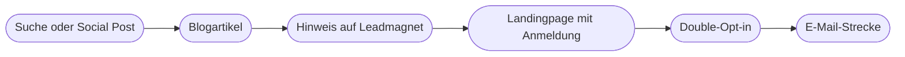

# Kapitel 15 – Blogartikel & Leadmagnete

{{ progress(15) }}

<div class="lernziele" markdown>
<h3>Was du in diesem Kapitel lernst</h3>

- Warum **Blogartikel und Leadmagnete** zusammengehören und welche Rolle sie im Funnel spielen
- Wie du ein **Artikel-Briefing** erstellst, das die KI wirklich steuert
- Warum du lange Texte **abschnittsweise** statt in einem Durchgang erzeugst
- Wie du echte **Erfahrung** einbringst (E-E-A-T) – das, was die KI nicht liefern kann
- Wie du **Fakten und Quellen** prüfst, bevor ein Artikel online geht
- Wie du einen **Leadmagneten**, die passende **Landingpage** und die Verbindung zur **E-Mail-Strecke** entwickelst
</div>

---

## 15.1 Blog und Leadmagnet: zwei Hälften eines Weges

Ein Blogartikel beantwortet eine Frage, die jemand hat – oft gefunden über die Suche. Ein **Leadmagnet** ist ein Angebot mit eigenem Nutzwert (Checkliste, Guide, Quiz, Mini-Kurs), das jemand gegen seine E-Mail-Adresse erhält. Zusammen bilden sie einen Weg: Der Artikel bringt Aufmerksamkeit, der Leadmagnet macht aus Lesenden Kontakte, die E-Mail-Strecke (Kap. 13) baut die Beziehung aus.



Für Fjordlicht heißt das konkret: Der Blog „Draußen-Notizen" erklärt, wie man eine Regenjacke richtig pflegt. Am Ende des Artikels steht ein Angebot: „Pflege-Kalender für deine Outdoor-Kleidung – als PDF zum Ausdrucken". Wer ihn anfordert, erhält danach eine kurze Willkommensstrecke mit Pflege- und Reparaturtipps.

KI beschleunigt jeden dieser Schritte. Aber sie bringt zwei Risiken mit, die bei langen Texten größer sind als bei Social Posts: **erfundene Fakten**, die in 1.500 Wörtern leichter untergehen, und **austauschbare Inhalte**, die genauso auf hundert anderen Seiten stehen. Beides adressiert dieses Kapitel.

!!! info "Merksatz"
    Die KI schreibt den Text, den es schon gibt. Deine Aufgabe ist der Teil, den es **noch nicht** gibt: eigene Erfahrung, eigene Daten, eigene Haltung.

---

## 15.2 Vom Thema zum Briefing

Ein Prompt wie „Schreib einen Blogartikel über Regenjackenpflege" liefert einen soliden, generischen Text. Ein **Briefing** macht daraus einen Text für **deine** Leserschaft. Das Briefing ist nichts anderes als ein ausführlicher P.R.O.M.P.T.-Auftrag (Kap. 5), den du vorab schriftlich festhältst.

| Briefing-Feld | P.R.O.M.P.T.-Baustein | Fjordlicht-Beispiel |
|---|---|---|
| Autor:in und Perspektive | Persona | Produktmanagerin Outdoor-Bekleidung, schreibt aus Werkstatt-Erfahrung |
| Arbeitstitel und Kernfrage | Request | „Regenjacke waschen: So bleibt sie dicht" – Wie wasche und imprägniere ich richtig? |
| Länge, Gliederungstiefe, Elemente | Output | ca. 1.200 Wörter, 5–6 Zwischenüberschriften, eine Schritt-für-Schritt-Liste, FAQ |
| Faktenbasis, Quellen, No-Gos | Modifier | Pflegehinweise laut Etikett, Hersteller-FAQ; keine Produktvergleiche mit Wettbewerbern |
| Zielgruppe, Suchintention, Ziel | Purpose | Besitzer:innen einer Regenjacke, die nachlässt; Ziel: Anmeldung für Pflege-Kalender |
| Markenstimme | Tone | ruhig, ehrlich, praktisch, Du-Ansprache, keine Superlative |
| Eigene Erfahrung | Modifier | drei Beobachtungen aus dem Reparaturservice (siehe 15.4) |

Die Suchintention und die Keywords kommen aus einer eigenen Recherche. Wie du dafür ein SEO-Briefing erstellst und warum KI keine Suchvolumina kennt, vertieft Kapitel 21. Hier geht es um den Schreibprozess.

!!! tip "Lass dir das Briefing von der KI prüfen"
    Gib dein ausgefülltes Briefing in den Chat und bitte: „Stelle mir bis zu fünf Rückfragen zu Lücken in diesem Briefing, bevor du schreibst." Der Rückfragen-Prompt (Kap. 7) deckt fast immer auf, dass Zielgruppe oder Ziel unscharf sind.

---

## 15.3 Gliederung zuerst, dann abschnittsweise schreiben

Lange Texte in einem Durchgang zu erzeugen, hat drei Nachteile: Die zweite Hälfte wird flacher, Wiederholungen nehmen zu, und du kannst nur das Ganze verwerfen statt einzelne Teile zu verbessern. Besser ist eine **Prompt-Kette** (Kap. 6).

| Schritt | Auftrag an die KI | Deine Rolle |
|---|---|---|
| 1. Gliederung | Gliederung mit Zwischenüberschriften und je 2 Stichpunkten Inhalt | streichen, umstellen, eigene Punkte ergänzen |
| 2. Einleitung | Einstieg, der die Kernfrage in den ersten 3 Sätzen beantwortet | prüfen, ob Versprechen und Inhalt passen |
| 3. Abschnitte | jeden Abschnitt einzeln, mit Briefing und bisherigem Text als Kontext | Fakten prüfen, Erfahrung einbauen |
| 4. FAQ und Fazit | FAQ aus echten Kundenfragen, Fazit mit Hinweis auf Leadmagnet | Fragen aus dem Service liefern |
| 5. Überarbeitung | Wiederholungen, Länge, Ton prüfen lassen | letzte Fassung lesen, freigeben |

```text
Hier ist das Briefing und die freigegebene Gliederung.
[Briefing]
[Gliederung]
Schreibe jetzt nur Abschnitt 3 "Waschen in der Maschine".
Max. 250 Wörter, eine nummerierte Schritt-Liste.
Nutze nur die Pflegehinweise aus dem Briefing.
Wo meine Erfahrung aus dem Reparaturservice passt, setze
[ERFAHRUNG EINFÜGEN] statt etwas zu erfinden.
```

Der Platzhalter `[ERFAHRUNG EINFÜGEN]` ist der wichtigste Teil dieses Prompts. Ohne ihn erfindet die KI Erfahrungsberichte („In unserer Werkstatt sehen wir täglich …"), die echt klingen, aber nicht stimmen.

Für das Überarbeiten einzelner Passagen eignen sich die Schreibblöcke in ChatGPT oder vergleichbare Editoren wie Claude Artifacts, Gemini Canvas oder Copilot Pages: Du markierst einen Absatz und gibst einen gezielten Auftrag, statt den ganzen Text neu erzeugen zu lassen (Kap. 11).

!!! warning "Typische Falle"
    Bei abschnittsweiser Erstellung verliert die KI den Überblick, wenn du in einem sehr langen Chat arbeitest: Sie wiederholt Tipps aus Abschnitt 2 in Abschnitt 5 oder widerspricht sich (Kontextverlust, Kap. 9). Gib deshalb bei jedem Abschnitt **Briefing und Gliederung erneut mit** und lies am Ende den ganzen Text am Stück.

---

## 15.4 Erfahrung einbringen: E-E-A-T

Google beschreibt die Qualität von Inhalten unter anderem mit **E-E-A-T**: Experience (Erfahrung), Expertise, Authoritativeness (Autorität), Trustworthiness (Vertrauenswürdigkeit). Wichtig für dich: Google bewertet Inhalte nach Qualität und Hilfreichkeit, nicht danach, ob KI beteiligt war. Massenhaft erzeugte Texte, die nur Rankings manipulieren sollen, gelten dagegen als Spam (Kap. 22).

Das erste E – **Erfahrung** – ist genau das, was ein Sprachmodell nicht hat. Es hat keine Jacke gewaschen, keine Naht repariert, keinen Kunden beraten. Diese Erfahrung musst du hineinbringen. Der effizienteste Weg ist, die KI **dich interviewen** zu lassen:

```text
Du bist Redakteurin für den Blog "Draußen-Notizen". Ich bin
Produktmanagerin bei Fjordlicht. Interviewe mich zum Thema
"Regenjacke waschen". Stelle mir nacheinander 6 Fragen, die auf
konkrete Erlebnisse zielen: Fehler, die wir im Reparaturservice
sehen, Kundenfragen, Überraschungen. Immer nur eine Frage, warte
auf meine Antwort. Fasse danach meine Antworten als 5 Zitate
zusammen, ohne Inhalte hinzuzufügen.
```

| Erfahrungsquelle | Beispiel bei Fjordlicht | Wie sie in den Text kommt |
|---|---|---|
| Kundenservice | häufigste Fragen zur Pflege | FAQ-Abschnitt |
| Reparaturservice | „Die meisten Jacken kommen mit verklebten Nähten durch Weichspüler." | Zitat, Warnhinweis |
| Eigene Tests | Wassersäule nach 10 Wäschen gemessen | Zahl mit Quelle „eigener Test" |
| Fotos | Vorher/Nachher einer imprägnierten Jacke | Bild mit Bildunterschrift |
| Autor:in | Name, Funktion, Erfahrung | Autorenbox |

!!! example "Vorher/Nachher"
    **KI allein:** „Viele Menschen machen beim Waschen ihrer Regenjacke Fehler, die die Funktion beeinträchtigen können."

    **Mit Erfahrung:** „In unserem Reparaturservice landen jeden Monat Jacken, deren Membran nicht kaputt ist, sondern verklebt – fast immer durch Weichspüler."

    Der zweite Satz ist konkreter, glaubwürdiger und kann so nur von Fjordlicht stammen. (Die Angabe ist für den Kurs erfunden; im echten Artikel muss sie aus dem Reparaturservice belegt sein.)

---

## 15.5 Faktencheck und Quellen

Je länger ein Text, desto mehr Behauptungen enthält er – und desto mehr Gelegenheit zur **Halluzination** (Kap. 2). Besonders gefährlich sind Aussagen, die präzise klingen: Prozentzahlen, Studien, Normen, Temperaturen.

| Art der Aussage | Risiko | Prüfweg |
|---|---|---|
| Zahlen und Statistiken | erfunden oder falsch zugeordnet | Originalquelle suchen, sonst streichen |
| Studien und Quellenangaben | existieren oft nicht | Titel und Herausgeber selbst aufrufen |
| Pflege- und Sicherheitshinweise | falsch verallgemeinert | Herstellerangaben, Etikett, Produktmanagement |
| Nachhaltigkeitsaussagen | Greenwashing, Irreführung | Claim-Liste des Unternehmens |
| Rechtliche Aussagen | veraltet oder falsch | Fachabteilung |

Ein bewährter Ablauf: Lass die KI nach dem Schreiben alle prüfbaren Behauptungen **auflisten** – und prüfe diese Liste selbst.

```text
Liste alle überprüfbaren Tatsachenbehauptungen im folgenden Text
als Tabelle: Behauptung | Abschnitt | Quelle im Briefing vorhanden
(ja/nein). Bewerte nicht, ob sie stimmen. Liste nur auf.
Text: [Artikel]
```

Mit Websuche oder Deep Research kann die KI Quellen vorschlagen. Prüfe trotzdem jede Quelle selbst: Existiert sie, steht die Aussage wirklich dort, und ist sie aktuell? Eine Quelle, die du nicht geöffnet hast, ist keine Quelle.

!!! warning "Typische Falle"
    „Laut einer Studie …" ist der verräterischste Satz in KI-Texten. Fehlt die konkrete Quelle, ist die Studie oft erfunden. Regel für Fjordlicht: **Keine Zahl ohne Quelle, keine Quelle ohne Link, den ein Mensch geöffnet hat.**

---

## 15.6 Leadmagnete, Landingpage und E-Mail-Strecke

Ein Leadmagnet funktioniert, wenn er **ein konkretes Problem schnell löst** und thematisch direkt an den Artikel anschließt. Ein allgemeines „E-Book über Nachhaltigkeit" unter einem Pflegeartikel bringt kaum Anmeldungen.

| Format | Stärke | Aufwand mit KI | Fjordlicht-Beispiel |
|---|---|---|---|
| Checkliste | sofort nutzbar, schnell erstellt | gering | „Packliste Herbstwanderung mit Kindern" |
| Guide | Tiefe, Expertise zeigen | mittel (Fakten prüfen!) | „Pflege-Guide für Outdoor-Kleidung" |
| Quiz | Interaktion, Segmentierung | mittel (Logik prüfen) | „Welche Regenjacke passt zu deinem Alltag?" |
| Mini-Kurs per E-Mail | Beziehung über mehrere Tage | mittel | „5 Tage, 5 Reparaturen, die du selbst schaffst" |
| Vorlage/Kalender | wiederkehrender Nutzen | gering | „Pflege-Kalender zum Ausdrucken" |

Die **Landingpage** hat genau eine Aufgabe: die Anmeldung. Bewährter Aufbau: Überschrift mit konkretem Nutzen, zwei bis drei Sätze zum Problem, drei Stichpunkte zum Inhalt, Vorschau (z. B. eine Seite des PDFs), Formular mit so wenigen Feldern wie möglich, kurzer Hinweis zur Datenverarbeitung. KI kann dir dafür schnell Varianten der Überschrift und der Stichpunkte liefern – genau die Elemente, die sich später im A/B-Test vergleichen lassen (Kap. 16).

```text
Schreibe den Text für eine Landingpage zum Leadmagneten
"Pflege-Kalender für Outdoor-Kleidung" (PDF, 2 Seiten).
Aufbau: Überschrift (max. 8 Wörter, konkreter Nutzen),
Unterzeile (1 Satz), 3 Stichpunkte zum Inhalt, Button-Text
(max. 4 Wörter). Liefere 3 Varianten der Überschrift.
Versprich nichts, was im PDF nicht enthalten ist: [Inhaltsverzeichnis].
Tone: ruhig, praktisch, Du-Ansprache.
```

Die Verknüpfung zur **E-Mail-Strecke** entscheidet, ob aus dem Kontakt eine Beziehung wird. Die erste Mail liefert den Leadmagneten, die nächsten zwei bis vier vertiefen das Thema und führen behutsam zum Produkt. Betreffzeilen, Aufbau und Sequenzlogik findest du in Kapitel 13; die Einwilligung über Double-Opt-in und der Datenschutzhinweis gehören vor dem Start in die Prüfung durch die verantwortliche Stelle.

!!! tip "Die Versprechenskette prüfen"
    Lies Artikel-Hinweis, Landingpage, Leadmagnet und erste Mail hintereinander. Jedes Element muss genau das halten, was das vorherige versprochen hat. KI-Texte übertreiben an den Übergängen gern („der ultimative Guide") – und enttäuschte Erwartungen führen zu Abmeldungen.

---

## Zusammenfassung

- Blogartikel und **Leadmagnet** bilden mit der E-Mail-Strecke einen Weg von Aufmerksamkeit zu Beziehung.
- Ein **Briefing** ist ein ausführlicher P.R.O.M.P.T.-Auftrag mit Faktenbasis, Zielgruppe und Ziel – lass es vor dem Schreiben auf Lücken prüfen.
- Lange Texte entstehen besser **abschnittsweise**: Gliederung, Einleitung, Abschnitte, FAQ, Überarbeitung.
- **Erfahrung** (E-E-A-T) kann die KI nicht liefern; hole sie per Interview-Prompt aus dem Team und markiere Lücken mit Platzhaltern.
- Jede prüfbare Behauptung braucht eine **Quelle, die ein Mensch geöffnet hat**; besonders Zahlen, Studien und Nachhaltigkeitsaussagen.
- Gute Leadmagnete lösen ein **konkretes Problem**, die Landingpage hat nur ein Ziel, und die ganze **Versprechenskette** muss halten.

---

## Kurzübungen

{{ task(file="tasks/k15_01.yaml") }}

{{ task(file="tasks/k15_02.yaml") }}

{{ task(file="tasks/k15_03.yaml") }}

---

## Workshop

{{ task(file="tasks/workshop_k15.yaml") }}
