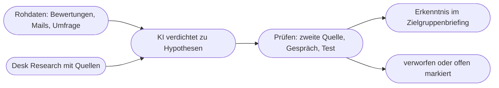

# Kapitel 17 – Zielgruppenanalyse mit KI

{{ progress(17) }}

<div class="lernziele" markdown>
<h3>Was du in diesem Kapitel lernst</h3>

- Warum die **Zielgruppe** der Baustein ist, an dem die meisten Marketing-Prompts scheitern – und wie er mit dem **Purpose** im P.R.O.M.P.T.-Framework zusammenhängt
- Welche **Datenquellen** du nutzen kannst – eigene Daten, Bewertungen, Umfragen, Foren, Statistiken – und was jede davon taugt
- Wie du mit KI Zielgruppen **segmentierst**, ohne in Klischees zu landen
- Wie du **Jobs-to-be-done**, **Pain Points** und **Gains** aus Rohtexten herausarbeitest
- Wie du **Desk Research** mit Websuche und Deep Research betreibst und Quellen prüfst
- Warum jede KI-gestützte Zielgruppenanalyse eine **Validierung** braucht – und wie die aussieht
</div>

---

## 17.1 Ohne Zielgruppe kein guter Prompt

Im P.R.O.M.P.T.-Framework (Kap. 5) beantwortet der Baustein **Purpose** die Frage „wozu und für wen". In der Praxis ist genau dieser Baustein am häufigsten leer oder mit einer Floskel gefüllt: „für unsere Zielgruppe", „für junge Leute", „für B2B-Kunden". Das Modell füllt die Lücke dann mit dem statistischen Durchschnitt – und der Text spricht niemanden an (Kap. 9).

Eine **Zielgruppenanalyse** liefert das Material, mit dem du den Purpose konkret füllst: Wer kauft, in welcher Situation, mit welchem Problem, mit welchen Worten und mit welchen Einwänden? KI hilft dabei an drei Stellen: beim **Auswerten** großer Textmengen (Bewertungen, Umfragefreitexte, Forenbeiträge), beim **Recherchieren** öffentlicher Quellen und beim **Strukturieren** der Ergebnisse. Was sie nicht kann: deine Kundschaft kennen. Ohne Daten erzeugt sie plausible Vermutungen – mehr nicht.

| Aufgabe | KI ist stark | KI ist schwach |
|---|---|---|
| 500 Bewertungen nach Themen ordnen | schnell, konsistent mit Kategorienschema | Ironie, Einzelfälle, Mengenangaben ohne Prüfung |
| Öffentliche Statistiken finden | mit Websuche/Deep Research gute Vorauswahl | erfundene oder veraltete Zahlen ohne Quellenprüfung |
| Segmente vorschlagen | strukturiert Kriterien und Hypothesen | erfindet Segmente, die gut klingen, aber nicht existieren |
| Kundensprache herausarbeiten | findet wiederkehrende Formulierungen | ohne echte Texte nur Werbesprache |

!!! info "Merksatz"
    KI ersetzt keine Zielgruppenkenntnis, sie **verdichtet** sie. Was du ihr an echten Daten gibst, kommt strukturiert zurück. Was du ihr nicht gibst, wird **erfunden** – überzeugend formuliert.

---

## 17.2 Datenquellen: Was du schon hast und was du findest

Die beste Quelle ist fast immer die, die im eigenen Haus liegt und selten ausgewertet wird. Bei der Fjordlicht GmbH sind das zum Beispiel Produktbewertungen im Webshop, Rücksendegründe, Kundenservice-Mails, Newsletter-Antworten und Kommentare auf Instagram.

| Quelle | Was sie zeigt | Stärke | Vorsicht |
|---|---|---|---|
| **Eigene Daten** (Shop, CRM, Newsletter-Statistik) | wer tatsächlich kauft und klickt | echt, spezifisch | personenbezogen – nur aggregiert oder pseudonymisiert in die KI (Kap. 4) |
| **Bewertungen** (Shop, Vergleichsportale, Konkurrenz) | Erwartungen, Enttäuschungen, Wortwahl | Kundensprache im Original | Extremmeinungen überwiegen |
| **Umfragen** (eigene, Freitextfelder) | Motive, Prioritäten | gezielte Fragen möglich | Fragen lenken Antworten; geringe Rücklaufquote |
| **Foren und Communities** (Reddit, Fachforen, Facebook-Gruppen) | Probleme vor dem Kauf, Vergleiche | ungefiltert, detailreich | nicht repräsentativ, Nutzungsbedingungen beachten |
| **Statistiken und Studien** (Statistisches Bundesamt, Verbände, Marktforschung) | Marktgröße, Trends | belastbar, wenn Quelle seriös | oft veraltet oder zu grob für dein Segment |
| **Suchdaten** (Search Console, Keyword-Tools) | was Menschen wirklich fragen | Bedarf in eigenen Worten | Suchvolumen kennt die KI nicht (Kap. 21) |

!!! warning "Typische Falle"
    Der CRM-Export wird „mal eben" komplett in ChatGPT geladen. Namen, E-Mail-Adressen und Bestellhistorien sind personenbezogene Daten. Entferne vor der Analyse alles, was eine Person identifiziert, und nutze nur freigegebene Werkzeuge mit Auftragsverarbeitungsvertrag (Kap. 4). Für eine Zielgruppenanalyse brauchst du **Muster**, keine Namen.

---

## 17.3 Segmentierung mit KI

**Segmentierung** heißt: den Markt in Gruppen teilen, die sich in ihrem Bedarf so unterscheiden, dass sie unterschiedlich angesprochen werden sollten. Die klassischen Kriterien:

| Kriterium | Beispiele | Beispiel Fjordlicht |
|---|---|---|
| demografisch | Alter, Lebensphase, Einkommen | Familien mit Kindern unter 10 |
| geografisch | Region, Stadt/Land, Klima | Großstadt mit Mittelgebirge in Reichweite |
| psychografisch | Werte, Lebensstil, Einstellungen | Nachhaltigkeit wichtig, aber skeptisch gegenüber Öko-Werbung |
| verhaltensbezogen | Kaufhäufigkeit, Anlass, Nutzung | kauft vor dem Urlaub, nutzt Jacke auch im Alltag |
| firmografisch (B2B) | Branche, Größe, Entscheidungswege | Handwerksbetriebe mit 20–100 Beschäftigten für „Fjordlicht Business" |

Demografie allein trägt selten. Zwei 35-Jährige aus Münster können völlig verschiedene Gründe haben, eine Regenjacke zu kaufen. Verhaltens- und Bedarfskriterien trennen meist schärfer. Genau hier ist KI nützlich: Sie kann in Freitexten Muster finden, die in keiner Spalte stehen.

```text
Du bist Marktforscherin mit Erfahrung im Outdoor-Handel.
Aufgabe: Schlage auf Basis der folgenden 60 Produktbewertungen
3 bis 5 Kundensegmente vor.
Format: Tabelle mit den Spalten Segment, Kaufanlass, Hauptbedarf,
typische Formulierung (wörtliches Zitat), Anzahl Bewertungen.
Regeln:
- Bilde Segmente nach Bedarf und Kaufanlass, nicht nach Alter.
- Jedes Segment muss durch mindestens 5 Bewertungen belegt sein.
- Zitate nur wörtlich aus den Bewertungen, nichts umformulieren.
- Wenn ein Muster nur schwach belegt ist, markiere es als [HYPOTHESE].
Zweck: Die Segmente sind Grundlage für Kundenavatare (Kap. 18).
Bewertungen:
"""
[Bewertungen einfügen, ohne Namen]
"""
```

Der Prompt folgt P.R.O.M.P.T.: Persona, Request, Output (Tabelle), Modifier (Belegpflicht, wörtliche Zitate, Hypothesen-Markierung), Purpose. Der Ton spielt bei einer Analyse keine Rolle und fehlt deshalb bewusst. Die Belegpflicht ist der entscheidende Modifier: Sie zwingt das Modell, sich an den Daten festzuhalten, statt plausible Segmente zu erfinden. Die Anzahl prüfst du stichprobenartig nach – beim Zählen ist ein Sprachmodell unzuverlässig, die Datenanalyse-Funktion (Kap. 20) zählt verlässlicher.

---

## 17.4 Jobs-to-be-done, Pain Points und Gains

Der Ansatz **Jobs-to-be-done** (JTBD) fragt nicht „Wer ist die Kundin?", sondern „Welche Aufgabe will sie mit dem Produkt erledigen?". Niemand will eine Regenjacke – man will trocken zur Arbeit radeln, ohne verschwitzt anzukommen. Die übliche Formulierung:

> **Wenn** [Situation], **will ich** [Motivation], **damit** [erwartetes Ergebnis].

Ergänzend unterscheidest du **Pain Points** (Ärgernisse, Risiken, Hindernisse) und **Gains** (erhoffte Vorteile, auch emotionale). Beides steckt in Rohtexten oft zwischen den Zeilen.

```text
Analysiere die folgenden Kundenservice-Mails und Bewertungen
(anonymisiert). Arbeite heraus:
1. Jobs-to-be-done im Format "Wenn ..., will ich ..., damit ..."
2. Pain Points (was ärgert, verunsichert, hält vom Kauf ab)
3. Gains (was sich Kundinnen und Kunden erhoffen)
Ordne jedem Punkt die Nummern der Texte zu, aus denen er stammt.
Erfinde keine Punkte, die nicht in den Texten stehen.
Texte:
"""
[1] ...
[2] ...
"""
```

!!! example "Ergebnis aus Fjordlicht-Bewertungen (Auszug)"
    | Typ | Ergebnis | Belegt in |
    |---|---|---|
    | Job | Wenn ich morgens bei Nieselregen zur Arbeit radle, will ich eine Jacke, die nicht nach Expedition aussieht, damit ich sie im Büro anlassen kann. | 4, 11, 23 |
    | Pain Point | Unsicherheit, ob „recycelt" mehr ist als Werbung | 7, 15, 31, 40 |
    | Pain Point | Größentabelle passt nicht zu Schichten darunter | 9, 18, 22 |
    | Gain | eine Jacke für Alltag und Wanderurlaub statt zwei | 4, 12, 26 |

    Der zweite Pain Point ist für das Marketing Gold: Er zeigt, dass Nachhaltigkeitsaussagen **belegt** sein müssen – genau das, was die Markenstimme von Fjordlicht ohnehin verlangt.

Ein Nebenprodukt dieser Analyse wird oft unterschätzt: die **Kundensprache**. Wenn Kundinnen von „nicht nach Expedition aussehen" sprechen, ist das eine bessere Formulierung als jede Werbezeile über „urbane Funktionalität". Lass dir deshalb zusätzlich eine Liste wörtlicher Formulierungen ausgeben, sortiert nach Häufigkeit, und lege sie neben den Styleguide. Diese Liste nutzt du später als Modifier („Verwende Formulierungen aus dieser Liste, keine Fachbegriffe") oder als Few-Shot-Material (Kap. 6).

Auch Bewertungen der **Konkurrenz** sind eine ergiebige Quelle: Was dort bemängelt wird, ist ein offener Bedarf, den du adressieren kannst – sofern dein Produkt ihn tatsächlich besser löst. Vergleichende Werbung, die Wettbewerber herabsetzt, ist dagegen tabu (UWG).

---

## 17.5 Desk Research mit Websuche und Deep Research

**Desk Research** ist die Auswertung bereits vorhandener, öffentlicher Informationen: Marktstudien, Verbandszahlen, Fachartikel, Diskussionen. Ohne Websuche greift das Modell nur auf seinen Trainingsstand zurück (Kap. 2) – für Zahlen und Trends ungeeignet. Mit **Websuche** (ChatGPT, Copilot, Gemini, Claude) oder einer Antwortmaschine wie **Perplexity** bekommst du aktuelle Treffer mit Quellen. **Deep Research** geht weiter: Das Werkzeug recherchiert mehrere Minuten selbstständig, liest viele Quellen und liefert einen Bericht.

```text
Recherchiere mit Websuche: Wie hat sich in Deutschland seit 2023
die Nachfrage nach nachhaltiger Outdoor-Bekleidung entwickelt?
Format: maximal 8 Kernaussagen. Zu jeder Aussage: Quelle (Herausgeber,
Titel, Jahr), Link, und ob es sich um eigene Erhebung, Hochrechnung
oder Meinung handelt.
Regeln: Nur Quellen ab 2023. Keine Zahl ohne Quelle. Wenn sich Quellen
widersprechen, nenne beide. Kennzeichne Herstellerstudien als solche.
Zweck: Einleitung für ein internes Zielgruppenbriefing.
```

| Prüfschritt | Worauf du achtest |
|---|---|
| Link öffnen | Existiert die Seite? Steht die Zahl wirklich dort? |
| Herausgeber | Statistikamt, Verband, Institut – oder ein Anbieter mit Eigeninteresse? |
| Datum und Bezug | Von wann sind die Daten, für welches Land, welche Grundgesamtheit? |
| Methode | Befragung, Hochrechnung, Schätzung – wie viele Befragte? |
| Übertragbarkeit | Passt die Aussage zu deinem Segment oder nur zum Gesamtmarkt? |

!!! warning "Typische Falle"
    Deep-Research-Berichte wirken durch Umfang und Fußnoten verlässlich. Trotzdem kommen falsch zugeordnete Zahlen, veraltete Studien und Quellen vor, die etwas anderes sagen als behauptet. **Jede Zahl, die in ein Briefing oder eine Präsentation geht, prüfst du an der Originalquelle** (Kap. 9).

---

## 17.6 Validierung: Von der Hypothese zur Erkenntnis

Alles, was KI dir über deine Zielgruppe liefert, ist zunächst eine **Hypothese**. Erst wenn sie durch eine zweite, unabhängige Quelle gestützt wird, wird daraus eine belastbare Erkenntnis. Dieses Prinzip heißt **Triangulation**.



| Evidenzstufe | Beispiel | Verwendung |
|---|---|---|
| **Vermutung** | KI-Vorschlag ohne Datenbasis | nur als Ausgangsfrage |
| **Hypothese** | Muster in 8 von 60 Bewertungen | als „zu prüfen" kennzeichnen |
| **gestützt** | Muster in Bewertungen **und** Kundenservice-Mails | darf ins Briefing |
| **bestätigt** | zusätzlich durch Gespräche oder A/B-Test (Kap. 16) | Grundlage für Kampagnen |

Praktische Validierungswege ohne großes Budget: fünf kurze Telefonate mit Bestandskunden, eine Frage im Newsletter, eine Umfrage-Story auf Instagram, ein Gespräch mit dem Kundenservice, der täglich mit echten Menschen spricht. Wie du Rückmeldungen aus sozialen Netzwerken systematisch auswertest, zeigt Kap. 19.

!!! tip "Das Zielgruppenbriefing"
    Fasse die Ergebnisse auf einer Seite zusammen: Segmente, Jobs, Pain Points, Gains, typische Formulierungen – und zu jedem Punkt die Evidenzstufe. Diese Seite ist die Grundlage für deinen Kundenavatar (Kap. 18) und wandert später als Wissensdatei in einen Assistenten (Kap. 24).

---

## Zusammenfassung

- Der **Purpose** im P.R.O.M.P.T.-Framework braucht eine konkrete Zielgruppe; ohne sie schreibt die KI für den Durchschnitt.
- KI **verdichtet** echte Daten, ersetzt sie aber nicht. Ohne Datengrundlage entstehen plausible Erfindungen.
- Die wertvollsten Quellen liegen oft im eigenen Haus: Bewertungen, Kundenservice-Mails, Rücksendegründe – immer **ohne Personenbezug** in die KI.
- **Segmentiere** nach Bedarf und Verhalten, nicht nur nach Demografie, und verlange Belege für jedes Segment.
- **Jobs-to-be-done**, Pain Points und Gains übersetzen Rohtexte in Ansatzpunkte für Botschaften.
- Desk Research mit Websuche oder Deep Research spart Zeit, aber **jede Zahl** wird an der Originalquelle geprüft.
- Jede KI-Aussage ist eine Hypothese, bis sie durch eine **zweite Quelle** gestützt ist.

---

## Kurzübungen

{{ task(file="tasks/k17_01.yaml") }}

{{ task(file="tasks/k17_02.yaml") }}

{{ task(file="tasks/k17_03.yaml") }}

---

## Workshop

{{ task(file="tasks/workshop_k17.yaml") }}
