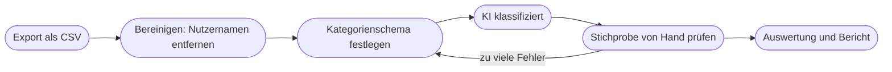

# Kapitel 19 – Social Listening mit KI

{{ progress(19) }}

<div class="lernziele" markdown>
<h3>Was du in diesem Kapitel lernst</h3>

- Was **Social Listening** ist und wie es sich vom reinen **Monitoring** unterscheidet
- Welche **Quellen** und **Werkzeuge** es gibt – von Brandwatch bis zur Bordfunktion der Plattformen
- Wie du **Sentiment- und Themenanalysen** mit ChatGPT auf exportierten Daten durchführst
- Wie du mit Schwellenwerten und Eskalationsstufen eine **Krisenfrüherkennung** aufbaust
- Was beim **Datenschutz** zu beachten ist, wenn Beiträge echter Menschen ausgewertet werden
- Wo die **Grenzen** liegen: Ironie, Kontext, Stichprobenverzerrung und Scheingenauigkeit
</div>

---

## 19.1 Zuhören statt nur zählen

**Social Monitoring** beantwortet die Frage „Was wird über uns gesagt?": Erwähnungen zählen, Reichweite messen, auf einzelne Beiträge reagieren. **Social Listening** geht einen Schritt weiter und fragt „Was bedeutet das?": Welche Themen bewegen die Zielgruppe, wie verändert sich die Stimmung, welche Begriffe tauchen neu auf, was sagen die Leute über Wettbewerber und über die Kategorie insgesamt?

| | Monitoring | Listening |
|---|---|---|
| Blick | einzelne Erwähnungen, jetzt | Muster und Entwicklungen über Zeit |
| typische Frage | „Wer hat uns markiert?" | „Warum kippt die Stimmung zu unseren Nachhaltigkeitsaussagen?" |
| Ergebnis | Reaktion, Antwort, Ticket | Erkenntnis für Content, Produkt, Avatar |
| Rolle der KI | Vorsortieren, Antwortentwürfe (Kap. 14) | Kategorisieren, Verdichten, Trends benennen |

Für das Marketing ist Listening eine laufende Zielgruppenanalyse (Kap. 17): Es liefert Kundensprache, Pain Points und neue Themen – ungefragt und in Echtzeit. Gleichzeitig ist es ein Frühwarnsystem für Krisen.

!!! info "Merksatz"
    Monitoring sagt dir, **dass** etwas passiert. Listening sagt dir, **was es bedeutet** – und KI hilft vor allem beim zweiten Schritt, nicht beim Sammeln.

---

## 19.2 Quellen und Werkzeuge

Gehört wird dort, wo die Zielgruppe spricht: Instagram, TikTok, LinkedIn, YouTube-Kommentare, Reddit und Fachforen, Bewertungsportale, Blogs, Nachrichtenseiten. Dazu kommen die eigenen Kanäle: Kommentare, Direktnachrichten, Antworten auf den Newsletter.

Wichtig für die Erwartungshaltung: Nicht alles ist abrufbar. Viele Plattformen haben den Datenzugang für Dritte in den letzten Jahren eingeschränkt oder verteuert, private Profile und geschlossene Gruppen sind tabu, und was ein Tool „sieht", hängt von seinen Verträgen mit den Plattformen ab. Jedes Listening-Ergebnis ist deshalb ein **Ausschnitt**.

| Werkzeugtyp | Beispiele | Eignung |
|---|---|---|
| Enterprise-Plattformen | Brandwatch, Talkwalker, Meltwater | große Marken, viele Quellen, KI-Funktionen eingebaut, entsprechend teuer |
| Werkzeuge für kleinere Teams | Brand24 und vergleichbare Anbieter | Erwähnungen und Grundstimmung zu überschaubaren Kosten |
| Bordmittel der Plattformen | Meta Business Suite, TikTok- und LinkedIn-Statistiken | eigene Kanäle, kostenlos, keine Fremdbeiträge |
| einfache Alarme | Google Alerts, gespeicherte Suchen auf Plattformen | Startpunkt, lückenhaft |
| KI auf Exporten | ChatGPT-Datenanalyse, Claude, Gemini, Copilot | Auswertung von CSV-Exporten aus den oben genannten Quellen |

Die Enterprise-Plattformen bringen heute eigene KI-Funktionen mit: automatische Zusammenfassungen, Themencluster, Sentiment-Erkennung. Für ein Unternehmen wie Fjordlicht ist der realistische Weg oft ein kleineres Tool oder die Bordmittel – plus eine eigene KI-Auswertung der Exporte. Funktionsumfang und Preise ändern sich schnell; prüfe sie vor einer Entscheidung aktuell (Stand: Oktober 2026).

!!! tip "Suchbegriffe sind die halbe Miete"
    Ein Listening-Tool findet nur, wonach du suchst. Lass dir von der KI eine Suchbegriffsliste erstellen: Markenname mit Tippfehlern („Fjordlich", „Fjord Licht"), Produktnamen ohne Sonderzeichen („Solv" statt „Sølv"), Kategoriebegriffe („Regenjacke recycelt"), Wettbewerber, typische Beschwerdeformulierungen. Und eine Ausschlussliste: „Fjordlicht" ist vielleicht auch ein Café oder ein Romantitel.

---

## 19.3 Sentiment- und Themenanalyse mit KI

Der Kern der KI-Arbeit im Listening ist die Auswertung exportierter Beiträge. Der Ablauf:



Das **Kategorienschema** legst du fest, nicht die KI. Sonst erfindet sie bei jeder Auswertung andere Kategorien, und du kannst Monate nicht vergleichen. Für Fjordlicht könnte es so aussehen:

| Dimension | Ausprägungen |
|---|---|
| Sentiment | positiv / neutral / negativ / gemischt / unklar |
| Thema | Qualität, Passform, Nachhaltigkeit, Preis, Lieferung, Kundenservice, Design, Sonstiges |
| Bezug | Fjordlicht / Wettbewerber / Kategorie allgemein |
| Handlungsbedarf | keiner / Antwort / Weiterleitung Kundenservice / Eskalation |

```text
Persona: Du bist Analystin für Social Listening.
Request: Klassifiziere jeden Beitrag in der angehängten CSV-Datei
nach dem Schema unten. Ergänze dafür Spalten in der Tabelle.
Output: 1. Tabelle mit allen Beiträgen und neuen Spalten,
2. Auszählung nach Thema und Sentiment, berechnet mit Python,
3. drei Kernaussagen mit je zwei Beispiel-IDs.
Modifier:
- Nutze ausschließlich die vorgegebenen Kategorien.
- Wenn Ironie möglich ist oder der Beitrag unklar ist: Sentiment "unklar".
- Begründe jede Einstufung "negativ" in höchstens 10 Wörtern.
- Keine Aussagen über einzelne Personen.
Purpose: Monatsbericht für das Marketingteam von Fjordlicht.
Schema: [Schema einfügen]
```

Tone fehlt hier bewusst – bei einer Analyse zählt Genauigkeit, nicht Stimme. Wichtig ist die Arbeitsteilung: Die **Klassifizierung** übernimmt das Sprachmodell, das **Zählen** übernimmt die Datenanalyse mit Python (Kap. 20). Ein Sprachmodell, das 300 Zeilen „im Kopf" zählt, liegt schnell daneben.

!!! warning "Typische Falle"
    Die Auswertung meldet „72 % positiv" und das Team freut sich. Niemand hat geprüft, ob die Einstufungen stimmen. Ziehe nach jeder Klassifizierung eine **Stichprobe von 20 bis 30 Beiträgen** und prüfe sie von Hand. Liegt die Übereinstimmung deutlich unter neun von zehn, schärfst du Schema oder Prompt nach, bevor du Zahlen weitergibst.

---

## 19.4 Vom Befund zur Handlung

Eine Auswertung, die nur Prozentwerte liefert, verändert nichts. Der Wert von Social Listening entsteht erst, wenn Befunde bei den Menschen ankommen, die etwas daraus machen können. Im Fjordlicht-Team heißt das: Content-Planung, Produktabteilung, Kundenservice und die Pflege der Avatare.

| Befund (Beispiel) | Wer damit arbeitet | Mögliche Handlung |
|---|---|---|
| Viele Fragen, wie man die Sølv richtig wäscht | Content, Kundenservice | Pflege-Video, FAQ-Eintrag, Newsletter-Tipp (Kap. 13, Kap. 14) |
| Wiederkehrende Kritik an der Passform der Vidde | Produktabteilung | Größentabelle prüfen, Rückmeldung an Hersteller |
| Neuer Begriff in der Community: „Buy it for life" | Content, Avatar-Pflege | Formulierung in Kundensprache aufnehmen (Kap. 18) |
| Wettbewerber wird für fehlende Reparaturangebote kritisiert | Marketingleitung | eigenen kostenlosen Reparaturservice (erste zwei Jahre nach Kauf) sichtbarer machen |
| Lob für den ruhigen Ton im Newsletter | Content | Bestätigung der Markenstimme, im Styleguide festhalten |

Für den regelmäßigen Bericht genügt eine feste Struktur, die die KI aus der klassifizierten Tabelle befüllt:

```text
Erstelle aus der klassifizierten Tabelle einen Monatsbericht Social Listening.
Gliederung:
1. Datenbasis: Zeitraum, Quellen, Anzahl Beiträge (ohne diese Angabe kein Bericht)
2. Stimmung im Vergleich zum Vormonat (Vormonatswerte unten)
3. Top-3-Themen mit je zwei wörtlichen Beispielzitaten (IDs angeben)
4. Neue Begriffe oder Themen, die im Vormonat nicht vorkamen
5. Empfohlene Handlungen, je eine Zeile, mit zuständigem Bereich
Regeln: Keine Ursachen behaupten, die die Daten nicht zeigen.
Formuliere Vermutungen ausdrücklich als Vermutung.
Vormonat: [Werte einfügen]
```

Die Regel gegen behauptete Ursachen ist wichtig: Wenn die Stimmung sinkt, liefert das Modell sonst gern eine plausible Erklärung mit („vermutlich wegen der Preiserhöhung"), die niemand geprüft hat. Korrelation ist keine Kausalität (Kap. 20).

---

## 19.5 Krisenfrüherkennung

Eine Krise kündigt sich selten mit einem Paukenschlag an. Typischer ist ein Muster: Ein kritischer Beitrag wird geteilt, in den Kommentaren greifen andere das Thema auf, ein reichweitenstarker Account kommentiert, die Stimmung kippt binnen Stunden. Wer erst im Monatsbericht davon erfährt, ist zu spät.

Frühwarnung braucht drei Dinge: **Schwellenwerte**, **Zuständigkeiten** und eine **Eskalationslogik**. KI hilft dabei, Ausschläge schnell einzuordnen und Antwortentwürfe vorzubereiten – die Entscheidung bleibt beim Menschen.

| Stufe | Auslöser (Beispiele) | Reaktion |
|---|---|---|
| **Grün** | normales Volumen, Sentiment im üblichen Rahmen | Routine, Wochenbericht |
| **Gelb** | negatives Sentiment deutlich über dem Durchschnitt der letzten Wochen, ein Thema häuft sich | Social-Media-Team prüft, informiert Teamleitung, Antworten nach Leitfaden |
| **Orange** | Beitrag mit hoher Reichweite, Medienanfrage, Vorwurf mit Rechts- oder Sicherheitsbezug | Teamleitung und Geschäftsführung, abgestimmte Stellungnahme, keine Einzelantworten aus dem Bauch |
| **Rot** | breite Berichterstattung, Produktsicherheit, Verdacht auf Rechtsverstoß | Krisenteam, Rechtsabteilung, festgelegte Sprecherrolle |

!!! example "Fjordlicht: Der Greenwashing-Vorwurf"
    Dienstagmorgen: Ein Nutzer postet auf TikTok, die Regenjacke Sølv sei „gar nicht recycelt, nur das Futter". Bis Mittag gibt es 40 Kommentare, Stimmung negativ, mehrere fragen nach Belegen. Stufe Gelb.

    Die KI fasst die Kommentare zusammen und sortiert sie: Wer fragt sachlich, wer wiederholt den Vorwurf, wer verteidigt die Marke? Ergebnis: Die meisten wollen schlicht wissen, welcher Anteil recycelt ist. Das Team prüft mit der Produktabteilung die Fakten – das Obermaterial ist recycelt, das Futter tatsächlich nicht. Die Produktseite war ungenau.

    Antwort nach Freigabe: Fakten offenlegen, Ungenauigkeit einräumen, Produktseite korrigieren. Die KI liefert Entwürfe, die Zahlen kommen ausschließlich aus der Produktdokumentation. Der Fall zeigt, warum die Markenstimme von Fjordlicht nur belegbare Nachhaltigkeitsaussagen erlaubt.

!!! tip "Antworten vorbereiten, nicht automatisieren"
    Lass die KI zu wiederkehrenden kritischen Themen Antwortbausteine vorbereiten, die vorab freigegeben werden. Im Ernstfall passt das Team sie an. Vollautomatische Antworten auf Kritik sind in Krisen ein Brandbeschleuniger.

---

## 19.6 Datenschutz und Grenzen

Auch öffentliche Beiträge enthalten **personenbezogene Daten**: Nutzernamen, Profilbilder, manchmal Ortsangaben. Die DSGVO gilt trotzdem. Für die Praxis bedeutet das (Kap. 4):

- Werte **Themen und Muster** aus, nicht Personen. Profile Einzelner anzulegen ist tabu.
- Entferne Nutzernamen und Profil-Links vor dem Hochladen in ein KI-Werkzeug oder ersetze sie durch IDs.
- Nutze für Exporte nur freigegebene Werkzeuge mit Auftragsverarbeitungsvertrag.
- Kein eigenes Abgreifen (Scraping) von Plattformen ohne Prüfung der Nutzungsbedingungen und der Rechtslage – dafür gibt es lizenzierte Tools.
- Lösche Rohdaten, wenn die Auswertung abgeschlossen ist.

Dieses Kapitel gibt Orientierung, keine Rechtsberatung. Wenn du ein Listening-Tool einführst oder Daten in größerem Umfang auswertest, beziehe Datenschutzbeauftragte oder Rechtsabteilung ein.

Die fachlichen Grenzen sind mindestens ebenso wichtig:

| Grenze | Beispiel | Gegenmittel |
|---|---|---|
| Ironie und Sarkasmus | „Super, Jacke nach zwei Wochen undicht. Danke, Fjordlicht!" | Kategorie „unklar", Stichprobe prüfen |
| fehlender Kontext | Antwort ohne den Beitrag, auf den sie sich bezieht | Gesprächsverläufe mitexportieren |
| Emojis, Slang, Dialekt | ein Totenkopf-Emoji kann Lachen oder Entsetzen bedeuten | Beispiele im Prompt (Few-Shot, Kap. 6) |
| Stichprobenverzerrung | laute Minderheit, nur bestimmte Plattformen erfasst | Ergebnis immer mit Quellenbasis angeben |
| Bots und Kampagnen | viele gleichlautende Beiträge in kurzer Zeit | Duplikate und Kontoalter prüfen |
| Scheingenauigkeit | „Sentiment 63,4 %" bei 80 Beiträgen | gerundete Werte, Fallzahl nennen |

Die Stichprobenverzerrung wird am häufigsten unterschätzt. Wer auf TikTok listet, hört eine andere Zielgruppe als im Newsletter-Postfach. Zufriedene Kundinnen posten selten, enttäuschte häufiger. Social Listening zeigt also nicht, was „die Kundschaft" denkt, sondern was **die Lautesten auf den erfassten Kanälen** sagen. Für Avatare (Kap. 18) und Zielgruppenbriefings (Kap. 17) ist es eine wertvolle Quelle – aber eine unter mehreren.

---

## Zusammenfassung

- **Monitoring** erfasst Erwähnungen, **Listening** erkennt Muster und Bedeutung – KI hilft vor allem beim Verdichten.
- Jedes Werkzeug sieht nur einen **Ausschnitt**; Suchbegriffe, Ausschlüsse und Quellenauswahl bestimmen das Ergebnis.
- Für Sentiment- und Themenanalysen gibst du das **Kategorienschema** vor, lässt die KI klassifizieren, Python zählen – und prüfst eine **Stichprobe** von Hand.
- Krisenfrüherkennung braucht **Schwellenwerte, Zuständigkeiten und Eskalationsstufen**; KI bereitet vor, Menschen entscheiden.
- Auch öffentliche Beiträge sind **personenbezogene Daten**: Muster auswerten, Namen entfernen, freigegebene Werkzeuge nutzen.
- Ironie, fehlender Kontext, Bots und **Stichprobenverzerrung** begrenzen die Aussagekraft; Fallzahl und Quellenbasis gehören in jeden Bericht.

---

## Kurzübungen

{{ task(file="tasks/k19_01.yaml") }}

{{ task(file="tasks/k19_02.yaml") }}

{{ task(file="tasks/k19_03.yaml") }}

---

## Workshop

{{ task(file="tasks/workshop_k19.yaml") }}
