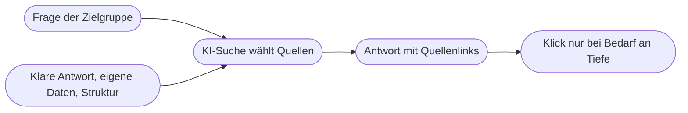

# Kapitel 22 – SEO mit KI II: On-Page-Optimierung und KI-Suche

{{ progress(22) }}

<div class="lernziele" markdown>
<h3>Was du in diesem Kapitel lernst</h3>

- Wie du mit KI **Title, Meta-Description und Überschriften** optimierst, ohne in Keyword-Stopfen zu verfallen
- Wie **interne Links** und **FAQ-Abschnitte** Nutzerinnen und Suchmaschinen gleichermaßen helfen
- Was **strukturierte Daten** (Schema.org) sind und wie KI beim Erstellen hilft
- Wie du **bestehende Inhalte** systematisch überarbeitest, statt immer neue zu schreiben
- Wie **Google zu KI-Inhalten** steht und wo „scaled content abuse" beginnt
- Was **AI Overviews**, AI Mode und **Generative Engine Optimization** für deine Texte bedeuten
</div>

---

## 22.1 On-Page-Optimierung: Die Seite selbst verständlich machen

On-Page-Optimierung umfasst alles, was du **auf der eigenen Seite** veränderst, damit Suchmaschinen sie verstehen und Menschen sie in den Ergebnissen anklicken. Grundlage ist das SEO-Briefing aus Kap. 21: Hauptkeyword, Intention und Ziel stehen fest, jetzt geht es um die Umsetzung im Text und in den Seitenelementen.

| Element | Aufgabe | Richtwert | Was KI gut kann |
|---|---|---|---|
| Title-Tag | Überschrift im Suchergebnis | etwa 50–60 Zeichen, Hauptkeyword vorn | Varianten erzeugen und Zeichen zählen lassen |
| Meta-Description | Teaser im Suchergebnis | etwa 140–160 Zeichen, mit Nutzenversprechen | Varianten mit klarem Nutzen formulieren |
| H1 | Hauptüberschrift auf der Seite | genau eine, Thema klar benannt | Abgleich mit Title, Alternativen |
| H2/H3 | Gliederung | beantworten die Kernfragen aus dem Briefing | Gliederung prüfen, Lücken finden |
| Einleitung | Antwort und Einordnung | Kernaussage in den ersten zwei, drei Sätzen | kürzen, auf den Punkt bringen |
| Bild-Alt-Texte | Bildbeschreibung für Screenreader und Suche | beschreibend, nicht keywordgestopft | Entwürfe aus Bildbeschreibung |
| URL | Adresse der Seite | kurz, sprechend | Vorschläge |

Google schreibt Titles und Descriptions häufig selbst um, wenn sie nicht zur Suchanfrage passen. Ein guter Title ist deshalb kein Trick, sondern eine **präzise Zusammenfassung** dessen, was auf der Seite steht.

!!! example "Vorher/Nachher bei Fjordlicht"
    Vorher: „Pflege – Fjordlicht" (kein Inhalt erkennbar).
    Nachher: „Regenjacke imprägnieren: So perlt sie wieder ab | Fjordlicht" (60 Zeichen).
    Meta-Description: „Wann eine Regenjacke neue Imprägnierung braucht, wie du sie aufträgst und woran du einen Membranschaden erkennst – aus unserer Reparaturwerkstatt."

Ein Prompt nach dem P.R.O.M.P.T.-Framework (Kap. 5):

```text
Persona: Du bist SEO-Redakteurin mit Erfahrung im E-Commerce.
Request: Formuliere für den angehängten Artikel fünf Varianten für
Title-Tag und Meta-Description.
Output: Tabelle mit Title, Zeichenzahl Title, Description, Zeichenzahl
Description. Zähle die Zeichen mit der Datenanalyse, nicht geschätzt.
Modifier: Hauptkeyword "[Keyword]" im Title möglichst vorn. Title maximal
60 Zeichen, Description maximal 155. Keine Superlative, keine Versprechen,
die der Artikel nicht einlöst. Markenname am Ende des Titles.
Purpose: Mehr Klicks aus der Google-Suche für einen Ratgeber im Blog.
Tone: ruhig, konkret, Du-Ansprache.
Artikel: [Text einfügen]
```

!!! warning "Typische Falle"
    KI neigt dazu, das Keyword in jede Überschrift und jeden zweiten Satz zu setzen, wenn du es als „wichtig" markierst. Das liest sich holprig und bringt seit vielen Jahren keinen Vorteil mehr. Formuliere im Modifier: „Verwende das Keyword natürlich, höchstens dort, wo es inhaltlich passt."

---

## 22.2 Interne Links, FAQ und strukturierte Daten

**Interne Links** verbinden Seiten deiner eigenen Website. Sie zeigen Suchmaschinen, welche Seiten zusammengehören und welche wichtig sind – und sie führen Leserinnen zum nächsten Schritt. Im Themencluster aus Kap. 21 verlinkt die Pillar Page auf alle Detailartikel und umgekehrt. KI hilft, wenn du ihr eine Liste deiner URLs mit Titeln gibst: „Schlage für diesen Artikel fünf interne Links vor, mit Ankertext und der Stelle im Text, an der der Link sinnvoll ist." Ankertexte sollen beschreiben, wohin der Link führt – „hier klicken" verschenkt den Kontext.

**FAQ-Abschnitte** beantworten konkrete Anschlussfragen in kurzer Form. Sie sind nützlich, wenn die Fragen echt sind: aus Kundenservice, Social Listening (Kap. 19) oder den „Ähnlichen Fragen" der Suche. Von der KI erfundene Fragen, die niemand stellt, blähen die Seite nur auf.

**Strukturierte Daten** sind maschinenlesbare Zusatzangaben im Quelltext einer Seite, meist im Format JSON-LD nach dem Vokabular von **Schema.org**. Sie sagen der Suchmaschine ausdrücklich: Das ist ein Produkt mit Preis und Verfügbarkeit, das ist ein Artikel mit Autorin und Datum, das ist eine Organisation mit Adresse.

| Schema-Typ | Einsatz bei Fjordlicht | Möglicher Effekt |
|---|---|---|
| Product (mit Offer, AggregateRating) | Produktseiten Sølv, Skog, Vidde, Tind | Preis, Verfügbarkeit, Bewertungssterne im Ergebnis |
| Article / BlogPosting | Artikel in „Draußen-Notizen" | Autorin, Datum, bessere Einordnung |
| Organization | Startseite, Impressum | Logo, Kontaktdaten, Verknüpfung der Profile |
| BreadcrumbList | gesamter Shop | Pfadanzeige im Suchergebnis |
| FAQPage | FAQ-Abschnitte | Verständnis der Fragen; erweiterte FAQ-Darstellung zeigt Google seit 2023 nur noch für wenige Websites |

Eine KI kann solche Auszeichnungen aus einem Produkttext erstellen. Ein Ausschnitt sieht so aus:

```text
<script type="application/ld+json">
{
  "@context": "https://schema.org",
  "@type": "Product",
  "name": "Regenjacke Sølv",
  "brand": "Fjordlicht",
  "offers": {
    "@type": "Offer",
    "price": "[Preis]",
    "priceCurrency": "EUR",
    "availability": "https://schema.org/InStock"
  }
}
</script>
```

!!! warning "Typische Falle"
    Strukturierte Daten müssen dem **sichtbaren Inhalt** entsprechen. Erfindet die KI Bewertungen, Preise oder Eigenschaften, verstößt das gegen Googles Richtlinien und kann zu manuellen Maßnahmen führen. Prüfe jede generierte Auszeichnung mit dem **Test für Rich-Suchergebnisse** von Google und gleiche die Werte mit dem Shop ab. Meist erzeugt das Shopsystem diese Daten ohnehin automatisch – dann prüfst du nur, ob sie vollständig sind.

---

## 22.3 Bestandsoptimierung: Alte Inhalte besser machen

Viele Websites haben Hunderte Artikel, von denen ein Großteil kaum Besuche bekommt. Neue Texte zu schreiben, ist verlockend – oft lohnt die Überarbeitung bestehender Inhalte mehr. Ausgangspunkt sind die Daten der **Google Search Console** (Kap. 21): Seiten mit vielen Impressionen, aber wenigen Klicks, oder Seiten auf Position 8 bis 20.

| Befund in der Search Console | Wahrscheinliche Ursache | Maßnahme mit KI |
|---|---|---|
| viele Impressionen, niedrige Klickrate | Title/Description passen nicht zur Suchanfrage | neue Varianten auf Basis der tatsächlichen Suchanfragen |
| Position 8–20 für wichtiges Keyword | Inhalt beantwortet die Frage unvollständig | Lückenanalyse gegen Top-Ergebnisse, Abschnitte ergänzen |
| Ranking für unpassende Suchanfragen | Thema unscharf | Fokus schärfen, Abschnitte auslagern |
| sinkende Klicks über Monate | Inhalt veraltet oder Suchverhalten verändert | Aktualität prüfen, Daten und Beispiele erneuern |
| zwei Artikel zum selben Thema | Kannibalisierung | zusammenführen, Weiterleitung einrichten |

Die KI arbeitet hier am besten mit beiden Quellen: dem bestehenden Artikel und dem Search-Console-Export der Suchanfragen für diese URL. Der Prompt lautet dann sinngemäß: „Welche dieser Suchanfragen beantwortet der Artikel nicht oder nur am Rand? Schlage Ergänzungen vor, ohne den Artikel insgesamt umzuschreiben." Das Ziel ist gezielte Verbesserung, nicht ein komplett neuer Text, der die bisherigen Stärken verliert. Mit Schreibblöcken in ChatGPT oder vergleichbaren Editoren (Kap. 11) kannst du einzelne Abschnitte markieren und gezielt überarbeiten lassen.

!!! tip "Datum ehrlich führen"
    Aktualisiere das Datum eines Artikels nur, wenn sich der Inhalt wirklich geändert hat. Ein neues Datum ohne neue Inhalte ist eine kleine Täuschung – für Leserinnen wie für Suchmaschinen.

---

## 22.4 Googles Haltung zu KI-Inhalten

Google bewertet Inhalte nach **Qualität und Hilfreichkeit**, nicht danach, wie sie entstanden sind. KI-Unterstützung ist also kein Problem an sich. Problematisch ist, Inhalte **massenhaft** zu erzeugen, um Rankings zu manipulieren, ohne Nutzerinnen echten Mehrwert zu bieten. Google führt das in seinen Spam-Richtlinien als **„scaled content abuse"** – unabhängig davon, ob Menschen oder Maschinen die Texte schreiben.

| Eher unproblematisch | Eher problematisch |
|---|---|
| KI entwirft, Fachperson prüft, ergänzt Erfahrung, gibt frei | hunderte Seiten nach Schablone, nur Ortsname oder Produkt ausgetauscht |
| KI überarbeitet Title, Gliederung, Lesbarkeit | Texte, die Konkurrenzartikel umformulieren, ohne Neues zu bieten |
| KI hilft bei strukturierten Daten und FAQ aus echten Fragen | erfundene Erfahrungsberichte, Tests oder Bewertungen |
| Übersetzung mit menschlicher Prüfung | ungeprüfte Massenübersetzung |

Maßstab ist **E-E-A-T**: Experience, Expertise, Authoritativeness, Trustworthiness (Kap. 15). Gerade die Erfahrung kann KI nicht liefern. Ein Artikel, in dem die Fjordlicht-Werkstatt beschreibt, welche Reißverschlüsse am häufigsten reißen, hat etwas, das kein Modell erzeugen kann. Offizielle Hinweise findest du in [Google Search Central](https://developers.google.com/search).

!!! info "Merksatz"
    Google fragt nicht „Wer hat das geschrieben?", sondern „Hilft das der Person, die gesucht hat?". KI-Texte ohne eigene Erfahrung und Prüfung beantworten diese Frage selten mit Ja.

---

## 22.5 KI-Suche: AI Overviews, AI Mode und Generative Engine Optimization

Die Suche verändert sich. **AI Overviews** fassen bei vielen Anfragen die Antwort oberhalb der klassischen Ergebnisse zusammen und verlinken einige Quellen. Der **AI Mode** führt die Suche als Dialog fort. Daneben nutzen viele Menschen ChatGPT mit Websuche, Perplexity oder Gemini als Antwortmaschine. Die Folge: Bei einfachen Wissensfragen klicken weniger Menschen auf eine Website, weil die Antwort schon dasteht. Wer genannt wird, gewinnt Sichtbarkeit; wer nicht genannt wird, verliert Klicks.

Für dieses Umfeld hat sich der Begriff **Generative Engine Optimization (GEO)** etabliert – die Optimierung dafür, in KI-Antworten als Quelle aufgegriffen zu werden. Vieles davon ist gutes SEO mit anderer Gewichtung:

| GEO-Prinzip | Umsetzung |
|---|---|
| Klare, zitierfähige Antworten | Kernaussage in ein, zwei Sätzen direkt unter der Frage-Überschrift |
| Eigene Fakten und Daten | Messwerte, Erfahrungen, Zahlen aus dem eigenen Haus mit Kontext |
| Struktur | eindeutige Überschriften, Listen, Tabellen, strukturierte Daten |
| Glaubwürdigkeit | Autorin mit Expertise, Quellen, Datum, Impressum |
| Erwähnungen außerhalb der eigenen Seite | Fachartikel, Bewertungen, Kooperationen, Pressearbeit |
| Technische Erreichbarkeit | Seite indexierbar, Inhalte als Text, nicht nur im Bild |

Für Fjordlicht heißt das konkret: Ein Ratgeber „Welche Regenjacke für Radfahren in der Stadt?" beginnt mit einer klaren Zwei-Satz-Antwort, nennt danach die Kriterien in einer Tabelle (Länge, Kapuze, Reflektoren, Belüftung) und belegt sie mit Erfahrungen aus Tests des eigenen Teams. Genau solche Passagen lassen sich von einer Antwortmaschine sauber übernehmen und mit Quelle verlinken.

Wie KI-Systeme ihre Quellen genau auswählen, legen die Anbieter nicht offen. Vorsicht deshalb bei Diensten, die „garantierte Nennung in ChatGPT" versprechen, und bei Rezepten, die als Standard verkauft werden, aber unbelegt sind. Prüfen kannst du die eigene Sichtbarkeit, indem du typische Fragen deiner Zielgruppe regelmäßig in mehrere Antwortmaschinen eingibst und dokumentierst, ob und wie Fjordlicht vorkommt.



!!! tip "Den Klick wert sein"
    Wenn die Kurzantwort schon in der Suche steht, muss deine Seite mehr bieten: Tiefe, eigene Erfahrung, Entscheidungshilfe, Werkzeuge wie eine Größentabelle oder einen Pflegeplaner. Das ist gleichzeitig die beste Antwort auf Googles Qualitätsmaßstab.

---

## Zusammenfassung

- **On-Page-Elemente** wie Title, Meta-Description und Überschriften fassen präzise zusammen, was auf der Seite steht – KI liefert Varianten, Zeichen werden gezählt, nicht geschätzt.
- **Interne Links** und **FAQ** aus echten Fragen verbinden Cluster und führen zum nächsten Schritt.
- **Strukturierte Daten** nach Schema.org müssen dem sichtbaren Inhalt entsprechen und werden mit Googles Testwerkzeug geprüft.
- **Bestandsoptimierung** auf Basis der Search Console lohnt oft mehr als neue Artikel.
- Google bewertet **Hilfreichkeit, nicht Herkunft**; massenhaft erzeugte Inhalte ohne Mehrwert gelten als **scaled content abuse**.
- **AI Overviews**, AI Mode und Antwortmaschinen verändern das Klickverhalten; **GEO** setzt auf klare Antworten, eigene Daten, Struktur und Glaubwürdigkeit.

---

## Kurzübungen

{{ task(file="tasks/k22_01.yaml") }}

{{ task(file="tasks/k22_02.yaml") }}

{{ task(file="tasks/k22_03.yaml") }}

---

## Workshop

{{ task(file="tasks/workshop_k22.yaml") }}
