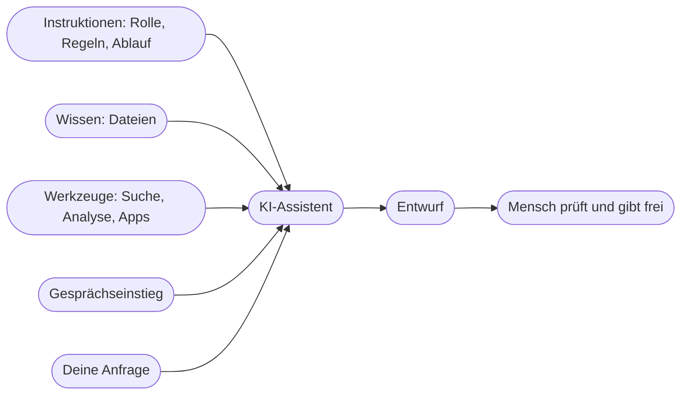

# Kapitel 23 – Vom Prompt zum KI-Assistenten

{{ progress(23) }}

<div class="lernziele" markdown>
<h3>Was du in diesem Kapitel lernst</h3>

- Was einen **KI-Assistenten** von einem gespeicherten Prompt unterscheidet
- Die vier Bausteine jedes Assistenten: **Instruktionen, Wissen, Werkzeuge, Gesprächseinstieg**
- Welche **Varianten** es gibt – vom Custom GPT bzw. ChatGPT-Plugin über Projekte bis zu Claude Projects, Gemini Gems und Copilot Agents
- Was die **Ablösung der Custom GPTs durch Plugins** (Stand Oktober 2026) für dich bedeutet
- Nach welchen **Kriterien** du entscheidest, ob sich ein Assistent lohnt – oder ob eine Prompt-Vorlage reicht
- Warum du einen Assistenten **werkzeugunabhängig dokumentierst**, bevor du ihn irgendwo anklickst
</div>

---

## 23.1 Das Problem mit dem zwanzigsten Copy-and-paste

In Block 2 hast du gelernt, gute Prompts zu bauen (Kap. 5) und sie in einer Bibliothek abzulegen (Kap. 10). Im Alltag des Fjordlicht-Marketingteams sieht das so aus: Jeden Montag kopiert jemand den Newsletter-Prompt aus dem Teamordner, hängt den Styleguide als PDF an, ergänzt die Claim-Liste, fügt drei Beispieltexte ein – und schreibt dann erst den eigentlichen Auftrag. Fünf Minuten Vorbereitung, bevor die Arbeit beginnt. Und wer den Styleguide vergisst, bekommt Superlative, die Fjordlicht nie verwenden würde.

Ein **KI-Assistent** löst genau dieses Problem. Er ist ein dauerhaft eingerichteter Arbeitsrahmen, in dem Rolle, Regeln, Hintergrundwissen und erlaubte Werkzeuge **bereits hinterlegt** sind. Du öffnest ihn und schreibst nur noch das, was sich von Mal zu Mal ändert: „Newsletter-Intro zur neuen Regenjacke Sølv, Fokus Herbstwanderungen".

!!! info "Merksatz"
    Ein Assistent ist ein **gespeicherter Arbeitskontext**, kein neues Wesen. Er kann nichts, was das zugrunde liegende Modell nicht kann – aber er sorgt dafür, dass es **jedes Mal mit denselben Voraussetzungen** arbeitet.

Das klingt unspektakulär, verändert aber zwei Dinge grundlegend: Erstens hängt die Qualität nicht mehr davon ab, wer gerade am Rechner sitzt. Zweitens kannst du Wissen, das sonst in Köpfen oder PDFs steckt, einem ganzen Team zugänglich machen.

---

## 23.2 Die vier Bausteine eines Assistenten

Egal, wie das Werkzeug heißt: Jeder Assistent besteht aus denselben vier Bausteinen. Wer sie kennt, kann jeden Anbieter bedienen – und muss bei der nächsten Produktumstellung nichts Neues lernen.

| Baustein | Was er leistet | Beispiel Fjordlicht | Typische Falle |
|---|---|---|---|
| **Instruktionen** | dauerhafte Rolle, Ziel, Regeln, Arbeitsablauf, Ausgabeformat | „Du schreibst Entwürfe in der Fjordlicht-Markenstimme. Keine Superlative." | zu allgemein oder widersprüchlich |
| **Wissen** | hinterlegte Dateien, auf die der Assistent zugreift | Styleguide, Produktdatenblatt, Claim-Liste, Beispieltexte | veraltete oder unaufgeräumte Dateien |
| **Werkzeuge** | Fähigkeiten über das Schreiben hinaus | Websuche, Datenanalyse, Bildgenerierung, Anbindung an Apps | alles einschalten „für alle Fälle" |
| **Gesprächseinstieg** | Konversationsstarter, Beschreibung, Kurzanleitung | „Newsletter-Intro schreiben", „Text gegen Claim-Liste prüfen" | fehlt – Kolleg:innen wissen nicht, was der Assistent kann |



Die Instruktionen sind im Grunde ein sehr gründlicher Prompt nach dem P.R.O.M.P.T.-Framework (Kap. 5), der nicht bei jeder Anfrage neu eingegeben wird. Das Wissen ersetzt das ständige Anhängen von Dateien. Die Werkzeuge entscheiden, ob der Assistent zum Beispiel im Web recherchieren oder eine CSV-Datei auswerten darf. Der Gesprächseinstieg wird am häufigsten unterschätzt: Ein Assistent, den niemand bedienen kann, wird nicht genutzt.

!!! tip "Benutzerdefinierte Anweisungen sind kein Assistent"
    Die benutzerdefinierten Anweisungen und das Memory in ChatGPT (Kap. 7) wirken auf **alle** deine Chats. Ein Assistent wirkt nur dort, wo du ihn bewusst öffnest. Für persönliche Vorlieben („antworte knapp") taugen Anweisungen, für eine konkrete Aufgabe mit eigenem Regelwerk braucht es einen Assistenten.

---

## 23.3 Varianten: dieselbe Idee, verschiedene Namen

Alle großen Anbieter haben eine Form von Assistent im Angebot. Die Bezeichnungen und Oberflächen ändern sich häufig, die vier Bausteine bleiben. Die folgende Übersicht gibt den Stand Oktober 2026 wieder; Funktionsumfang und Verfügbarkeit hängen vom Tarif ab.

| Variante | Anbieter | Typischer Einsatz | Teilen im Team |
|---|---|---|---|
| **Custom GPT** (wird abgelöst) bzw. **ChatGPT-Plugin** | OpenAI | wiederkehrende Aufgabe mit festem Regelwerk, Wissensdateien, optional Anbindung an Apps | je nach Plan im Arbeitsbereich oder per Link |
| **Projekt** in ChatGPT | OpenAI | Arbeitsraum für ein Vorhaben: Chats, Dateien, Anweisungen, projektbezogenes Gedächtnis | in Team-/Business-Plänen möglich |
| **Claude Projects** | Anthropic | Projektanweisungen plus Projektwissen für Claude | in Team-/Enterprise-Plänen |
| **Gemini Gems** | Google | eigene Gemini-Varianten mit Anweisungen und Dateien | je nach Konto teilbar |
| **Copilot Agents** | Microsoft | Agenten im Microsoft-365-Umfeld, Zugriff auf SharePoint- und Teams-Inhalte | über die Microsoft-365-Umgebung des Unternehmens |

Der wichtigste Unterschied liegt zwischen **Projekt** und **Assistent**. Ein Projekt ist ein Arbeitsraum für ein Vorhaben – etwa „Herbstkampagne 2026" – mit wachsenden Unterlagen und Gesprächen. Ein Assistent ist ein **Werkzeug für eine wiederkehrende Aufgabe** – etwa „Produkttexte für den Webshop" – das viele Menschen auf dieselbe Weise nutzen. Projekte sammeln, Assistenten standardisieren.

!!! warning "Typische Falle"
    Die Werkzeugwahl wird oft nach Gewohnheit getroffen: „Wir nutzen ChatGPT, also bauen wir einen GPT." Entscheidend ist aber, **wo eure Daten liegen dürfen**. Arbeitet euer Unternehmen mit Microsoft 365 und hat nur dafür eine Auftragsverarbeitungsvereinbarung, ist ein Copilot Agent die realistische Wahl – auch wenn ChatGPT im Kurs das Hauptwerkzeug ist (Kap. 4).

---

## 23.4 Stand Oktober 2026: von Custom GPTs zu Plugins

Seit 2023 waren **Custom GPTs** der Standardweg, in ChatGPT eigene Assistenten zu bauen. Am **11.09.2026** hat OpenAI angekündigt, Custom GPTs abzulösen und durch **Plugins** zu ersetzen. Für diesen Kurs fällt die Umstellung genau in den Block zu KI-Assistenten – du lernst also an einem Produkt, das sich gerade verändert. Das ist kein Nachteil, sondern ein realistischer Testfall: Genau so wird es dir im Berufsalltag immer wieder gehen.

**Die Eckdaten** (laut Ankündigung und Hochschul- bzw. Fachmeldungen; Termine können je Konto variieren):

- seit **01.10.2026**: Funktion „Migrate to plugin" zum Überführen bestehender GPTs
- ab ca. **25./26.10.2026**: Übergangsphase; in Enterprise-Konten ab 26.10. keine neuen GPTs mehr
- **11.12.2026**: geplantes Ende für Custom GPTs
- spätestens ab **11.02.2027**: nicht migrierte GPTs nicht mehr nutzbar (Enterprise mit Aufschub)

**Was bei der Migration passiert:**

| Bestandteil des Custom GPT | Nach der Migration |
|---|---|
| Instruktionen | werden zu einem **Skill** |
| Wissensdateien | werden zu **Referenzdateien** |
| verbundene Apps | können übernommen werden |
| Gesprächsverläufe | werden **nicht** übertragen |
| gewähltes Modell | wird **nicht** übertragen |
| Custom Actions (eigene Schnittstellen) | werden **nicht** übertragen – ggf. Neubau als App bzw. MCP-Server |
| Freigabe-Einstellungen | werden **nicht** übertragen – Plugins starten **privat** |

Die gute Nachricht steckt in der linken Spalte: Instruktionen, Wissen, Werkzeuge und Teilen gibt es weiterhin. Was sich ändert, sind Namen, Menüs und einige technische Details. Wer verstanden hat, **wozu** Instruktionen und Wissensdateien da sind, überträgt sie in jedes neue Format. Die Konfigurationsdetails und Grenzen vertiefst du in Kap. 28, die Umsetzung Schritt für Schritt in Kap. 25.

!!! example "Was das für Fjordlicht konkret heißt"
    Das Team hat einen Custom GPT für Produkttexte, eine eigene Aktion für den Abruf von Lagerbeständen und ihn im Arbeitsbereich geteilt. Nach der Migration ist der Skill mit den Instruktionen da, die Wissensdateien auch. Die Lagerbestand-Aktion fehlt, und niemand außer der Erstellerin sieht das Plugin. Zwei Aufgaben also: Freigabe neu setzen, Anbindung neu planen (Kap. 27 zeigt, wie man so etwas konzeptionell angeht).

---

## 23.5 Wann lohnt sich ein Assistent?

Nicht jede Aufgabe braucht einen Assistenten. Ein schlecht gepflegter Assistent ist schlimmer als ein guter Prompt, weil er Vertrauen erzeugt, das er nicht verdient. Prüfe deshalb fünf Kriterien:

| Kriterium | Spricht für einen Assistenten | Spricht dagegen |
|---|---|---|
| **Häufigkeit** | mindestens wöchentlich | einmal im Quartal |
| **Gleichartigkeit** | ähnliche Anfragen, gleiche Regeln | jedes Mal ein anderes Thema |
| **Nutzerkreis** | mehrere Personen, auch Neue | nur du selbst |
| **Wissen** | stabile Unterlagen (Styleguide, Produktdaten) | Wissen ändert sich täglich |
| **Qualitätsrisiko** | Fehler fallen auf die Marke zurück | interne Notiz ohne Außenwirkung |

Faustregel: Treffen **drei oder mehr** Kriterien zu, lohnt sich der Aufbau. Bei ein bis zwei reicht eine gute Vorlage in der Prompt-Bibliothek (Kap. 10) oder ein Projekt.

Du kannst dir die Vorauswahl von der KI vorbereiten lassen – die Bewertung triffst du aber selbst, denn nur du kennst Häufigkeit und Risiko im eigenen Team:

```text
Ich arbeite im Marketing eines Online-Shops für Outdoor-Bekleidung.
Hier ist eine Liste wiederkehrender Aufgaben aus unserem Team:
[Aufgabenliste]
Erstelle eine Tabelle mit den Spalten: Aufgabe | Häufigkeit | Gleichartigkeit |
Nutzerkreis | Wissen | Qualitätsrisiko | Vorschlag (Prompt-Vorlage, Projekt
oder Assistent). Bewerte jede Spalte mit 0, 1 oder 2.
Wenn dir für eine Bewertung Angaben fehlen, schreibe [FRAGE: ...] statt
zu schätzen. Begründe jeden Vorschlag in einem Satz.
```

Die `[FRAGE: …]`-Markierungen sind der eigentliche Gewinn: Sie zeigen dir, welche Informationen das Team erst klären muss, bevor jemand einen Assistenten baut.

!!! example "Drei Fälle aus dem Fjordlicht-Team"
    - **Produkttexte für neue Artikel im Webshop:** jede Woche, immer gleiches Schema, drei Personen, Produktdaten und Styleguide stabil, Außenwirkung hoch – klarer Fall für einen Assistenten.
    - **Pressemitteilung zum Firmenjubiläum:** einmalig, Spezialwissen, eine Person – Prompt-Vorlage reicht.
    - **Herbstkampagne:** viele unterschiedliche Aufgaben über acht Wochen, wachsende Unterlagen – ein **Projekt** ist passender als ein Assistent.

Ein häufiger Wunsch ist der „Marketing-Assistent für alles". Er scheitert fast immer: Je mehr Aufgaben in einem Assistenten stecken, desto länger und widersprüchlicher werden die Instruktionen, desto häufiger greift er auf die falsche Wissensdatei zurück. Besser sind mehrere schmale Assistenten mit klarem Zweck (Kap. 24).

---

## 23.6 Grenzen – und warum du außerhalb des Werkzeugs dokumentierst

Ein Assistent macht ein Sprachmodell nicht verlässlicher, als es ist. Er kann weiterhin halluzinieren (Kap. 2), er liest Wissensdateien nicht vollständig, sondern sucht passende Abschnitte heraus (Kap. 28), und er vergisst in langen Gesprächen auch hinterlegte Regeln (Kap. 9). Hinzu kommen drei organisatorische Grenzen:

- **Datenschutz:** Was in den Wissensdateien liegt, ist für alle Nutzenden des Assistenten zugänglich – und lässt sich unter Umständen auslesen. Kundendaten, Preise im Einkauf oder interne Strategiepapiere gehören nicht hinein (Kap. 4, Kap. 28).
- **Transparenz:** Sobald ein Assistent direkt mit Kundinnen und Kunden spricht, greift die Transparenzpflicht nach Art. 50 Abs. 1 AI Act – Menschen müssen erkennen, dass sie mit KI interagieren. Das vertiefst du am CRM-Chatbot in Kap. 27.
- **Plattformabhängigkeit:** Die Umstellung von GPTs auf Plugins zeigt, wie schnell sich ein Werkzeug ändert. Wer seine Instruktionen nur im Editor eines Anbieters pflegt, verliert sie im schlimmsten Fall.

Die Konsequenz daraus ist einfach und gilt für alle folgenden Kapitel: Lege für jeden Assistenten einen **Assistenten-Steckbrief** als eigene Datei an – Zweck, Instruktionen im Volltext, Liste der Wissensdateien mit Stand, eingeschaltete Werkzeuge, Konversationsstarter, verantwortliche Person, Testfälle. Diese Datei ist das Original; was im Werkzeug steht, ist eine Kopie. Damit kannst du einen Assistenten jederzeit in ein anderes Format übertragen, ob Plugin, Gem oder Copilot Agent.

!!! info "Merksatz"
    **Das Konzept gehört dir, die Oberfläche dem Anbieter.** Dokumentiere Instruktionen, Wissen und Tests werkzeugunabhängig – dann überlebt dein Assistent jede Produktumstellung.

---

## Zusammenfassung

- Ein **KI-Assistent** ist ein gespeicherter Arbeitskontext: Er spart wiederholtes Vorbereiten und macht die Qualität unabhängig davon, wer ihn bedient.
- Jeder Assistent besteht aus vier Bausteinen: **Instruktionen, Wissen, Werkzeuge, Gesprächseinstieg**.
- Varianten sind Custom GPT bzw. **ChatGPT-Plugin**, ChatGPT-Projekte, **Claude Projects**, **Gemini Gems** und **Copilot Agents**; Projekte sammeln, Assistenten standardisieren.
- OpenAI löst Custom GPTs durch **Plugins** ab (Ankündigung 11.09.2026, Migration seit 01.10.2026, geplantes Ende 11.12.2026). Instruktionen werden zum **Skill**, Wissensdateien zu **Referenzdateien**; Verläufe, Modell, Custom Actions und Freigaben werden nicht übertragen.
- Ein Assistent lohnt sich bei **häufigen, gleichartigen** Aufgaben mit **mehreren Nutzenden**, stabilem Wissen und hohem Qualitätsrisiko – schmale Assistenten schlagen den „Assistenten für alles".
- Halte jeden Assistenten in einem **werkzeugunabhängigen Steckbrief** fest; die Kopie im Werkzeug ist austauschbar.

---

## Kurzübungen

{{ task(file="tasks/k23_01.yaml") }}

{{ task(file="tasks/k23_02.yaml") }}

{{ task(file="tasks/k23_03.yaml") }}

---

## Workshop

{{ task(file="tasks/workshop_k23.yaml") }}
