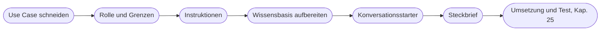

# Kapitel 24 – Aufbau eines KI-Marketingassistenten I: Konzeption

{{ progress(24) }}

<div class="lernziele" markdown>
<h3>Was du in diesem Kapitel lernst</h3>

- Wie du einen **Use Case** so zuschneidest, dass ein Assistent ihn verlässlich erfüllen kann
- Wie du **Rolle und Grenzen** festlegst: was der Assistent tut, was nicht und wann er nachfragt
- Nach welcher **Struktur** du Instruktionen schreibst – und warum Reihenfolge und Eindeutigkeit zählen
- Wie du eine **Wissensbasis** vorbereitest: welche Dateien, welche Formate, welche Aufbereitung
- Wozu **Konversationsstarter** dienen und wie gute aussehen
- Wie du alles in einem **Assistenten-Steckbrief** bündelst, der in jedem Werkzeug funktioniert
</div>

---

## 24.1 Den Use Case schneiden

Die meisten Assistenten scheitern nicht an schlechten Instruktionen, sondern an einem schlecht geschnittenen Auftrag. „Hilft beim Marketing" ist kein Use Case. „Schreibt Produkttexte für neue Artikel im Fjordlicht-Webshop auf Basis des Produktdatenblatts" ist einer.

Ein guter Zuschnitt beantwortet vier Fragen: **Wer** nutzt den Assistenten, **wofür** genau, **mit welchem Material** als Eingabe und **was** soll am Ende herauskommen? Wenn du eine dieser Fragen nicht in einem Satz beantworten kannst, ist der Use Case noch zu breit.

| Zuschnitt | Beispiel | Problem |
|---|---|---|
| zu breit | „Marketing-Assistent für Fjordlicht" | widersprüchliche Regeln für Kanäle, kaum testbar |
| zu eng | „Schreibt den Produkttext für die Regenjacke Sølv" | einmalige Aufgabe, ein Prompt reicht |
| passend | „Schreibt Produkttexte für neue Webshop-Artikel aus dem Datenblatt" | klare Eingabe, klares Ergebnis, wiederkehrend |
| passend | „Prüft fertige Texte gegen Styleguide und Claim-Liste" | eine Prüfaufgabe mit festen Kriterien |

Die beiden passenden Beispiele zeigen ein nützliches Muster: Viele Marketingassistenten haben einen **Schreibmodus** und einen **Prüfmodus**. Beide können in einem Assistenten stecken, solange sie dieselbe Wissensbasis nutzen. Wie das in einem vollständigen Fall aussieht, zeigt der Content-Assistent von Fjordlicht mit seinem Prüfmodus „Claim-Check" in Kap. 26.

Für den Zuschnitt eignet sich die KI selbst als Sparringspartner. Der Rückfragen-Prompt aus Kap. 7 dreht dabei die Rollen um: Nicht du beschreibst alles auf einmal, sondern das Werkzeug fragt nach, bis der Zweck klar ist.

```text
Ich möchte einen KI-Assistenten für unser Marketingteam konzipieren.
Meine erste Idee: [Idee in einem Satz].
Stelle mir nacheinander Fragen, bis du Folgendes eindeutig beantworten
kannst: Wer nutzt den Assistenten? Wofür genau? Welche Eingabe liefern
die Nutzenden? Welches Ergebnis soll entstehen? Was soll er ausdrücklich
nicht tun? Stelle immer nur eine Frage pro Nachricht.
Fasse danach den Zweck in genau einem Satz zusammen und nenne Aufgaben,
die du für einen eigenen Assistenten abtrennen würdest.
```

Wichtig ist der letzte Satz des Prompts: Er macht sichtbar, wo deine Idee eigentlich zwei oder drei Assistenten sind.

!!! info "Merksatz"
    **Ein Assistent, eine Aufgabenfamilie.** Wenn zwei Aufgaben unterschiedliche Regeln, unterschiedliches Wissen oder unterschiedliche Nutzergruppen brauchen, sind es zwei Assistenten.

---

## 24.2 Rolle und Grenzen festlegen

Die Rolle eines Assistenten ist mehr als „Du bist ein erfahrener Texter". Sie legt fest, **was er tun darf, was er nicht tun darf und wann er sich zurückmeldet**. Gerade der dritte Punkt wird oft vergessen. Ein Assistent ohne Rückfrageregel füllt jede Lücke mit Wahrscheinlichem – bei Produkttexten heißt das: erfundene Materialangaben, Gewichte, Pflegehinweise.

| Darf | Darf nicht | Fragt nach bzw. markiert |
|---|---|---|
| Produkttexte aus dem Datenblatt schreiben | Produktdaten ergänzen, die nicht im Datenblatt stehen | fehlende Angaben als `[FEHLT: …]` |
| Varianten in Länge und Fokus liefern | Nachhaltigkeitsaussagen ohne Beleg in der Claim-Liste | Aussage nicht in Claim-Liste: `[CLAIM PRÜFEN]` |
| Texte kürzen oder umformulieren | Preise, Rabatte, Lieferzeiten nennen | Zielgruppe unklar: eine Rückfrage vor dem Schreiben |
| auf Styleguide-Regeln hinweisen | Konkurrenzprodukte bewerten | Anfrage außerhalb des Zwecks: freundlich ablehnen und erklären |

!!! warning "Typische Falle"
    Rollen wie „Du bist der beste Werbetexter der Welt" bringen nichts (Kap. 7). Wirksam ist eine Rolle, die eine **Perspektive und einen Maßstab** liefert: „Du schreibst Produkttexte für Fjordlicht. Maßstab ist der Styleguide; im Zweifel gilt: lieber nüchtern als übertrieben."

---

## 24.3 Instruktionen schreiben

Instruktionen sind der Kern des Assistenten. Sie werden bei jeder Anfrage mitgelesen, ohne dass die Nutzenden sie sehen. Deshalb müssen sie **vollständig, eindeutig und gut gegliedert** sein. Bewährt hat sich eine feste Reihenfolge mit Markdown-Überschriften – das Modell erkennt Abschnitte, und du findest Stellen beim Überarbeiten schneller wieder.

| Abschnitt | Inhalt | Bezug |
|---|---|---|
| Rolle und Ziel | wer der Assistent ist, wozu er da ist | Persona, Purpose (Kap. 5) |
| Nutzende und Kontext | wer ihn bedient, Unternehmen, Zielgruppe | Purpose |
| Arbeitsablauf | Schritte von der Anfrage bis zur Ausgabe | Request |
| Regeln und No-Gos | Markenstimme, verbotene Aussagen, Prioritäten | Modifier, Tone |
| Umgang mit Wissen | welche Datei wofür, was bei Widerspruch gilt | Modifier |
| Ausgabeformat | Aufbau, Länge, Markierungen | Output |
| Grenzen | Ablehnung, Rückfragen, Lücken | Modifier |

So sieht eine kompakte Fassung für den Produkttext-Assistenten aus:

```text
# Rolle und Ziel
Du schreibst Produkttexte für den Webshop von Fjordlicht, einer Marke
für nachhaltige Outdoor-Bekleidung aus Münster. Ziel: Texte, die
informieren und zur Marke passen, nicht überreden.

# Nutzende
Mitarbeitende im Marketing. Sie liefern ein Produktdatenblatt oder
Stichpunkte und nennen optional Zielgruppe und Fokus.

# Arbeitsablauf
1. Prüfe, ob Produktname, Material, Einsatzbereich und Pflege vorliegen.
2. Fehlt die Zielgruppe, stelle genau eine Rückfrage.
3. Schreibe den Text nach dem Ausgabeformat.
4. Prüfe jede Nachhaltigkeitsaussage gegen die Datei Claim-Liste.

# Regeln
- Markenstimme laut Styleguide: ruhig, ehrlich, naturverbunden,
  leicht nordisch-trocken, Du-Ansprache.
- Keine Superlative, keine Ausrufezeichen, keine Werbefloskeln.
- Nachhaltigkeit nur, wenn die Aussage wörtlich oder sinngemäß in der
  Claim-Liste steht. Sonst: [CLAIM PRÜFEN: Aussage].
- Keine Preise, Rabatte oder Lieferzeiten.

# Umgang mit Wissen
- Styleguide: Ton und Wortwahl. Produktdaten: alle Fakten.
- Bei Widerspruch zwischen Anfrage und Produktdaten: Widerspruch nennen,
  nicht entscheiden.

# Ausgabeformat
Überschrift (max. 8 Wörter), Einleitung (2 Sätze),
3 bis 5 Stichpunkte zu Eigenschaften, Pflegehinweis (1 Satz).
Fehlende Angaben als [FEHLT: ...].

# Grenzen
Anfragen außerhalb von Produkttexten lehnst du freundlich ab und
verweist auf das Marketingteam.
```

!!! tip "Prioritäten ausdrücklich machen"
    Regeln kollidieren. „Halte dich kurz" und „nenne alle Eigenschaften" passen nicht immer zusammen. Schreib dazu, was im Zweifel gilt – etwa: „Richtigkeit vor Vollständigkeit vor Kürze." Ohne diese Angabe entscheidet das Modell jedes Mal anders.

Drei Regeln für das Schreiben: Formuliere **positiv**, was gelten soll, und ergänze Verbote nur dort, wo sie nötig sind. Kopiere **kein Wissen** in die Instruktionen – Produktdaten gehören in eine Datei, nicht in die Regeln. Und halte die Instruktionen **so kurz wie möglich, so lang wie nötig**: Werkzeuge haben Zeichenbegrenzungen, die je nach Anbieter unterschiedlich ausfallen, und jede überflüssige Zeile verdünnt die wichtigen.

---

## 24.4 Die Wissensbasis vorbereiten

Wissensdateien liefern dem Assistenten Fakten und Beispiele. Technisch wird bei einer Anfrage nach passenden Abschnitten gesucht, und nur diese fließen in die Antwort ein (genauer in Kap. 28). Daraus folgt: Der Assistent findet nur, was **klar gegliedert und eindeutig benannt** ist.

**Was hineingehört:** Styleguide bzw. Markenstimme, Produktdaten, Claim-Liste mit belegbaren Aussagen, zwei bis fünf freigegebene Beispieltexte, gegebenenfalls ein Glossar mit Fachbegriffen und Schreibweisen (Sølv, nicht Solv).

**Was nicht hineingehört:** personenbezogene Daten (Kundenlisten, CRM-Exporte), vertrauliche Informationen (Einkaufspreise, Margen, Strategiepapiere), veraltete Versionen neben aktuellen, ganze Ordner „zur Sicherheit". Alles, was im Wissen liegt, kann über geschickte Fragen auch wieder herausgeholt werden (Kap. 28).

| Format | Eignung | Hinweis |
|---|---|---|
| TXT / Markdown | sehr gut | klare Überschriften, kein Layout-Ballast |
| DOCX | gut | Überschriftenformate nutzen, keine Textfelder |
| PDF (mit Text) | mittel | Spalten, Kopfzeilen und Tabellen werden oft zerstückelt |
| PDF (Scan) | schlecht | Text muss erst erkannt werden, Fehler häufig |
| CSV / XLSX | gut für Daten | eine Zeile pro Produkt, sprechende Spaltennamen, ein Tabellenblatt |
| PPTX | schlecht | Stichworte ohne Zusammenhang |

!!! example "Aufbereitung vorher – nachher"
    **Vorher:** Ein 40-seitiges Marken-PDF mit Moodbildern, Zitaten der Gründer, Farbcodes, Schriftarten und – auf Seite 31 – zwei Absätzen zur Tonalität.

    **Nachher:** `Fjordlicht_Markenstimme_2026-10.md` mit fünf Abschnitten: Grundhaltung, Wortwahl (bevorzugt / vermieden), Satzbau, Anrede, drei Beispielsätze vorher/nachher. Zwei Seiten statt vierzig, und jede Regel ist auffindbar.

Gib jeder Datei einen **sprechenden Namen mit Datum** und schreib oben in die Datei, wofür sie gilt. Beispieltexte kennzeichnest du ausdrücklich: „Gutes Beispiel" bzw. „So nicht – Grund: Superlativ". Ohne diese Kennzeichnung behandelt der Assistent auch schlechte Beispiele als Vorbild (Kap. 6).

---

## 24.5 Konversationsstarter und Beschreibung

Der Gesprächseinstieg entscheidet, ob Kolleginnen und Kollegen den Assistenten richtig nutzen. Bei Custom GPTs heißen die vorbereiteten Einstiegsknöpfe **Konversationsstarter**; in anderen Werkzeugen übernehmen eine kurze Beschreibung, eine angeheftete Kurzanleitung oder ein Startprompt in der Prompt-Bibliothek diese Aufgabe.

Gute Konversationsstarter erfüllen drei Funktionen: Sie **zeigen, was der Assistent kann**, sie **liefern das richtige Eingabeformat** gleich mit, und sie **decken die wichtigsten Modi** ab.

```text
Produkttext aus Datenblatt: Ich füge das Datenblatt ein, du fragst nach
der Zielgruppe und schreibst dann.

Bestehenden Produkttext kürzen auf [Anzahl] Wörter.

Prüfe diesen Text gegen Styleguide und Claim-Liste: [Text]

Was kannst du - und was nicht?
```

Der letzte Starter ist kein Scherz: Er zwingt dich, in den Instruktionen eine klare Selbstbeschreibung zu hinterlegen, und neue Teammitglieder lernen in einer Antwort die Grenzen kennen.

Schwache Starter erkennst du daran, dass sie nichts verraten: „Hallo!", „Hilf mir beim Marketing" oder „Schreib was Schönes". Sie führen zu Anfragen ohne Material – und damit genau zu den generischen Ergebnissen, die der Assistent eigentlich verhindern soll. Die **Beschreibung** des Assistenten (ein bis zwei Sätze, sichtbar für alle Nutzenden) ergänzt die Starter: Sie nennt Zweck, benötigte Eingabe und die wichtigste Grenze, etwa „Schreibt Produkttexte aus dem Datenblatt. Erfindet keine Produktdaten – fehlende Angaben werden markiert."

---

## 24.6 Alles in den Assistenten-Steckbrief

Bevor du irgendein Werkzeug öffnest, bündelst du die Konzeption in einem **Steckbrief** (Kap. 23). Er ist das Original, das du später in den GPT-Editor, ein Plugin, ein Projekt, ein Gem oder einen Copilot Agent überträgst – und das bei der nächsten Produktumstellung übrig bleibt.

| Feld | Inhalt |
|---|---|
| Name und Version | z. B. „Produkttext-Assistent v0.1" |
| Zweck | ein Satz: wer, wofür, mit welcher Eingabe, welches Ergebnis |
| Nutzende | Personen bzw. Rollen |
| Instruktionen | Volltext nach Abschnitt 24.3 |
| Wissensdateien | Dateiname, Inhalt, Stand, verantwortliche Person |
| Werkzeuge | was eingeschaltet ist und warum – und was bewusst aus bleibt |
| Konversationsstarter | drei bis vier |
| Testfälle | mindestens zehn, Grundlage für Kap. 25 |
| Verantwortlich | wer pflegt, wer gibt frei |



!!! info "Merksatz"
    **Erst konzipieren, dann klicken.** Wer direkt im Editor anfängt, baut den Assistenten um die Oberfläche herum – wer mit dem Steckbrief anfängt, baut ihn um die Aufgabe herum.

---

## Zusammenfassung

- Ein guter Use Case beantwortet in je einem Satz: **wer, wofür, mit welcher Eingabe, welches Ergebnis**; zu breite Assistenten sind kaum testbar.
- Rolle heißt nicht Selbstlob, sondern **Perspektive, Maßstab und Grenzen** – inklusive Regel für Rückfragen und fehlende Angaben.
- Instruktionen folgen einer festen Struktur: Rolle und Ziel, Nutzende, Arbeitsablauf, Regeln, Umgang mit Wissen, Ausgabeformat, Grenzen; **Prioritäten** werden ausdrücklich genannt.
- Die **Wissensbasis** besteht aus wenigen, aktuellen, klar gegliederten Dateien mit sprechenden Namen; Textformate schlagen Layout-PDFs, personenbezogene und vertrauliche Daten bleiben draußen.
- **Konversationsstarter** zeigen, was der Assistent kann, und liefern das richtige Eingabeformat mit.
- Der **Assistenten-Steckbrief** bündelt alles werkzeugunabhängig und ist die Grundlage für Umsetzung und Test.

---

## Kurzübungen

{{ task(file="tasks/k24_01.yaml") }}

{{ task(file="tasks/k24_02.yaml") }}

{{ task(file="tasks/k24_03.yaml") }}

---

## Workshop

{{ task(file="tasks/workshop_k24.yaml") }}
