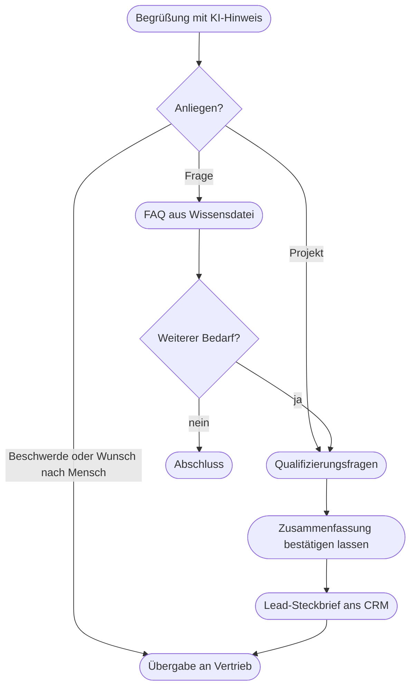
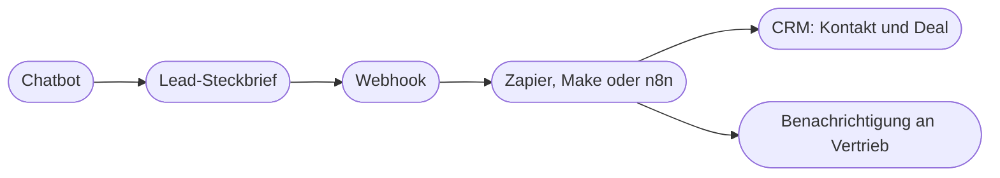

# Kapitel 27 – Praxisbeispiel CRM-Chatbot

{{ progress(27) }}

<div class="lernziele" markdown>
<h3>Was du in diesem Kapitel lernst</h3>

- Wie ein Chatbot **Anfragen vorqualifiziert**, FAQ beantwortet und dabei Grenzen einhält
- Wie ein **Gesprächsleitfaden** für die Lead-Qualifizierung aufgebaut ist
- Wie ein **Lead-Steckbrief** aussieht, den ein CRM direkt übernehmen kann
- Welche Wege es gibt, den Bot an ein **CRM** anzubinden – von Copy-and-paste bis **Actions, Apps, MCP** und **Zapier/Make/n8n**
- Was die **Transparenzpflicht nach Art. 50 Abs. 1 AI Act** und die **DSGVO** für einen Kundenchatbot bedeuten
- Wann und wie der Bot an einen **Menschen übergibt**
</div>

---

## 27.1 Ausgangslage: zu viele Anfragen, zu wenig Zeit

Fjordlicht Business verkauft Firmenbekleidung mit Logo-Veredelung: Regenjacken für Gärtnereien, Fleecejacken für Architekturbüros, Softshells für Kitas. Die Anfragen kommen über das Kontaktformular, per E-Mail und über LinkedIn. Zwei Personen im Vertrieb beantworten sie. Das Problem: Etwa die Hälfte der Anfragen sind Standardfragen („Gibt es eine Mindestmenge?"), und bei den echten Projekten fehlen fast immer die Angaben, die für ein Angebot nötig sind. Der Vertrieb verbringt die ersten zwei Mails jeder Anfrage mit Nachfragen.

Der **CRM-Chatbot** soll drei Dinge leisten: häufige Fragen beantworten, Projektanfragen strukturiert vorqualifizieren und das Ergebnis als **Lead-Steckbrief** an das CRM übergeben. Angebote, Preise und Zusagen bleiben beim Vertrieb.

| Aufgabe | Chatbot | Vertrieb |
|---|---|---|
| FAQ (Mindestmengen, Veredelung, Lieferzeiten laut FAQ-Datei) | ja | – |
| Bedarf erfragen und zusammenfassen | ja | prüft |
| Lead-Stufe vorschlagen | ja | entscheidet |
| Preise, Rabatte, verbindliche Termine | nein | ja |
| Beschwerden, Reklamationen | nein, Übergabe | ja |
| Angebot erstellen | nein | ja |

Wichtig zur Einordnung: Ein Custom GPT oder Plugin läuft innerhalb von ChatGPT. Kundinnen und Kunden auf der Fjordlicht-Website erreichst du damit nicht direkt. Fjordlicht hat deshalb in zwei Stufen gearbeitet: **Prototyp** als Custom GPT, um Leitfaden, Instruktionen und Steckbrief zu testen; danach **Produktivbetrieb** über eine Chatbot-Funktion des CRM bzw. eine Chatbot-Plattform, in die dieselben Instruktionen und Wissensdateien übernommen wurden. Die konzeptionelle Arbeit – um die es hier geht – ist in beiden Stufen dieselbe.

---

## 27.2 Ablauf und Gesprächsleitfaden



Die Qualifizierung folgt einem festen Leitfaden. Der Bot stellt **eine Frage pro Nachricht**, nicht fünf auf einmal – sonst beantworten Menschen nur die erste.

| Schritt | Frage des Bots (sinngemäß) | Feld im Steckbrief |
|---|---|---|
| 1 | Für welches Unternehmen fragst du an, und in welcher Branche seid ihr tätig? | Firma, Branche |
| 2 | Wofür soll die Bekleidung eingesetzt werden – draußen, im Büro, bei Events? | Einsatzzweck |
| 3 | An welche Produkte denkst du, und für wie viele Personen ungefähr? | Produkte, Menge |
| 4 | Soll ein Logo aufgebracht werden? | Veredelung |
| 5 | Bis wann braucht ihr die Ware? | Zeitrahmen |
| 6 | Wer entscheidet über die Bestellung, und wie erreichen wir dich am besten? | Rolle, Kontakt |

Daraus leitet der Bot einen Vorschlag für die **Lead-Stufe** ab. Die Kriterien stehen in einer Wissensdatei, damit der Vertrieb sie ändern kann, ohne die Instruktionen anzufassen (fiktive Werte):

| Stufe | Kriterien | Reaktion Vertrieb |
|---|---|---|
| A | ab 25 Teilen, Zeitrahmen unter drei Monaten, Ansprechperson entscheidet mit | Rückruf innerhalb eines Werktags |
| B | ab 25 Teilen, Zeitrahmen offen oder Entscheidung liegt woanders | Mail mit Katalog, Nachfass nach einer Woche |
| C | unter 25 Teilen oder reine Information | Verweis auf Webshop, kein aktiver Kontakt |

!!! warning "Typische Falle"
    Der Bot qualifiziert **zu hart**. In den ersten Tests stufte er eine Kita mit 18 Mitarbeitenden als C ein – obwohl sie für drei Standorte anfragte. Lösung: Der Bot schlägt die Stufe nur vor und begründet sie; entscheiden tut der Vertrieb. Und die Frage nach der Menge lautet „für wie viele Personen insgesamt".

---

## 27.3 Der Lead-Steckbrief: strukturierte Übergabe

Damit ein CRM die Daten übernehmen kann, braucht es feste Feldnamen in fester Reihenfolge. Der Bot erzeugt am Ende jeder Qualifizierung diesen Block:

```text
LEAD-STECKBRIEF
firma: Gärtnerei Hollmann GmbH
branche: Garten- und Landschaftsbau
einsatzzweck: Außeneinsatz ganzjährig, Regen und Kälte
produkte: Regenjacke Sølv, Fleece Skog
menge: ca. 40 Personen
veredelung: Logo Brust links, 1-farbig
zeitrahmen: bis Ende Februar
rolle_anfragende: Geschäftsführerin, entscheidet
kontakt_weg: Telefon, vormittags
lead_stufe_vorschlag: A
begründung: Menge über 25, Zeitrahmen unter drei Monaten, entscheidet selbst
offene_punkte: Größenverteilung, Logo-Datei
einwilligung_kontakt: ja
```

Die Instruktionen für diesen Teil sind knapp und verbindlich. Ein Auszug:

```text
# Lead-Steckbrief
Erzeuge den LEAD-STECKBRIEF erst, wenn die Person der Zusammenfassung
zugestimmt hat. Verwende exakt die Feldnamen und die Reihenfolge aus
steckbrief_vorlage.txt. Fehlt eine Angabe, schreibe "offen". Erfinde nichts.
Schlage eine lead_stufe_vorschlag nach lead-kriterien.md vor und begründe
sie in einem Satz. Nimm keine Angaben auf, die nicht für das Angebot nötig
sind (keine Geburtsdaten, keine privaten Adressen, keine Gesundheitsangaben).
```

!!! tip "Erst bestätigen, dann übergeben"
    Der Schritt „Zusammenfassung bestätigen lassen" ist kein Höflichkeitsritual. Er fängt Missverständnisse ab, bevor sie im CRM landen, und er gibt der Person die Kontrolle über das, was gespeichert wird.

---

## 27.4 Anbindung an das CRM

Wie kommt der Steckbrief ins CRM? Es gibt vier Stufen, von einfach bis vollautomatisch. Die technische Umsetzung ist nicht Teil dieses Kurses; du solltest die Varianten aber unterscheiden und mit der IT besprechen können.

| Variante | Wie es funktioniert | Aufwand | Geeignet für |
|---|---|---|---|
| Copy-and-paste | Vertrieb kopiert den Steckbrief ins CRM | keiner | Prototyp, wenige Anfragen |
| E-Mail-Weiterleitung | Bot-Plattform sendet Steckbrief an ein Postfach, CRM liest es ein | gering | kleine Teams |
| Automatisierung | Webhook an Zapier, Make oder n8n; dort werden Felder dem CRM zugeordnet | mittel | regelmäßiger Betrieb |
| Direkte Anbindung | Custom Action (OpenAPI), App bzw. MCP-Server oder native CRM-Integration | hoch, IT nötig | hohe Volumina |



Zwei Hinweise zur Plattformabhängigkeit: **Custom Actions** werden bei der Migration von Custom GPTs zu Plugins nicht übertragen und müssen gegebenenfalls als App oder MCP-Server neu gebaut werden (Kap. 28). Und **MCP** (Model Context Protocol) ist ein offener Standard, über den KI-Assistenten auf externe Werkzeuge zugreifen – er wird von mehreren Anbietern unterstützt und macht dich unabhängiger von einer einzelnen Plattform. Fjordlicht hat sich deshalb für den Weg über eine Automatisierungsplattform entschieden: Der Steckbrief ist das Bindeglied, und er bleibt gleich, egal welcher Chatbot ihn erzeugt.

!!! info "Merksatz"
    Das wichtigste Integrationswerkzeug ist das **feste Format**. Ein sauber strukturierter Steckbrief lässt sich auf jedem Weg ins CRM bringen; ein Freitext lässt sich auf keinem Weg zuverlässig verarbeiten.

---

## 27.5 Transparenz, Datenschutz und die Übergabe an Menschen

**Transparenz.** Seit dem 02.08.2026 gilt Art. 50 Abs. 1 AI Act: Menschen müssen erkennen können, dass sie mit einem KI-System interagieren, sofern das nicht offensichtlich ist. Die Pflicht trifft den Anbieter des Systems; für dich als Betreiber heißt das praktisch: Die Plattform muss den Hinweis ermöglichen, und du solltest ihn nicht wegkonfigurieren. Fjordlichts Bot beginnt jedes Gespräch so:

```text
Hallo, ich bin der digitale Assistent von Fjordlicht Business – eine KI,
kein Mensch. Ich beantworte Fragen zu Firmenbekleidung und nehme deine
Anfrage für unser Vertriebsteam auf. Du kannst jederzeit "Mensch" schreiben,
dann meldet sich jemand aus dem Team bei dir.
```

**Datenschutz.** Ein Kundenchatbot verarbeitet personenbezogene Daten. Die Grundregeln aus Kap. 4 gelten hier ganz konkret:

- Hinweis auf die Datenschutzerklärung zu Beginn; dort ist der Chatbot beschrieben.
- **Datenminimierung**: nur Felder, die für das Angebot nötig sind.
- Betrieb nur mit einem Business- oder Enterprise-Tarif bzw. einer Plattform mit Auftragsverarbeitungsvertrag (AVV); keine Nutzung der Eingaben zum Training.
- Löschfristen für Gesprächsprotokolle festlegen, nicht „für immer" speichern.
- Keine sensiblen Daten erfragen; wenn jemand sie ungefragt nennt, nicht in den Steckbrief übernehmen.

**Übergabe an Menschen.** Der Bot muss erkennen, wann er aufhört. Diese Auslöser stehen in den Instruktionen:

| Auslöser | Reaktion des Bots |
|---|---|
| Person schreibt „Mensch" oder fragt nach Ansprechperson | sofortige Übergabe, Steckbrief mit bisherigen Angaben |
| Beschwerde, Reklamation, Ärger | kurze Entschuldigung, Übergabe, keine Lösungsversprechen |
| Frage nach Preis, Rabatt, Sonderkonditionen | Hinweis, dass der Vertrieb ein Angebot erstellt |
| Frage, die nicht in den Wissensdateien beantwortet ist | ehrlich sagen, Übergabe anbieten |
| dreimal Missverständnis im selben Gespräch | Übergabe anbieten |

!!! warning "Typische Falle"
    Ein Chatbot, der etwas zusagt, sagt es im Namen des Unternehmens zu. 2024 musste eine kanadische Fluggesellschaft eine Erstattung zahlen, die ihr Chatbot falsch in Aussicht gestellt hatte. Deshalb: keine Preise, keine Rabatte, keine verbindlichen Termine – und Lieferzeiten nur so, wie sie in der FAQ-Datei stehen.

Dieses Kapitel gibt Orientierung, keine Rechtsberatung. Vor dem Livegang eines Kundenchatbots gehören Datenschutzbeauftragte und gegebenenfalls Rechtsabteilung an den Tisch.

---

## 27.6 Testen und messen

Vor dem Livegang hat Fjordlicht den Bot mit 20 Testgesprächen geprüft, darunter Fallen: eine Anfrage auf Englisch, eine Preisverhandlung („Bei 200 Stück gibt's doch sicher 20 Prozent?"), eine Beschwerde, ein Versuch, die Instruktionen auszulesen, und eine Person, die mitten im Gespräch ihre Meinung ändert. Für den laufenden Betrieb beobachtet das Team vier Kennzahlen:

| Kennzahl | Was sie zeigt | Zielwert (Fjordlicht) |
|---|---|---|
| Vollständigkeit der Steckbriefe | Anteil der Pflichtfelder, die nicht „offen" sind | über 80 % |
| Übereinstimmung Lead-Stufe | wie oft der Vertrieb den Vorschlag übernimmt | über 70 % |
| Übergabequote | Anteil der Gespräche, die an Menschen gehen | beobachten, nicht minimieren |
| Fehlantworten FAQ | stichprobenartig geprüft, wöchentlich 20 Gespräche | null bei Preisen und Fristen |

Aus den ersten vier Wochen im Betrieb hat Fjordlicht drei Lehren gezogen. Erstens: Die meisten Korrekturen betrafen nicht die Instruktionen, sondern die **FAQ-Datei** – Fragen, die niemand vorhergesehen hatte, etwa zu Sammelbestellungen für mehrere Standorte. Zweitens: Der Vertrieb übernahm den Lead-Stufen-Vorschlag eher, seit der Bot jede Stufe in einem Satz begründet. Drittens: Die Zeit bis zum ersten Angebot sank deutlich, weil die Nachfrage-Mails wegfielen; die Zahl der Abschlüsse dagegen hängt weiter an Produkt, Preis und Beratung. Ein Chatbot macht den Vertrieb schneller, nicht überflüssig.

!!! tip "Übergabequote ist kein Misserfolg"
    Eine niedrige Übergabequote sieht gut aus, kann aber bedeuten, dass der Bot Fälle behält, die er abgeben sollte. Prüfe immer stichprobenartig Gespräche **ohne** Übergabe.

---

## Zusammenfassung

- Der CRM-Chatbot übernimmt **FAQ, Vorqualifizierung und Übergabe** – Preise, Zusagen und Angebote bleiben beim Vertrieb.
- Ein **Gesprächsleitfaden** mit einer Frage pro Nachricht und eine **Bestätigung der Zusammenfassung** sichern die Datenqualität.
- Der **Lead-Steckbrief** mit festen Feldnamen ist das Bindeglied zu jedem CRM, egal über welchen Weg.
- Anbindung reicht von Copy-and-paste über **Zapier/Make/n8n** bis zu **Actions, Apps oder MCP**; Custom Actions sind von der Plugin-Migration betroffen.
- **Art. 50 Abs. 1 AI Act** verlangt erkennbaren KI-Hinweis; die **DSGVO** verlangt Datenminimierung, AVV und Löschfristen.
- Klare **Übergabe-Auslöser** und Stichproben schützen vor Zusagen, die das Unternehmen binden.

---

## Kurzübungen

{{ task(file="tasks/k27_01.yaml") }}

{{ task(file="tasks/k27_02.yaml") }}

{{ task(file="tasks/k27_03.yaml") }}

---

## Workshop

{{ task(file="tasks/workshop_k27.yaml") }}
