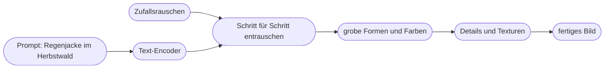

# Kapitel 29 – Wie Bild-KI funktioniert

{{ progress(29) }}

<h3>Was du in diesem Kapitel lernst</h3>

- Was eine Bild-KI tatsächlich tut – und warum sie **keine Bilddatenbank** ist, aus der etwas herausgesucht wird
- Wie **Diffusionsmodelle** aus Rauschen ein Bild formen und was das für deine Prompts bedeutet
- Was **autoregressive** und **multimodale Bildmodelle** anders machen und warum ChatGPT Images im Gespräch so gut nachbessert
- Die drei Arbeitsmodi **Text-zu-Bild, Bild-zu-Bild und Bearbeitung** und ihre typischen Marketing-Einsätze
- Die **Werkzeuglandschaft** im Herbst 2026: ChatGPT Images, Midjourney, Ideogram, Adobe Firefly, Google und FLUX
- Nach welchen **Kriterien** du ein Bildwerkzeug für dein Team auswählst – jenseits von „sieht schön aus"

---

## 29.1 Was Bild-KI eigentlich tut

Mit Block 6 wechselst du vom Text zum Bild. Das Grundprinzip kennst du schon aus Kap. 1: Ein Modell lernt aus sehr vielen Beispielen statistische Muster und erzeugt daraus etwas Neues. Bei Sprachmodellen sind die Beispiele Texte, bei Bildmodellen sind es **Bild-Text-Paare** – Milliarden von Bildern mit Beschreibungen, Alt-Texten oder Bildunterschriften.

Daraus lernt das Modell, welche visuellen Merkmale mit welchen Wörtern zusammenhängen: wie „Regen" aussieht, wie „Gegenlicht" wirkt, was ein „Weitwinkel" mit einem Raum macht, wie „Aquarell" sich von „Studiofoto" unterscheidet. Ein fertiges Bild ist deshalb **keine Collage** aus gespeicherten Fotos und kein Treffer aus einer Datenbank, sondern eine Neuberechnung, die zu deiner Beschreibung statistisch passt.

| Verbreitete Annahme | Was tatsächlich passiert | Folge für die Praxis |
|---|---|---|
| „Die KI sucht passende Bilder im Netz." | Das Modell berechnet ein neues Bild aus gelernten Mustern. | Es gibt kein „Original", das du nachschlagen kannst. |
| „Die KI kennt unsere Regenjacke." | Sie kennt nur, wie Regenjacken **im Allgemeinen** aussehen. | Echte Produkte werden nicht detailgetreu dargestellt (Kap. 33, 34). |
| „Mehr Wörter ergeben ein besseres Bild." | Wörter wirken unterschiedlich stark, manche werden ignoriert. | Wichtiges zuerst und eindeutig benennen (Kap. 30). |
| „Gleicher Prompt, gleiches Bild." | Jede Generierung startet mit neuem Zufall. | Ergebnisse schwanken, Serien brauchen Referenzen (Kap. 33). |

!!! info "Merksatz"
    Bild-KI **erfindet plausibel**, sie bildet nicht ab. Alles, was im Bild real stimmen muss – Produktdetails, Logos, Gesichter echter Menschen, Orte – ist genau das, was sie am wenigsten zuverlässig liefert.

Weil die Muster aus Trainingsdaten stammen, erbt das Modell auch deren Schlagseite. Fragst du nach „Wanderer", bekommst du ohne weitere Angaben häufig sehr ähnliche Typen – jung, schlank, hell. Das ist **Bias** (Kap. 2), und im Bild ist er sofort sichtbar. Für Fjordlicht, deren Zielgruppen Familien und Stadtmenschen zwischen 25 und 45 sind, heißt das: Vielfalt muss man beschreiben, sie entsteht nicht von selbst. Ausführlich dazu Kap. 34.

---

## 29.2 Diffusionsmodelle: aus Rauschen wird ein Bild

Die meisten bekannten Bildgeneratoren der letzten Jahre basieren auf **Diffusionsmodellen** oder deren Weiterentwicklungen. Das Prinzip lässt sich ohne Mathematik verstehen.

**Training:** Man nimmt ein echtes Foto und fügt schrittweise Bildrauschen hinzu – so lange, bis nur noch grauer „Schnee" übrig ist. Das Modell lernt die Umkehrung: Es bekommt ein verrauschtes Bild plus die Beschreibung und soll vorhersagen, welches Rauschen entfernt werden muss, damit das Bild wieder ein Stück klarer wird.

**Generierung:** Beim Erzeugen startet das Modell mit reinem Zufallsrauschen und entfernt dieses in vielen kleinen Schritten. Bei jedem Schritt fragt es sinngemäß: „Wie müsste dieses Rauschen aussehen, wenn darin eine Regenjacke im Herbstwald steckt?" Dein Prompt wird dafür zuvor von einem **Text-Encoder** in eine Zahlenrepräsentation übersetzt, die jeden Schritt in die passende Richtung lenkt.

Damit das nicht unendlich viel Rechenleistung frisst, arbeiten moderne Verfahren in einem komprimierten Zwischenraum (**latenter Raum**) und rechnen erst am Ende in Pixel um. Varianten wie **Flow-Modelle**, die etwa bei FLUX zum Einsatz kommen, folgen demselben Grundgedanken: vom Zufall zum Bild, gesteuert durch den Text.

Drei Eigenschaften dieses Verfahrens begegnen dir im Alltag ständig:

- **Der Zufallsstart bestimmt viel.** Derselbe Prompt mit anderem Startrauschen ergibt ein anderes Bild. Manche Werkzeuge zeigen diese Startzahl als **Seed** an; mit gleichem Seed und gleichem Prompt kommst du nah an ein früheres Ergebnis heran.
- **Grobes entsteht vor Feinem.** Komposition und Farbverteilung stehen früh fest, Details kommen zuletzt. Deshalb sind kleine Details – Finger, Reißverschlüsse, Schrift – historisch die Schwachstellen.
- **Der Text lenkt, er befiehlt nicht.** Klassische Diffusionsmodelle verstehen Sprache nur so gut wie ihr Text-Encoder. Komplexe Satzlogik („links der Hund, rechts die Katze, die Katze trägt einen roten Schal") ging früher oft daneben.

**Bild-zu-Bild im Diffusionsprinzip:** Statt mit reinem Rauschen kann das Modell auch mit einem **teilweise verrauschten Vorlagebild** starten. Je weniger Rauschen hinzukommt, desto näher bleibt das Ergebnis an der Vorlage. Viele Werkzeuge bieten dafür einen Regler mit Namen wie „Stärke", „Ähnlichkeit" oder „Image Weight". So entsteht aus einer Bleistiftskizze für einen Kampagnenaufbau ein ausgearbeitetes Motiv mit derselben Komposition.

---

## 29.3 Autoregressive und multimodale Bildmodelle

Seit 2025 hat sich ein zweiter Ansatz durchgesetzt, vor allem bei den großen Chat-Anbietern. **Autoregressive** Modelle erzeugen ein Bild nicht durch Entrauschen, sondern **Stück für Stück**, ähnlich wie ein Sprachmodell Token für Token einen Text schreibt (Kap. 1). Das Bild wird dafür in kleine Bildbausteine zerlegt, die das Modell nacheinander vorhersagt.

Entscheidend für dich ist weniger das Verfahren als die Folge: Wenn Bilderzeugung **direkt im multimodalen Sprachmodell** steckt, versteht das Modell deinen Auftrag mit seiner vollen Sprachkompetenz und kennt den gesamten Gesprächsverlauf. OpenAI beschreibt **ChatGPT Images** (Modellfamilie „GPT Image") als eine solche nativ in das Modell integrierte Bildgenerierung; Googles Gemini-Bildmodelle, bekannt unter dem Namen „Nano Banana", gehen in eine ähnliche Richtung. In der Praxis arbeiten viele Systeme mit **Mischformen** – welche genau, legen die Anbieter nicht immer offen.

| Merkmal | Klassisches Diffusionsmodell | Multimodales Modell im Chat |
|---|---|---|
| Verständnis komplexer Anweisungen | begrenzt, Stichworte wirken oft besser | gut, auch lange Sätze und Bedingungen |
| Text im Bild | lange eine Schwäche | kurze Texte meist korrekt |
| Nachbessern | neuer Prompt, neues Bild | im Gespräch: „Mach den Himmel dunkler" |
| Bezug auf hochgeladene Bilder | über eigene Funktionen | direkt im Gespräch |
| Ästhetische Eigenständigkeit | oft hoch, starker „Look" | eher neutral, folgt dem Prompt |
| Geschwindigkeit | meist schnell | teils spürbar langsamer |

!!! tip "Was das für dein Prompting heißt"
    Bei Chat-Bildmodellen schreibst du in **ganzen Sätzen** und darfst Zusammenhänge erklären („Das Bild ist für einen Newsletter-Header, der Text kommt später links daneben, lass dort Ruhe im Bild"). Bei stark ästhetisch trainierten Diffusionswerkzeugen wie Midjourney funktionieren **knappe, präzise Beschreibungen plus Parameter** oft besser. Kap. 30 zeigt beide Schreibweisen.

Der Unterschied verschwimmt zunehmend: Auch Midjourney, Ideogram und Firefly verstehen 2026 deutlich mehr natürliche Sprache als noch vor zwei Jahren. Kurze Texte im Bild schreiben inzwischen alle großen Modelle meist korrekt – die Unterschiede zeigen sich bei **Layout und viel Text**.

---

## 29.4 Drei Arbeitsmodi: Text-zu-Bild, Bild-zu-Bild, Bearbeitung

Unabhängig vom Verfahren arbeitest du mit Bild-KI in drei Modi. Für Marketing ist der dritte oft der wertvollste – und der am meisten unterschätzte.

| Modus | Was du hineingibst | Was herauskommt | Typischer Marketing-Einsatz |
|---|---|---|---|
| **Text-zu-Bild** | nur einen Prompt | ein neues Bild | Moodboards, Stimmungsbilder, Illustrationen für den Blog |
| **Bild-zu-Bild** | Vorlage + Prompt | Variation mit übernommener Komposition oder übernommenem Stil | Skizze ausarbeiten, Stilreferenz übertragen, Variationen |
| **Bearbeitung** | vorhandenes Bild + Anweisung oder Markierung | verändertes Originalbild | Hintergrund erweitern, Störendes entfernen, Format anpassen |

Bei der Bearbeitung unterscheidest du drei Techniken, die in Kap. 33 vertieft werden:

- **Inpainting:** Du markierst einen Bereich und lässt nur diesen neu erzeugen – etwa ein Schild im Hintergrund entfernen.
- **Outpainting:** Das Bild wird über seinen Rand hinaus erweitert – etwa ein Hochformat für eine 16:9-Kopfgrafik verbreitern. In Photoshop heißt das „Generatives Erweitern", die Bereichsbearbeitung „Generative Fill" (deutsch „Generatives Füllen").
- **Anweisungsbasierte Bearbeitung:** Du beschreibst die Änderung in Worten, ohne zu markieren – „Ersetze den Sommerhimmel durch tief hängende Herbstwolken". Das ist die Stärke der Chat-Bildmodelle.

!!! warning "Typische Falle"
    Ein echtes Produktfoto wird per KI „verschönert": mehr Glanz auf dem Stoff, eine andere Farbe, eine Kapuze, die es so nicht gibt. Das Bild wirkt besser – und zeigt nicht mehr das Produkt, das Kundinnen und Kunden geliefert bekommen. Bearbeitung echter Produktbilder ist erlaubt, solange das **Produkt selbst unverändert** bleibt. Alles andere ist ein Irreführungsrisiko (UWG, Kap. 34).

---

## 29.5 Die Werkzeuglandschaft im Herbst 2026

Der Markt bewegt sich schnell. Versionsnummern veralten innerhalb weniger Monate; die folgende Übersicht gibt den **Stand Oktober 2026** wieder und beschreibt Stärken, die über Versionssprünge hinweg erstaunlich stabil geblieben sind.

| Werkzeug | Anbieter | Stärken | Zu beachten |
|---|---|---|---|
| **ChatGPT Images** (ehem. DALL·E) | OpenAI | Anweisungen präzise umsetzen, Bearbeitung im Gespräch, kurze Texte, für alle Nutzer verfügbar | eher neutraler Look; Kontotyp und Datenschutz wie beim Chat prüfen |
| **Midjourney** | Midjourney | starke Ästhetik und Art Direction, Stil- und Charakterreferenzen, viele Parameter | Bedienung über Web und Discord, keine offizielle API; Sichtbarkeit der Bilder je nach Plan |
| **Ideogram** | Ideogram | Typografie und Text im Bild, Plakat- und Grafiklayouts | für fotorealistische Szenen nicht immer erste Wahl |
| **Adobe Firefly** | Adobe | trainiert auf lizenzierten bzw. gemeinfreien Inhalten, als kommerziell abgesichert beworben, Content Credentials, in Photoshop und Express integriert | ästhetisch teils vorsichtiger; Partnermodelle in der Firefly-App gesondert prüfen |
| **Nano Banana / Gemini-Bildmodelle** | Google | Fotorealismus, Bearbeitung bestehender Bilder, in Gemini integriert | Bildherkunft wird über Wasserzeichen (SynthID) markiert |
| **FLUX** | Black Forest Labs (Freiburg) | hohe Bildqualität, in vielen Plattformen und Werkzeugen eingebaut, teils auch selbst betreibbar | Bedienung meist über Drittanbieter; deren Bedingungen gelten |

!!! info "DALL·E heißt heute ChatGPT Images"
    In vielen Kursunterlagen, Blogartikeln und Stellenanzeigen steht noch „DALL·E". Der offizielle DALL·E-GPT in ChatGPT wurde am **30.08.2026** eingestellt, auch über die API sind die DALL·E-Modelle nicht mehr verfügbar. Die Bildgenerierung in ChatGPT heißt **ChatGPT Images** und basiert auf der Modellfamilie **GPT Image**; aktuell ist Images 2.5 (seit 08.09.2026), verfügbar für alle Nutzer. In diesem Kurs schreiben wir deshalb „DALL·E (heute: ChatGPT Images)".

Daneben gibt es Bildfunktionen in Microsoft Copilot und Designer, in Canva, in Social-Media-Planungstools und in Shop-Systemen. Oft steckt dahinter eines der oben genannten Modelle. Für die Bewertung hilft deshalb die Frage: **Welches Modell läuft eigentlich im Hintergrund, und wessen Nutzungsbedingungen gelten?**

---

## 29.6 Auswahlkriterien: welches Werkzeug für welchen Zweck

„Welche Bild-KI ist die beste?" ist die falsche Frage. Die richtige lautet: **Welche ist für diesen Zweck, dieses Team und diese Rechtslage geeignet?** Die folgenden Kriterien helfen bei der Entscheidung.

| Kriterium | Prüffrage | Warum es zählt |
|---|---|---|
| **Bildqualität und Look** | Passt der typische Stil zu unserer Bildsprache? | Ein starker Eigen-Look kann Markenbilder überlagern (Kap. 32). |
| **Steuerbarkeit** | Setzt es Komposition, Perspektive und Details um, die wir vorgeben? | Für Kampagnen zählt Präzision mehr als Zufallstreffer. |
| **Text im Bild** | Braucht das Motiv Schrift, und wie viel? | Bei Plakaten und Grafiken entscheidend; sonst Text besser im Layout-Tool (Kap. 33). |
| **Bearbeitung** | Kann es bestehende Bilder verändern und erweitern? | Formatvarianten und Retusche sind Alltagsarbeit. |
| **Rechte und Nutzung** | Was sagen die Nutzungsbedingungen zur kommerziellen Nutzung? Gibt es Zusagen zur Haftung? | Grundlage für jede Veröffentlichung (Kap. 34, 39). |
| **Datenschutz und Vertraulichkeit** | Werden Uploads zum Training genutzt? Sind Bilder öffentlich sichtbar? | Unveröffentlichte Produkte gehören nicht in eine öffentliche Galerie. |
| **Integration** | Passt es in unsere Werkzeuge (Adobe, Canva, Chat-Lizenz)? | Was umständlich ist, wird nicht genutzt. |
| **Kosten und Lizenzmodell** | Abo, Credits, Team-Lizenz? Was kostet ein brauchbares Motiv realistisch? | Viele Versuche pro gutem Bild sind normal. |
| **Herkunftskennzeichnung** | Werden Content Credentials (C2PA) oder Wasserzeichen gesetzt? | Relevant für Transparenz und Plattformlabels (Kap. 34). |

!!! example "Fjordlicht entscheidet"
    Das Marketingteam von Fjordlicht hat bereits ChatGPT-Lizenzen (Business-Tarif) und Adobe Creative Cloud. Für schnelle Ideen und Moodboards nutzt es ChatGPT Images, für Retusche und Formaterweiterung Firefly in Photoshop. Midjourney wird für eine Herbstkampagne getestet, weil die Art Direktorin den Look schätzt – aber erst, nachdem geklärt ist, dass die Bilder im gewählten Plan nicht öffentlich sichtbar sind. Ideogram kommt für Infografiken im Blog „Draußen-Notizen" in Frage. **Produktfotos bleiben echte Fotos.**

!!! warning "Typische Falle"
    Ein Team wählt sein Werkzeug nach einem einzigen beeindruckenden Beispielbild aus einem Social-Media-Post. Solche Bilder sind ausgesucht, oft nachbearbeitet und selten mit dem Prompt nachvollziehbar. Teste Werkzeuge immer **mit deinem eigenen Briefing**, mehreren Durchläufen und den Kriterien oben – wie das geht, zeigt der Vergleichstest in Kap. 31.

---

## Zusammenfassung

- Bild-KI lernt aus Bild-Text-Paaren und **berechnet neue Bilder** – sie sucht nichts heraus und kennt eure echten Produkte nicht.
- **Diffusionsmodelle** formen ein Bild in vielen Schritten aus Zufallsrauschen; der Prompt lenkt, Grobes entsteht vor Feinem, der Zufallsstart (Seed) prägt das Ergebnis.
- **Autoregressive bzw. multimodale Modelle** wie ChatGPT Images erzeugen Bilder im Sprachmodell selbst: gutes Anweisungsverständnis, Bearbeitung im Gespräch, kurze Texte meist korrekt.
- Du arbeitest in drei Modi: **Text-zu-Bild, Bild-zu-Bild, Bearbeitung** (Inpainting, Outpainting, anweisungsbasiert) – echte Produkte dürfen dabei nicht verfälscht werden.
- Die Landschaft im Herbst 2026: **ChatGPT Images (ehem. DALL·E), Midjourney, Ideogram, Adobe Firefly, Google Nano Banana, FLUX** – mit jeweils eigenen Stärken.
- Werkzeuge wählst du nach **Zweck, Steuerbarkeit, Rechten, Datenschutz, Integration und Kosten**, nicht nach dem schönsten Beispielbild.

---

## Kurzübungen

{{ task(file="tasks/k29_01.yaml") }}

{{ task(file="tasks/k29_02.yaml") }}

{{ task(file="tasks/k29_03.yaml") }}

---

## Workshop

{{ task(file="tasks/workshop_k29.yaml") }}
