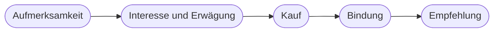

# Kapitel 3 – Generative KI im Marketing

{{ progress(3) }}

<div class="lernziele" markdown>
<h3>Was du in diesem Kapitel lernst</h3>

- Warum du KI-Einsatz von der **Aufgabe** her denkst und nicht vom Werkzeug
- Wo generative KI entlang der **Customer Journey** konkret ansetzt – von der Aufmerksamkeit bis zur Kundenbindung
- Wie die **Werkzeuglandschaft** für Text, Bild, Video, Audio und Assistenten aufgebaut ist (Stand: Oktober 2026)
- Wie eine sinnvolle **Rollenverteilung zwischen Mensch und KI** in einem Content-Prozess aussieht
- Wie du den **realistischen Nutzen** einschätzt – mit Zeitrechnung statt Bauchgefühl
- Wie du mit einem einfachen **Bewertungsraster** entscheidest, womit dein Team anfängt
</div>

---

## 3.1 Von der Aufgabe her denken, nicht vom Werkzeug

Die meisten Marketingteams steigen über ein Werkzeug ein: Jemand probiert ChatGPT aus, ist begeistert, und plötzlich soll „alles mit KI" laufen. Ein paar Wochen später ist die Bilanz gemischt – einige sparen viel Zeit, andere haben mehr Korrekturarbeit als vorher. Der Grund ist fast immer derselbe: Es wurde gefragt „Was kann das Werkzeug?" statt „Welche Aufgabe haben wir, und welcher Teil davon passt zu dem, was generative KI gut kann?"

In Kapitel 2 hast du gesehen, wo generative KI stark ist (Entwürfe, Varianten, Umformulieren, Strukturieren, Zusammenfassen) und wo sie schwach ist (Fakten, aktuelle Zahlen, Verlässlichkeit ohne Prüfung). Für das Marketing heißt das: KI ist ein hervorragender **Entwurfs- und Variantengenerator**, aber kein Ersatz für Strategie, Markenkenntnis und Verantwortung.

| Frage vom Werkzeug her | Frage von der Aufgabe her |
|---|---|
| „Was kann ChatGPT alles?" | „Wofür brauchen wir jede Woche am meisten Zeit?" |
| „Sollen wir Midjourney kaufen?" | „Welche Bilder fehlen uns, und dürfen sie generiert sein?" |
| „Machen wir jetzt KI-Videos?" | „Welches Video-Format bringt unserer Zielgruppe etwas?" |
| „Welches Tool ist das beste?" | „Welches Tool passt zu Aufgabe, Daten und Budget?" |

!!! info "Merksatz"
    Werkzeuge wechseln im Monatstakt, Aufgaben bleiben. Wer seinen KI-Einsatz an **Aufgaben** festmacht, kann das Werkzeug austauschen, ohne von vorn anzufangen.

---

## 3.2 Einsatzfelder entlang der Customer Journey

Ein nützliches Raster, um Einsatzfelder zu sortieren, ist die **Customer Journey** – der Weg, den eine Person von der ersten Wahrnehmung einer Marke bis zur wiederholten Kaufentscheidung zurücklegt. Im Marketing wird sie oft als **Funnel** (Trichter) dargestellt: Oben sind viele Menschen, die eine Marke gerade erst wahrnehmen, unten wenige, die kaufen und wiederkommen.



| Phase | Typische Marketingaufgabe | Was generative KI beiträgt | Vertiefung |
|---|---|---|---|
| Aufmerksamkeit | Social-Media-Posts, Kampagnenmotive, kurze Clips | Ideen, Hooks, Textvarianten, Bildentwürfe, Storyboards | Kap. 12, 14, 30–35 |
| Interesse und Erwägung | Blogartikel, Ratgeber, Leadmagnete, SEO-Inhalte | Gliederungen, Rohfassungen, FAQ, Briefings | Kap. 15, 21, 22 |
| Kauf | Produkttexte, Landingpages, Werbeanzeigen | Varianten für A/B-Tests, Kürzen, Zielgruppenadaption | Kap. 16 |
| Bindung | Newsletter, Willkommensstrecken, Kundenservice | Betreffzeilen, Sequenzen, Antwortentwürfe, Assistenten | Kap. 13, 27 |
| Empfehlung | Bewertungen auswerten, Community pflegen | Sentiment- und Themenanalyse, Antwortvorschläge | Kap. 19, 20 |

Quer zu allen Phasen liegen Aufgaben, die keinen Kanal haben, aber viel Zeit kosten: **Zielgruppenanalyse** (Kap. 17, 18), **Redaktionsplanung** (Kap. 12) und **Auswertung** von Kampagnendaten (Kap. 20).

!!! example "Fjordlicht: ein Thema, fünf Phasen"
    Fjordlicht bringt im Herbst die überarbeitete Regenjacke „Sølv" heraus. Entlang der Journey entstehen daraus: ein TikTok-Clip „Münsteraner Nieselregen-Test" (Aufmerksamkeit), ein Blogartikel „Woran du eine gute Regenjacke erkennst" in den „Draußen-Notizen" (Erwägung), eine Produktseite mit zwei Textvarianten für einen Test (Kauf), eine Pflegeanleitung als Newsletter-Strecke nach dem Kauf (Bindung) und eine Auswertung der ersten 200 Bewertungen (Empfehlung). KI hilft bei jedem Schritt – aber bei keinem ohne Briefing und Prüfung.

---

## 3.3 Die Werkzeuglandschaft im Überblick

Die Zahl der KI-Werkzeuge ist unüberschaubar und ändert sich ständig. Für den Kurs genügt eine Landkarte in fünf Kategorien. Die genannten Werkzeuge sind Beispiele, keine Empfehlungen; Funktionsumfang und Preise ändern sich schnell (Stand: Oktober 2026).

| Kategorie | Beispiele | Typischer Marketing-Einsatz | Vertiefung |
|---|---|---|---|
| **Text und Chat** | ChatGPT, Claude, Gemini, Microsoft Copilot, Perplexity (mit Quellen) | Entwürfe, Varianten, Recherche, Auswertung, Ideen | Block 2–4 |
| **Bild** | ChatGPT Images (früher DALL·E), Midjourney, Ideogram, Adobe Firefly, Gemini-Bildmodelle, FLUX | Moodboards, Kampagnenmotive, Hintergründe, Bildvarianten | Block 6 |
| **Video** | Google Veo, Runway, Kling, Luma, Adobe Firefly Video | kurze Social-Clips, Animationen, Storyboards | Kap. 35 |
| **Audio und Avatare** | ElevenLabs, Suno, HeyGen, Synthesia | Sprecherstimmen, Hintergrundmusik, Erklärvideos | Kap. 36–38 |
| **Assistenten** | Custom GPTs bzw. ChatGPT-Plugins, Projekte, Claude Projects, Gemini Gems, Copilot Agents | wiederkehrende Aufgaben mit festen Regeln und Wissen | Block 5 |

Zwei Entwicklungen solltest du kennen, weil sie zeigen, wie schnell sich die Landschaft dreht. Erstens hat ChatGPT im Mai 2026 den Seitenleisten-Editor **Canvas** aus den aktuellen Modellen entfernt; an seine Stelle sind **Schreibblöcke** direkt in der Antwort getreten (Kap. 11). Zweitens löst OpenAI die **Custom GPTs** durch **Plugins** ab (angekündigt im September 2026, Migrationsfunktion seit Oktober 2026) (Kap. 23, 28). Das Arbeitsprinzip bleibt in beiden Fällen gleich – deshalb lernst du in diesem Kurs Prinzipien, die du auf das jeweils aktuelle Werkzeug überträgst.

Für die Praxis ist außerdem eine Grundsatzfrage wichtig: **Generalist oder Spezialist?** Die großen Chat-Werkzeuge können inzwischen Text, Bild, Datenanalyse und Websuche in einem Fenster. Für viele Teams ist das der beste Einstieg, weil nur ein Werkzeug gelernt, lizenziert und datenschutzrechtlich geprüft werden muss. Spezialwerkzeuge lohnen sich, wenn eine Aufgabe häufig vorkommt und der Generalist dort sichtbar schwächer ist – etwa Typografie im Bild, Art Direction für Kampagnenmotive oder Sprecherstimmen. Welche Kriterien bei der Auswahl zählen, vertieft Kapitel 4.

!!! tip "Hauptwerkzeug und Alternativen"
    Im Kurs arbeitest du vor allem mit **ChatGPT**. Alle Prompts sind so formuliert, dass sie auch in Claude, Gemini oder Copilot funktionieren. Wenn dein Unternehmen ein anderes Werkzeug lizenziert hat, nutze dieses – entscheidend ist, dass es für berufliche Daten freigegeben ist (Kap. 4).

---

## 3.4 Rollenverteilung: Was macht der Mensch, was die KI?

Die produktivste Form der Zusammenarbeit ist keine Arbeitsteilung „KI schreibt, Mensch liest drüber". Sie ist ein Prozess, in dem der Mensch **Anfang und Ende** verantwortet und die KI den arbeitsintensiven Mittelteil beschleunigt.

| Schritt | Mensch | KI |
|---|---|---|
| Ziel und Strategie | legt Ziel, Zielgruppe, Botschaft fest | kann Optionen vorschlagen, entscheidet nicht |
| Briefing | liefert Fakten, Markenstimme, No-Gos | stellt Rückfragen, ergänzt Struktur |
| Entwurf und Varianten | wählt aus, kombiniert | erzeugt schnell viele Fassungen |
| Überarbeitung | gibt gezielte Änderungsaufträge | kürzt, schärft, passt an Kanäle an |
| Prüfung | prüft Fakten, Claims, Recht, Ton | kann Checklisten abarbeiten, ersetzt aber keine Prüfung |
| Freigabe und Veröffentlichung | trägt die Verantwortung | – |

Ein Prompt, der diese Rollenverteilung abbildet, sieht für Fjordlicht etwa so aus:

```text
Du unterstützt das Marketingteam der Fjordlicht GmbH, einer Marke für
nachhaltige Outdoor-Bekleidung aus Münster.

Aufgabe: Schreibe drei Varianten für einen Instagram-Post zur neuen
Regenjacke „Sølv".

Fakten (nur diese verwenden):
- Obermaterial 100 % recyceltes Polyamid
- PFAS-freie Imprägnierung
- Wassersäule 20.000 mm
- Gewicht 390 g

Markenstimme: ruhig, ehrlich, leicht nordisch-trocken, Du-Ansprache,
keine Superlative, keine Nachhaltigkeitsaussagen über die Fakten hinaus.

Format: je Variante maximal 60 Wörter, ein Hook in der ersten Zeile,
höchstens drei Hashtags.

Wenn dir für eine Aussage ein Fakt fehlt, schreibe [FEHLT] statt zu raten.
```

Ohne diese Angaben würde dieselbe Aufgabe – „Schreib einen Instagram-Post zur Regenjacke Sølv" – drei austauschbare Texte voller „perfekter Begleiter" und „umweltfreundlicher Innovation" liefern. Das ist kein Versagen des Werkzeugs, sondern die wahrscheinlichste Fortsetzung eines unbestimmten Auftrags (Kap. 1).

Beachte, was in diesem Prompt steht: die **Faktenliste** (die KI soll nichts erfinden), die **Markenstimme** (die sie nicht kennen kann) und die Regel für **fehlende Angaben**. Wie du solche Prompts systematisch aufbaust, lernst du in Kapitel 5.

!!! warning "Typische Falle"
    „Die KI hat das so geschrieben" ist keine Entschuldigung. Behauptet ein Post „klimaneutral", obwohl das nicht belegbar ist, haftet Fjordlicht – nicht das Werkzeug. Gerade bei **Nachhaltigkeitsaussagen** erfindet KI gern plausible Formulierungen, die rechtlich als Irreführung gelten können. Prüfung und Freigabe bleiben immer beim Menschen.

---

## 3.5 Realistischer Nutzen: rechnen statt schwärmen

Aussagen wie „KI spart 70 Prozent der Zeit" sind wertlos, solange niemand sagt, welche Aufgabe gemeint ist und was mitgerechnet wurde. Ehrlich wird die Rechnung erst, wenn du **Prüf- und Korrekturzeit** einbeziehst.

| Aufgabe bei Fjordlicht | ohne KI | mit KI (inkl. Prüfung) | Einschätzung |
|---|---|---|---|
| 10 Betreffzeilen für den Newsletter | 30 Min. | 10 Min. | großer Gewinn – Varianten sind die Stärke der KI |
| Produkttext „Vidde" auf drei Kanäle anpassen | 60 Min. | 25 Min. | deutlicher Gewinn, Fakten vorher sammeln |
| Blogartikel mit 1.200 Wörtern | 4 Std. | 2,5 Std. | Gewinn, aber Faktencheck und eigene Erfahrung kosten Zeit |
| Antwort auf eine heikle Kundenbeschwerde | 20 Min. | 20 Min. | kaum Gewinn – Fingerspitzengefühl zählt |
| Kampagnenstrategie für Fjordlicht Business | 2 Tage | 2 Tage | KI liefert Anregungen, Entscheidung bleibt Kopfarbeit |

Die Zahlen sind Schätzungen für ein geübtes Team. Am Anfang dauert alles länger, weil Prompts, Vorlagen und Prüfroutinen erst entstehen müssen (Kap. 10). Das Muster ist aber typisch: Der Nutzen ist dort am größten, wo **viele Varianten** gebraucht werden und **Fakten bekannt** sind. Er ist gering, wo Urteilsvermögen, Beziehung oder Strategie gefragt sind.

Es gibt außerdem Nutzen, der sich nicht in Minuten misst: mehr getestete Varianten, schnellere Reaktion auf Anlässe, weniger „leeres Blatt". Und es gibt Kosten, die oft vergessen werden: Lizenzen, Einarbeitung, Prüfaufwand und das Risiko eines peinlichen Fehlers.

!!! warning "Typische Falle: die Content-Flut"
    Wenn ein Post nur noch fünf Minuten kostet, liegt es nahe, dreimal so viele zu veröffentlichen. Mehr Inhalt ist aber nicht automatisch mehr Wirkung – im Gegenteil: Austauschbare Masseninhalte schwächen die Marke, und Google wertet massenhaft erzeugte Inhalte zur Rankingmanipulation als Spam (Kap. 22). Nutze gewonnene Zeit lieber für **bessere** Inhalte, eigene Erfahrungen und Tests.

---

## 3.6 Womit anfangen? Ein einfaches Bewertungsraster

Statt KI überall gleichzeitig einzuführen, wählst du zwei bis drei Einsatzfelder, die sich lohnen und wenig Risiko tragen. Ein Raster mit vier Kriterien reicht dafür, jeweils mit 1 (gering) bis 3 (hoch) bewertet:

| Kriterium | Leitfrage |
|---|---|
| **Häufigkeit** | Wie oft fällt die Aufgabe an? Wöchentlich schlägt jährlich. |
| **Zeitersparnis** | Wie viel spart KI realistisch, inklusive Prüfung? |
| **Risiko** (umgekehrt werten) | Was passiert bei einem Fehler? Interner Entwurf oder öffentliche Aussage? |
| **Datenlage** | Sind die nötigen Fakten vorhanden und dürfen sie ins Werkzeug? |

Für Fjordlicht landen „Newsletter-Betreffzeilen", „Social-Media-Varianten aus einem Blogartikel" und „Bewertungen auswerten" oben. „Antworten auf Presseanfragen" landet unten – selten, heikel, wenig Zeitgewinn.

```text
Hier ist eine Liste von Marketingaufgaben unseres Teams:
[Liste der Aufgaben]

Bewerte jede Aufgabe von 1 bis 3 nach Häufigkeit, Zeitersparnis durch
generative KI, Risiko bei Fehlern und Datenlage. Stelle das Ergebnis
als Tabelle dar und begründe jede Bewertung in einem Satz.
Kennzeichne Bewertungen, bei denen dir Informationen fehlen, mit [UNSICHER].
```

Die KI-Bewertung ist ein **Diskussionsanstoß**, keine Entscheidung. Sie kennt euren Alltag nicht – aber sie zwingt dich, die Kriterien für jede Aufgabe einmal durchzudenken.

---

## Zusammenfassung

- KI-Einsatz beginnt bei der **Aufgabe**, nicht beim Werkzeug – Werkzeuge wechseln, Aufgaben bleiben.
- Entlang der **Customer Journey** gibt es in jeder Phase Einsatzfelder, vom Hook bis zur Bewertungsanalyse.
- Die **Werkzeuglandschaft** gliedert sich in Text, Bild, Video, Audio/Avatare und Assistenten; sie ändert sich schnell, die Prinzipien bleiben.
- Der Mensch verantwortet **Ziel, Briefing, Prüfung und Freigabe**, die KI beschleunigt Entwurf, Varianten und Überarbeitung.
- Realistischer Nutzen ergibt sich erst **inklusive Prüfzeit**; er ist groß bei Varianten mit bekannten Fakten und klein bei Urteils- und Beziehungsarbeit.
- Mehr Inhalt ist nicht mehr Wirkung: gewonnene Zeit in **Qualität** investieren.
- Ein Raster aus **Häufigkeit, Zeitersparnis, Risiko und Datenlage** zeigt, womit ein Team sinnvoll anfängt.

---

## Kurzübungen

{{ task(file="tasks/k03_01.yaml") }}

{{ task(file="tasks/k03_02.yaml") }}

{{ task(file="tasks/k03_03.yaml") }}

---

## Workshop

{{ task(file="tasks/workshop_k03.yaml") }}
