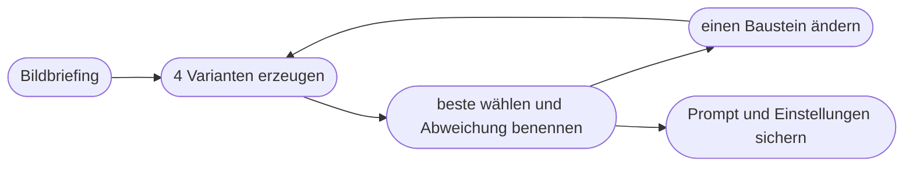

# Kapitel 30 – Prompting für Bild-KI: die Bildprompt-Anatomie

{{ progress(30) }}

<div class="lernziele" markdown>
<h3>Was du in diesem Kapitel lernst</h3>

- Warum ein Bildprompt **mehr Entscheidungen** treffen muss als ein Textprompt
- Die acht Bausteine der **Bildprompt-Anatomie**: Motiv, Umgebung, Stil, Licht, Komposition, Kamera, Farbstimmung, Format
- Das wichtigste **Bildvokabular** für Licht, Perspektive, Einstellungsgröße und Objektiv
- Wann du in **natürlicher Sprache** schreibst und wann eine **Stichwortliste** besser funktioniert
- Wie du mit **negativen Angaben** umgehst, ohne genau das Unerwünschte ins Bild zu holen
- Wie du **systematisch iterierst**, statt so lange neu zu würfeln, bis zufällig etwas passt
</div>

---

## 30.1 Ein Bild hat keine Lücken

Ein Text kann offenlassen, ob es regnet. Ein Bild nicht. Jedes Bild hat zwingend eine Tageszeit, eine Lichtrichtung, einen Blickwinkel, einen Bildausschnitt, eine Farbstimmung und ein Format. Was du davon nicht festlegst, entscheidet das Modell – und es entscheidet sich für das, was in seinen Trainingsdaten am häufigsten vorkam.

Das Ergebnis kennst du: das **Durchschnittsbild**. Eine Person in Outdoorjacke, mittig im Bild, frontal fotografiert, Sonnenuntergang, gesättigte Farben, perfekte Haut. Technisch einwandfrei, inhaltlich austauschbar – und für eine Marke wie Fjordlicht, deren Bildsprache ruhig, ehrlich und leicht nordisch-trocken sein soll, genau falsch.

!!! info "Merksatz"
    Ein Bildprompt ist eine **Art-Direction-Anweisung**, keine Suchanfrage. Je mehr der sichtbaren Entscheidungen du selbst triffst, desto weniger landet das Modell beim Durchschnitt.

Die Grundlogik aus dem P.R.O.M.P.T.-Framework (Kap. 5) gilt weiter: Wozu ist das Bild, für wen, in welchem Kanal? Nur die Bausteine, mit denen du das ausdrückst, sind andere. Eine Rolle („Du bist Fotograf") bringt bei Bildmodellen wenig; eine präzise Beschreibung von Licht und Bildausschnitt bringt viel.

---

## 30.2 Die acht Bausteine der Bildprompt-Anatomie

| Baustein | Frage, die er beantwortet | Beispiel für Fjordlicht |
|---|---|---|
| **Motiv** | Wer oder was ist zu sehen, was tut es? | „eine Frau um die vierzig, die einen Thermobecher in beiden Händen hält" |
| **Umgebung** | Wo und wann? | „auf einem Steg an einem norddeutschen See, früher Morgen im Oktober" |
| **Stil / Medium** | Foto, Illustration, Aquarell, 3D? Welche Anmutung? | „dokumentarisches Reportagefoto, ungestellt" |
| **Licht** | Woher, wie hart, welche Tageszeit? | „weiches, diffuses Licht durch Hochnebel" |
| **Komposition / Perspektive** | Wo steht das Motiv, aus welchem Blickwinkel? | „Person im rechten Drittel, Blick auf Augenhöhe, viel freie Fläche links" |
| **Kamera / Objektiv** | Brennweite, Schärfentiefe, Einstellungsgröße? | „Halbtotale, 50 mm, Hintergrund leicht unscharf" |
| **Farbstimmung** | Welche Palette, welche Sättigung? | „gedeckte Grün- und Grautöne, entsättigt, kühle Weißbalance" |
| **Format** | Seitenverhältnis, Kanal, Platz für Text? | „Querformat 3:1 für einen Newsletter-Header" |

Nicht jedes Bild braucht alle acht. Eine flache Illustration für einen Blogartikel braucht kein Objektiv, ein Muster für einen Pinterest-Hintergrund kein Motiv im engeren Sinn. Aber wenn ein Bild „irgendwie nicht passt", findest du die Ursache fast immer in einem Baustein, den du dem Modell überlassen hast.

!!! tip "Reihenfolge"
    Beginne mit **Motiv und Stil** – das sind die Angaben, die am stärksten wirken. Viele Modelle gewichten den Anfang eines Prompts höher. Licht, Kamera und Farbe folgen, das Format steht am Ende oder wird über Werkzeugeinstellungen bzw. Parameter gesetzt (Kap. 31).

Bei Chat-Bildmodellen lohnt ein Satz zum **Zweck**: „Das Bild wird Header eines Newsletters, die Headline steht später links." Das Modell kann diese Information in Komposition und Format übersetzen. Bei reinen Diffusionswerkzeugen bringt der Zweck dagegen wenig – dort zählt nur, was sichtbar sein soll.

---

## 30.3 Bildvokabular: Licht, Perspektive, Objektiv

Bildmodelle haben aus Bildunterschriften und Fotografie-Metadaten gelernt. Deshalb reagieren sie besonders gut auf **Begriffe aus Fotografie und Film**. Du musst keine Fotografin sein – aber ein Dutzend Begriffe macht einen großen Unterschied.

| Bereich | Begriff | Wirkung im Bild |
|---|---|---|
| Licht | goldene Stunde | warmes, flaches Licht kurz nach Sonnenauf- oder vor Sonnenuntergang |
| Licht | Gegenlicht | Lichtsaum um Haare und Kanten, Stimmung, Gesichter dunkler |
| Licht | diffuses Licht, bedeckter Himmel | weiche Schatten, ruhig, ehrlich, gut für Produkte |
| Licht | hartes Mittagslicht | starke Kontraste, harte Schatten |
| Perspektive | Augenhöhe | neutral, nahbar |
| Perspektive | Froschperspektive | Motiv wirkt groß, heroisch |
| Perspektive | Vogelperspektive / Draufsicht | Überblick, grafisch; Flatlays |
| Einstellungsgröße | Totale | Mensch klein in großer Landschaft |
| Einstellungsgröße | Halbnah | Person ab Hüfte, Gesicht und Kleidung erkennbar |
| Einstellungsgröße | Detail / Makro | Stoffstruktur, Wassertropfen, Naht |
| Objektiv | Weitwinkel (z. B. 24 mm) | viel Umgebung, Tiefe, Verzerrung am Rand |
| Objektiv | Tele (z. B. 85 mm) | verdichteter Hintergrund, Porträtwirkung |
| Schärfe | geringe Schärfentiefe | Motiv scharf, Hintergrund weich (Bokeh) |

!!! warning "Typische Falle"
    Stilbegriffe stapeln: „cinematic, epic, ultra-detailed, 8K, award-winning, hyperrealistic, masterpiece". Solche Füllwörter stammen aus frühen Prompt-Sammlungen. Bei aktuellen Modellen bringen sie wenig und schieben das Bild oft genau in den überglatten Hochglanz-Look, den eine ehrliche Marke vermeiden will. **Ein präziser Lichtbegriff wirkt mehr als fünf Superlative.**

Vorsicht auch mit **Künstlernamen**. „Im Stil von [lebende Fotografin]" funktioniert technisch oft, ist aber rechtlich und ethisch heikel und für eine eigene Markenbildsprache ohnehin der falsche Weg. Beschreibe stattdessen die Merkmale, die dir gefallen: Licht, Farben, Ausschnitt, Stimmung. Mehr dazu in Kap. 34 und 39.

---

## 30.4 Vom Stichwort zum Bildbriefing: ein Beispiel in drei Stufen

Die Aufgabe: ein Stimmungsbild für den Oktober-Newsletter von Fjordlicht, Thema „Draußen bleiben, wenn es ungemütlich wird".

**Stufe 0 – der übliche Anfang**

```text
Person in Regenjacke im Herbst
```

Ergebnis: das Durchschnittsbild. Frontal, mittig, oft ein Model mit perfektem Lächeln, bunte Blätter, Sonne. Nichts davon ist „ungemütlich", nichts davon klingt nach Fjordlicht.

**Stufe 1 – Motiv, Umgebung, Stil**

```text
Dokumentarisches Foto: Ein Mann um die vierzig in einer olivgrünen
Regenjacke geht bei Nieselregen einen schmalen Feldweg im Münsterland
entlang. Die Kapuze ist auf, er wirkt zufrieden, nicht inszeniert.
```

Besser: Die Situation stimmt, das Bild hat eine Geschichte. Aber Licht, Ausschnitt und Format sind noch Zufall – und der Header braucht Platz für Text.

**Stufe 2 – Licht, Komposition, Kamera, Farbe, Format**

```text
Dokumentarisches Foto: Ein Mann um die vierzig in einer olivgrünen
Regenjacke geht bei Nieselregen einen schmalen Feldweg im Münsterland
entlang. Die Kapuze ist auf, er wirkt zufrieden, nicht inszeniert.
Licht: grauer Himmel, weiches diffuses Licht, leichter Nebel in der Ferne.
Komposition: Person klein im rechten Drittel, von hinten schräg gesehen,
Weg führt ins Bild hinein, linke Bildhälfte ruhig für späteren Text.
Kamera: Totale, Augenhöhe, natürliche Schärfentiefe.
Farben: gedeckte Grün-, Braun- und Grautöne, leicht entsättigt.
Format: Querformat 3:1. Kein Text, keine Logos im Bild.
```

Jetzt ist das Bild **steuerbar**: Es passt zum Kanal, zur Markenstimme und lässt Raum für die Headline, die später im Newsletter-Werkzeug gesetzt wird (Kap. 33).

| Stufe | Ergänzt | Was besser wird | Was noch fehlt |
|---|---|---|---|
| 0 | – | nichts, Durchschnittsbild | fast alles |
| 1 | Motiv, Umgebung, Stil | Situation und Geschichte | Licht, Ausschnitt, Format |
| 2 | Licht, Komposition, Kamera, Farbe, Format | kanaltauglich, markengerecht, textfreundlich | Auswahl und Prüfung durch Menschen |

---

## 30.5 Natürliche Sprache oder Stichwortliste?

Lange galt: Bildprompts sind Stichwortketten, durch Kommas getrennt. Mit multimodalen Modellen wie ChatGPT Images oder Gemini (Kap. 29) hat sich das verschoben. Heute gilt grob:

| | Natürliche Sprache | Stichwortliste |
|---|---|---|
| Funktioniert gut bei | ChatGPT Images, Gemini, Copilot, Firefly, Ideogram | Midjourney, viele FLUX-Oberflächen, ältere Modelle |
| Stärke | Beziehungen und Bedingungen („links … rechts …", „während …") | schnell variierbar, knapp, gut kombinierbar mit Parametern |
| Schwäche | lange Prompts verwässern, wenn sie Nebensächliches enthalten | Beziehungen zwischen Bildteilen gehen leicht verloren |
| Beispiel | siehe Stufe 2 oben | siehe unten |

```text
documentary photo, man in his forties, olive green rain jacket, hood up,
walking on narrow field path, drizzle, overcast, soft diffuse light,
distant fog, wide shot from behind, subject in right third, muted greens
and browns, desaturated --ar 3:1
```

Englische Prompts liefern bei manchen Werkzeugen etwas verlässlichere Ergebnisse, weil die Trainingsdaten überwiegend englisch beschriftet sind. Die großen Chat-Werkzeuge verstehen Deutsch inzwischen sehr gut. Teste es für dein Werkzeug, statt es pauschal anzunehmen.

!!! example "Den Chat als Übersetzer nutzen"
    Du kannst dein deutsches Bildbriefing in ChatGPT, Claude oder Gemini in eine Stichwortfassung für Midjourney umwandeln lassen:

    ```text
    Wandle das folgende Bildbriefing in einen knappen englischen
    Midjourney-Prompt um. Reihenfolge: Medium, Motiv, Umgebung, Licht,
    Komposition, Farben. Hänge --ar [Seitenverhältnis] an. Lass alles weg,
    was nicht sichtbar ist (Gefühle, Zielgruppe, Zweck).
    Briefing: [Briefing einfügen]
    ```

---

## 30.6 Negative Angaben: was nicht ins Bild soll

„Keine Menschen", „ohne Text", „kein Logo" – solche Angaben sind nötig, aber tückisch. Bei klassischen Diffusionsmodellen landet das Wort „Menschen" im Prompt und zieht das Bild **in Richtung Menschen**, die Verneinung wird schwächer verarbeitet. Multimodale Chat-Modelle verstehen Verneinungen deutlich besser, aber auch dort gilt:

- **Positiv beschreiben, was stattdessen da ist:** statt „keine Menschen" lieber „menschenleerer Waldweg"; statt „nicht kitschig" lieber „nüchtern, dokumentarisch, gedeckte Farben".
- **Eigene Felder nutzen:** Midjourney hat dafür den Parameter `--no` (etwa `--no text, logo`), manche Oberflächen ein eigenes Feld für einen „Negative Prompt". Dort wirken Ausschlüsse zuverlässiger als im Fließtext.
- **Kurz halten:** Lange Verbotslisten verwässern den Prompt. Nimm nur auf, was in den Ergebnissen tatsächlich wiederholt auftaucht.

!!! warning "Typische Falle"
    „Das Bild darf auf keinen Fall eine rote Jacke zeigen" – und auf drei von vier Bildern ist eine rote Jacke. Die Lösung ist fast nie eine schärfere Verneinung, sondern eine **positive Farbvorgabe**: „Jacke in Olivgrün".

---

## 30.7 Systematisch iterieren statt würfeln

Bild-KI verführt zum Glücksspiel: noch einmal generieren, noch einmal, noch einmal. Das kostet Zeit und Credits und lehrt dich nichts. Besser ist dasselbe Vorgehen wie beim Text (Kap. 8, 9): **Abweichung benennen, gezielt ändern, vergleichen.**

1. **Vier Varianten erzeugen** (viele Werkzeuge tun das automatisch) und die beste wählen.
2. **Eine Abweichung benennen**: „Licht zu warm", „Person zu zentral", „wirkt gestellt".
3. **Genau einen Baustein ändern** und neu erzeugen. Ändere nicht Licht und Perspektive gleichzeitig, sonst weißt du nicht, was gewirkt hat.
4. **Funktionierende Prompts sichern** – mit Werkzeug, Einstellungen und Beispielbild in eurer Prompt-Bibliothek (Kap. 10).

Damit Schritt 2 und 3 schnell gehen, hilft eine kleine Zuordnung von typischen Abweichungen zum zuständigen Baustein:

| Abweichung im Bild | Zuständiger Baustein | Mögliche Änderung |
|---|---|---|
| wirkt gestellt, „Stockfoto-Lächeln" | Stil, Motiv | „ungestellt, Reportage, Person beschäftigt mit [Tätigkeit]" |
| zu bunt, zu glatt | Farbstimmung, Stil | „gedeckte Farben, leicht entsättigt, natürliche Hauttöne" |
| Motiv klebt in der Mitte | Komposition | „Person im linken Drittel, viel Raum rechts" |
| zu wenig Umgebung | Kamera | „Totale, Weitwinkel" statt Halbnah |
| falsche Tageszeit oder Stimmung | Licht, Umgebung | „bedeckter Vormittag, diffuses Licht" |
| kein Platz für Text | Format, Komposition | Seitenverhältnis festlegen, ruhige Fläche benennen |



Ein nützlicher Zwischenschritt in Chat-Werkzeugen: Lade ein Bild hoch, das der gewünschten Wirkung nahekommt – ein eigenes Foto oder ein freigegebenes Kampagnenbild – und lass es beschreiben: „Beschreibe Licht, Perspektive, Bildausschnitt und Farbstimmung dieses Fotos in Stichworten." Diese Beschreibung ist ein hervorragender Baustein für deinen nächsten Prompt und der erste Schritt zu einem Bildsprache-Guide (Kap. 32).

---

## Zusammenfassung

- Ein Bild hat **keine Lücken**: Was du nicht festlegst, entscheidet das Modell – meist zugunsten des austauschbaren Durchschnittsbilds.
- Die acht Bausteine sind **Motiv, Umgebung, Stil, Licht, Komposition, Kamera, Farbstimmung, Format**; Motiv und Stil gehören nach vorn.
- **Fotografie-Vokabular** (Licht, Perspektive, Einstellungsgröße, Brennweite) wirkt stärker als Superlative wie „ultra-detailed, masterpiece".
- Multimodale Chat-Modelle verstehen **natürliche Sprache** gut; bei Midjourney und ähnlichen Werkzeugen funktionieren **Stichwortlisten mit Parametern** oft besser.
- **Negative Angaben** positiv umformulieren oder in eigene Felder bzw. `--no` auslagern; kurz halten.
- **Iterieren** heißt: eine Abweichung benennen, einen Baustein ändern, vergleichen – und Funktionierendes in der Prompt-Bibliothek sichern.

---

## Kurzübungen

{{ task(file="tasks/k30_01.yaml") }}

{{ task(file="tasks/k30_02.yaml") }}

{{ task(file="tasks/k30_03.yaml") }}

---

## Workshop

{{ task(file="tasks/workshop_k30.yaml") }}
