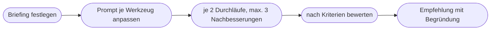

# Kapitel 31 – Werkzeuge in der Praxis: ChatGPT Images, Midjourney, Ideogram, Adobe Firefly

{{ progress(31) }}

<div class="lernziele" markdown>
<h3>Was du in diesem Kapitel lernst</h3>

- Wie du in **ChatGPT Images** (ehem. DALL·E) Bilder erzeugst, im Gespräch verfeinerst und vorhandene Bilder bearbeitest
- Wie **Midjourney** bedient wird und was die wichtigsten **Parameter** wie `--ar`, `--stylize`, `--chaos`, `--no` und `--sref` bewirken
- Warum **Ideogram** bei Typografie und Text im Bild punktet und wie du Text sauber vorgibst
- Was **Adobe Firefly** für Unternehmen interessant macht und wie es in **Photoshop** und **Express** arbeitet
- Wie du einen fairen **Vergleichstest** mit demselben Briefing aufsetzt und auswertest
- Welche **Bedienungsdetails** sich schnell ändern und wie du damit umgehst
</div>

---

## 31.1 Vier Werkzeuge, ein Briefing

In Kap. 29 hast du die Werkzeuglandschaft kennengelernt, in Kap. 30 die Bildprompt-Anatomie. Jetzt geht es an die Bedienung. Vier Werkzeuge stehen im Mittelpunkt, weil sie im Marketing am verbreitetsten sind und vier unterschiedliche Stärken verkörpern:

| Werkzeug | Rolle im Werkzeugkasten | Zugang | Prompt-Stil |
|---|---|---|---|
| **ChatGPT Images** | Allrounder im Gespräch, Bearbeitung auf Zuruf | im ChatGPT-Chat, für alle Nutzer | natürliche Sprache |
| **Midjourney** | Art Direction, Ästhetik, Stilreferenzen | Web-App und Discord, Abo | knappe Beschreibung plus Parameter |
| **Ideogram** | Typografie, Plakate, Grafiken mit Text | Web-App, Abo bzw. Credits | natürliche Sprache, Text in Anführungszeichen |
| **Adobe Firefly** | kommerziell abgesicherte Erzeugung, Retusche, Integration in Adobe-Programme | Firefly-Web-App, Photoshop, Express | natürliche Sprache plus Referenzen |

Alle Angaben beschreiben den **Stand Oktober 2026**. Menüs, Tarife, Parameternamen und Modellversionen ändern sich bei allen vier Anbietern mehrmals im Jahr. Lerne deshalb die **Funktionsprinzipien** – und schlage Bedienungsdetails in der aktuellen Hilfe des Anbieters nach.

!!! info "Merksatz"
    Kein Werkzeug ist in allem am besten. Ein Marketingteam braucht meist **ein Allround-Werkzeug** für den Alltag und höchstens ein bis zwei **Spezialwerkzeuge** für das, was der Allrounder nicht kann.

---

## 31.2 ChatGPT Images (ehem. DALL·E)

Die Bildgenerierung in ChatGPT hieß lange DALL·E. Der offizielle DALL·E-GPT wurde am 30.08.2026 eingestellt; heute heißt die Funktion **ChatGPT Images** und basiert auf der Modellfamilie **GPT Image** (aktuell Images 2.5 seit 08.09.2026). Sie steht allen Nutzerinnen und Nutzern zur Verfügung, der Umfang hängt vom Plan ab.

**Bedienung im Kern:**

- **Erzeugen:** Du beschreibst im Chat, was du brauchst – „Erstelle ein Bild …". Über das Werkzeugmenü lässt sich die Bilderstellung auch ausdrücklich auswählen.
- **Verfeinern im Gespräch:** „Mach den Himmel bewölkter", „Die Person soll eine Mütze tragen", „Format 4:5". Das Modell kennt das vorherige Bild und den Verlauf.
- **Bearbeiten:** Du lädst ein eigenes Bild hoch und beschreibst die Änderung. Je nach Oberfläche kannst du einen Bereich markieren, der geändert werden soll.
- **Referenzen:** Mehrere hochgeladene Bilder lassen sich kombinieren – etwa ein Hintergrund und eine Farbpalette.

```text
Erstelle ein Bild für den Header unseres Oktober-Newsletters.
Motiv: Thermobecher und eine gefaltete Wollmütze auf einem
verwitterten Holztisch auf einer Terrasse, im Hintergrund unscharf ein
nebliger Garten. Stil: ruhiges, natürliches Foto, kein Hochglanz.
Licht: bedeckter Morgen, weiches Licht von links. Farben: gedeckte
Grün- und Brauntöne. Format: Querformat 3:1, die linke Hälfte bleibt
ruhig für die Headline. Kein Text und keine Logos im Bild.
```

!!! tip "Lange Bildgespräche neu starten"
    Nach vielen Bearbeitungsrunden in einem Chat beginnen Bilder zu „wandern": Gesichter, Kleidung oder Hintergrund verändern sich unbeabsichtigt mit. Wenn das passiert, starte einen **neuen Chat**, lade das beste bisherige Bild hoch und beschreibe nur noch die gewünschte Änderung. Das ist dieselbe Logik wie beim Kontextverlust in langen Text-Chats (Kap. 9).

**Stärken:** präzise Umsetzung komplexer Anweisungen, Bearbeitung auf Zuruf, kurze Texte im Bild meist korrekt, kein zusätzliches Werkzeug nötig. **Grenzen:** eher neutraler Look, der ohne genaue Stilvorgaben schnell nach „KI-Standard" aussieht; Bildserien mit identischen Figuren bleiben anspruchsvoll (Kap. 33). OpenAI versieht erzeugte Bilder nach eigenen Angaben mit **C2PA-Metadaten**, die die KI-Herkunft dokumentieren (Kap. 34). Für den Datenschutz gilt dasselbe wie beim Text: Unveröffentlichtes gehört nur in einen freigegebenen Business- oder Enterprise-Zugang (Kap. 4).

---

## 31.3 Midjourney

Midjourney gilt seit Jahren als das Werkzeug mit der stärksten eigenen **Ästhetik**. Bedient wird es über die **Web-App** oder über **Discord**; eine offizielle API gibt es nicht. Ein Prompt liefert in der Regel mehrere Varianten, die du anschließend hochskalieren, variieren oder im Editor bearbeiten kannst (Bereich neu erzeugen, Bild erweitern, Ausschnitt verschieben).

Gesteuert wird Midjourney neben dem Text über **Parameter**, die mit zwei Bindestrichen an den Prompt angehängt werden:

| Parameter | Wirkung | Beispiel |
|---|---|---|
| `--ar` | Seitenverhältnis | `--ar 4:5` (Instagram), `--ar 16:9`, `--ar 2:3` (Pinterest) |
| `--stylize` / `--s` | wie stark Midjourneys eigene Ästhetik einfließt; niedrig = näher am Prompt, hoch = künstlerischer | `--s 50` für sachliche Bilder |
| `--chaos` | wie unterschiedlich die Varianten eines Durchlaufs ausfallen | `--chaos 30` für ein Moodboard |
| `--no` | was nicht im Bild sein soll | `--no text, logo` |
| `--seed` | Startwert für den Zufall; hilft, nah an einem Ergebnis zu bleiben | `--seed 1234` |
| `--sref` | Stilreferenz: übernimmt Look und Farbwelt eines Referenzbilds oder eines Stilcodes | `--sref [Bild-URL]` |
| Charakter-/Objektreferenz | hält eine Figur oder ein Objekt über Bilder hinweg ähnlich; früher `--cref`, ab Version 7 als „Omni-Reference" | siehe aktuelle Doku |
| `--style raw` | reduziert die automatische Verschönerung, wirkt fotografischer | `--style raw` |

```text
documentary photo, woman in her forties holding a thermos cup with both
hands, wooden jetty on a misty lake, early October morning, soft diffuse
light, subject in right third, muted greens and greys, desaturated
--ar 3:1 --s 50 --style raw --no text, logo
```

!!! warning "Typische Falle"
    Wer bei Midjourney mit kleinem Plan arbeitet, übersieht leicht, dass erzeugte Bilder standardmäßig in der **öffentlichen Galerie** sichtbar sein können; ein privater Modus („Stealth") war bislang höheren Plänen vorbehalten. Prüfe vor dem ersten Kampagnenmotiv, welche Sichtbarkeit dein Plan hat – unveröffentlichte Kampagnen gehören nicht in eine öffentliche Galerie.

Parameternamen, Wertebereiche und Standardwerte unterscheiden sich zwischen Versionen (aktuell V8.x). Mit `--v` wählst du bei Bedarf eine bestimmte Version. Notiere in deiner Prompt-Bibliothek (Kap. 10) immer, **mit welcher Version** ein Prompt getestet wurde – sonst lassen sich gute Ergebnisse später nicht reproduzieren. Die Stil- und Charakterreferenzen vertieft Kap. 33.

---

## 31.4 Ideogram

Ideogram hat sich von Anfang an auf **Text im Bild** spezialisiert und ist dort weiterhin besonders stark (aktuell Version 4). Kurze Wörter schreiben 2026 alle großen Modelle meist korrekt; die Unterschiede zeigen sich bei **mehreren Textelementen, Hierarchien und Layouts** – genau dem, was Plakate, Infografiken, Thumbnails und Pinterest-Pins brauchen.

**So gibst du Text sauber vor:**

- Setze den gewünschten Text in **Anführungszeichen** und benenne seine Rolle: Überschrift, Unterzeile, Button.
- Beschreibe die **Typografie**: „schlichte serifenlose Schrift, fett, weiß", „handschriftlich", „kleine Versalien".
- Lege die **Position** fest: „Überschrift oben mittig, Unterzeile darunter, unten rechts Platz frei".
- Prüfe die automatische **Prompt-Erweiterung** (bei Ideogram „Magic Prompt"): Sie ergänzt deinen Prompt um eigene Details. Für schnelle Ideen hilfreich, für präzise Vorgaben besser ausschalten.

```text
Pinterest-Grafik im Hochformat 2:3 im Stil einer schlichten Infografik.
Hintergrund: helles Sandbeige mit dezenter Papierstruktur.
Oben die Überschrift "Regenjacke richtig pflegen" in fetter
serifenloser Schrift, dunkelgrün.
Darunter drei Zeilen mit einfachen Linien-Icons:
"1 Lauwarm waschen", "2 Kein Weichspüler", "3 Trocknen und neu imprägnieren".
Viel Weißraum, ruhig, keine Fotos, keine Logos.
```

!!! example "Text im Bild: Entwurf ja, Endfassung im Layout"
    Selbst wenn Ideogram den Text fehlerfrei setzt, ist das Bild am Ende ein Pixelbild: Tippfehler, Pflegehinweise oder Preise lassen sich nicht nachträglich korrigieren, und Schriften entsprechen selten exakt dem Corporate Design. Nutze Ideogram für **Layoutideen und Entwürfe**. Die finale Grafik mit geprüften Texten setzt du in Canva, Adobe Express oder InDesign (Kap. 33). Pflegehinweise und Nachhaltigkeitsaussagen prüfst du vorher gegen die Claim-Liste – wie beim Content-Assistenten (Kap. 26).

---

## 31.5 Adobe Firefly

Adobe Firefly (aktuell Image Model 5) ist weniger ein einzelnes Werkzeug als eine Modellfamilie, die in der **Firefly-Web-App**, in **Photoshop**, in **Adobe Express** und weiteren Adobe-Programmen steckt. Für Unternehmen ist vor allem ein Argument entscheidend: Adobe gibt an, die eigenen Firefly-Modelle auf **lizenzierten Inhalten** (unter anderem Adobe Stock) und **gemeinfreien Inhalten** trainiert zu haben, und bewirbt sie als **kommerziell abgesichert**. Erzeugte Bilder erhalten **Content Credentials** nach dem C2PA-Standard, also maschinenlesbare Herkunftsangaben.

| Ort | Typischer Einsatz | Funktion |
|---|---|---|
| **Firefly-Web-App** | Motive erzeugen, Varianten, Referenzen | Text-zu-Bild mit Stil- und Strukturreferenz, Seitenverhältnisse, Effekte |
| **Photoshop** | echte Fotos bearbeiten | „Generatives Füllen" (Generative Fill) für markierte Bereiche, „Generatives Erweitern" für neue Formate, Objekte entfernen |
| **Adobe Express** | Social-Posts, Flyer, schnelle Layouts | Vorlagen, Texteffekte, Bildgenerierung direkt im Layout |

Für Fjordlicht ist Photoshop der häufigste Einsatzort: Ein echtes Produktfoto der Jacke „Sølv" wird für einen 16:9-Header **nach links und rechts erweitert**, ein störendes Verkehrsschild im Hintergrund entfernt. Das Produkt selbst bleibt unangetastet – genau so, wie es Kap. 29 und Kap. 34 verlangen.

!!! warning "Typische Falle"
    Die Firefly-App bietet inzwischen auch **Partnermodelle** anderer Anbieter zur Auswahl an. Für diese gelten Adobes Aussagen zu Trainingsdaten und kommerzieller Absicherung **nicht automatisch**. Prüfe vor dem Generieren, welches Modell ausgewählt ist, wenn die rechtliche Absicherung dein Grund für Firefly war.

Abgerechnet wird über **generative Credits**, die je nach Abo und Funktion unterschiedlich schnell verbraucht werden. **Stärken:** Integration in vorhandene Arbeitsabläufe, Retusche und Formaterweiterung echter Fotos, Herkunftsnachweis, Rechtsposition. **Grenzen:** bei freien, künstlerischen Motiven oft weniger eigenständig als Midjourney.

---

## 31.6 Der Vergleichstest: dasselbe Briefing, vier Werkzeuge

Welches Werkzeug für euch passt, entscheidet kein Testbericht, sondern ein **eigener Vergleich mit euren Aufgaben**. Damit der Vergleich fair ist, gelten vier Regeln:

1. **Dasselbe Briefing** für alle Werkzeuge – inhaltlich identisch, nur im jeweils passenden Prompt-Stil (Satz oder Stichworte, Parameter).
2. **Mehrere Durchläufe**: mindestens zwei Generierungen pro Werkzeug, damit kein Zufallstreffer entscheidet.
3. **Feste Kriterien vorab**, gewichtet nach euren Prioritäten (Kap. 29).
4. **Gleicher Aufwand**: höchstens drei Nachbesserungsrunden pro Werkzeug, Zeit notieren.



| Kriterium | Gewicht | ChatGPT Images | Midjourney | Ideogram | Firefly |
|---|---|---|---|---|---|
| Briefingtreue (Motiv, Komposition) | 25 % | [1–5] | [1–5] | [1–5] | [1–5] |
| Passung zur Markenbildsprache | 25 % | [1–5] | [1–5] | [1–5] | [1–5] |
| Text im Bild (falls gefordert) | 10 % | [1–5] | [1–5] | [1–5] | [1–5] |
| Aufwand bis zum brauchbaren Bild | 15 % | [1–5] | [1–5] | [1–5] | [1–5] |
| Rechte, Datenschutz, Sichtbarkeit | 15 % | [1–5] | [1–5] | [1–5] | [1–5] |
| Integration in den Arbeitsablauf | 10 % | [1–5] | [1–5] | [1–5] | [1–5] |

Ein typisches Ergebnis für ein Stimmungsbild: Midjourney liefert den schönsten Look, ChatGPT Images trifft die Komposition am genauesten, Firefly punktet bei Rechten und Integration, Ideogram fällt ohne Textanteil ab. Bei einer Infografik dreht sich das Bild. **Deshalb testest du mit mindestens zwei unterschiedlichen Aufgaben.**

---

## Zusammenfassung

- **ChatGPT Images** (ehem. DALL·E; GPT Image, aktuell Images 2.5) ist der Allrounder: Erzeugen und Bearbeiten im Gespräch, präzise bei komplexen Anweisungen, bei langen Bildgesprächen neu starten.
- **Midjourney** steht für Ästhetik und Art Direction; gesteuert wird es über Parameter wie `--ar`, `--stylize`, `--chaos`, `--no`, `--seed`, `--sref` – Version und Sichtbarkeit der Bilder immer prüfen.
- **Ideogram** ist stark bei Typografie: Text in Anführungszeichen, Rolle und Position benennen; finale Texte trotzdem im Layout-Werkzeug setzen.
- **Adobe Firefly** punktet mit lizenzierten Trainingsdaten, Content Credentials und der Integration in Photoshop (Generatives Füllen, Generatives Erweitern) und Express – Partnermodelle gesondert prüfen.
- Ein fairer **Vergleichstest** nutzt dasselbe Briefing, mehrere Durchläufe, vorab gewichtete Kriterien und gleichen Aufwand.
- Bedienungsdetails ändern sich schnell: **Prinzipien lernen**, Version und Datum in der Prompt-Bibliothek festhalten.

---

## Kurzübungen

{{ task(file="tasks/k31_01.yaml") }}

{{ task(file="tasks/k31_02.yaml") }}

{{ task(file="tasks/k31_03.yaml") }}

---

## Workshop

{{ task(file="tasks/workshop_k31.yaml") }}
