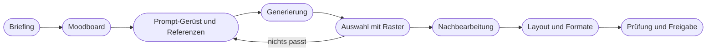

# Kapitel 33 – Bildserien und Kampagnenmotive

{{ progress(33) }}

<div class="lernziele" markdown>
<h3>Was du in diesem Kapitel lernst</h3>

- Was **Konsistenz** in einer Bildserie bedeutet und auf welchen Ebenen sie gesichert werden muss
- Wie du mit **Stil- und Charakterreferenzen, Seeds** und einem festen **Prompt-Gerüst** Serien erzeugst
- Wann **Bearbeiten** (Inpainting, Outpainting, Generative Fill) besser ist als neu generieren
- Wie aus einem Schlüsselmotiv **Formatvarianten** von 1:1 bis 16:9 werden
- Warum Text-Overlays und **echte Produkte** nicht in die Bild-KI gehören, sondern ins Layout bzw. vor die Kamera
- Den Kampagnen-Workflow **Briefing → Moodboard → Generierung → Auswahl → Nachbearbeitung**
</div>

---

## 33.1 Vom Einzelbild zur Serie

Eine Kampagne besteht selten aus einem Bild. Für den Herbstauftakt von Fjordlicht braucht das Team etwa ein Schlüsselmotiv, drei Instagram-Posts, eine Story-Sequenz, einen Newsletter-Header, ein Webshop-Banner und zwei Pinterest-Pins. Alle sollen erkennbar zusammengehören. Genau hier zeigt Bild-KI ihre größte Schwäche: Jede Generierung beginnt von vorn. Dieselbe Person sieht beim nächsten Bild anders aus, das Licht wechselt, die Jacke bekommt plötzlich eine zweite Brusttasche.

**Konsistenz** hat mehrere Ebenen – und jede braucht ein eigenes Mittel:

| Ebene | Was gleich bleiben soll | Mittel |
|---|---|---|
| Stil | Licht, Farbwelt, Bearbeitung, Look | Bildsprache-Baustein (Kap. 32), Stilreferenz |
| Figur | dieselbe Person über mehrere Motive | Charakter- bzw. Personenreferenz, Referenzbild |
| Produkt | Schnitt, Farbe, Details, Logo | echtes Produktfoto – nicht generieren (33.5) |
| Szene | Ort, Wetter, Tageszeit | festes Prompt-Gerüst, Seed, Bearbeitung statt Neugenerierung |
| Layout | Schrift, Logo, Platzierung | Layout-Werkzeug mit Vorlage (33.4) |

!!! info "Merksatz"
    Bild-KI hat kein Gedächtnis für deine Kampagne. Konsistenz entsteht nicht durch Hoffen auf ähnliche Ergebnisse, sondern durch **feste Bausteine, Referenzen und Nachbearbeitung**.

---

## 33.2 Werkzeuge für Konsistenz

Die meisten Werkzeuge bieten heute Möglichkeiten, Ergebnisse aneinander auszurichten. Bedienung und Parameter im Detail behandelt Kap. 31; hier geht es um den Einsatz in Serien.

- **Stilreferenz:** Du gibst ein oder mehrere Bilder mit, deren Look übernommen werden soll. In Midjourney mit `--sref` und einer Bild-URL oder einem Stil-Code, in Firefly über ein Referenzbild für den Stil, in ChatGPT Images und Gemini durch Hochladen mit klarer Anweisung, was übernommen wird.
- **Charakter- bzw. Personenreferenz:** Eine Figur wird in neue Szenen übertragen. Midjourney bietet dafür die Charakterreferenz `--cref` bzw. in neueren Versionen die Omni-Referenz; ChatGPT Images und die Gemini-Bildmodelle halten eine Figur oft über mehrere Bearbeitungsschritte im selben Chat stabil. Die Ähnlichkeit ist gut, aber selten perfekt.
- **Seed:** Der Startwert des Zufalls. Gleicher Prompt plus gleicher Seed ergibt ein sehr ähnliches Bild – nützlich, um gezielt **eine** Prompt-Änderung zu testen. In Midjourney mit `--seed`, in Chat-Werkzeugen meist nicht steuerbar.
- **Festes Prompt-Gerüst:** Der wichtigste und werkzeugunabhängige Hebel. Feste Teile bleiben wortgleich, nur markierte Teile ändern sich.

```text
[Motiv: Person, Handlung]
in [Ort] an einem nebligen Oktobermorgen, weiches diffuses Licht.
Person trägt eine ockergelbe Regenjacke als einzigen Farbakzent.
Komposition: [Komposition], Format [Format].
Gedämpfte, entsättigte Naturtöne, dokumentarischer Fotolook,
natürlicher Kontrast, leichte Filmkörnung.
Vermeide: Hochglanz, Posen in die Kamera, Siegergesten, Blätter-Symbolik.
```

!!! tip "Figur mit Steckbrief"
    Wenn eine wiederkehrende, **fiktive** Figur die Kampagne trägt, lege einen Steckbrief an wie bei einem Kundenavatar (Kap. 18): Alter, Haare, Statur, typische Kleidung, Ausrüstung. Der Steckbrief steht wortgleich in jedem Prompt; das erste gelungene Bild dient als Referenz für alle weiteren.

!!! warning "Typische Falle"
    Eine Charakterreferenz auf Basis eines Fotos einer **realen** Person – etwa einer Mitarbeiterin oder eines Influencers – ist kein technisches, sondern ein rechtliches Thema: Recht am eigenen Bild, Persönlichkeitsrecht, gegebenenfalls Kennzeichnung als Deepfake. Dazu Kap. 34. Ohne schriftliche Einwilligung tabu.

---

## 33.3 Bearbeiten statt neu würfeln

Ein Bild ist zu 90 Prozent gut, aber die Hand wirkt seltsam oder ein Ast ragt ins Gesicht. Der Reflex ist, neu zu generieren – und damit auch die 90 Prozent zu verlieren. Besser: **gezielt bearbeiten**.

| Technik | Was sie tut | Typischer Einsatz | Beispiele |
|---|---|---|---|
| **Inpainting** | markierten Bereich neu erzeugen | Hand korrigieren, störendes Element entfernen, Gegenstand ergänzen | Generative Fill in Photoshop/Firefly, Bereich markieren in ChatGPT Images, Midjourney „Vary Region" |
| **Outpainting** | Bild über den Rand hinaus erweitern | 1:1 zu 16:9, Platz für Text schaffen | Generative Expand in Photoshop, Zoom/Pan in Midjourney |
| **Variation** | ähnliche Fassungen eines Bilds | Feinauswahl bei fast gutem Ergebnis | Variationsfunktion der meisten Werkzeuge |
| **Bearbeitung per Anweisung** | Änderung in natürlicher Sprache | „mach den Himmel grauer", „entferne die zweite Person" | ChatGPT Images, Gemini/Nano Banana |
| **Hochskalieren** | Auflösung erhöhen | Druck, große Banner | Upscale-Funktionen, Photoshop |

Bei der Bearbeitung per Anweisung gilt: Nenne ausdrücklich, was **gleich bleiben** soll – sonst verändert das Modell gern mehr als verlangt.

```text
Ändere nur den Himmel: grauer, mit tief hängendem Nebel.
Person, Jacke, Weg, Bildausschnitt und Farbwelt bleiben exakt gleich.
```

Bearbeitung hat Grenzen: Jeder Durchgang kann das Bild leicht verändern, Details verlieren an Schärfe, und bei mehreren Bearbeitungen hintereinander summieren sich kleine Abweichungen. Bei Chat-Werkzeugen wird das Bild je nach Funktion teilweise neu erzeugt, auch wenn du nur eine Stelle ändern willst. Vergleiche deshalb nach jeder Bearbeitung mit dem Ausgangsbild und speichere Zwischenstände.

!!! warning "Typische Falle"
    „Noch einmal, vielleicht wird es diesmal besser": Wer zwanzigmal neu generiert, ohne den Prompt zu ändern, testet den Zufall, nicht die Idee. Lege vorher fest, nach wie vielen Versuchen du entweder den Prompt änderst (Kap. 9 – Symptom benennen, Ursache suchen) oder zur Bearbeitung wechselst. Eine pragmatische Grenze: höchstens vier Durchgänge pro Prompt-Fassung.

---

## 33.4 Formatvarianten und Text-Overlay

Ein Schlüsselmotiv muss in mehreren Formaten funktionieren (Kanalformate siehe Kap. 32). Zwei Wege führen dorthin:

| Weg | Vorgehen | Vorteil | Nachteil |
|---|---|---|---|
| Je Format neu generieren | gleiches Prompt-Gerüst, anderes Seitenverhältnis | Komposition für jedes Format optimal | Motive weichen voneinander ab |
| Ein Master, dann erweitern | Motiv in einem Format, dann Outpainting oder Zuschnitt | Motiv identisch in allen Formaten | erweiterte Ränder genau prüfen |

In der Praxis bewährt sich: Master im **breitesten** benötigten Format oder mit großzügigem Rand anlegen, Motiv mittig mit Abstand zu den Rändern, dann zuschneiden und nur wo nötig erweitern. Bei 9:16 für Stories und Reels die Bereiche oben und unten freihalten, in denen die Plattform Bedienelemente einblendet.

**Text gehört ins Layout, nicht ins Bild.** Kurze Schriftzüge erzeugen die großen Modelle inzwischen meist korrekt, Ideogram ist darin besonders stark (Kap. 31). Für Kampagnen setzt du Headline, Preis, Logo und Button trotzdem besser in einem Layout-Werkzeug wie Canva, Adobe Express oder Figma:

- Die **Hausschrift** und exakte Markenfarben stehen nur dort zuverlässig zur Verfügung.
- Ein Tippfehler oder eine Preisänderung ist eine Korrektur in Sekunden, keine Neugenerierung.
- Übersetzungen und Formatvarianten entstehen aus einer Vorlage.
- Echter Text bleibt für Screenreader und Suchmaschinen nutzbar; ergänze trotzdem einen Alt-Text.

Plane den Text deshalb schon beim Generieren mit: „obere 30 Prozent ruhige Fläche ohne Details" oder „rechte Bildhälfte unscharfer Hintergrund". Die Schrift kommt danach im Layout-Werkzeug darauf.

---

## 33.5 Echte Produkte zeigen

Bild-KI kennt eure Regenjacke „Sølv" nicht. Sie erzeugt eine **plausible** gelbe Regenjacke – mit erfundenen Nähten, Taschen, Kapuzenform und manchmal einem Fantasielogo. Für ein Stimmungsbild ohne Produktbezug mag das reichen. Sobald ein Bild ein **konkretes, kaufbares Produkt** zeigt, muss das Produkt echt sein. Alles andere ist ein Täuschungsrisiko nach UWG (Kap. 34) und erzeugt Retouren und Beschwerden.

Bewährte Wege:

1. **Produktfoto plus KI-Umgebung:** Das Produkt wird echt fotografiert (freigestellt oder auf neutralem Grund), Hintergrund und Szene entstehen mit Generative Fill bzw. Hintergrundgenerierung. Das Produkt selbst bleibt unverändert.
2. **Shooting plus KI-Erweiterung:** Echtes Foto mit Person im Produkt, KI erweitert Format, ersetzt Himmel oder entfernt Störendes.
3. **Referenzbild im Werkzeug:** Produktfoto als Referenz hochladen. Ergebnisse kommen dem Original oft nahe, Details weichen aber ab – nur für Entwürfe und Moodboards, nicht für die Produktseite.

Beim Composing (Weg 1 und 2) entscheidet die Glaubwürdigkeit über das Ergebnis: Licht und Schatten des Produktfotos müssen zur generierten Szene passen. Fotografiere das Produkt deshalb möglichst mit weichem, seitlichem Licht, das zur Bildsprache passt, und gib der Szene im Prompt dieselbe Lichtrichtung vor („Licht von links, diffus, bedeckter Himmel"). Ein Produkt im harten Studiolicht vor einer Nebellandschaft wirkt sofort montiert.

!!! warning "Typische Falle"
    Die generierte Jacke sieht „fast genauso" aus. Fast heißt: andere Taschen, andere Kapuze, falscher Farbton. Kundinnen vergleichen genau – und Abweichungen bei Farbe und Details sind ein häufiger Retourengrund. **Jedes Bild mit Produktbezug wird gegen das echte Produkt geprüft**, am besten von jemandem aus Produktmanagement oder Einkauf.

---

## 33.6 Der Kampagnen-Workflow



Das **Briefing** beantwortet: Kampagnenziel, Bildaufgabe, Zielgruppe, Kanäle und Formate, Kernbotschaft, Produkte, Tabus, Termine. Ein Bildbriefing für Fjordlicht passt auf eine halbe Seite:

```text
Kampagne: Herbstauftakt "Die ersten kalten Morgen", Start 1. Oktoberwoche
Ziel: Sichtbarkeit für Fleece Skog bei Stadtmenschen 25-45
Bildaufgabe: Gefühl (Feed, Newsletter), Handlung (Banner)
Kanäle/Formate: Instagram 4:5, Story 9:16, Newsletter ca. 3:1, Banner 16:9
Kernbotschaft: Draußen beginnt vor der Haustür.
Produkte: Fleece Skog in Flaschengrün - nur als echtes Produktfoto
Tabus: Gipfeljubel, Hochglanz, Blätter-Symbolik, Text im Bild
Freigabe: Produktmanagement (Produkt), Marketingleitung (Motiv)
```

Das **Moodboard** (Kap. 32) sichert die Abstimmung, bevor Zeit in Generierung fließt. Danach entsteht das **Prompt-Gerüst** mit Referenzen. In der **Generierung** lieber viele Varianten mit kleinen, dokumentierten Änderungen als wenige Zufallstreffer. Die **Auswahl** erfolgt mit dem Bewertungsraster aus Kap. 32. **Nachbearbeitung** heißt Inpainting, Farbkorrektur, Hochskalieren. Erst dann folgen **Layout und Formate** und die **Freigabe** inklusive Rechte- und Kennzeichnungsprüfung (Kap. 34).

Du kannst ChatGPT, Claude oder Gemini nutzen, um aus einem Kampagnenbriefing die Prompt-Serie abzuleiten:

```text
Du bist Art Director. Aus dem folgenden Kampagnenbriefing entwickelst du eine
Bildserie für Fjordlicht.
Ausgabe als Tabelle mit den Spalten: Nr., Kanal, Format, Bildaufgabe, Motiv,
Komposition, vollständiger Bildprompt.
Regeln:
- Alle Prompts nutzen wortgleich den Bildsprache-Baustein unten.
- Die Produkte erscheinen nur als Platzhalter [PRODUKTFOTO], sie werden nicht generiert.
- Kein Text im Bild; plane Negativraum für Overlays ein.
- Wenn dir für ein Motiv Angaben fehlen, schreibe [FEHLT].
Bildsprache-Baustein: [Baustein]
Briefing: [Briefing]
```

!!! example "Dokumentation, die sich lohnt"
    Halte zu jedem freigegebenen Motiv fest: Werkzeug, vollständiger Prompt, Referenzbilder, Seed (falls vorhanden), Bearbeitungsschritte, Datum, freigebende Person. Das macht Folgemotive reproduzierbar, beantwortet spätere Rechtefragen und ist die Grundlage für die Kennzeichnungsentscheidung.

---

## Zusammenfassung

- Konsistenz in Serien hat mehrere Ebenen – **Stil, Figur, Produkt, Szene, Layout** – und jede braucht ein eigenes Mittel.
- **Stil- und Charakterreferenzen, Seeds** und vor allem ein **festes Prompt-Gerüst** mit markierten variablen Teilen machen Serien beherrschbar.
- Fast gute Bilder **bearbeitest** du gezielt (Inpainting, Outpainting, Generative Fill) und sagst dabei, was gleich bleiben soll.
- Formatvarianten entstehen aus einem Master mit Rand oder durch Neugenerierung je Format; 9:16 braucht freie Ränder.
- **Text, Logo und Preis** setzt du im Layout-Werkzeug, **Produkte** zeigst du echt – generierte Produkte sind ein Täuschungsrisiko.
- Der Workflow **Briefing → Moodboard → Generierung → Auswahl → Nachbearbeitung → Freigabe** und eine saubere Dokumentation machen Kampagnen reproduzierbar.

---

## Kurzübungen

{{ task(file="tasks/k33_01.yaml") }}

{{ task(file="tasks/k33_02.yaml") }}

{{ task(file="tasks/k33_03.yaml") }}

---

## Workshop

{{ task(file="tasks/workshop_k33.yaml") }}
