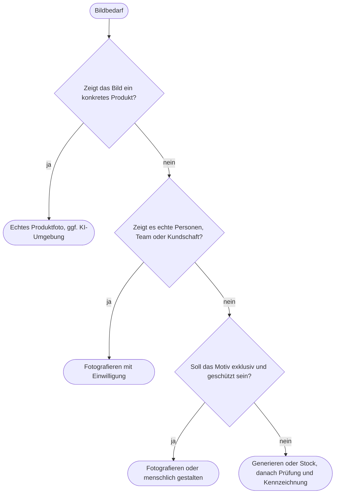

# Kapitel 34 – Anwendungsgrenzen der Bild-KI

{{ progress(34) }}

<div class="lernziele" markdown>
<h3>Was du in diesem Kapitel lernst</h3>

- Welche **technischen Fehler** Bild-KI typischerweise macht und wie du sie systematisch findest
- Wie **Bias und Stereotype** in generierten Bildern entstehen und wie du gegensteuerst
- Warum **echte Personen, fremde Marken und bekannte Figuren** tabu sind – auch wenn das Werkzeug sie erzeugt
- Was für **Urheber- und Nutzungsrechte** an KI-Bildern gilt und worauf du in den Bedingungen der Werkzeuge achtest
- Wann eine **Kennzeichnung** nötig ist: Plattformlabels, Art. 50 AI Act bei Deepfakes, C2PA
- Wie du mit einem **Entscheidungsraster** zwischen Generieren, Fotografieren und Stock wählst
</div>

---

!!! info "Hinweis"
    Dieses Kapitel gibt Orientierung für die Praxis, keine Rechtsberatung. Im Zweifel – insbesondere vor größeren Kampagnen – fragst du die Rechtsabteilung oder eine Anwältin bzw. einen Anwalt. Die Vertiefung zu Urheberrecht, Transparenzpflichten und Ethik folgt in Kap. 39.

## 34.1 Technische Fehler: wo Bild-KI danebenliegt

Bildmodelle erzeugen statistisch plausible Pixel, kein Wissen über die Welt (Kap. 29). Deshalb scheitern sie dort, wo Details einer Logik folgen müssen: Anatomie, Schrift, Mechanik, Physik. Die Modelle sind 2026 deutlich besser als noch vor zwei Jahren – aber die Fehler sind nicht verschwunden, sondern **subtiler** geworden. Gerade das macht sie gefährlich: Sie fallen beim schnellen Hinsehen nicht auf.

| Fehlerbild | Woran du es erkennst | Gegenmittel |
|---|---|---|
| Hände und Gliedmaßen | Fingerzahl, verschmolzene Finger, unmögliche Gelenke | heranzoomen, Inpainting, Hände aus dem Bild nehmen |
| Text im Bild | Buchstabendreher, Fantasiewörter in Hintergrundschildern | Text im Layout setzen (Kap. 33), Hintergrundschrift entfernen |
| Logos | verzerrtes eigenes Logo, Fantasielogos auf Kleidung | Logo nie generieren, nachträglich einsetzen |
| Produktdetails | Reißverschlüsse ohne Ende, falsche Taschen, Nähte im Nichts | echtes Produktfoto, Prüfung durch Produktmanagement |
| Physik und Logik | Schatten in verschiedene Richtungen, Spiegelbild passt nicht, Regen ohne nasse Flächen | Bild in Ruhe „von Ecke zu Ecke" lesen |
| Wiederholungen | gleiche Gesichter in Gruppen, kopierte Bäume, Muster in erweiterten Rändern | besonders nach Outpainting prüfen |
| Kontext | falsche Jahreszeit, Ausrüstung für die Situation ungeeignet | Fachperson draufschauen lassen |

!!! tip "Die 100-Prozent-Prüfung"
    Prüfe jedes Bild vor der Freigabe in voller Auflösung, Quadrant für Quadrant. Schau dabei bewusst auf Hände, Schrift, Kanten, Spiegelungen und Produkt. Für Outdoor-Marken kommt die fachliche Prüfung dazu: Trägt jemand bei Starkregen eine offene Jacke? Steht ein Zelt im Bachbett? Solche Fehler erkennt nur, wer sich auskennt – und genau diese Fehler fallen auch der Kundschaft auf.

---

## 34.2 Bias und Stereotype

Bildmodelle lernen aus riesigen Bildmengen und übernehmen deren Schieflagen. Ohne nähere Angaben erzeugen sie den **statistischen Durchschnitt** – und der ist selten neutral: „Eine Führungskraft" ist dann meist ein Mann mittleren Alters, „eine Familie beim Wandern" weiß, schlank, Vater, Mutter, zwei Kinder, „eine Pflegekraft" eine junge Frau. Für Fjordlicht hieße das: eine Kampagne, in der sich große Teile der Zielgruppe nicht wiederfinden.

```text
Vorher:
Familie beim Wandern im Herbstregen, Fotostil.

Nachher:
Familie beim Wandern im Herbstregen: eine Mutter Anfang 40 mit kurzem grauem
Haar, ihr Sohn etwa 10 Jahre alt, Großvater mit Wanderstock. Alle tragen
Regenkleidung, lachen über eine Pfütze. Natürliche Körperformen, Alltagslook.
[Bildsprache-Baustein]
```

Gegensteuern heißt **konkret beschreiben**, nicht pauschal „divers" ergänzen. Pauschale Anweisungen führen oft zu einer anderen Klischee-Variante – etwa dem immer gleichen „gemischten Team", das wie aus der Stockfoto-Bibliothek wirkt. Prüfe außerdem die ganze **Serie**, nicht das Einzelbild: Wer kommt vor, in welcher Rolle, wer handelt, wer schaut zu?

!!! warning "Typische Falle"
    Vielfalt als Dekoration: Eine Person im Rollstuhl im Hintergrund eines Wanderbildes, ohne dass Weg oder Situation dazu passen, wirkt nicht inklusiv, sondern gestellt. Repräsentation ist dann glaubwürdig, wenn die Situation für die gezeigten Menschen realistisch ist – im Zweifel ist hier ein echtes Shooting mit echten Menschen die bessere Wahl.

---

## 34.3 Echte Personen, fremde Marken, bekannte Figuren

Dass ein Werkzeug etwas erzeugt, heißt nicht, dass du es verwenden darfst. Die Filter der Anbieter sind keine rechtliche Prüfung.

- **Echte Personen:** Bilder, die erkennbar eine reale Person zeigen – Prominente, Influencer, Mitarbeitende, Kundschaft –, berühren das **Recht am eigenen Bild** (§§ 22 f. KUG) und das allgemeine Persönlichkeitsrecht. Ohne Einwilligung ist eine werbliche Nutzung praktisch immer unzulässig. Auch „Lookalikes", die erkennbar an eine bekannte Person erinnern sollen, sind riskant.
- **Fremde Marken:** Logos, Produktdesigns und Markennamen anderer Unternehmen gehören nicht in eure Werbung. Bild-KI setzt gern bekannte Logos auf Kleidung, Autos oder Getränkedosen – das kann Markenrechte verletzen und eine Verbindung suggerieren, die es nicht gibt.
- **Figuren und Werke:** Bekannte Comic-, Film- oder Spielfiguren sind urheber- und oft markenrechtlich geschützt. Ein Bild „im Stil von" ist nicht per se verboten, die **Nachbildung konkreter Werke oder Figuren** schon.
- **Reale Orte und Ereignisse:** Ein generiertes Bild vom Prinzipalmarkt in Münster bei Schnee, das echt wirkt, kann ein Deepfake im Sinne des AI Act sein (34.5).

---

## 34.4 Urheber- und Nutzungsrechte

Zwei Fragen musst du auseinanderhalten: **Wem gehört das Bild?** und **Was darfst du laut Werkzeug damit tun?**

Zur ersten: Nach deutschem Recht schützt das Urheberrecht nur **persönliche geistige Schöpfungen** (§ 2 Abs. 2 UrhG). Ein Bild, das im Wesentlichen die KI erzeugt hat, ist in der Regel **nicht geschützt** – auch nicht durch einen langen Prompt. Die Konsequenz für das Marketing: Die Konkurrenz kann euer KI-Kampagnenmotiv grundsätzlich übernehmen. Schutz entsteht eher dort, wo ein Mensch schöpferisch gestaltet – etwa im Composing mit eigenem Foto, im Layout, in der Gesamtgestaltung. Für Motive, die exklusiv bleiben sollen, etwa ein Markenzeichen oder eine Maskottchen-Figur, ist reine Bild-KI deshalb eine schwache Grundlage.

Zur zweiten: Die Nutzungsbedingungen der Werkzeuge regeln, ob und wie du Ergebnisse kommerziell nutzen darfst. Stand Oktober 2026 im Überblick – Bedingungen ändern sich, prüfe vor dem Einsatz die aktuelle Fassung:

| Werkzeug | Worauf achten |
|---|---|
| ChatGPT Images | Nutzungsrechte am Output laut Bedingungen bei den Nutzenden; C2PA-Metadaten werden eingebettet; Datenschutz und Tarif beachten (Kap. 4) |
| Midjourney | kommerzielle Nutzung nur in Bezahlplänen, für größere Unternehmen höhere Pläne vorgeschrieben; Bilder je nach Plan öffentlich sichtbar |
| Adobe Firefly | trainiert auf lizenzierten Adobe-Stock- und gemeinfreien Inhalten, für kommerzielle Nutzung ausgelegt; Content Credentials; in Unternehmensverträgen teils zusätzliche Absicherung |
| Ideogram | kommerzielle Nutzung möglich; Sichtbarkeit und Rechte je nach Plan prüfen |
| Gemini / Nano Banana | Google-Bedingungen; Bilder tragen ein unsichtbares SynthID-Wasserzeichen |

Unabhängig davon kann ein Output **Rechte Dritter** verletzen, wenn er einem geschützten Werk, einer Marke oder einer Person zu nahe kommt. Die Frage, ob das Training der Modelle selbst rechtmäßig war, ist Gegenstand laufender Verfahren (Kap. 39) – sie ändert nichts an deiner Pflicht, den eigenen Output zu prüfen.

---

## 34.5 Kennzeichnung

Für die Kennzeichnung gibt es drei Ebenen, die oft verwechselt werden:

1. **Anbieterpflicht (Art. 50 Abs. 2 AI Act):** Anbieter generativer Systeme müssen synthetische Inhalte maschinenlesbar markieren – über Metadaten wie **C2PA/Content Credentials** oder Wasserzeichen wie SynthID. Das ist Aufgabe von OpenAI, Adobe, Google & Co. Deine Aufgabe: diese Markierungen nicht absichtlich entfernen.
2. **Betreiberpflicht bei Deepfakes (Art. 50 Abs. 4, seit 02.08.2026):** Wer Bild-, Audio- oder Videoinhalte veröffentlicht, die realen Personen, Orten, Gegenständen oder Ereignissen ähneln und fälschlich echt wirken, muss offenlegen, dass sie künstlich erzeugt oder manipuliert sind. Bei erkennbar künstlerischen, satirischen oder fiktionalen Werken gilt das in eingeschränkter Form.
3. **Plattformregeln:** Meta, TikTok und YouTube verlangen Labels für realistische KI-Inhalte und erkennen C2PA-Daten teils automatisch – unabhängig vom AI Act.

| Fall bei Fjordlicht | AI Act Art. 50 Abs. 4 | Empfehlung |
|---|---|---|
| Echtes Produktfoto, KI-generierte Nebellandschaft als Hintergrund | i. d. R. kein Deepfake | Plattformregeln prüfen, KI-Label bei fotorealistischer Wirkung setzen |
| Illustration im Aquarellstil für den Blog | keine Pflicht | freiwilliger Hinweis möglich |
| Fotorealistischer, echter Ort mit erfundenem Ereignis (Schneechaos am Prinzipalmarkt) | Deepfake möglich | offenlegen oder auf das Motiv verzichten |
| Erkennbare reale Person im Fjordlicht-Look | Deepfake | ohne Einwilligung nicht verwenden; mit Einwilligung offenlegen |
| Generiertes „Kundinnenfoto" mit Zitat | Täuschung | nicht verwenden (34.6) |

!!! info "Merksatz"
    Kennzeichnung ist mehr als eine Rechtspflicht: Fjordlichts Markenwert ist Ehrlichkeit. Wenn du überlegst, ob ein Label „nötig" ist, frage zusätzlich, ob sich Kundinnen getäuscht fühlen würden, wenn sie später erfahren, dass das Bild generiert war.

---

## 34.6 Täuschungsrisiko: wenn das Bild mehr verspricht als das Produkt

Unabhängig vom AI Act verbietet das **UWG** irreführende geschäftliche Handlungen. Ein Werbebild ist eine Aussage über das Produkt. Riskant sind vor allem:

- **Produktabbildungen, die nicht dem Produkt entsprechen:** andere Farbe, andere Details, bessere Verarbeitung (Kap. 33).
- **Erfundene Nutzungssituationen mit Wirkungsversprechen:** die Jacke trocken im Wolkenbruch am Gipfel, obwohl sie nur für leichten Regen ausgelegt ist.
- **Vermeintlich echte Menschen:** generierte „Kundschaft", „Mitarbeitende" oder „Testimonials".
- **Visuelles Greenwashing:** Natursymbolik, die Umweltvorteile suggeriert, die nicht belegt sind (Kap. 32).
- **Vorher/Nachher-Bilder**, die nicht auf echten Aufnahmen beruhen.

---

## 34.7 Entscheidungsraster: generieren, fotografieren oder Stock?

Bild-KI ist ein Werkzeug unter dreien. Die Wahl hängt von der Bildaufgabe ab, nicht von der Neugier auf das Werkzeug.

| Kriterium | Generieren | Fotografieren | Stock |
|---|---|---|---|
| Produkt im Bild | nur als Composing mit echtem Foto | erste Wahl | ungeeignet für eigene Produkte |
| Echte Menschen, Team, Kundschaft | nein | erste Wahl | nur als erkennbar allgemeine Szene |
| Stimmung, Hintergrund, Illustration | stark | aufwendig | gut, aber austauschbar |
| Exklusivität und Schutz | schwach (kein Urheberrecht) | stark | schwach (andere nutzen dasselbe Bild) |
| Tempo und Varianten | sehr hoch | gering | hoch |
| Rechtssicherheit | Bedingungen und Output prüfen | mit Verträgen und Einwilligungen hoch | Lizenz prüfen |



!!! example "Prüffrage vor jeder Freigabe"
    Bitte ChatGPT, Claude oder Gemini um eine kritische Zweitmeinung – als Ergänzung, nicht als Ersatz für deine Prüfung:

    ```text
    Prüfe dieses Werbebild für Fjordlicht vor der Veröffentlichung auf:
    1. technische Fehler (Hände, Text, Logos, Produktdetails, Physik),
    2. Stereotype in der Darstellung von Menschen,
    3. erkennbare reale Personen, Orte, fremde Marken oder Figuren,
    4. Bildaussagen, die über das Produkt hinausgehen könnten:
       [Produktbeschreibung mit belegten Eigenschaften].
    Nenne jeden Fund mit Bildbereich. Schreibe "unsicher", wo du es nicht
    beurteilen kannst. Keine rechtliche Bewertung, nur Hinweise zur Prüfung.
    ```

---

## Zusammenfassung

- Technische Fehler sind 2026 **subtiler**, nicht verschwunden: Hände, Text, Logos, Produktdetails und Physik prüfst du in voller Auflösung.
- Bild-KI reproduziert **Stereotype**; gegensteuern heißt konkret beschreiben und die ganze Serie prüfen.
- **Echte Personen, fremde Marken und geschützte Figuren** sind tabu – Werkzeugfilter ersetzen keine rechtliche Prüfung.
- Reiner KI-Output ist in der Regel **nicht urheberrechtlich geschützt**; die Nutzungsbedingungen der Werkzeuge regeln die kommerzielle Nutzung.
- Kennzeichnung hat drei Ebenen: Anbietermarkierung (C2PA, SynthID), **Deepfake-Offenlegung nach Art. 50 Abs. 4** und Plattformlabels.
- Bilder sind Produktaussagen: Abweichungen, erfundene Kundschaft und visuelles Greenwashing sind ein **UWG-Risiko**.
- Das **Entscheidungsraster** führt zur passenden Quelle: Produkt und echte Menschen fotografieren, Stimmung generieren oder aus Stock.

---

## Kurzübungen

{{ task(file="tasks/k34_01.yaml") }}

{{ task(file="tasks/k34_02.yaml") }}

{{ task(file="tasks/k34_03.yaml") }}

---

## Workshop

{{ task(file="tasks/workshop_k34.yaml") }}
