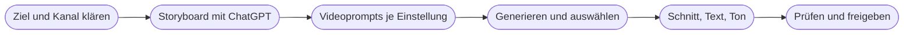

# Kapitel 35 – KI-Videos: Text-to-Video und Animation

{{ progress(35) }}

<div class="lernziele" markdown>
<h3>Was du in diesem Kapitel lernst</h3>

- Was **Videomodelle** heute leisten – Text-zu-Video, Bild-zu-Video, Bearbeitung – und wo sie verlässlich scheitern
- Welche **Werkzeuge** es im Herbst 2026 gibt (Veo, Runway, Kling, Luma, Firefly Video, Sora) und wie du auswählst
- Wie ein **Videoprompt** aufgebaut ist: Szene, Handlung, **Kamerabewegung**, Licht, Stil, Ton
- Warum **Bild-zu-Video** im Marketing meist der kontrolliertere Weg ist
- Wie du mit ChatGPT ein **Storyboard** und daraus kurze **Social-Clips** planst
- Wie der **Schnitt-Workflow** aussieht und welche Grenzen du einplanen musst
</div>

---

## 35.1 Was Videomodelle können – und was nicht

Videomodelle funktionieren im Kern wie die Bildmodelle aus Kapitel 29 – mit einer zusätzlichen Dimension: der **Zeit**. Das Modell erzeugt nicht ein Bild, sondern eine Folge von Bildern, die zueinander passen müssen. Genau dort liegen Stärke und Schwäche zugleich: Licht, Stimmung und Bewegung wirken oft verblüffend echt, aber über mehrere Sekunden hinweg müssen Gesichter, Hände, Logos und Produktdetails stabil bleiben. Das gelingt nicht immer.

Drei Arbeitsweisen solltest du unterscheiden:

| Arbeitsweise | Was du eingibst | Typischer Einsatz | Kontrolle |
|---|---|---|---|
| **Text-zu-Video** | nur einen Prompt | Stimmungsbilder, Hintergründe, Ideenskizzen | gering |
| **Bild-zu-Video** | ein Startbild (ggf. Endbild) plus Prompt | Produktszene animieren, Kampagnenmotiv bewegen | hoch |
| **Video-zu-Video / Bearbeitung** | ein vorhandenes Video plus Anweisung | Stil ändern, Objekte entfernen, Szene verlängern | mittel bis hoch |

Ein generierter Clip ist **kurz**: typischerweise einige Sekunden pro Durchgang. Längere Sequenzen entstehen durch Verlängern, Aneinanderreihen und Schnitt. Wer „einen zweiminütigen Imagefilm per Prompt" erwartet, wird enttäuscht – wer 6 bis 15 Sekunden für einen Reel-Einstieg, einen Hintergrund oder eine Produktanimation braucht, bekommt oft sehr Brauchbares.

!!! info "Merksatz"
    KI-Video liefert **Einstellungen**, keine fertigen Filme. Den Film machst du im Schnitt – mit Dramaturgie, Text, Ton und Prüfung.

---

## 35.2 Die Werkzeuglandschaft (Stand: Oktober 2026)

Der Markt bewegt sich schneller als bei Text und Bild. Versionsnummern veralten in Wochen; entscheidend sind Fähigkeiten, Nutzungsbedingungen und Integration. Die folgende Übersicht ist eine Momentaufnahme.

| Werkzeug | Anbieter | Besonderheiten | Hinweise |
|---|---|---|---|
| **Veo** (3.x) | Google | erzeugt Video **mit Ton** (Geräusche, Atmosphäre, auch Sprache), u. a. über Gemini und Google Flow | Wasserzeichen SynthID |
| **Runway** (Gen-4.5) | Runway | starke Bearbeitungs- und Editing-Funktionen, Referenzbilder, Kamerasteuerung | eher Profi-Werkzeug |
| **Kling** (3.0) | Kuaishou | realistische Bewegungen, Bild-zu-Video, Start-/Endbild | Datenschutz und Nutzungsbedingungen prüfen |
| **Luma** | Luma AI | flüssige Kamerafahrten, schnelle Iteration | — |
| **Adobe Firefly Video** | Adobe | Integration in Adobe-Umgebung, kommerziell abgesichert beworben, Content Credentials | naheliegend, wenn das Team ohnehin mit Adobe arbeitet |
| **Sora** (2) | OpenAI | App-basiert, hohe Qualität | Sora-2-API wurde am 24.09.2026 eingestellt – Zukunft unklar, nicht als Kernwerkzeug einplanen |

Für die Auswahl helfen dieselben Kriterien wie bei Bildwerkzeugen (Kap. 29): Qualität für deinen Anwendungsfall, Rechte und kommerzielle Nutzung, Datenschutz (wo werden hochgeladene Produktfotos verarbeitet?), Integration in eure Werkzeuge und Kosten. Fast alle Anbieter rechnen über **Credits** ab – ein Clip kostet je nach Länge und Qualität unterschiedlich viel, und verworfene Versuche zählen mit.

!!! tip "Kosten realistisch planen"
    Rechne für einen brauchbaren Clip mit **fünf bis zehn Versuchen**. Wer das Credit-Budget für einen Monat an einem Nachmittag verbraucht, hat meist ohne Storyboard drauflosgeneriert.

---

## 35.3 Der Videoprompt: Bildprompt plus Bewegung

Ein Videoprompt enthält alles, was du in Kapitel 30 für Bildprompts gelernt hast – Motiv, Umgebung, Stil, Licht, Farbstimmung, Format. Hinzu kommen drei Bausteine, die es im Standbild nicht gibt: **Handlung**, **Kamerabewegung** und **Ton**.

| Baustein | Leitfrage | Beispiel |
|---|---|---|
| Szene | Wo und wann? | „Küstenpfad an der Nordsee, später Nachmittag, leichter Nieselregen" |
| Motiv | Wer oder was? | „Frau Mitte 30 in einer salbeigrünen Regenjacke" |
| **Handlung** | Was passiert in diesen Sekunden? | „sie zieht die Kapuze hoch und geht gegen den Wind weiter" |
| **Kamera** | Wie bewegt sich der Blick? | „langsame Kamerafahrt seitlich mit, auf Schulterhöhe" |
| Licht & Stil | Wie sieht es aus? | „gedämpftes Tageslicht, natürliche Farben, dokumentarischer Look" |
| **Ton** | Was hört man? (falls das Modell Ton erzeugt) | „Wind, Regen auf Stoff, entfernte Möwen, keine Musik" |
| Format & Dauer | Wofür? | „9:16, 8 Sekunden" |

Die wichtigsten **Kamerabewegungen** solltest du benennen können – die Modelle verstehen die englischen Fachbegriffe meist besser als die deutschen:

| Begriff | Bedeutung | Wirkung |
|---|---|---|
| Static shot | Kamera steht still | ruhig, sachlich |
| Pan | Schwenk nach links/rechts | Überblick, Umgebung zeigen |
| Tilt | Neigung nach oben/unten | Größe, Enthüllung |
| Dolly in / out | Kamera fährt heran / weg | Nähe aufbauen / Kontext öffnen |
| Tracking shot | Kamera begleitet das Motiv | Dynamik, Mitgehen |
| Orbit | Kamera kreist um das Motiv | Produkt von allen Seiten |
| Drone / aerial shot | Luftaufnahme | Landschaft, Weite |
| Handheld | leicht wackelnd | authentisch, dokumentarisch |

Ein vollständiger Videoprompt für Fjordlicht sieht so aus:

```text
Szene: Küstenpfad an der Nordsee, später Nachmittag, leichter Nieselregen,
graue Wolken mit hellem Streifen am Horizont.
Motiv und Handlung: Eine Frau Mitte 30 in einer schlichten salbeigrünen
Regenjacke ohne sichtbares Logo zieht die Kapuze hoch und geht ruhig
gegen den Wind weiter. Regentropfen perlen auf dem Stoff ab.
Kamera: langsamer Tracking Shot seitlich auf Schulterhöhe, dann leichter
Dolly in auf die Schulterpartie der Jacke.
Licht und Stil: gedämpftes Tageslicht, natürliche, leicht kühle Farben,
dokumentarischer Look, keine Hochglanzwerbung.
Ton: Wind, Regen auf Stoff, entfernte Möwen, keine Musik, keine Sprache.
Format: 9:16, etwa 8 Sekunden.
Vermeide: Text im Bild, Logos, übertriebene Zeitlupe.
```

!!! warning "Typische Falle"
    Zu viel Handlung in einem Clip. „Sie geht los, trinkt Kaffee, packt den Rucksack, steigt auf den Gipfel und lacht in die Kamera" überfordert jedes Modell – das Ergebnis springt oder verformt sich. **Eine Einstellung, eine Handlung.** Mehrere Handlungen werden mehrere Clips.

---

## 35.4 Bild-zu-Video: der kontrollierte Weg

Im Marketing ist Text-zu-Video vor allem für Stimmungen, Landschaften und Hintergründe geeignet. Sobald ein **konkretes Produkt** im Bild ist, wird Bild-zu-Video meist zur besseren Wahl: Du startest mit einem Bild, das du geprüft hast, und das Modell bewegt es nur noch.

Typische Startbilder:

- ein **echtes Produktfoto** (z. B. Rucksack „Tind" auf einem Felsen) – das Modell ergänzt Bewegung von Nebel, Licht, Gräsern
- ein in Kapitel 33 erstelltes **Kampagnenmotiv**, das als Reel-Variante leicht animiert wird
- ein **Start- und ein Endbild**, zwischen denen das Modell den Übergang erzeugt

```text
Animiere dieses Bild dezent. Die Kamera fährt sehr langsam heran
(slow dolly in). Nebel zieht von links nach rechts durch das Tal,
die Gräser im Vordergrund bewegen sich leicht im Wind.
Der Rucksack selbst bleibt unverändert: keine Verformung,
keine zusätzlichen Riemen, keine neuen Details, kein Text.
Dauer etwa 6 Sekunden, ruhige Stimmung.
```

Auch beim Animieren eines echten Fotos kann das Modell das Produkt verändern: Nähte verschwinden, Reißverschlüsse wandern, Farben kippen. Ein Video, das ein Produkt anders zeigt, als es ist, ist dasselbe Täuschungsrisiko wie beim Bild (Kap. 34) – nur schwerer zu bemerken, weil es sich bewegt.

!!! tip "Prüfen in Einzelbildern"
    Schau dir jeden Clip vor der Freigabe **Bild für Bild** an oder zumindest in halber Geschwindigkeit. Verformungen dauern oft nur wenige Frames und fallen bei normaler Wiedergabe erst beim dritten Ansehen auf – dann aber auch der Kundschaft.

---

## 35.5 Vom Storyboard zum Social-Clip

Das Videomodell ist der letzte Schritt, nicht der erste. Davor steht die Frage, was der Clip erreichen soll – und dabei hilft ChatGPT (oder Claude, Gemini, Copilot) als Planungswerkzeug.



Ein Storyboard-Prompt nach dem P.R.O.M.P.T.-Prinzip (Kap. 5):

```text
Du bist Art Director für kurze Social-Media-Videos.
Erstelle ein Storyboard für ein Instagram-Reel (9:16, 15 Sekunden)
zum Fleece "Skog" von Fjordlicht.
Ziel: Aufmerksamkeit bei naturverbundenen Stadtmenschen 25-45,
Botschaft: warm, leicht, für kühle Herbstmorgen draußen.
Format: Tabelle mit den Spalten Nr., Dauer, Bildinhalt, Handlung,
Kamerabewegung, Ton, Texteinblendung.
Regeln: 4 bis 5 Einstellungen, jede mit genau einer Handlung.
Die ersten 2 Sekunden müssen ohne Ton verständlich sein.
Keine Nachhaltigkeitsaussagen außer: [belegte Aussage aus Claim-Liste].
Ton: ruhig, ehrlich, leicht nordisch-trocken, keine Superlative.
Schreibe danach für jede Einstellung einen eigenen Videoprompt.
```

Für kurze Social-Clips gelten die Plattformlogiken aus Kapitel 14: Der **Hook** muss in den ersten ein bis zwei Sekunden sitzen, viele schauen **ohne Ton** (also Untertitel und Texteinblendungen), das Format ist meist **9:16**. Für LinkedIn (Fjordlicht Business) funktionieren ruhigere, sachlichere Clips oft besser als schnelle Schnitte.

| Clip-Typ | Eignung für KI-Video | Bemerkung |
|---|---|---|
| Stimmungs-Intro (Landschaft, Wetter) | sehr gut | kaum Konsistenzprobleme |
| Produkt in Bewegung (Bild-zu-Video) | gut, mit Prüfung | echtes Produktfoto als Basis |
| Hintergrund für Texteinblendung | sehr gut | Text kommt im Schnitt dazu |
| Person mit Gesicht über mehrere Einstellungen | eingeschränkt | Gesicht verändert sich zwischen Clips |
| Anleitung (z. B. Imprägnieren) | schlecht | echte Handgriffe filmen |
| Testimonial | ungeeignet | erfundene Kundenstimme = Täuschung |

---

## 35.6 Grenzen und Schnitt-Workflow

Die typischen Fehlerbilder kennst du teilweise aus der Bild-KI, im Video kommen eigene hinzu:

- **Physik:** Wasser fließt bergauf, Schritte passen nicht zum Untergrund, Gegenstände durchdringen sich.
- **Konsistenz:** Dieselbe Person sieht in Einstellung 2 anders aus als in Einstellung 1; Jackenfarbe und Details wandern. Referenzbilder und Charakter-Funktionen helfen, lösen es aber nicht vollständig.
- **Hände, Text, Logos:** Schrift im Video ist noch unzuverlässiger als im Bild. Text gehört in den Schnitt.
- **Länge:** Lange Sequenzen driften. Lieber kurze Clips sauber schneiden.
- **Ton:** Erzeugter Ton (z. B. bei Veo) ist praktisch für Atmosphäre, aber Sprache und Lippen passen nicht immer zusammen.

Der **Schnitt** macht aus Clips ein Video. Gängige Werkzeuge: **CapCut** (schnell, mobil, viele Social-Vorlagen – Nutzungsbedingungen für Unternehmen prüfen), **Adobe Premiere Pro** (professionell, mit KI-Funktionen wie Szenenverlängerung) und **Descript** (Schnitt über das Transkript, praktisch für Videos mit Sprache). Dort ergänzt du Untertitel, Texteinblendungen in Markenschrift, Logo, Musik (Kap. 37) und Sprecher (Kap. 36).

!!! warning "Typische Falle"
    Realistische KI-Szenen mit Menschen ohne Hinweis posten. Meta, TikTok und YouTube verlangen **Labels für realistische KI-Inhalte**. Zeigt ein Clip reale Personen, Orte oder Ereignisse so, dass er fälschlich echt wirkt, greift zudem die Offenlegungspflicht für Deepfakes nach **Art. 50 Abs. 4 AI Act**. Für erkennbar inszenierte Stimmungsbilder ist das meist kein Deepfake – die Plattformregeln gelten trotzdem. Details und Entscheidungsbaum in Kapitel 39.

!!! info "Merksatz"
    Generieren ist schnell, Prüfen ist Arbeit. Plane für jeden KI-Clip ein: **Einzelbildprüfung, Produktabgleich, Kennzeichnung, Freigabe.**

---

## Zusammenfassung

- Videomodelle erzeugen **kurze Einstellungen** von wenigen Sekunden; der Film entsteht erst im Schnitt.
- Werkzeuge im Herbst 2026: **Veo** (mit Ton), **Runway**, **Kling**, **Luma**, **Firefly Video**; Sora nur mit Vorbehalt, da die API eingestellt wurde.
- Ein Videoprompt ergänzt den Bildprompt um **Handlung, Kamerabewegung und Ton** – eine Einstellung, eine Handlung.
- **Bild-zu-Video** mit echtem Produktfoto ist im Marketing meist der kontrolliertere Weg; Produktdetails trotzdem Bild für Bild prüfen.
- ChatGPT plant das **Storyboard** und schreibt die Prompts je Einstellung; Hook, Untertitel und 9:16 gehören von Anfang an dazu.
- Grenzen sind Physik, Konsistenz, Text und Länge; **Plattformlabels** und ggf. Art. 50 Abs. 4 AI Act sind einzuplanen.

---

## Kurzübungen

{{ task(file="tasks/k35_01.yaml") }}

{{ task(file="tasks/k35_02.yaml") }}

{{ task(file="tasks/k35_03.yaml") }}

---

## Workshop

{{ task(file="tasks/workshop_k35.yaml") }}
