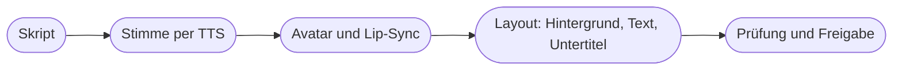

# Kapitel 36 – Avatar-Videos und KI-Sprecher

{{ progress(36) }}

<div class="lernziele" markdown>
<h3>Was du in diesem Kapitel lernst</h3>

- Wie **Avatar-Videos** entstehen und welche Avatar-Typen es gibt (Stock-, eigener und Foto-Avatar)
- Was die Werkzeuge **HeyGen**, **Synthesia** und **D-ID** unterscheidet und wie du auswählst
- Wie du ein **Skript fürs Sprechen** schreibst – und warum ein guter Lesetext ein schlechter Sprechtext ist
- Wie du eine **KI-Sprecherstimme** (Text-to-Speech, z. B. ElevenLabs) steuerst: Aussprache, Pausen, Betonung
- Wie **Übersetzung mit Lip-Sync** funktioniert und welche Prüfschritte unverzichtbar sind
- Für welche **Einsatzfelder** Avatare taugen, wo das **Uncanny Valley** droht und wann **Transparenz** Pflicht ist
</div>

---

## 36.1 Wie ein Avatar-Video entsteht

Ein Avatar-Video zeigt eine digitale Person, die einen Text spricht. Technisch laufen drei Schritte hintereinander: Aus dem **Skript** wird mit **Text-to-Speech (TTS)** eine Tonspur, dann werden Lippen, Mimik und Kopfbewegung des Avatars passend zur Tonspur erzeugt (**Lip-Sync**), schließlich wird das Ganze mit Hintergrund, Einblendungen und Untertiteln zu einem Video gerendert.



Anders als beim Text-zu-Video aus Kapitel 35 erfindet das System keine Szene. Es bewegt eine Figur nach Vorlage. Dadurch sind Avatar-Videos **sehr konsistent** – dieselbe Person, dieselbe Stimme, jede Woche – aber auch **statisch**: frontal, sprechend, wenig Handlung.

| Avatar-Typ | Was es ist | Typischer Einsatz | Achtung |
|---|---|---|---|
| **Stock-Avatar** | vom Anbieter bereitgestellte Person (echte Darsteller:innen, lizenziert) | Schulung, interne Kommunikation, schnelle Tests | Dieselbe Person sprechen auch andere Firmen – geringe Markenbindung |
| **Eigener Avatar** („digitaler Zwilling") | Aufnahme einer echten Person aus eurem Haus, daraus trainiert | Geschäftsführung, Produktexpertin, Markengesicht | Einwilligung, Vertrag, Widerruf, Ausscheiden der Person |
| **Foto-Avatar** | ein Standbild wird zum Sprechen animiert | einfache Erklärsequenzen, Illustrationen | wirkt schnell künstlich; bei Fotos realer Personen Persönlichkeitsrechte |

!!! info "Merksatz"
    Ein Avatar-Video ist **ein Sprecher vor der Kamera, der nie müde wird** – nicht mehr, nicht weniger. Es ersetzt den Dreh einer Talking-Head-Aufnahme, nicht den Film.

---

## 36.2 Werkzeuge und Auswahl

Die bekanntesten Anbieter sind **HeyGen**, **Synthesia** und **D-ID** (Stand: Oktober 2026; Funktionsumfang und Preise ändern sich laufend). Für die reine Stimme kommt häufig **ElevenLabs** dazu.

| Werkzeug | Schwerpunkt | Eignet sich für |
|---|---|---|
| **HeyGen** | Avatar-Videos, eigene Avatare, **Videoübersetzung** mit Lip-Sync | Social-Clips, Produkterklärungen, mehrsprachige Varianten |
| **Synthesia** | Unternehmenskommunikation, Schulungen, viele Sprachen, Team-Funktionen | E-Learning, Onboarding, interne Videos |
| **D-ID** | Animation von Fotos, sprechende Porträts, interaktive Avatare | kurze Erklärsequenzen, Experimente |
| **ElevenLabs** | Text-to-Speech, Stimmenbibliothek, Voice Cloning, Synchronisation | Sprecherstimme für Videos, Podcasts, Audiogramme |

Wichtiger als der Name des Werkzeugs sind die **Auswahlkriterien**:

- **Datenschutz und Vertrag:** Wo werden Aufnahmen und Skripte verarbeitet? Gibt es einen Auftragsverarbeitungsvertrag (AVV)? Werden eure Aufnahmen zum Training verwendet?
- **Einwilligungsprozess:** Seriöse Anbieter verlangen für eigene Avatare und geklonte Stimmen eine **Verifikation**, dass die abgebildete Person zustimmt. Fehlt das, ist das ein Warnsignal.
- **Sprachen und Aussprache:** Wie klingt Deutsch? Lassen sich Aussprachen für Produktnamen festlegen?
- **Markenelemente:** Schriften, Farben, Logo, Vorlagen fürs Team.
- **Kommerzielle Nutzung:** In welchem Tarif sind Videos für Werbung erlaubt?

!!! tip "Erst Test, dann Tarif"
    Erstelle mit jedem Kandidaten **dasselbe 30-Sekunden-Skript** mit euren schwierigsten Wörtern. Der Vergleich dauert eine Stunde und erspart einen Jahresvertrag mit einem Werkzeug, das „Sølv" als „Solf" ausspricht.

---

## 36.3 Ein Skript fürs Sprechen schreiben

Der häufigste Qualitätsmangel in Avatar-Videos ist nicht der Avatar, sondern das **Skript**. Texte, die fürs Lesen geschrieben sind – Blogabsätze, Produktbeschreibungen, Newsletter –, klingen gesprochen hölzern. Wer liest, kann zurückspringen; wer zuhört, nicht.

| Lesetext | Sprechtext |
|---|---|
| lange Sätze mit Einschüben | kurze Sätze, eine Aussage pro Satz |
| Substantivstil („Die Durchführung der Imprägnierung …") | Verben („So imprägnierst du …") |
| Klammern, Abkürzungen, Sonderzeichen | ausgeschrieben („zum Beispiel", „Grad") |
| Zahlen als Ziffern („20.000 mm") | so, wie man sie sagt („zwanzigtausend Millimeter Wassersäule") |
| Wichtiges steht irgendwo | Wichtiges am Anfang und am Ende, ggf. wiederholt |
| ca. 200–250 Wörter lesen sich in einer Minute | ca. 120–150 Wörter **sprechen** sich in einer Minute |

**Vorher** (aus der Produktseite übernommen):

> Die Regenjacke „Sølv" verfügt über eine 3-Lagen-Membran (Wassersäule 20.000 mm, Atmungsaktivität RET < 6), deren Funktionalität durch regelmäßige Reinigung und Re-Imprägnierung (s. Pflegehinweise) erhalten bleibt.

**Nachher** (Sprechfassung):

> Deine Sølv hält dicht – auch bei Dauerregen. Damit das so bleibt, braucht sie ab und zu Pflege. Ich zeige dir in einer Minute, wie du sie wäschst und neu imprägnierst.

Ein Prompt, der diese Umwandlung zuverlässig leistet:

```text
Du bist Sprechtexterin für kurze Erklärvideos.
Schreibe den folgenden Text in ein Sprechskript für ein Avatar-Video um.
Zweck: Kundinnen und Kunden von Fjordlicht lernen, wie sie ihre Regenjacke
pflegen. Dauer: 60 Sekunden, also höchstens 140 Wörter.
Regeln:
- kurze Sätze, eine Aussage pro Satz, Du-Ansprache
- Zahlen, Abkürzungen und Einheiten so ausschreiben, wie man sie spricht
- keine Klammern, keine Sonderzeichen
- Kernbotschaft im ersten und im letzten Satz
- markiere Sprechpausen mit [Pause]
- Ton: ruhig, ehrlich, leicht nordisch-trocken, keine Superlative
- erfinde keine Produkteigenschaften; was im Text fehlt, markierst du mit [FEHLT]
Text: [Produkt- oder Pflegetext einfügen]
```

!!! warning "Typische Falle"
    Das Skript nur lesen statt **laut sprechen**. Lies jedes Skript einmal selbst laut mit Stoppuhr. Wo du stolperst, stolpert auch die KI-Stimme – und wo du nach 60 Sekunden erst bei der Hälfte bist, ist das Video zu lang.

---

## 36.4 Die Sprecherstimme: Text-to-Speech steuern

KI-Stimmen klingen 2026 in vielen Sprachen natürlich. Die Unterschiede liegen im Detail: Betonung, Pausen, Aussprache von Namen und Fachwörtern. Genau dort entscheidet sich, ob ein Video professionell wirkt.

| Stellschraube | Was du tust | Beispiel |
|---|---|---|
| **Stimmauswahl** | Stimme passend zur Markenstimme wählen, nicht nach erstem Eindruck | ruhig, mittlere Tonlage, nicht werblich-aufgedreht |
| **Aussprache** | Lautschrift oder Ersatzschreibung, in manchen Werkzeugen Aussprache-Wörterbuch | „Sølv" → „Söll", „Vidde" → „Widde" |
| **Pausen** | Satzzeichen, Absätze oder Pausenmarker des Werkzeugs nutzen | nach der Kernaussage kurz absetzen |
| **Betonung** | Satzbau so wählen, dass das Wichtige am Satzende steht | „Was die Jacke dicht hält, ist die Membran." |
| **Tempo und Stabilität** | Regler im Werkzeug, je nach Anbieter | für Erklärungen eher langsamer |

**ElevenLabs** ist das bekannteste spezialisierte TTS-Werkzeug; Avatar-Plattformen bringen eigene Stimmen mit und binden teilweise externe Stimmen ein. Für Fjordlicht lohnt eine **Ausspracheliste** aller Produktnamen, die in jedes Projekt übernommen wird – das ist dieselbe Logik wie eine Wissensdatei für einen Assistenten (Kap. 24).

Eine **geklonte Stimme** – etwa die der Geschäftsführerin oder einer festen Sprecherin – ist technisch nur einen Schritt entfernt. Ob und wie ihr das macht, ist eine eigene Entscheidung mit Einwilligung, Vertrag und Sicherheitsregeln. Das behandelt Kapitel 38 ausführlich.

!!! example "Aussprachetest in fünf Minuten"
    Lass die Stimme diesen Satz sprechen und hör genau hin:

    ```text
    Sølv, Skog, Vidde und Tind - vier Begleiter für draußen.
    Fjordlicht Business berät dich ab zehn Teilen. Mehr dazu im Webshop.
    ```

    Markennamen, Zahlen und Abkürzungen sind die Stellen, an denen KI-Stimmen am häufigsten danebenliegen.

---

## 36.5 Übersetzung und Lip-Sync

Eine der stärksten Funktionen ist die **Videoübersetzung**: Ein Video wird in eine andere Sprache übertragen, die Stimme klingt ähnlich wie im Original, und die Lippen werden an den neuen Text angepasst. Für ein Unternehmen wie Fjordlicht, das etwa Kundschaft in den Niederlanden oder Dänemark erreichen will, ist das verlockend: ein Dreh, mehrere Sprachen.

Die Qualität der Übersetzung ist aber nur so gut wie die Prüfung. Typische Fehlerquellen:

| Risiko | Beispiel | Gegenmittel |
|---|---|---|
| Fachbegriffe falsch | „Wassersäule" wörtlich übersetzt | Glossar vorgeben, Fachbegriffe prüfen |
| Ansprache passt nicht | Du/Sie-Konventionen unterscheiden sich je Sprache und Markt | Ansprache je Zielsprache festlegen |
| Länge | Übersetzung ist länger, Sprechtempo steigt hörbar | Skript in der Zielsprache kürzen statt beschleunigen |
| Zahlen, Maße, Preise | Formatierung, Währung, Größenangaben | separat prüfen |
| Rechtliche Aussagen | Nachhaltigkeits-Claim in der Zielsprache stärker formuliert | Claim-Liste je Sprache |

!!! tip "Muttersprachliche Abnahme"
    Lass jede Sprachfassung vor der Veröffentlichung von einer Person mit Muttersprache und Marktkenntnis anhören. Das ist kein Luxus: Ein falscher Ton in der Fremdsprache fällt dir selbst nicht auf – der Kundschaft sofort.

Der saubere Ablauf ist deshalb: **Skript übersetzen (KI) → Skript prüfen (Mensch) → Video erzeugen → Video abnehmen (Mensch)**. Die direkte Ein-Klick-Übersetzung eines fertigen Videos eignet sich für interne Zwecke und Tests, für Werbung nur mit Abnahme.

---

## 36.6 Einsatzfelder, Akzeptanz und Transparenz

Avatare sind kein Ersatz für Menschen in jeder Situation. Wo es um **Information** geht, funktionieren sie gut; wo es um **Vertrauen und Emotion** geht, schlechter.

| Einsatzfeld | Eignung | Warum |
|---|---|---|
| Schulung, Onboarding (z. B. für Fjordlicht Business-Kunden) | gut | sachlich, oft aktualisiert, mehrsprachig |
| Produkt-FAQ, Pflegeanleitung (Sprecher plus Einblendungen) | gut | wiederkehrende Fragen, klare Struktur |
| Interne Updates | gut | schnell, konsistent |
| Social Media Ads | eingeschränkt | Avatare wirken im Feed oft austauschbar |
| Krisenkommunikation, Entschuldigung | ungeeignet | braucht echte, verantwortliche Menschen |
| Kundenstimmen, Testimonials | ungeeignet | erfundene Erfahrung ist Täuschung |

Das **Uncanny Valley** („unheimliches Tal") beschreibt den Effekt, dass fast menschliche Figuren befremdlicher wirken als deutlich künstliche: starre Augen, zu gleichmäßige Kopfbewegung, eine Mimik, die nicht ganz zum Gesagten passt. Je länger ein Avatar-Video, desto stärker der Effekt. Gegenmittel: kurze Sequenzen, Wechsel zwischen Avatar und Produktbildern, ehrlicher Umgang.

**Transparenz** ist dabei nicht nur Stilfrage:

- **Plattformlabels:** Meta, TikTok und YouTube verlangen Kennzeichnungen für realistische KI-Inhalte.
- **Art. 50 Abs. 4 AI Act:** Wirkt ein Avatar wie eine echte Person und kann fälschlich für echt gehalten werden, ist das als Deepfake offenzulegen. Bei einem digitalen Zwilling der Geschäftsführerin liegt das nahe.
- **Einwilligung:** Ein eigener Avatar braucht die informierte, schriftliche Einwilligung der Person (Recht am eigenen Bild, §§ 22 f. KUG; Persönlichkeitsrecht auch an der Stimme), geregelt für Zweck, Dauer, Widerruf und Ausscheiden aus dem Unternehmen.

!!! info "Merksatz"
    Ein Satz wie „Dieses Video wurde mit einem KI-Avatar erstellt" kostet nichts – herausgekommene Täuschung kostet Vertrauen. **Im Zweifel kennzeichnen.**

!!! warning "Keine Rechtsberatung"
    Die rechtlichen Hinweise in diesem Kapitel geben Orientierung. Für Verträge mit Mitarbeitenden oder Sprecher:innen und für konkrete Kennzeichnungsfragen ziehe im Zweifel die Rechtsabteilung oder eine Anwältin hinzu. Vertiefung in Kapitel 38 (Voice Cloning) und Kapitel 39 (Transparenzpflichten).

---

## Zusammenfassung

- Ein Avatar-Video entsteht aus **Skript → TTS-Stimme → Lip-Sync → Layout**; es ist konsistent, aber statisch.
- **HeyGen**, **Synthesia** und **D-ID** unterscheiden sich im Schwerpunkt; entscheidend sind Datenschutz, Einwilligungsprozess, Sprachqualität und kommerzielle Nutzung.
- Ein **Sprechtext** hat kurze Sätze, ausgeschriebene Zahlen und rund 120–150 Wörter pro Minute; jedes Skript laut testen.
- Die Stimme steuerst du über Auswahl, **Aussprache**, Pausen und Satzbau; Voice Cloning ist Thema von Kapitel 38.
- **Videoübersetzung** mit Lip-Sync spart Aufwand, braucht aber Glossar, Kürzung und **muttersprachliche Abnahme**.
- Avatare passen zu Information, nicht zu Vertrauensthemen; **Plattformlabels**, ggf. Art. 50 Abs. 4 AI Act und **Einwilligung** sind Pflicht.

---

## Kurzübungen

{{ task(file="tasks/k36_01.yaml") }}

{{ task(file="tasks/k36_02.yaml") }}

{{ task(file="tasks/k36_03.yaml") }}

---

## Workshop

{{ task(file="tasks/workshop_k36.yaml") }}
