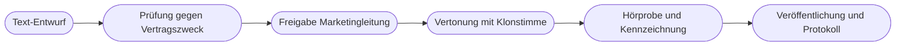

# Kapitel 38 – Voice Cloning

{{ progress(38) }}

<div class="lernziele" markdown>
<h3>Was du in diesem Kapitel lernst</h3>

- Wie **Voice Cloning** technisch funktioniert und wie es sich von Standard-Sprecherstimmen (TTS) unterscheidet
- Wofür eine geklonte Stimme im Marketing sinnvoll ist: **Markenstimme**, **Mehrsprachigkeit**, **Korrekturen**
- Warum die Stimme rechtlich geschützt ist (**Persönlichkeitsrecht**) und was in **Einwilligung und Vertrag** mit Sprecher:innen gehört
- Wie geklonte Stimmen **missbraucht** werden – Fake-Anrufe, CEO-Fraud – und wie sich ein Unternehmen schützt
- Wann eine KI-Stimme nach **Art. 50 Abs. 4 AI Act** als Deepfake offengelegt werden muss
- Welche **Sicherheitsregeln** für den Umgang mit einer eigenen Klon-Stimme gelten
</div>

---

## 38.1 Wie Voice Cloning funktioniert

In Kapitel 36 hast du KI-Sprecherstimmen aus dem Katalog genutzt: **Text-to-Speech (TTS)** mit einer Stimme, die der Anbieter bereitstellt. **Voice Cloning** geht einen Schritt weiter. Das System lernt aus Aufnahmen einer bestimmten Person deren Klangfarbe, Sprechmelodie und Eigenheiten und kann danach beliebigen Text **mit dieser Stimme** sprechen – auch Sätze, die die Person nie gesagt hat, und in Sprachen, die sie nicht spricht.

Das ist die Stärke und das Risiko zugleich: Eine Stimme ist nach wenigen Minuten Material kopierbar. Wer heute öffentlich spricht – im Podcast, in Webinaren, in Videos auf LinkedIn –, liefert ungewollt Trainingsmaterial.

| Verfahren | Was du brauchst | Ergebnis | Beispiel |
|---|---|---|---|
| **Standard-TTS** | nur Text | Katalogstimme, keine reale Person erkennbar | Stimmbibliotheken bei ElevenLabs, HeyGen, Synthesia |
| **Instant Voice Cloning** | kurze, saubere Aufnahme | schnell, ähnlich, bei Emotion und Betonung oft unsauber | ElevenLabs Instant Voice Cloning |
| **Professional Voice Cloning** | deutlich mehr hochwertiges Material, Verifikation | sehr nah am Original, stabil über lange Texte | ElevenLabs Professional Voice Cloning |
| **Speech-to-Speech** | eine eingesprochene Aufnahme | Betonung des Sprechers, Klang der Zielstimme | Korrekturen, Nachvertonung |

Seriöse Anbieter lassen nicht jede beliebige Stimme klonen. ElevenLabs etwa verlangt beim Professional Voice Cloning einen **Verifikationsprozess**, bei dem die Person selbst einen vorgegebenen Text einspricht, und lässt sich bestätigen, dass eine Einwilligung vorliegt. Das schützt vor dem plumpsten Missbrauch – aber nicht vor Werkzeugen, die solche Prüfungen nicht haben.

!!! info "Merksatz"
    Eine geklonte Stimme ist kein Sprecherkatalog, sondern ein **Abbild einer realen Person**. Alles, was du mit ihr tust, sagt diese Person – aus Sicht der Hörer.

---

## 38.2 Einsatzfelder im Marketing

Richtig eingesetzt, löst Voice Cloning echte Probleme. Drei Felder sind im Marketing besonders relevant.

**Eigene Markenstimme.** Fjordlicht arbeitet seit Jahren mit einer Sprecherin für Erklärvideos und Podcast-Intros zusammen. Mit ihrer Einwilligung entsteht ein Klon, der kurze Produkt-FAQ-Videos, Updates im Webshop oder Audioversionen von Blogartikeln aus „Draußen-Notizen" vertont – ohne für jeden Satz einen Studiotermin.

**Mehrsprachigkeit.** Fjordlicht Business will Kunden in den Niederlanden und Skandinavien erreichen. Die vertraute Stimme spricht dieselben Inhalte auf Englisch oder Niederländisch. Wichtig: Die Übersetzung prüft ein Mensch mit Sprachkenntnis (Kap. 36), und die Sprecherin muss dem mehrsprachigen Einsatz zugestimmt haben.

**Korrekturen und Pick-ups.** Im fertigen Erklärvideo hat sich ein Preis geändert, oder ein Produktname war falsch ausgesprochen. Statt neu aufzunehmen, wird ein einzelner Satz mit der Klonstimme ersetzt.

| Einsatz | Nutzen | Wo es heikel wird |
|---|---|---|
| Produkt-FAQ, Webshop-Audio | schnell, konsistent, skalierbar | Aussagen, die die Sprecherin nie freigegeben hätte |
| Übersetzung der Markenstimme | Wiedererkennung über Sprachen | Akzent, Betonung, kulturelle Passung |
| Korrektur einzelner Sätze | spart Studiotermin | Sinn wird verändert, ohne dass jemand es merkt |
| Stimme der Geschäftsführung für LinkedIn-Videos | Präsenz ohne Zeitaufwand | Glaubwürdigkeit, Täuschung, Missbrauchsvorlage |
| Stimme eines Prominenten oder Influencers „nachbauen" | – | ohne Vertrag rechtswidrig, mit Vertrag kennzeichnungspflichtig |

!!! warning "Typische Falle"
    „Wir klonen einfach die Stimme unserer Geschäftsführerin, dann muss sie die Videos nicht mehr selbst einsprechen." Technisch ist das in einer Stunde erledigt. Aber jedes so erzeugte Video ist eine Aussage, die sie nie gemacht hat – und je öfter ihre Stimme öffentlich synthetisch auftaucht, desto leichter fällt ein Betrüger-Anruf in ihrem Namen auf fruchtbaren Boden (38.4).

---

## 38.3 Einwilligung, Vertrag und Persönlichkeitsrecht

Die Stimme gehört zur Persönlichkeit. In Deutschland ist sie über das **allgemeine Persönlichkeitsrecht** geschützt. Wer die erkennbare Stimme einer Person ohne deren Zustimmung nachbildet und für Werbung nutzt, greift in dieses Recht ein – egal, ob ein Stimmenimitator oder eine KI spricht. Dazu kommt der Datenschutz: Stimmaufnahmen sind **personenbezogene Daten**, und ein Stimmprofil, das eine Person eindeutig erkennbar macht, ist besonders sensibel. Das **Recht am eigenen Bild** (KUG §§ 22 f.) greift bei Avatar-Videos mit Gesicht zusätzlich (Kap. 36).

Daraus folgt: Ohne **ausdrückliche, informierte Einwilligung** und einen **schriftlichen Vertrag** wird keine Stimme geklont – auch nicht die von Mitarbeitenden. Bei Beschäftigten ist besondere Vorsicht geboten, weil im Arbeitsverhältnis Druck entstehen kann; die Einwilligung muss freiwillig sein und darf keine Nachteile bei Ablehnung nach sich ziehen.

| Vertragsbaustein | Was geregelt sein muss |
|---|---|
| **Zweck** | wofür die Stimme verwendet wird (z. B. Produkt-FAQ, Webshop-Audio) – und wofür nicht (Politik, Werbung für Dritte) |
| **Umfang** | Kanäle, Sprachen, Textarten, maximale Länge |
| **Freigabe** | ob jeder Text vorab vorgelegt wird oder eine Rahmenfreigabe gilt |
| **Werkzeug und Speicherort** | welcher Anbieter, welches Konto, wer Zugriff hat |
| **Dauer und Ende** | Laufzeit, Kündigung, **Widerruf** der Einwilligung |
| **Löschung** | was mit Stimmmodell und Rohaufnahmen am Ende passiert |
| **Vergütung** | einmalig, pro Nutzung oder pauschal pro Jahr |
| **Kennzeichnung** | ob und wie der Einsatz einer KI-Stimme offengelegt wird |

!!! example "Prompt für einen Vertragsentwurf – als Vorbereitung, nicht als Ersatz"
    ```text
    Du unterstützt eine Marketingabteilung bei der Vorbereitung eines
    Gesprächs mit einer Sprecherin. Wir möchten mit ihrer Einwilligung
    einen Stimmklon für [Einsatzzweck] in [Sprachen] erstellen.
    Erstelle eine Checkliste aller Punkte, die wir mit ihr klären und
    vertraglich regeln sollten. Gliedere nach Zweck, Umfang, Freigabe,
    Technik, Dauer, Widerruf, Löschung, Vergütung, Kennzeichnung.
    Markiere, wo eine juristische Prüfung zwingend ist.
    Formuliere keine fertigen Vertragsklauseln.
    ```

    Die Checkliste ist eine Gesprächsvorbereitung. Den Vertrag formuliert eure Rechtsabteilung oder eine Anwältin.

---

## 38.4 Missbrauch: Fake-Anrufe und CEO-Fraud

Dieselbe Technik, die eure Produkt-FAQ vertont, nutzen Betrüger. Das bekannteste Muster ist der **CEO-Fraud**: Eine Mitarbeiterin der Buchhaltung bekommt einen Anruf, scheinbar von der Geschäftsführerin, die eine dringende, vertrauliche Überweisung verlangt. Früher kam die Masche per E-Mail, heute mit geklonter Stimme – das Material stammt aus Keynotes, Podcasts oder LinkedIn-Videos. Für Marketingteams gibt es weitere Varianten.

| Missbrauchsszenario | Wie es abläuft | Gegenmaßnahme |
|---|---|---|
| CEO-Fraud | „Chefin" ruft an, verlangt eilige Zahlung | Rückruf über bekannte Nummer, Vier-Augen-Prinzip bei Zahlungen |
| Fake-Anruf bei Agentur oder Dienstleister | „Marketingleitung" lässt Zugangsdaten oder Dateien schicken | keine Zugangsdaten am Telefon, Bestätigung über zweiten Kanal |
| Gefälschtes Statement | Klonstimme „bestätigt" einen Skandal in einem Social-Clip | Monitoring (Kap. 19), Krisenplan, schnelle Richtigstellung |
| Fake-Werbung mit eurer Markenstimme | Dritte nutzen eure Sprecherin für eigene Produkte | Plattformmeldung, rechtliche Schritte, Sprecherin informieren |
| Gestohlenes Stimmmodell | Konto bei Anbieter wird übernommen | Zwei-Faktor-Anmeldung, wenige Berechtigte, Protokoll |

!!! tip "Das Codewort-Prinzip"
    Vereinbart für Zahlungen, Passwortänderungen und vertrauliche Freigaben eine einfache Regel: **Kein Auftrag allein per Telefon oder Sprachnachricht.** Wer anruft, bekommt einen Rückruf über die im System hinterlegte Nummer oder eine Bestätigung über einen zweiten Kanal. Manche Teams nutzen zusätzlich ein internes Codewort, das nie digital geteilt wird. Das wirkt altmodisch – und funktioniert genau deshalb.

---

## 38.5 Kennzeichnung: Art. 50 Abs. 4 AI Act

Seit dem **02.08.2026** gelten die Transparenzpflichten nach **Art. 50 AI Act**. Für Voice Cloning ist vor allem **Absatz 4** entscheidend: **Betreiber** – also auch dein Unternehmen – müssen offenlegen, wenn sie **Deepfakes** verbreiten. Ein Deepfake ist ein KI-erzeugter oder manipulierter Bild-, Audio- oder Videoinhalt, der realen Personen, Orten oder Ereignissen ähnelt und fälschlich als echt erscheinen würde.

Eine geklonte Stimme einer realen, erkennbaren Person, die etwas sagt, was diese so nie gesagt hat, fällt typischerweise darunter. Bei erkennbar künstlerischen, satirischen oder fiktionalen Werken gilt die Pflicht in eingeschränkter Form – sie entfällt aber nicht.

| Fall | Kennzeichnung nach Art. 50 Abs. 4? | Empfehlung |
|---|---|---|
| Katalogstimme (TTS) liest Produktbeschreibung | i. d. R. nein, keine reale Person nachgebildet | freiwilliger Hinweis „KI-Stimme" schafft Vertrauen |
| Klon der Fjordlicht-Sprecherin in Produkt-FAQ | wahrscheinlich ja, wenn Hörer sie für echt halten | im Video oder in der Beschreibung offenlegen |
| Ein Satz im Erklärvideo per Klon korrigiert | Grenzfall | im Zweifel kennzeichnen, Sprecherin hat zugestimmt |
| Klon der Geschäftsführerin im LinkedIn-Video | ja | deutlich offenlegen, ehrlicher: selbst einsprechen |
| Prominentenstimme in Satire-Clip | eingeschränkt, aber ja | ohne Einwilligung zusätzlich Persönlichkeitsrecht verletzt |

Neben dem AI Act gelten die **Plattformregeln**: Meta, TikTok und YouTube verlangen Labels für realistische KI-Inhalte. Außerdem das **UWG**: Wer Kunden mit einer künstlichen Stimme über eine echte Person täuscht, riskiert eine Irreführung. Anbieter wie ElevenLabs müssen nach Art. 50 Abs. 2 synthetische Audioinhalte maschinenlesbar markieren (Übergangsfrist für Bestandssysteme bis 02.12.2026) – das ersetzt aber nicht deine Offenlegung als Betreiber. Ab dem **02.12.2026** gelten zudem neue Verbote, unter anderem für nicht-einvernehmliche intime Deepfakes. Die vollständige Systematik „muss / muss nicht / freiwillig" vertieft Kapitel 39.

!!! warning "Keine Rechtsberatung"
    Dieses Kapitel gibt Orientierung, keine Rechtsberatung. Gerade bei Stimmen realer Personen, bei Beschäftigten und bei grenzüberschreitendem Einsatz klärst du Vertrag, Datenschutz und Kennzeichnung mit eurer Rechtsabteilung oder einer Anwältin.

---

## 38.6 Sicherheitsregeln für die eigene Klonstimme

Eine Klonstimme ist ein Unternehmenswert und ein Risiko zugleich – behandle sie wie einen Generalschlüssel. Die folgenden Regeln gehören in eure KI-Richtlinie (Kap. 4).



1. **Wenige Berechtigte.** Nur zwei bis drei Personen haben Zugriff auf das Konto mit dem Stimmmodell, mit Zwei-Faktor-Anmeldung.
2. **Unternehmenskonto, kein Privatkonto.** Das Modell liegt in einem Business-Tarif mit Vertrag und Auftragsverarbeitung.
3. **Jeder Text wird freigegeben.** Kein Satz geht mit der Klonstimme raus, der nicht vom Vertragszweck gedeckt und von einer zweiten Person geprüft ist.
4. **Protokoll führen.** Datum, Text, Kanal, Freigabe – so kannst du der Sprecherin jederzeit zeigen, was ihre Stimme gesagt hat.
5. **Exit planen.** Endet die Zusammenarbeit oder widerruft die Sprecherin, werden Modell und Rohaufnahmen gelöscht und die Löschung dokumentiert.
6. **Notfallplan.** Wer reagiert, wenn eine Fälschung mit eurer Markenstimme auftaucht? Ansprechpartner, Meldewege der Plattformen und eine vorbereitete Richtigstellung liegen bereit.

!!! info "Merksatz"
    Die beste Sicherheitsregel ist die einfachste: **Die Stimme sagt nur, was die Person auch selbst gesagt hätte – und jeder weiß, wer das freigegeben hat.**

---

## Zusammenfassung

- **Voice Cloning** bildet die Stimme einer realen Person nach; anders als Katalog-TTS ist das Ergebnis ein Abbild dieser Person.
- Sinnvolle Einsätze sind **Markenstimme**, **Mehrsprachigkeit** und **Korrekturen** – immer im Rahmen dessen, was die Person freigegeben hat.
- Die Stimme ist über das **Persönlichkeitsrecht** und den Datenschutz geschützt; ohne freiwillige Einwilligung und **schriftlichen Vertrag** mit Zweck, Umfang, Widerruf und Löschung wird nicht geklont.
- Geklonte Stimmen sind ein Werkzeug für **CEO-Fraud** und Fake-Anrufe; Rückruf über bekannte Nummer und Vier-Augen-Prinzip sind die wirksamste Gegenwehr.
- Eine Klonstimme realer Personen ist nach **Art. 50 Abs. 4 AI Act** typischerweise als Deepfake offenzulegen; Plattformlabels und UWG gelten zusätzlich.
- Für die eigene Klonstimme gelten **Sicherheitsregeln**: wenige Berechtigte, Freigabe jedes Textes, Protokoll, Exit- und Notfallplan.

---

## Kurzübungen

{{ task(file="tasks/k38_01.yaml") }}

{{ task(file="tasks/k38_02.yaml") }}

{{ task(file="tasks/k38_03.yaml") }}

---

## Workshop

{{ task(file="tasks/workshop_k38.yaml") }}
