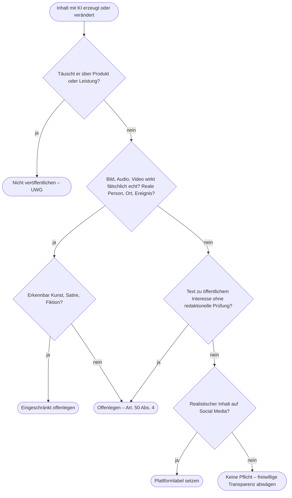

# Kapitel 39 – Urheberrecht, Transparenzpflichten und Ethik

{{ progress(39) }}

<div class="lernziele" markdown>
<h3>Was du in diesem Kapitel lernst</h3>

- Warum reiner KI-Output in Deutschland in der Regel **nicht urheberrechtlich geschützt** ist – und was das für deine Kampagnen bedeutet
- Wie das **Text-und-Data-Mining** (§ 44b UrhG) funktioniert und was die aktuellen **Urteile** zu Trainingsdaten aussagen
- Welche **Rechte Dritter** im Output stecken können: Marken, Figuren, Werke, Bild und Stimme realer Personen
- Was **Art. 50 AI Act** seit dem 02.08.2026 konkret verlangt – und was **nicht** darunter fällt
- Wie du mit einem **Entscheidungsbaum** in einer Minute klärst, ob ein Inhalt gekennzeichnet werden muss
- Welche **ethischen Fragen** über das Rechtliche hinausgehen: Täuschung, Manipulation, Bias, Energie, Verantwortung
</div>

---

## 39.1 Wem gehört der KI-Output?

In Kap. 4 hast du den rechtlichen Rahmen im Überblick kennengelernt, in Kap. 34, 37 und 38 die Besonderheiten bei Bild, Musik und Stimme. Hier geht es um die Fragen, die über alle Medien hinweg gleich sind. Die erste lautet fast immer: Gehört uns das, was die KI erzeugt hat?

Das deutsche Urheberrecht schützt nur **persönliche geistige Schöpfungen** (§ 2 Abs. 2 UrhG). Gemeint ist eine Leistung eines Menschen. Ein Bild, das ein Modell auf den Prompt „Regenjacke im Herbstwald, Morgennebel" erzeugt, ist nach herrschender Auffassung in der Regel **nicht geschützt** – der Prompt gibt eine Idee vor, die konkrete Gestaltung trifft das Modell. Die Folge: Ein Wettbewerber könnte dieses Motiv grundsätzlich übernehmen, ohne dass du urheberrechtlich dagegen vorgehen kannst.

Anders sieht es aus, wenn ein Mensch die Gestaltung **prägt**: ein Text, den du aus einem KI-Entwurf substanziell umschreibst, ein Bild, das eine Designerin aus mehreren generierten Elementen komponiert und nachbearbeitet. Wo genau die Grenze liegt, ist rechtlich noch nicht abschließend geklärt.

| Situation | Schutz wahrscheinlich? | Praktische Folge |
|---|---|---|
| Unbearbeiteter KI-Text aus einem kurzen Prompt | eher nein | Wettbewerber darf ähnliche oder gleiche Texte nutzen |
| KI-Entwurf, von dir stark umgeschrieben und ergänzt | eher ja, für deinen Anteil | eigene Leistung dokumentieren |
| KI-Bild, unbearbeitet als Kampagnenmotiv | eher nein | kein Exklusivrecht am Motiv |
| KI-Elemente, von Designer:in komponiert und retuschiert | möglich, für die Gestaltung | Arbeitsschritte festhalten |
| Eigenes Foto, mit Generative Fill ergänzt | ja, für das Foto | Fotograf:in bleibt Urheber:in des Ausgangsbilds |

!!! info "Merksatz"
    Was die KI allein gestaltet, gehört rechtlich in der Regel **niemandem exklusiv**. Exklusivität entsteht durch das, was ein Mensch daraus macht – und durch Marke, Logo, echte Produktfotos und Gesamtauftritt.

Für Fjordlicht heißt das: Die Kampagnenidee, der Claim, das Logo und die Produktfotografie sind die eigentlichen Schutzgüter. KI-Hintergründe, Stimmungsbilder und Textentwürfe sind Arbeitsmaterial. Wer ein Kampagnenmotiv exklusiv braucht, plant menschliche Gestaltung von Anfang an ein.

---

## 39.2 Trainingsdaten: Text-und-Data-Mining und die Urteile

Die zweite Frage betrifft die andere Seite: Dürfen KI-Anbieter fremde Werke zum Training nutzen? Für dich als Anwenderin ist das vor allem relevant, um Risiken einzuschätzen und eigene Inhalte zu schützen.

Das deutsche Recht erlaubt **Text-und-Data-Mining** (TDM) nach § 44b UrhG: Frei zugängliche Werke dürfen automatisiert ausgewertet werden – es sei denn, der Rechteinhaber hat einen **maschinenlesbaren Nutzungsvorbehalt** erklärt (Opt-out), etwa über Angaben in den Nutzungsbedingungen oder technische Hinweise auf der Website. Seit dem 02.08.2025 müssen Anbieter großer KI-Modelle mit allgemeinem Verwendungszweck (GPAI) nach dem AI Act außerdem eine **Urheberrechts-Policy** haben und eine **Zusammenfassung der Trainingsdaten** veröffentlichen.

| Verfahren | Kern | Stand |
|---|---|---|
| **Kneschke ./. LAION** (LG Hamburg 2024, dann OLG Hamburg) | Erstellung eines Trainingsdatensatzes aus Bildern ist als TDM zulässig | Gericht folgte dem Datensatz-Ersteller |
| **GEMA ./. OpenAI** (LG München I, 11.11.2025) | Memorisierung von Liedtexten im Modell ist eine Vervielfältigung | **nicht rechtskräftig** |
| **GEMA ./. Suno** (LG München I, 31.07.2026) | GEMA erhält weitgehend Recht gegen den Musik-KI-Anbieter | **nicht rechtskräftig** |

Die Richtung ist erkennbar, aber nicht endgültig: Das Sammeln von Daten für Trainingszwecke kann zulässig sein, das Modell darf geschützte Werke aber nicht so „gespeichert" haben, dass es sie wiedergibt. Beide Münchner Urteile können in höheren Instanzen noch geändert werden.

!!! tip "Eigene Inhalte schützen"
    Wenn Fjordlicht nicht möchte, dass Blogartikel und Produkttexte für KI-Training genutzt werden, gehört ein **maschinenlesbarer Nutzungsvorbehalt** auf die Website. Das ist eine Aufgabe für Webteam und Rechtsabteilung gemeinsam – und eine bewusste Abwägung, denn wer KI-Crawler komplett aussperrt, wird womöglich auch in KI-Antworten seltener genannt (Kap. 22).

---

## 39.3 Nutzungsbedingungen und Rechte Dritter im Output

Ob du einen Output **kommerziell nutzen** darfst, regeln zunächst die **Nutzungsbedingungen** des Werkzeugs. Sie unterscheiden sich stark: Manche Musik-KI erlaubt die kommerzielle Nutzung nur in Bezahlplänen (Kap. 37), Adobe Firefly wirbt mit Training auf lizenzierten Inhalten (Kap. 31), einige Anbieter bieten Business-Kunden Freistellungen bei Urheberrechtsansprüchen an. Lies die Bedingungen für den Tarif, den ihr tatsächlich nutzt, und lege das Ergebnis in eurer KI-Richtlinie ab (Kap. 4).

Die Nutzungsbedingungen klären aber nur das Verhältnis zwischen dir und dem Anbieter. Sie schützen dich **nicht** davor, dass der Output Rechte Dritter verletzt.

| Risiko | Beispiel | Rechtsgrundlage | Gegenmittel |
|---|---|---|---|
| Fremde Marke | Logo eines Wettbewerbers auf generierter Jacke | Markenrecht | Logos, Schriftzüge prüfen und entfernen |
| Geschützte Figur | Comicfigur als Maskottchen im Post | Urheberrecht | keine bekannten Figuren prompten |
| Konkretes Werk | Bild, das ein bekanntes Foto nachbildet | Urheberrecht | keine Werke als Vorlage nennen |
| Stil | „im Stil der nordischen Landschaftsmalerei" | Stil als solcher nicht geschützt | zulässig, solange kein konkretes Werk nachgebildet wird |
| Reale Person | erkennbares Gesicht einer Influencerin | Recht am eigenen Bild (KUG §§ 22 f.) | nur mit Einwilligung |
| Stimme | geklonte Stimme eines Sprechers ohne Vertrag | allgemeines Persönlichkeitsrecht | Einwilligung und Vertrag (Kap. 38) |
| Irreführung | KI-Produktbild zeigt Details, die die Jacke nicht hat | UWG | echte Produktfotos verwenden (Kap. 34) |

!!! warning "Typische Falle"
    „Das Tool hat es erzeugt, also ist es erlaubt" – dieser Schluss ist falsch. Die Verantwortung für das, was veröffentlicht wird, liegt beim **veröffentlichenden Unternehmen**, nicht beim Werkzeug. Ein Logo im Hintergrund oder eine Ähnlichkeit mit einer realen Person fällt bei einem schnellen Blick nicht auf. Deshalb gehört eine Sichtprüfung auf Rechte Dritter in jeden Freigabeprozess.

---

## 39.4 AI Act Art. 50: Transparenzpflichten im Detail

Seit dem **02.08.2026** gelten die Transparenzpflichten aus **Art. 50 AI Act** (VO (EU) 2024/1689). Der Digital Omnibus, in Kraft seit 27.07.2026, hat sie **nicht** verschoben. Für das Marketing sind drei Absätze wichtig:

- **Abs. 1 – Chatbots:** Anbieter müssen sicherstellen, dass Menschen erkennen, dass sie mit einer KI interagieren, sofern das nicht offensichtlich ist. Praktisch: Euer CRM-Chatbot weist sich zu Beginn als KI aus (Kap. 27).
- **Abs. 2 – maschinenlesbare Kennzeichnung:** Anbieter generativer Systeme müssen synthetische Inhalte maschinenlesbar markieren, etwa per Wasserzeichen oder Metadaten wie C2PA. Für Systeme, die vor dem 02.08.2026 am Markt waren, gilt eine Übergangsfrist bis **02.12.2026**. Diese Pflicht trifft die Werkzeug-Anbieter, nicht dich – entferne solche Markierungen aber nicht.
- **Abs. 4 – Betreiberpflichten:** Hier bist du gemeint. Wer als Unternehmen KI einsetzt, muss **Deepfakes offenlegen**: Bild-, Audio- oder Videoinhalte, die realen Personen, Orten, Gegenständen oder Ereignissen ähneln und fälschlich als echt erscheinen würden. Bei erkennbar künstlerischen, satirischen oder fiktionalen Werken genügt eine eingeschränkte Offenlegung, die den Genuss des Werks nicht stört. Außerdem sind KI-erzeugte oder -veränderte **Texte** offenzulegen, die veröffentlicht werden, um die **Öffentlichkeit über Angelegenheiten von öffentlichem Interesse zu informieren** – es sei denn, sie wurden menschlich geprüft und jemand trägt die redaktionelle Verantwortung.

| Fall bei Fjordlicht | AI Act | Begründung |
|---|---|---|
| Newsletter-Text mit ChatGPT entworfen, redigiert | **muss nicht** | normaler Werbetext, kein Deepfake |
| Illustrierter Pinterest-Pin, erkennbar gezeichnet | **muss nicht** | wirkt nicht fälschlich echt |
| Video: Geschäftsführerin spricht mit geklonter Stimme | **muss** | Deepfake einer realen Person (Abs. 4) |
| Foto-realistisches Bild „Fjordlicht-Team beim Clean-up am Aasee", das nie stattfand | **muss** | ähnelt realem Ort und Ereignis, wirkt echt |
| Satirischer Clip mit erkennbar übertriebener Szene | **muss, eingeschränkt** | Offenlegung, ohne das Werk zu stören |
| Chatbot im Webshop | **muss** | Hinweis auf KI-Interaktion (Abs. 1) |
| Fotorealistisches Stimmungsbild einer fiktiven Wanderin | **Grauzone** | Plattformlabel nötig; AI-Act-Einordnung umstritten, im Zweifel kennzeichnen |
| KI-erstellter Blogbeitrag zu neuen EU-Textilvorgaben ohne Prüfung | **muss** | Text zu öffentlichem Interesse ohne redaktionelle Verantwortung |
| derselbe Beitrag, fachlich geprüft und verantwortet | **muss nicht** | Ausnahme bei redaktioneller Verantwortung |
| Hinweis „mit KI-Unterstützung erstellt" unter Blogartikeln | **freiwillig** | Vertrauensmaßnahme, keine Pflicht |

Unabhängig vom AI Act verlangen **Meta, TikTok und YouTube** Labels für realistische KI-Inhalte – teils setzen sie diese anhand der Metadaten automatisch. Und das **UWG** greift, sobald ein KI-Inhalt Kundinnen und Kunden über das Produkt täuscht. Die Kommission erarbeitet außerdem einen Verhaltenskodex (Code of Practice) zur Kennzeichnung, der die Praxis weiter konkretisieren wird. Verstöße gegen Art. 50 können mit bis zu 15 Mio. € oder 3 % des weltweiten Jahresumsatzes geahndet werden.

!!! warning "Typische Falle"
    „Normale Werbetexte müssen nicht gekennzeichnet werden" heißt **nicht**: „Alles mit KI ist kennzeichnungsfrei." Ein Text ist harmlos, ein realistisches Video mit erfundenem Kundenstatement ist ein Deepfake – und zugleich irreführend nach UWG. Prüfe jeden Inhalt einzeln, nicht das Werkzeug.

---

## 39.5 Entscheidungsbaum: Kennzeichnen?

Für den Redaktionsalltag brauchst du keine Gesetzeslektüre, sondern eine schnelle, dokumentierbare Entscheidung. Der folgende Baum fasst Art. 50, Plattformregeln und UWG zusammen.



Die Entscheidung hältst du kurz fest: Inhalt, verwendetes Werkzeug, Ergebnis des Baums, wer freigegeben hat. So kannst du später nachweisen, dass ihr bewusst entschieden habt.

!!! example "Prompt: Kennzeichnungs-Vorprüfung"
    KI kann dir die Einordnung vorbereiten, die Entscheidung bleibt bei dir:

    ```text
    Du unterstützt eine Marketingabteilung bei der Vorprüfung von Inhalten
    nach Art. 50 AI Act, Plattformregeln und UWG. Du gibst keine Rechtsberatung.

    Inhalt: [Beschreibung des Inhalts, Kanal, verwendetes KI-Werkzeug]

    Prüfe in dieser Reihenfolge und antworte als Tabelle
    (Prüffrage | Antwort | Begründung):
    1. Kann der Inhalt über Produkt oder Leistung täuschen?
    2. Ist es Bild, Audio oder Video, das realen Personen, Orten oder
       Ereignissen ähnelt und fälschlich echt wirken könnte?
    3. Ist es erkennbar künstlerisch, satirisch oder fiktional?
    4. Ist es ein Text zu einer Angelegenheit von öffentlichem Interesse?
       Gibt es menschliche Prüfung und redaktionelle Verantwortung?
    5. Verlangt der Zielkanal ein Label für realistische KI-Inhalte?
    Schließe mit einer Empfehlung und markiere Unsicherheiten mit [UNKLAR].
    ```

---

## 39.6 Ethik: was über das Recht hinausgeht

Nicht alles, was erlaubt ist, passt zu einer Marke. Gerade Fjordlicht, das mit Ehrlichkeit und „kein Greenwashing" wirbt, wird an seinem KI-Einsatz gemessen. Fünf Fragen helfen bei der Abwägung:

| Thema | Leitfrage | Beispiel Fjordlicht |
|---|---|---|
| **Täuschung** | Würde sich die Kundin getäuscht fühlen, wenn sie wüsste, wie der Inhalt entstanden ist? | erfundene „Kundenstimmen" sind tabu, auch ohne Rechtspflicht |
| **Manipulation** | Nutzt der Inhalt Schwächen aus statt zu überzeugen? | keine künstliche Verknappung, keine KI-optimierten Angst-Hooks |
| **Bias und Diversität** | Wen zeigen die Bilder, wen nicht? | generierte Motive zeigen ohne Vorgabe oft junge, schlanke, weiße Menschen (Kap. 34) |
| **Nachhaltigkeit** | Steht der Rechenaufwand im Verhältnis zum Nutzen? | nicht 200 Bildvarianten erzeugen, wenn 10 reichen; Video ist aufwendiger als Text |
| **Verantwortung** | Wer steht für den Inhalt gerade? | jede Veröffentlichung hat eine verantwortliche Person, nicht „die KI" |

Zum Energiebedarf kursieren sehr unterschiedliche Zahlen; belastbar ist vor allem die Tendenz: Bild- und besonders Videogenerierung benötigen deutlich mehr Rechenleistung als Text. Für eine Marke, die mit Nachhaltigkeit wirbt, ist ein bewusster, sparsamer Einsatz glaubwürdiger als jede Behauptung.

!!! info "Merksatz"
    Recht setzt die Untergrenze, die Marke setzt den Maßstab. Die Frage lautet nicht nur „Dürfen wir das?", sondern „Würden wir es unserer Community genau so erklären?"

!!! warning "Kein Ersatz für Rechtsberatung"
    Dieses Kapitel gibt dir eine Orientierung für den Arbeitsalltag. Rechtsprechung und Leitlinien entwickeln sich laufend, mehrere Urteile sind nicht rechtskräftig. Im Zweifel fragst du eure Rechtsabteilung oder eine Anwältin bzw. einen Anwalt.

---

## Zusammenfassung

- Reiner KI-Output ist nach § 2 Abs. 2 UrhG in der Regel **nicht geschützt**; Exklusivität entsteht durch menschliche Gestaltung, Marke und echte Produktfotos.
- Training ist über **TDM nach § 44b UrhG** mit Opt-out geregelt; die Münchner Urteile **GEMA ./. OpenAI** und **GEMA ./. Suno** sind **nicht rechtskräftig**.
- Nutzungsbedingungen klären die kommerzielle Nutzung, schützen aber nicht vor **Rechten Dritter** – Marken, Figuren, Werke, Bild und Stimme.
- **Art. 50 AI Act** gilt seit 02.08.2026: Chatbots als KI erkennbar machen, **Deepfakes offenlegen**, Texte zu öffentlichem Interesse ohne redaktionelle Verantwortung kennzeichnen.
- Normale Werbetexte sind nach dem AI Act meist **nicht** kennzeichnungspflichtig – Plattformlabels und **UWG** gelten trotzdem.
- Der **Entscheidungsbaum** macht die Kennzeichnung prüfbar; die Entscheidung wird dokumentiert.
- Ethisch zählen **Täuschung, Manipulation, Bias, Ressourcenverbrauch und klare Verantwortung** – gemessen an der eigenen Markenstimme.

---

## Kurzübungen

{{ task(file="tasks/k39_01.yaml") }}

{{ task(file="tasks/k39_02.yaml") }}

{{ task(file="tasks/k39_03.yaml") }}

---

## Workshop

{{ task(file="tasks/workshop_k39.yaml") }}
