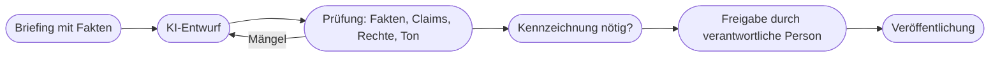

# Kapitel 4 – Regulatorischer Rahmen und Best Practices

{{ progress(4) }}

<h3>Was du in diesem Kapitel lernst</h3>

- Wie der **EU AI Act** aufgebaut ist: Risikoklassen, Rollen und die Regeln für KI-Modelle mit allgemeinem Verwendungszweck
- Welche **Fristen** gelten und was davon das Marketing betrifft – insbesondere **Art. 4 (KI-Kompetenz)** und **Art. 50 (Transparenz)**
- Die **DSGVO-Grundregeln** für KI-Werkzeuge und die **Ampel für Daten im Prompt**
- Was in eine **KI-Richtlinie** für ein Marketingteam gehört
- Wie ein schlanker **Freigabeprozess** für KI-gestützte Inhalte aussieht
- Nach welchen Kriterien du **Werkzeuge auswählst**

---

## 4.1 Warum Regeln – und was dieses Kapitel leistet

Marketing ist öffentlich. Ein Fehler in einem internen Entwurf kostet Zeit, ein Fehler in einer veröffentlichten Anzeige kostet Vertrauen und unter Umständen Geld. Mit generativer KI kommen drei Risikofelder hinzu: **Daten**, die du ins Werkzeug gibst, **Inhalte**, die herauskommen, und **Transparenz** gegenüber Menschen, die mit KI-Inhalten in Berührung kommen.

Dieses Kapitel gibt dir einen Überblick über die Regeln, die für den Alltag im Marketing zählen, und über bewährte Praktiken im Team. Urheberrecht und Kennzeichnung vertiefst du in Kapitel 39; hier geht es um das Grundgerüst, das ab dem ersten Prompt gilt.

!!! warning "Keine Rechtsberatung"
    Dieses Kapitel gibt Orientierung, keine Rechtsberatung. Die Rechtslage rund um KI entwickelt sich schnell (Stand: Oktober 2026). Im Zweifel fragst du eure Rechtsabteilung, den Datenschutzbeauftragten oder eine Anwältin.

---

## 4.2 Der EU AI Act im Überblick

Der **EU AI Act** – offiziell Verordnung (EU) 2024/1689 – ist seit dem **01.08.2024** in Kraft. Als EU-Verordnung gilt er unmittelbar in allen Mitgliedstaaten. Er reguliert nicht „die KI" pauschal, sondern verfolgt einen **risikobasierten Ansatz**: Je höher das Risiko eines Einsatzes für Gesundheit, Sicherheit und Grundrechte, desto strenger die Regeln. Der Text ist auf [EUR-Lex](https://eur-lex.europa.eu/eli/reg/2024/1689/oj) frei abrufbar.

| Risikostufe | Was darunter fällt | Folge | Bezug zum Marketing |
|---|---|---|---|
| **Verboten** (Art. 5) | z. B. manipulative Techniken, die Menschen erheblich schaden, Ausnutzen von Schwächen, Social Scoring | Einsatz untersagt | Grenze für aggressive Manipulation |
| **Hohes Risiko** | z. B. Personalauswahl, Bonitätsbewertung, kritische Infrastruktur | strenge Anforderungen an Risikomanagement, Dokumentation, Aufsicht | typischerweise nicht betroffen |
| **Transparenzpflichten** (Art. 50) | Chatbots, generierte Inhalte, Deepfakes | offenlegen bzw. kennzeichnen | **direkt relevant** |
| **Minimales Risiko** | z. B. Textentwürfe, Spamfilter, Ideenfindung | keine besonderen Pflichten | der Großteil des Alltags |

Daneben gibt es eigene Regeln für **KI-Modelle mit allgemeinem Verwendungszweck** (General Purpose AI, GPAI) – also die großen Modelle hinter ChatGPT, Gemini oder Claude. Diese Pflichten treffen die **Modellanbieter** wie OpenAI oder Google, etwa eine Urheberrechts-Policy und eine Zusammenfassung der Trainingsdaten.

Wichtig ist die Unterscheidung der **Rollen**: Ein **Anbieter** entwickelt ein KI-System und bringt es auf den Markt. Ein **Betreiber** setzt ein KI-System in eigener Verantwortung beruflich ein. Fjordlicht ist in aller Regel **Betreiber** – wenn das Team ChatGPT nutzt oder einen Chatbot auf der Website einsetzt.

!!! info "Merksatz"
    Für ein Marketingteam ist der AI Act vor allem eine Frage von **Kompetenz** (Art. 4) und **Transparenz** (Art. 50). Hochrisiko-Pflichten betreffen Marketing typischerweise nicht – Ausnahmen gibt es, wenn KI etwa über Bonität oder Personalauswahl mitentscheidet.

---

## 4.3 Fristen und was das Marketing betrifft

Der AI Act gilt gestaffelt. Durch den sogenannten **Digital Omnibus**, ein EU-Änderungspaket, das seit dem **27.07.2026** in Kraft ist, wurden einige Termine und Pflichten angepasst.

| Seit / ab | Was gilt | Relevanz für Marketing |
|---|---|---|
| 02.02.2025 | Verbote (Art. 5) und KI-Kompetenz (Art. 4) | Art. 4 betrifft jedes Team, das KI nutzt |
| 02.08.2025 | Pflichten für GPAI-Modellanbieter | betrifft Anbieter, nicht euch |
| **02.08.2026** | **Transparenzpflichten nach Art. 50** | Chatbots, Deepfakes, bestimmte Texte |
| 02.12.2026 | Ende der Übergangsfrist für maschinenlesbare Kennzeichnung bei Systemen, die vor dem 02.08.2026 am Markt waren; neue Verbote durch den Omnibus, u. a. nicht-einvernehmliche intime Deepfakes | Werkzeuge kennzeichnen ihre Ausgaben technisch |
| 02.12.2027 | Hochrisiko-Pflichten nach Anhang III (verschoben) | meist nicht betroffen |
| 02.08.2028 | Hochrisiko-Pflichten nach Anhang I (verschoben) | meist nicht betroffen |

**Art. 4 – KI-Kompetenz.** Anbieter und Betreiber müssen **Maßnahmen ergreifen**, um die KI-Kompetenz ihres Personals zu fördern. Durch den Omnibus wurde die Pflicht abgeschwächt: Ein bestimmtes Kompetenzniveau muss nicht mehr „sichergestellt" werden; Kommission und Mitgliedstaaten unterstützen. Die Pflicht zu handeln bleibt aber bestehen – Schulungen wie dieser Kurs, eine KI-Richtlinie und dokumentierte Einweisungen sind typische Maßnahmen.

**Art. 50 – Transparenz.** Seit dem 02.08.2026 gelten Transparenzpflichten, die durch den Omnibus nicht verschoben wurden. Für das Marketing sind diese relevant:

| Absatz | Wer | Was | Beispiel Fjordlicht |
|---|---|---|---|
| (1) | Anbieter | Menschen müssen erkennen, dass sie mit KI interagieren, sofern nicht offensichtlich | Website-Chatbot muss sich als KI zu erkennen geben (Kap. 27) |
| (2) | Anbieter generativer Systeme | synthetische Inhalte maschinenlesbar kennzeichnen | betrifft die Werkzeughersteller |
| (4) | **Betreiber** | **Deepfakes** offenlegen: Bild, Audio, Video, die realen Personen, Orten oder Ereignissen ähneln und fälschlich echt wirken; bei erkennbar künstlerischen, satirischen oder fiktionalen Werken in eingeschränkter Form | realistisches KI-Video eines „echten" Fjordlicht-Kunden im Regen |
| (4) | **Betreiber** | KI-Texte offenlegen, die veröffentlicht werden, um die Öffentlichkeit über Angelegenheiten von öffentlichem Interesse zu informieren – außer bei menschlicher Prüfung und redaktioneller Verantwortung | selten; normale Werbetexte fallen i. d. R. nicht darunter |

Normale Werbetexte, Produktbeschreibungen oder Social-Media-Captions unterliegen in der Regel **keiner** Kennzeichnungspflicht nach dem AI Act. Das heißt aber nicht „alles egal": **Plattformregeln** von Meta, TikTok und YouTube verlangen Labels für realistische KI-Inhalte, das **UWG** verbietet Irreführung, und Ehrlichkeit gegenüber Kundinnen und Kunden ist eine Frage der Markenhaltung. Einen Verhaltenskodex zur Kennzeichnung erarbeitet die EU-Kommission derzeit. Die Details mit Entscheidungsbaum folgen in Kapitel 39.

!!! warning "Typische Falle"
    „Werbetexte müssen nicht gekennzeichnet werden" wird oft zu „KI-Inhalte müssen nie gekennzeichnet werden" verkürzt. Ein fotorealistisches KI-Bild einer echten Person oder eines realen Ereignisses ist ein Deepfake im Sinne von Art. 50 Abs. 4 – und auf Instagram oder TikTok zusätzlich labelpflichtig. Die Bußgelder sind erheblich: bis 35 Mio. € oder 7 % des weltweiten Jahresumsatzes bei Verstößen gegen Verbote, bis 15 Mio. € oder 3 % bei sonstigen Pflichten.

---

## 4.4 DSGVO-Grundregeln und die Ampel für Daten im Prompt

Die **DSGVO** gilt unabhängig vom AI Act. Sobald personenbezogene Daten in ein KI-Werkzeug gelangen – Namen, E-Mail-Adressen, Bestellhistorien, CRM-Exporte –, findet eine Verarbeitung statt, die eine Rechtsgrundlage braucht. Drei Grundregeln reichen für den Alltag:

1. **Kein ungeprüftes Consumer-Werkzeug für personenbezogene Daten.** Private Konten kostenloser oder privater Tarife sind für Kundendaten tabu.
2. **Business- oder Enterprise-Tarife** mit **Auftragsverarbeitungsvertrag (AVV)** und der Zusage, dass Eingaben **nicht zum Training** verwendet werden, sind die Voraussetzung für berufliche Daten.
3. **Datenminimierung und Pseudonymisierung:** Gib nur, was für die Aufgabe nötig ist. Für eine Auswertung von Bewertungen braucht das Werkzeug den Text, nicht den Namen.

Für die schnelle Entscheidung im Alltag hilft eine **Ampel**:

| Ampel | Datenart | Beispiele | Regel |
|---|---|---|---|
| **Grün** | öffentliche oder unkritische Informationen | veröffentlichte Produkttexte, Blogartikel, allgemeine Fragen, fiktive Daten | in freigegebenen Werkzeugen erlaubt |
| **Gelb** | interne, nicht personenbezogene Informationen | unveröffentlichte Kampagnenpläne, Styleguide, Umsatzzahlen nach Kanal | nur im freigegebenen Business-Werkzeug |
| **Rot** | personenbezogene oder vertrauliche Daten | Kundenlisten, CRM-Exporte, Bewertungen mit Namen, Verträge, Zugangsdaten | nur nach Freigabe durch Datenschutz, anonymisiert oder gar nicht |

!!! example "Aus Rot wird Grün"
    Das Team möchte 300 Produktbewertungen zur Fleecejacke „Skog" auswerten. Der Export enthält Namen, Wohnort und Bestellnummer. Vor dem Prompt werden diese Spalten gelöscht; übrig bleiben Sternebewertung und Text. Bewertungstexte können trotzdem Personenbezug enthalten („Ich, Jana aus Gievenbeck …") – deshalb vorher stichprobenartig prüfen und solche Stellen schwärzen.

---

## 4.5 Die KI-Richtlinie im Team

Eine **KI-Richtlinie** übersetzt Recht und Markenhaltung in Alltagsregeln. Sie ist gleichzeitig eine der naheliegenden Maßnahmen nach Art. 4. Für ein Marketingteam genügen zwei Seiten, wenn sie konkret sind.

| Baustein | Leitfrage | Beispiel Fjordlicht |
|---|---|---|
| Zweck und Geltung | Wofür gilt die Richtlinie, für wen? | alle, die Inhalte für Fjordlicht erstellen, auch Agenturen |
| Freigegebene Werkzeuge | Was darf genutzt werden, mit welchem Konto? | ChatGPT Business, Adobe Firefly; keine Privatkonten |
| Daten | Was darf rein? | Ampel aus Abschnitt 4.4 |
| Inhalte | Was darf raus? | nur belegbare Nachhaltigkeitsaussagen laut Claim-Liste, keine echten Personen generieren |
| Kennzeichnung | Wann wird gekennzeichnet? | Deepfakes und realistische KI-Bilder immer, Plattformlabels nutzen |
| Prüfung und Freigabe | Wer prüft, wer gibt frei? | Vier-Augen-Prinzip für alles Öffentliche |
| Kompetenz | Wie lernen wir? | Einweisung für neue Kolleginnen, Austausch monatlich |
| Verantwortung und Pflege | Wer pflegt die Richtlinie? | Marketingleitung, Überprüfung halbjährlich |

!!! tip "Kurz, konkret, mit Beispielen"
    Eine Richtlinie, die niemand liest, schützt niemanden. Schreibe Regeln als Handlungsanweisungen („Lösche Namen vor dem Upload") statt als Prinzipien („Wir achten den Datenschutz") und gib zu jeder Regel ein Beispiel aus eurem Alltag.

---

## 4.6 Freigabeprozess und Werkzeugauswahl

Der **Freigabeprozess** sorgt dafür, dass kein KI-Inhalt ungeprüft veröffentlicht wird. Er muss nicht bürokratisch sein – entscheidend ist, dass die Prüfschritte festgelegt sind und jemand namentlich verantwortlich ist.

Die Prüfung umfasst vier Fragen: Stimmen alle **Fakten** und Zahlen? Sind **Claims**, besonders zu Nachhaltigkeit, belegt? Verletzt der Inhalt **Rechte Dritter** – Marken, erkennbare Personen, konkrete Werke? Passt der **Ton** zur Marke? Ob und wie gekennzeichnet wird, entscheidest du mit dem Entscheidungsbaum aus Kapitel 39. Ein Hinweis zum Urheberrecht gehört schon hierher: KI-Output ohne eigene schöpferische Leistung ist in Deutschland in der Regel **nicht urheberrechtlich geschützt** – die Konkurrenz darf ein rein generiertes Motiv also grundsätzlich auch verwenden.

Für die **Werkzeugauswahl** helfen sechs Kriterien:

| Kriterium | Leitfrage |
|---|---|
| Datenschutz | Gibt es einen AVV, Serverstandort-Angaben und den Ausschluss von Training auf Eingaben? |
| Nutzungsrechte | Was sagen die Nutzungsbedingungen zur kommerziellen Nutzung des Outputs? |
| Qualität für die Aufgabe | Liefert das Werkzeug im Test mit eurem Briefing gute Ergebnisse? |
| Integration | Passt es zu vorhandenen Werkzeugen, etwa Office, Adobe, CMS? |
| Kosten und Lizenzmodell | Was kostet es pro Person, gibt es Team-Verwaltung? |
| Zukunftssicherheit | Wie abhängig macht ihr euch? Was passiert, wenn eine Funktion eingestellt wird? |

Das letzte Kriterium ist keine Theorie: Die Ablösung von Canvas und Custom GPTs bei ChatGPT im Jahr 2026 zeigt, wie schnell sich Funktionen ändern (Kap. 11, 28). Dokumentiere deshalb Prompts und Arbeitsabläufe werkzeugunabhängig.

---

## Zusammenfassung

- Der **EU AI Act** reguliert risikobasiert; Marketing ist meist minimales Risiko, betroffen sind vor allem **Kompetenz** und **Transparenz**.
- **Art. 4** verlangt seit 02.02.2025 Maßnahmen zur Förderung der KI-Kompetenz; der Digital Omnibus hat die Pflicht abgeschwächt, aber nicht abgeschafft.
- **Art. 50** gilt seit 02.08.2026: Chatbots offenlegen, **Deepfakes** als Betreiber kennzeichnen; normale Werbetexte sind i. d. R. nicht kennzeichnungspflichtig – Plattformregeln und UWG gelten trotzdem.
- **DSGVO:** keine personenbezogenen Daten in ungeprüfte Consumer-Werkzeuge; Business-Tarife mit AVV, Datenminimierung, Pseudonymisierung.
- Die **Ampel** (Grün, Gelb, Rot) macht die Datenfrage im Alltag in Sekunden entscheidbar.
- Eine kurze, konkrete **KI-Richtlinie** und ein **Freigabeprozess** mit namentlicher Verantwortung sichern den Einsatz im Team ab.
- Werkzeuge wählst du nach **Datenschutz, Rechten, Qualität, Integration, Kosten und Zukunftssicherheit**.

---

## Kurzübungen

{{ task(file="tasks/k04_01.yaml") }}

{{ task(file="tasks/k04_02.yaml") }}

{{ task(file="tasks/k04_03.yaml") }}

---

## Workshop

{{ task(file="tasks/workshop_k04.yaml") }}
