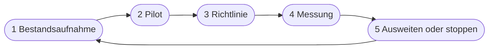

# Kapitel 40 – Marketingberufe im Wandel und KI im Arbeitsalltag

{{ progress(40) }}

<div class="lernziele" markdown>
<h3>Was du in diesem Kapitel lernst</h3>

- Wie sich **Marketingrollen** durch generative KI verändern – und welche neuen Aufgaben entstehen
- Welche **Kompetenzen** künftig zählen und was die **KI-Kompetenzpflicht** nach Art. 4 AI Act für Arbeitgeber bedeutet
- Wie ein Team KI **geordnet einführt**: Bestandsaufnahme, Pilot, Richtlinie, Messung, Ausweitung
- Wie du deinen persönlichen **90-Tage-Plan** für den Einstieg nach dem Kurs aufstellst
- Welche **Entwicklungen** absehbar sind: Agenten, multimodale Werkzeuge, KI-Suche, neue Fristen
- Wie du dich gezielt auf die **Klausur am 12.11.2026** vorbereitest
</div>

---

## 40.1 Was sich an den Rollen ändert

Generative KI ersetzt im Marketing selten ganze Berufe, aber sie verschiebt fast überall, **womit** die Arbeitszeit verbracht wird. Der erste Entwurf, die zehnte Variante, die Formatanpassung für den vierten Kanal – das kostet heute Minuten statt Stunden. Was bleibt und an Gewicht gewinnt, sind Urteil, Strategie, Markenverständnis und Verantwortung.

| Rolle | Was KI übernimmt oder beschleunigt | Was wichtiger wird |
|---|---|---|
| **Texter:in / Content Writer** | Rohfassungen, Varianten, Kürzungen, Übersetzungen | Briefing, Markenstimme, Faktencheck, Redigieren (Kap. 11, 15) |
| **Designer:in** | Moodboards, Stimmungsbilder, Hintergründe, Formatvarianten | Art Direction, Konsistenz, Rechte-Check, Nachbearbeitung (Kap. 32–34) |
| **Social Media Manager:in** | Captions, Hook-Varianten, Antwortentwürfe, Auswertungen | Community-Gespür, Plattformregeln, Krisenreaktion (Kap. 14, 19) |
| **Performance / CRM** | Betreffzeilen, Segment-Texte, Datenauswertung | Testdesign, Interpretation, Datenschutz (Kap. 13, 16, 20) |
| **Content-Strategie / SEO** | Themenrecherche, Cluster, Briefings, On-Page-Vorschläge | Suchintention, E-E-A-T, Sichtbarkeit in KI-Suche (Kap. 21, 22) |

Daneben entstehen neue Aufgaben, die oft zunächst **nebenbei** von bestehenden Rollen übernommen werden, in größeren Teams aber zu eigenen Stellen werden:

- **Assistenten-Verantwortliche:** pflegen Instruktionen, Wissensdateien und Testfälle von Assistenten wie dem Content-Assistenten von Fjordlicht (Kap. 25, 26).
- **Content Operations:** gestalten Abläufe von Briefing über KI-Entwurf bis Freigabe, inklusive Prompt-Bibliothek (Kap. 10).
- **KI-Governance im Marketing:** hält Richtlinie, Werkzeugliste, Kennzeichnungslinie und Schulungen aktuell (Kap. 4, 39).

!!! info "Merksatz"
    KI senkt die Kosten für **Entwürfe**, nicht für **Entscheidungen**. Wer im Marketing vor allem produziert, muss sich neu aufstellen; wer bewertet, auswählt und verantwortet, wird wichtiger.

!!! warning "Typische Falle"
    „Mit KI schaffen wir doppelt so viel Content" – und dann erscheint doppelt so viel Durchschnitt. Mehr Ausstoß ist kein Ziel. Die gewonnene Zeit gehört in bessere Briefings, gründlichere Prüfung, echte Fotos, Gespräche mit Kundinnen und Kunden. Massenhaft erzeugter, austauschbarer Content schadet zudem in der Suche (Kap. 22).

---

## 40.2 Kompetenzen, die zählen

Dieser Kurs hat dir Werkzeuge gezeigt, die sich bis zum nächsten Jahr verändern werden. Die Kompetenzen dahinter bleiben. Sie lassen sich in vier Gruppen fassen:

| Kompetenz | Was sie umfasst | Wo du sie geübt hast |
|---|---|---|
| **Auftragen** | klare Prompts, Kontext liefern, Beispiele, Iteration | Block 2 (Kap. 5–10) |
| **Beurteilen** | Fakten prüfen, Ton bewerten, Bias erkennen, Daten interpretieren | Kap. 2, 9, 20, 34 |
| **Gestalten** | Abläufe und Assistenten bauen, Bild- und Videoworkflows | Block 5–7 |
| **Verantworten** | Datenschutz, Urheberrecht, Kennzeichnung, Ethik, Freigabe | Kap. 4, 39 |

Für Arbeitgeber hat das einen rechtlichen Hintergrund. Seit dem 02.02.2025 gilt **Art. 4 AI Act** zur **KI-Kompetenz**. Durch den Digital Omnibus, in Kraft seit 27.07.2026, wurde die Pflicht abgeschwächt: Unternehmen, die KI einsetzen, müssen weiterhin **Maßnahmen ergreifen**, um die KI-Kompetenz ihres Personals zu fördern, aber nicht mehr ein bestimmtes Niveau „sicherstellen". Kommission und Mitgliedstaaten sollen dabei unterstützen. Schulungen, eine Richtlinie und dokumentierte Einweisungen bleiben damit der vernünftige Weg – auch, weil sie schlicht Fehler verhindern.

!!! tip "Dein Kursnachweis als Argument"
    Wenn du dich bewirbst oder intern eine KI-Rolle anstrebst: Beschreibe nicht „Kenntnisse in ChatGPT", sondern konkret, was du gebaut und geprüft hast – eine Prompt-Bibliothek, einen getesteten Assistenten, einen Kennzeichnungsleitfaden. Arbeitsproben aus den Workshops eignen sich dafür, sofern sie keine vertraulichen Daten enthalten.

---

## 40.3 KI geordnet in den Arbeitsalltag bringen

Viele Teams starten mit Begeisterung, jede Person nutzt ein anderes Werkzeug, und nach drei Monaten weiß niemand, was eigentlich besser geworden ist. Ein geordneter Einstieg folgt fünf Schritten:



| Schritt | Leitfrage | Ergebnis bei Fjordlicht |
|---|---|---|
| **Bestandsaufnahme** | Welche Aufgaben sind wiederkehrend, textlastig, zeitintensiv? | Liste mit 15 Aufgaben, bewertet nach Aufwand und Risiko |
| **Pilot** | Welcher Use Case ist nützlich, risikoarm und messbar? | Newsletter-Entwürfe mit dem Content-Assistenten, vier Wochen, zwei Personen |
| **Richtlinie** | Welche Werkzeuge, welche Daten, wer gibt frei? | eine Seite: Werkzeugliste, Datenampel, Freigabe, Kennzeichnung (Kap. 4, 39) |
| **Messung** | Was hat sich messbar verändert? | Zeit pro Ausgabe, Korrekturschleifen, Öffnungs- und Klickrate |
| **Ausweiten oder stoppen** | Lohnt sich der Einsatz unter dem Strich? | Ausweitung auf Social-Media-Captions, Bildgenerierung vorerst nur für Moodboards |

Die Messung ist der Schritt, der am häufigsten fehlt. Schon einfache Kennzahlen genügen, wenn du sie **vor** dem Pilot erhebst: Wie lange dauert ein Newsletter bisher? Wie viele Korrekturschleifen braucht er? Ohne diesen Ausgangswert bleibt jede Erfolgsmeldung ein Gefühl.

!!! example "Prompt: Use Cases für den Pilot priorisieren"
    ```text
    Du bist Beraterin für die Einführung von KI in Marketingteams.
    Unser Team: [Größe, Rollen, Kanäle]
    Wiederkehrende Aufgaben mit geschätztem Zeitaufwand pro Monat:
    [Liste der Aufgaben]

    Bewerte jede Aufgabe in einer Tabelle nach:
    Zeitersparnis (hoch/mittel/gering), Risiko bei Fehlern (hoch/mittel/gering),
    benötigte Daten (öffentlich/intern/personenbezogen), Messbarkeit.
    Empfiehl zwei Aufgaben für einen vierwöchigen Pilot und begründe.
    Schlage für jede eine Kennzahl vor, die wir vor dem Start erheben.
    Wenn dir Angaben fehlen, frage nach statt zu schätzen.
    ```

!!! warning "Typische Falle"
    Der Pilot startet mit dem spektakulärsten Use Case – etwa einem KI-Video mit Avatar der Geschäftsführung. Hohe Sichtbarkeit, hohes Risiko, schwer messbar. Besser: ein unspektakulärer Ablauf, der jede Woche vorkommt. Wer dort zeigt, dass es funktioniert, bekommt den Rückhalt für die größeren Schritte.

---

## 40.4 Dein persönlicher 90-Tage-Plan

Nach dem Kurs entscheidet sich in den ersten Wochen, ob das Gelernte Alltag wird oder verblasst. Ein 90-Tage-Plan hilft, weil er klein anfängt und jeden Abschnitt mit einem prüfbaren Ergebnis abschließt.

| Phase | Schwerpunkt | Prüfbares Ergebnis |
|---|---|---|
| **Tage 1–30** | Routine aufbauen | 10 getestete Prompts in deiner Bibliothek, täglich mindestens eine echte Aufgabe mit KI |
| **Tage 31–60** | Vertiefen | ein eigener Assistent oder Projektbereich für eine wiederkehrende Aufgabe, mit Testfällen |
| **Tage 61–90** | Teilen und messen | Vorher/Nachher-Vergleich einer Aufgabe, kurze Vorstellung im Team oder Arbeitsprobe für Bewerbungen |

```text
Erstelle mir einen 90-Tage-Plan für den Einsatz generativer KI in meiner
Arbeit. Ausgangslage: [deine Rolle oder Zielrolle, Branche, verfügbare
Werkzeuge, Zeit pro Woche]. Meine Stärken aus dem Kurs: [z. B. Prompting,
Bild-KI]. Wo ich unsicher bin: [z. B. Datenanalyse, Recht].
Gliedere in drei Phasen à 30 Tage. Jede Phase hat ein Ziel, drei konkrete
Aufgaben und ein prüfbares Ergebnis. Plane höchstens [Stunden] pro Woche.
Keine Werkzeuge vorschlagen, die ich nicht genannt habe, ohne das zu
kennzeichnen.
```

Prüfe den Vorschlag kritisch: KI-Pläne sind oft zu ambitioniert und setzen Werkzeuge voraus, die dir nicht zur Verfügung stehen. Streiche lieber zwei Aufgaben, als nach drei Wochen aufzugeben.

---

## 40.5 Ausblick: was absehbar ist

Werkzeuge ändern sich schnell – allein 2026 wurde Canvas in ChatGPT durch Schreibblöcke ersetzt (Kap. 11), DALL·E ging endgültig in ChatGPT Images auf (Kap. 31), und Custom GPTs werden gerade auf Plugins umgestellt (Kap. 28). Einige Linien zeichnen sich deutlich ab (Stand: Oktober 2026):

| Entwicklung | Was sie bedeutet | Was du tun kannst |
|---|---|---|
| **Agenten** | KI erledigt mehrstufige Aufgaben selbstständig, etwa mit ChatGPT Work | Aufgaben sauber beschreiben, Freigabepunkte festlegen |
| **Multimodalität** | Text, Bild, Video, Audio in einem Werkzeug | Briefings medienübergreifend denken |
| **KI-Suche** | AI Overviews, AI Mode und Antwortmaschinen verändern Klickverhalten | zitierfähige, klare, belegte Inhalte (Kap. 22) |
| **Assistenten als Plugins** | Custom GPTs werden abgelöst; die Konzepte bleiben | Instruktionen, Wissen, Tests sauber dokumentieren |
| **Regulierung** | Übergangsfrist Art. 50 Abs. 2 endet am 02.12.2026; neue Verbote, u. a. nicht-einvernehmliche intime Deepfakes, ab 02.12.2026; Hochrisiko-Pflichten nach Anhang III ab 02.12.2027 | Richtlinie halbjährlich prüfen |

!!! info "Merksatz"
    Lerne Prinzipien, nicht Menüpunkte. Wer verstanden hat, warum ein Prompt funktioniert, wie ein Assistent aufgebaut ist und wann ein Inhalt gekennzeichnet werden muss, kann jedes neue Werkzeug in kurzer Zeit produktiv nutzen.

---

## 40.6 So bereitest du dich auf die Klausur vor

Am **12.11.2026** schreibst du die Abschlussklausur. Sie prüft, ob du die Inhalte aller acht Blöcke verstanden hast und anwenden kannst – nicht, ob du Menüpunkte auswendig kennst. Nutze die folgende Übersicht als Wiederholungsplan.

| Block | Kernthemen zur Wiederholung |
|---|---|
| 1 · Einführung (Kap. 1–4) | Funktionsweise von Sprachmodellen, Halluzination und Bias, Einsatzfelder im Funnel, AI-Act-Überblick, DSGVO-Grundregeln |
| 2 · Prompt Engineering (Kap. 5–10) | P.R.O.M.P.T.-Framework, Techniken wie Few-Shot und Prompt-Ketten, Fehlerdiagnose, Prompt-Bibliothek |
| 3 · Copywriting (Kap. 11–16) | kollaboratives Schreiben, Redaktionsplanung, E-Mail, Social Media, Blog und Leadmagnete, A/B-Tests |
| 4 · Content-Optimierung (Kap. 17–22) | Zielgruppenanalyse, Kundenavatar, Social Listening, datenbasierte Optimierung, SEO und KI-Suche |
| 5 · Assistenten (Kap. 23–28) | Bausteine eines Assistenten, Instruktionen, Test, Content-Assistent, CRM-Chatbot, Grenzen und Sicherheit |
| 6 · Bildgenerierung (Kap. 29–34) | Funktionsweise, Bildprompt-Anatomie, Werkzeuge, visuelle Wirkung, Serien, Grenzen |
| 7 · Multimedia (Kap. 35–38) | Video, Avatare und Sprecher, Musik und Lizenzen, Voice Cloning |
| 8 · Recht und Ausblick (Kap. 39–40) | Urheberrecht, Art. 50, Kennzeichnungsentscheidung, Ethik, Einführung im Team |

So gehst du sinnvoll vor:

1. **Zusammenfassungen zuerst:** Lies die Zusammenfassung jedes Kapitels. Wo du einen Punkt nicht in eigenen Worten erklären kannst, liest du den Abschnitt nach.
2. **Kurzübungen wiederholen:** Bearbeite pro Block zwei Kurzübungen erneut, ohne vorher in die Lösung zu schauen.
3. **Begriffe und Fristen sauber trennen:** Vor allem bei Recht zählt Genauigkeit – wer ist Anbieter, wer Betreiber, was gilt seit wann.
4. **Mit KI üben, aber kritisch:** Lass dir Begriffe erklären oder dich abfragen, prüfe jede Antwort gegen das Wiki. KI-Werkzeuge kennen den Stand dieses Kurses nicht zuverlässig.

!!! tip "Wiederholen mit KI"
    ```text
    Ich wiederhole das Thema [Thema, z. B. Bildprompt-Anatomie].
    Hier meine Zusammenfassung in eigenen Worten: [Text].
    Stelle mir fünf Verständnisfragen dazu, eine nach der anderen.
    Bewerte jede Antwort kurz und sag mir, was fehlt.
    Erfinde keine Fakten, die nicht in meiner Zusammenfassung stehen.
    ```

---

## Zusammenfassung

- Generative KI verschiebt Marketingarbeit von der **Produktion** zu **Briefing, Urteil und Verantwortung**; neue Aufgaben entstehen rund um Assistenten, Content Operations und Governance.
- Die zentralen Kompetenzen sind **Auftragen, Beurteilen, Gestalten und Verantworten** – sie überdauern jedes Werkzeug.
- **Art. 4 AI Act** verlangt nach dem Omnibus weiterhin **Maßnahmen** zur KI-Kompetenz des Personals, aber kein garantiertes Niveau.
- Eine geordnete Einführung folgt **Bestandsaufnahme, Pilot, Richtlinie, Messung, Ausweiten oder Stoppen** – mit Kennzahlen, die vor dem Start erhoben werden.
- Ein **90-Tage-Plan** in drei Phasen mit prüfbaren Ergebnissen macht das Gelernte zur Routine.
- Absehbar sind **Agenten, Multimodalität, KI-Suche** und weitere Fristen des AI Act; Prinzipien sind wichtiger als Menüpunkte.
- Für die **Klausur am 12.11.2026** wiederholst du alle acht Blöcke über Zusammenfassungen, Kurzübungen und saubere Begriffe.

---

## Kurzübungen

{{ task(file="tasks/k40_01.yaml") }}

{{ task(file="tasks/k40_02.yaml") }}

{{ task(file="tasks/k40_03.yaml") }}

---

## Workshop

{{ task(file="tasks/workshop_k40.yaml") }}
