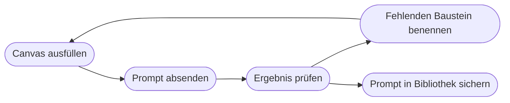

# Kapitel 5 – Das P.R.O.M.P.T.-Framework

{{ progress(5) }}

<div class="lernziele" markdown>
<h3>Was du in diesem Kapitel lernst</h3>

- Warum ein **Prompt** ein Arbeitsauftrag ist – und weshalb ein festes Raster dabei hilft
- Die sechs Bausteine des **P.R.O.M.P.T.-Frameworks**: Persona, Request, Output, Modifier, Purpose, Tone
- Was eine **gute Angabe** je Baustein ausmacht und wo die häufigsten Missverständnisse liegen
- Wie aus einem Ein-Satz-Prompt in drei Stufen ein **belastbarer Marketing-Prompt** wird
- Die **typischen Fehler** beim Prompten und woran du sie am Ergebnis erkennst
- Wie du mit dem **Prompt-Canvas** wiederkehrende Aufträge schnell und vollständig formulierst
</div>

---

## 5.1 Warum ein Framework?

Ein Sprachmodell setzt deine Eingabe mit der wahrscheinlichsten Fortsetzung fort (Kap. 1). Je unbestimmter die Eingabe, desto durchschnittlicher das Ergebnis. „Schreib einen Instagram-Post über unsere neue Jacke" liefert deshalb fast immer denselben Text: drei Ausrufezeichen, „perfekt für jedes Abenteuer", fünf Emojis, zehn Hashtags. Nicht, weil das Werkzeug schlecht ist, sondern weil es nichts über deine Marke, deine Zielgruppe und dein Ziel weiß.

Ein **Prompt** ist kein Suchbegriff, sondern ein **Arbeitsauftrag**. Der hilfreichste Vergleich: eine neue Freelancerin, sprachlich stark, schnell, aber ohne jede Kenntnis eures Hauses – und ohne die Möglichkeit, nachzufragen. Alles, was sie wissen muss, steht im Briefing oder fehlt.

Ein **Framework** ist nichts anderes als eine Checkliste für dieses Briefing. Es sorgt dafür, dass du nichts Wesentliches vergisst, und es gibt dem Team eine gemeinsame Sprache: „Dem Prompt fehlt der Purpose" ist ein präziserer Hinweis als „Das Ergebnis ist irgendwie generisch".

!!! info "Merksatz"
    Alles, was du **nicht** sagst, entscheidet das Modell selbst – nach Wahrscheinlichkeit, nicht nach deinem Bedarf. Ein Framework hilft dir, **vollständig genug** zu sein.

!!! tip "Varianten im Netz"
    Im Netz kursieren zahlreiche Prompt-Formeln – RTF, CO-STAR, CRISPE, RISEN und mehrere Varianten mit dem Kürzel P.R.O.M.P.T., jeweils mit leicht anderen Begriffen. Keine davon ist „die richtige". In diesem Kurs nutzen wir die unten beschriebene Variante. Entscheidend ist das Prinzip dahinter: Wer, was, in welcher Form, unter welchen Regeln, wozu und in welchem Ton.

---

## 5.2 Die sechs Bausteine im Überblick

| Buchstabe | Baustein | Frage, die er beantwortet | Beispielformulierung (Fjordlicht) |
|---|---|---|---|
| **P** | **Persona** | Aus welcher Rolle und mit welcher Expertise? | „Du bist Texterin für eine nachhaltige Outdoor-Marke." |
| **R** | **Request** | Was genau ist zu tun? | „Schreibe einen Newsletter-Teaser für das Fleece Skog." |
| **O** | **Output** | Welche Form, Länge, Struktur? | „Betreffzeile, Preheader, 80 Wörter Fließtext, ein Call-to-Action." |
| **M** | **Modifier** | Welche Regeln, Beispiele, No-Gos? | „Keine Superlative. Nachhaltigkeitsaussagen nur aus dem Produktblatt." |
| **P** | **Purpose** | Wozu und für wen? | „Ziel: Klicks auf die Produktseite. Leser: Bestandskunden 25–45." |
| **T** | **Tone** | Wie soll es klingen? | „Ruhig, ehrlich, leicht trocken, Du-Ansprache." |

Nicht jeder Prompt braucht alle sechs. Für „Fasse diese Kundenbewertungen in fünf Stichpunkten zusammen" genügen Request und Output. Aber wenn ein Ergebnis nicht passt, findest du die Ursache fast immer in einem **fehlenden Baustein** – im Marketing meist Purpose oder Modifier.

---

## 5.3 Baustein für Baustein

**Persona.** Die Rolle lenkt Perspektive, Fachvokabular und Schwerpunkte. „Du bist Social-Media-Managerin für eine B2B-Marke" erzeugt andere Texte als „Du bist Werbetexter". Aber: Eine Rolle verleiht dem Modell **kein Wissen**, das es nicht hat. „Du bist Rechtsanwalt für Wettbewerbsrecht" macht eine Antwort nicht rechtssicher – sie klingt nur so. Wirksamer als Titel ist eine kurze Beschreibung der Arbeitsweise: „…die konkrete Produktvorteile statt Werbefloskeln schreibt".

**Request.** Ein Verb, ein Gegenstand, ein Anlass. „Schreibe", „überarbeite", „vergleiche", „entwickle fünf Ideen für" – je präziser das Verb, desto präziser die Arbeit. Pack nicht mehrere Aufträge in einen Request; zerlege lieber (Kap. 6).

**Output.** Hier legst du fest, was am Ende auf dem Bildschirm steht: Textsorte, Länge in Wörtern oder Zeichen, Gliederung, Bestandteile, Anzahl der Varianten, ggf. Tabelle. Ohne Output-Vorgabe bekommst du mal drei Zeilen, mal eine Seite.

**Modifier.** Der unscheinbarste und wichtigste Baustein. Er enthält alles, was das Ergebnis **eingrenzt**: Fakten, die verwendet werden dürfen, Wörter, die tabu sind, rechtliche Grenzen, Beispiele für den gewünschten Stil (Kap. 6) und die Regel für Lücken: „Wenn dir eine Angabe fehlt, schreibe [FEHLT] statt zu raten." Diese Zeile macht das Halluzinationsrisiko sichtbar (Kap. 2).

**Purpose.** Wozu dient der Text, und wer liest ihn? Ein Post, der Reichweite bringen soll, ist anders gebaut als einer, der Bestandskunden zum Kauf bewegt. Purpose ist der Baustein, den Marketingprofis im Kopf haben und deshalb am häufigsten **nicht aufschreiben**.

**Tone.** Beschreibe die Tonalität nicht mit einem einzigen Adjektiv. „Locker" versteht jedes Modell anders. Besser sind **Gegensatzpaare** und ein Beispiel: „ehrlich statt euphorisch, konkret statt blumig, trocken statt witzig-bemüht". Gibt es einen Styleguide, gehört der Kern hinein – die systematische Stil-Extraktion aus Beispieltexten zeigt Kapitel 7.

!!! warning "Typische Falle"
    „Du bist der beste Marketingexperte der Welt mit 30 Jahren Erfahrung" bringt keinen messbaren Gewinn. Die Rolle wirkt über **inhaltliche** Hinweise (Branche, Zielgruppe, Arbeitsweise), nicht über Superlative. Mehr zu solchen Mythen in Kapitel 7.

---

## 5.4 Ein Marketing-Prompt entsteht – Schritt für Schritt

Die Aufgabe: Fjordlicht bringt das Fleece **Skog** in einer neuen Farbe. Für den Newsletter (rund 38.000 Abonnenten) brauchst du einen Teaser.

**Stufe 0 – der übliche Anfang**

```text
Schreib einen Newslettertext für unser neues Fleece.
```

Ergebnis: „Entdecke jetzt unser brandneues, unglaublich kuscheliges Fleece – der perfekte Begleiter für jedes Abenteuer!" Dazu erfundene Materialangaben, ein Rabattcode, den es nicht gibt, und ein Ton, der zu jeder Marke passt – also zu keiner.

**Stufe 1 – Request und Purpose ergänzen**

```text
Schreibe einen Newsletter-Teaser für das Fleece Skog von Fjordlicht,
das es ab sofort in der neuen Farbe Moosgrün gibt.
Ziel: Bestandskunden sollen auf die Produktseite klicken.
Leser: naturverbundene Stadtmenschen zwischen 25 und 45, die
Fjordlicht bereits kennen.
```

Besser: Der Text hat ein Ziel und spricht jemanden an. Länge, Aufbau und Ton schwanken aber stark, und die Materialangaben sind weiter frei erfunden.

**Stufe 2 – Output und Tone festlegen**

```text
[Stufe 1 wie oben]
Output: Betreffzeile (max. 45 Zeichen), Preheader (max. 80 Zeichen),
Fließtext mit höchstens 80 Wörtern, ein Call-to-Action-Button-Text.
Ton: ruhig, ehrlich, leicht nordisch-trocken, Du-Ansprache.
Ehrlich statt euphorisch, konkret statt blumig.
```

Jetzt ist das Ergebnis direkt verwendbar und hat eine verlässliche Form. Das eigentliche Risiko bleibt: Das Modell füllt Lücken – etwa mit „aus 100 % recycelten Materialien".

**Stufe 3 – Persona und Modifier setzen**

```text
Du bist Texterin für eine nachhaltige Outdoor-Marke und schreibst
konkrete Produkttexte ohne Werbefloskeln.
[Request, Purpose, Output und Ton wie oben]
Regeln:
- Verwende nur diese Produktfakten: Fleece aus 80 % recyceltem
  Polyester laut Produktblatt, Gewicht 320 g, zwei Reißverschlusstaschen,
  Preis 89 Euro.
- Keine Superlative, keine Ausrufezeichen, keine Emojis.
- Keine Nachhaltigkeitsaussagen außer der oben genannten.
- Keine Rabatte oder Aktionen erwähnen.
- Wenn dir eine Angabe fehlt, schreibe [FEHLT] statt zu raten.
```

| Stufe | Ergänzt | Was besser wird | Was noch fehlt |
|---|---|---|---|
| 0 | – | nichts, aber schnell getippt | fast alles |
| 1 | Request, Purpose | Text hat Ziel und Adressaten | Form, Ton, Faktentreue |
| 2 | Output, Tone | direkt verwendbar, markengerechter Klang | Schutz vor Erfundenem |
| 3 | Persona, Modifier | keine erfundenen Fakten, keine Greenwashing-Falle | nur noch die menschliche Freigabe |

!!! warning "Typische Falle"
    Viele hören nach Stufe 2 auf, weil der Text „gut klingt". Genau dort entstehen die teuren Fehler: eine erfundene Nachhaltigkeitsaussage (irreführende Werbung, Kap. 4), ein nicht existierender Rabatt, ein falscher Preis. **Modifier sind kein Feinschliff, sondern der Kern.**

---

## 5.5 Typische Fehler – und woran du sie erkennst

| Fehler | Symptom im Ergebnis | Gegenmittel (Baustein) |
|---|---|---|
| Vager Auftrag | austauschbarer Text, passt zu jeder Marke | Request präzisieren, Anlass nennen |
| Ziel und Zielgruppe nur im Kopf | Text spricht „alle" an, kein klarer Call-to-Action | Purpose ausschreiben |
| Keine Form vorgegeben | mal drei Sätze, mal eine Seite | Output mit Länge und Bestandteilen |
| Ton mit einem Adjektiv beschrieben | „locker" wird zu Jugendsprache | Gegensatzpaare, Beispiel (Tone) |
| Nur Verbote | das Verbotene taucht trotzdem auf | positiv formulieren, was stattdessen gilt |
| Fakten nicht mitgegeben | erfundene Materialien, Preise, Siegel | Fakten im Modifier, Regel für [FEHLT] |
| Mehrere Aufträge in einem Prompt | ein Teil gut, der Rest halbherzig | zerlegen in eine Prompt-Kette (Kap. 6) |

!!! example "Ein Satz, der oft viel rettet"
    Hänge an einen komplexen Auftrag an:

    ```text
    Bevor du beginnst: Stelle mir bis zu drei Rückfragen zu Angaben,
    die dir für ein gutes Ergebnis fehlen. Beginne erst nach meiner Antwort.
    ```

    Das dreht die Arbeitsrichtung um: Statt dass du raten musst, was fehlt, sagt es dir das Werkzeug. Dieser Rückfragen-Prompt ist der erste der Prompt-Hacks in Kapitel 7.

---

## 5.6 Der Prompt-Canvas: das Framework zum Ausfüllen

Für wiederkehrende Aufgaben lohnt sich ein **Prompt-Canvas** – eine Vorlage, die du ausfüllst wie ein Briefingformular. Kopiere sie in deine Notizen, ersetze die Platzhalter in eckigen Klammern und lösche Zeilen, die für den Fall nichts beitragen.

```text
PERSONA:  Du bist [Rolle] mit Erfahrung in [Branche/Thema].
          Du arbeitest [Arbeitsweise, z. B. faktenbasiert, ohne Floskeln].
REQUEST:  [Verb] [Gegenstand] für [Anlass/Kanal].
OUTPUT:   [Textsorte], [Länge], [Bestandteile/Struktur],
          [Anzahl Varianten], [Format, z. B. Tabelle].
MODIFIER: Fakten: [nur diese Angaben verwenden]
          No-Gos: [verbotene Wörter, Aussagen, Themen]
          Beispiel für den Stil: [optional, kurzer Beispieltext]
          Fehlt eine Angabe, schreibe [FEHLT].
PURPOSE:  Ziel: [gewünschte Handlung oder Wirkung].
          Zielgruppe: [wer liest, was weiß sie, was braucht sie].
TONE:     [Ton] - [Gegensatzpaar] statt [Gegensatzpaar]. [Du/Sie].
```

Die Reihenfolge im fertigen Prompt muss nicht der Reihenfolge der Buchstaben folgen. Bewährt hat sich: Persona und Request nach vorn, längeres Material (Produktblatt, Beispieltexte) ans Ende und klar markiert, etwa mit `Produktblatt:` oder Trennlinien (Kap. 6).



!!! tip "Erst Canvas, dann Chat"
    Fülle den Canvas für einen neuen Aufgabentyp einmal sorgfältig aus. Wenn das Ergebnis passt, übertrage Nachbesserungen aus dem Chat **zurück in den Canvas** – sonst beginnst du beim nächsten Mal wieder bei Stufe 0. Wie du daraus eine geteilte Prompt-Bibliothek machst, zeigt Kapitel 10; wie du Prompts mit KI-Hilfe weiter verbesserst, Kapitel 8.

Der Canvas ist ein **Denkwerkzeug**, kein Formular, das vollständig ausgefüllt werden muss. Er stellt sicher, dass du über alle sechs Fragen nachgedacht hast – auch wenn am Ende nur vier davon im Prompt landen. Ein kurzer Prompt, bei dem du bewusst auf Persona und Tone verzichtest, ist kein Fehler. Ein langer Prompt, in dem der Purpose fehlt, schon.

---

## Zusammenfassung

- Ein Prompt ist ein **Arbeitsauftrag**: Alles Ungesagte entscheidet das Modell nach Wahrscheinlichkeit.
- Das **P.R.O.M.P.T.-Framework** umfasst Persona, Request, Output, Modifier, Purpose und Tone; andere Formeln im Netz folgen demselben Prinzip.
- Die **Persona** lenkt Perspektive, verleiht aber kein Fachwissen; **Purpose** ist im Marketing der am häufigsten vergessene Baustein.
- **Modifier** sorgen für Verlässlichkeit: Fakten vorgeben, No-Gos benennen, Lücken mit **[FEHLT]** markieren lassen.
- **Tone** beschreibst du besser mit Gegensatzpaaren und Beispielen als mit einem einzelnen Adjektiv.
- Der **Prompt-Canvas** macht das Framework für wiederkehrende Aufgaben nutzbar; Verbesserungen gehören zurück in die Vorlage.

---

## Kurzübungen

{{ task(file="tasks/k05_01.yaml") }}

{{ task(file="tasks/k05_02.yaml") }}

{{ task(file="tasks/k05_03.yaml") }}

---

## Workshop

{{ task(file="tasks/workshop_k05.yaml") }}
