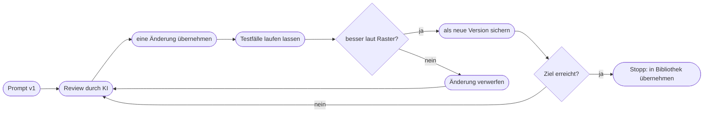

# Kapitel 8 – Optimierung eigener Prompts mit KI

{{ progress(8) }}

<div class="lernziele" markdown>
<h3>Was du in diesem Kapitel lernst</h3>

- Was **Meta-Prompting** ist und wie du die KI einen Prompt für dich entwerfen lässt
- Wie du einen bestehenden Prompt per **Prompt-Review** gegen das P.R.O.M.P.T.-Framework prüfen lässt
- Wie du **Testfälle** festlegst, an denen sich jede Prompt-Version messen muss
- Wie du zwei Prompt-Versionen fair im **A/B-Vergleich** gegeneinander antreten lässt
- Wie ein **Bewertungsraster** aus Bauchgefühl eine nachvollziehbare Entscheidung macht
- Woran du erkennst, dass Optimierung in **Überoptimierung** kippt – und wann du aufhörst
</div>

---

## 8.1 Die KI als Sparringspartner für deine Prompts

In den Kapiteln 5 bis 7 hast du Prompts selbst gebaut: mit dem P.R.O.M.P.T.-Framework (Kap. 5), mit Techniken wie Few-Shot und Prompt-Ketten (Kap. 6) und mit Alltagskniffen wie dem Rückfragen-Prompt (Kap. 7). Dieses Kapitel dreht die Blickrichtung um: Du setzt die KI ein, um **deine eigenen Prompts** besser zu machen.

Das klingt zunächst zirkulär, ist aber sinnvoll. Sprachmodelle haben in ihren Trainingsdaten unzählige Anleitungen, Briefings und Arbeitsaufträge gesehen. Sie erkennen deshalb recht zuverlässig, wenn in einem Auftrag die Zielgruppe fehlt, die Länge offen bleibt oder zwei Anweisungen sich widersprechen. Was sie **nicht** wissen: was du wirklich willst, wie eure Marke klingt und welche Aussagen bei euch belegbar sind. Daraus ergibt sich die Arbeitsteilung.

| Die KI kann gut … | Die KI kann nicht … |
|---|---|
| fehlende Bausteine im Prompt erkennen | wissen, welches Ergebnis du brauchst |
| unklare oder widersprüchliche Formulierungen finden | eure Markenstimme ohne Beispiele treffen |
| aus einer groben Idee einen strukturierten Prompt entwerfen | beurteilen, ob eine Aussage über euer Produkt stimmt |
| Varianten eines Prompts erzeugen | entscheiden, welche Variante im Alltag besser funktioniert |
| Ergebnisse gegen ein vorgegebenes Raster prüfen | ein Raster aufstellen, das eure Qualitätsmaßstäbe kennt |

!!! info "Merksatz"
    Die KI ist beim Optimieren **Lektorin, nicht Auftraggeberin**. Sie macht Vorschläge, du entscheidest – und zwar anhand von Tests, nicht anhand der Frage, welcher Prompt professioneller aussieht.

---

## 8.2 Meta-Prompting: die KI schreibt den Prompt

**Meta-Prompting** bedeutet: Du schreibst einen Prompt, dessen Ergebnis wieder ein Prompt ist. Das lohnt sich vor allem bei wiederkehrenden Aufgaben, für die du noch keine gute Vorlage hast. Statt bei null anzufangen, lässt du dir einen strukturierten Entwurf erstellen – idealerweise nachdem die KI dich zu allem befragt hat, was sie wissen muss.

Am Beispiel der Fjordlicht GmbH: Das Marketingteam braucht jede Woche Produkttexte für Instagram-Posts. Bisher tippt jede Person etwas anderes ins Chatfenster.

```text
Ich möchte einen wiederverwendbaren Prompt für folgende Aufgabe bauen:
Instagram-Captions für neue Produkte der Fjordlicht GmbH (nachhaltige
Outdoor-Bekleidung, Münster).

Gehe so vor:
1. Stelle mir zuerst bis zu acht Rückfragen, die du brauchst, um einen
   guten Prompt zu schreiben. Warte auf meine Antworten.
2. Schreibe danach den Prompt nach dem P.R.O.M.P.T.-Schema mit klar
   beschrifteten Abschnitten: Persona, Request, Output, Modifier,
   Purpose, Tone.
3. Markiere alle Stellen, die bei jeder Nutzung neu ausgefüllt werden,
   als Platzhalter in eckigen Klammern.
4. Nenne am Ende drei Annahmen, die du getroffen hast und die ich
   prüfen sollte.
```

Typische Rückfragen des Modells: Wer ist die Zielgruppe? Wie lang sollen Captions sein? Gibt es Hashtag-Regeln? Welche Aussagen zur Nachhaltigkeit sind erlaubt? Gibt es Beispiele, die als gelungen gelten? Genau diese Fragen hättest du dir selbst stellen müssen – das Modell zwingt dich dazu.

Der Entwurf, den du danach bekommst, ist ein **Startpunkt**. Er ist oft zu lang, enthält gut gemeinte Allgemeinplätze („Sei kreativ und ansprechend") und manchmal Regeln, die du nie verlangt hast. Die Liste der Annahmen am Ende ist deshalb der wertvollste Teil: Sie zeigt dir, wo das Modell geraten hat.

!!! tip "Meta-Prompting mit eigenem Material"
    Am besten funktioniert Meta-Prompting, wenn du **zwei bis drei gelungene Ergebnisse** mitgibst und fragst: „Schreibe einen Prompt, der zuverlässig Texte wie diese erzeugt." Das Modell leitet dann Länge, Aufbau und Ton aus echten Beispielen ab, statt sie zu erfinden. Das ist die Brücke zur Stil-Extraktion aus Kapitel 7.

---

## 8.3 Prompt-Review: den eigenen Prompt prüfen lassen

Häufiger als einen neuen Prompt zu bauen, willst du einen bestehenden verbessern. Dafür eignet sich ein **Prompt-Review**: Du gibst der KI deinen Prompt und ein Prüfraster. Ohne Raster bekommst du allgemeines Lob und ein paar kosmetische Vorschläge.

```text
Du bist erfahrene Prompt-Reviewerin für Marketingteams.
Prüfe den folgenden Prompt anhand des P.R.O.M.P.T.-Schemas:
Persona, Request, Output, Modifier, Purpose, Tone.

Gib das Ergebnis als Tabelle aus mit den Spalten:
Baustein | vorhanden (ja/teilweise/nein) | Problem | konkreter Verbesserungsvorschlag

Prüfe zusätzlich:
- Gibt es widersprüchliche Anweisungen?
- Gibt es Formulierungen, die mehrere Deutungen zulassen?
- Fehlt eine Regel für fehlende Angaben?

Schreibe den Prompt NICHT neu. Ich entscheide selbst, welche Vorschläge
ich übernehme.

Prompt:
"""
[dein Prompt]
"""
```

Die Zeile „Schreibe den Prompt nicht neu" ist bewusst gesetzt. Lässt du die KI direkt eine optimierte Fassung schreiben, ändert sie meist mehrere Dinge gleichzeitig – und du weißt hinterher nicht, welche Änderung gewirkt hat. Der Review liefert dir stattdessen eine **Liste einzelner Vorschläge**, die du nacheinander übernimmst und testest.

| Typischer Review-Befund | Baustein | Bewertung |
|---|---|---|
| „Zielgruppe ist nicht genannt" | Purpose | fast immer berechtigt |
| „Länge ist nicht festgelegt" | Output | fast immer berechtigt |
| „Anweisungen ‚kurz' und ‚ausführlich erklären' widersprechen sich" | Output, Modifier | berechtigt, sofort beheben |
| „Füge hinzu: Sei kreativ und überraschend" | Tone | meist wertlos – legt nichts fest |
| „Ergänze eine detaillierte Persona mit 15 Jahren Erfahrung" | Persona | selten wirksam, kostet nur Länge |
| „Nenne konkrete Nachhaltigkeitsvorteile des Produkts" | Request | **gefährlich** – lädt zum Erfinden von Claims ein |

!!! warning "Typische Falle"
    Ein Review-Vorschlag kann den Prompt **riskanter** machen. Bei Fjordlicht etwa schlägt das Modell gern vor, „konkrete Umweltvorteile hervorzuheben". Ohne hinterlegte Claim-Liste führt genau das zu erfundenen Aussagen wie „spart 40 Prozent CO₂" – ein Greenwashing-Risiko. Prüfe jeden Vorschlag darauf, ob er das Modell zu Behauptungen verleitet, die du nicht belegen kannst.

---

## 8.4 Testfälle: woran sich jede Version messen muss

Ob ein Prompt besser geworden ist, siehst du nicht am Prompt, sondern nur an seinen **Ergebnissen** – und zwar an mehreren. Ein einzelner Durchlauf sagt wenig, weil Sprachmodelle bei gleicher Eingabe unterschiedliche Antworten liefern (Kap. 1). Lege deshalb vor jeder Optimierung **drei bis fünf Testfälle** fest, die die Bandbreite deiner Aufgabe abdecken.

Für den Instagram-Prompt von Fjordlicht könnte das so aussehen:

```text
Testfall 1 Normalfall:   Regenjacke Sølv, vollständige Produktinfos,
                         zwei belegte Claims aus der Claim-Liste
Testfall 2 Lücke:       Fleece Skog, Material bekannt, aber keine
                         Angabe zur Nachhaltigkeit
Testfall 3 Sonderfall:   Rucksack Tind als Business-Variante für
                         Fjordlicht Business (andere Zielgruppe)
Testfall 4 Grenzfall:    Produktmanager wünscht "klimaneutral" im Text,
                         obwohl dazu kein Nachweis vorliegt
```

Der **Lückenfall** zeigt, ob dein Prompt fehlende Angaben markiert oder ergänzt. Der **Grenzfall** zeigt, ob deine Modifier halten, wenn die Eingabe selbst sie unterläuft. Gerade im Marketing ist der Grenzfall entscheidend: Ein Prompt, der bei sauberen Briefings gut funktioniert, aber bei einem unsauberen Briefing Werbeversprechen erfindet, ist nicht produktionsreif.

!!! example "Testfälle wiederverwenden"
    Speichere die Testfälle zusammen mit dem Prompt (Kap. 10). Bei jeder späteren Änderung lässt du dieselben Fälle erneut laufen. So bemerkst du, wenn eine Verbesserung an einer Stelle einen Rückschritt an einer anderen auslöst – etwa wenn eine strengere Längenvorgabe plötzlich den Pflichthinweis zur Materialherkunft verdrängt.

---

## 8.5 A/B-Vergleich und Bewertungsraster

Hast du zwei Fassungen eines Prompts – etwa die ursprüngliche (A) und eine nach dem Review überarbeitete (B) –, vergleichst du sie systematisch. Dieser **A/B-Vergleich von Prompts** ist nicht zu verwechseln mit A/B-Tests von Textvarianten an echten Empfängerinnen und Empfängern (Kap. 16): Hier prüfst du intern, welcher Prompt die besseren Entwürfe liefert.

So gehst du vor:

1. Beide Fassungen laufen mit **denselben Testfällen**, jeweils in einem **neuen Chat** – sonst beeinflusst der bisherige Verlauf das Ergebnis.
2. Jede Fassung läuft pro Testfall mindestens **zweimal**, damit du Zufallsschwankungen von echten Unterschieden trennst.
3. Du bewertest alle Ergebnisse mit demselben **Bewertungsraster**.
4. Ideal: Die Ergebnisse werden **ohne Kennzeichnung** bewertet, damit du deine Lieblingsfassung nicht bevorzugst.

Ein Bewertungsraster zerlegt „gefällt mir" in prüfbare Kriterien. Für Marketingtexte haben sich fünf bis sechs Kriterien mit einer einfachen Skala bewährt.

| Kriterium | 0 Punkte | 1 Punkt | 2 Punkte |
|---|---|---|---|
| Auftrag erfüllt | Thema verfehlt | teilweise | vollständig |
| Format eingehalten | Länge/Struktur falsch | kleine Abweichung | exakt |
| Markenstimme | klingt nach Werbeagentur | teilweise passend | ruhig, ehrlich, Du-Ansprache |
| Faktentreue | erfundene Angaben | unklare Formulierung | nur belegte Aussagen |
| Umgang mit Lücken | Lücke stillschweigend gefüllt | Lücke umschifft | Lücke markiert |
| Direkt verwendbar | neu schreiben | überarbeiten | nur Feinschliff |

Kriterien wie Faktentreue gewichtest du höher oder machst sie zum **K.-o.-Kriterium**: Eine Fassung, die auch nur einmal einen nicht belegten Claim erfindet, verliert – egal wie elegant sie formuliert.

!!! tip "KI als Bewerterin – mit Vorsicht"
    Du kannst die KI bitten, Ergebnisse anhand deines Rasters zu bewerten. Das spart Zeit bei vielen Durchläufen und findet formale Abweichungen zuverlässig. Bei Markenstimme und Faktentreue bleibt die Bewertung aber unsicher: Modelle bewerten Texte, die sie selbst geschrieben haben, oft zu wohlwollend und bevorzugen längere Antworten. Lass die KI vorsortieren, entscheide selbst – und bewerte in einem **neuen Chat**, nicht in dem, in dem die Texte entstanden sind.

---

## 8.6 Wann Optimierung zur Überoptimierung wird

Optimierung hat einen abnehmenden Ertrag. Die ersten Verbesserungen – Zielgruppe ergänzen, Format festlegen, Regel für Lücken – bringen viel. Danach werden die Schritte kleiner, die Prompts länger und die Risiken größer.



| Warnsignal | Was dahinter steckt |
|---|---|
| Der Prompt ist dreimal so lang wie am Anfang | Zusatzregeln, die nichts festlegen, verdecken die wichtigen |
| Ein Testfall wird besser, ein anderer schlechter | Regeln wurden auf einen Einzelfall zugeschnitten |
| Du verbesserst seit einer Stunde an Formulierungen | die Unterschiede liegen im Zufallsbereich |
| Nur noch du verstehst, warum eine Regel drinsteht | der Prompt ist nicht mehr teamfähig (Kap. 10) |
| Die Regeln widersprechen sich inzwischen | Ergänzungen wurden nie gegen den Rest geprüft |

Eine weitere Form der Überoptimierung: einen Prompt an **ein bestimmtes Modell** anpassen, bis er nur dort funktioniert. Modelle werden laufend ausgetauscht – in ChatGPT kam im Oktober 2026 eine neue Modellgeneration, und ähnliche Wechsel gibt es bei Claude, Gemini und Copilot. Ein Prompt mit klarem Ziel, klarem Format und klaren Grenzen übersteht solche Wechsel. Ein Prompt voller Tricks für ein Modell nicht. Aktuelle Reasoning-Modelle profitieren ohnehin eher von einem klaren Ziel als von kleinteiliger Schrittanleitung (Kap. 6).

!!! info "Merksatz"
    Lege **vorher** fest, wann du fertig bist: zum Beispiel „alle vier Testfälle mindestens 9 von 12 Punkten, kein K.-o.-Kriterium verletzt". Ist das erreicht, hörst du auf. Gut genug und stabil schlägt perfekt und zerbrechlich.

---

## Zusammenfassung

- Beim Optimieren ist die KI **Lektorin**: Sie findet Lücken und Widersprüche, die Entscheidung triffst du anhand von Tests.
- **Meta-Prompting** lässt die KI einen Prompt entwerfen – am besten nach Rückfragen und mit gelungenen Beispielen; die genannten Annahmen sind der wertvollste Teil.
- Ein **Prompt-Review** braucht ein Raster (P.R.O.M.P.T.) und die Anweisung, nicht neu zu schreiben; jeder Vorschlag wird auf Claim-Risiken geprüft.
- Drei bis fünf **Testfälle** mit Normal-, Lücken-, Sonder- und Grenzfall sind der Maßstab für jede Version.
- Beim **A/B-Vergleich** laufen beide Fassungen mit denselben Fällen in neuen Chats und werden mit einem **Bewertungsraster** beurteilt; Faktentreue ist K.-o.-Kriterium.
- **Überoptimierung** erkennst du an wachsender Länge, Einzelfallregeln und Zufallsunterschieden – lege das Abbruchkriterium vorher fest.

---

## Kurzübungen

{{ task(file="tasks/k08_01.yaml") }}

{{ task(file="tasks/k08_02.yaml") }}

{{ task(file="tasks/k08_03.yaml") }}

---

## Workshop

{{ task(file="tasks/workshop_k08.yaml") }}
