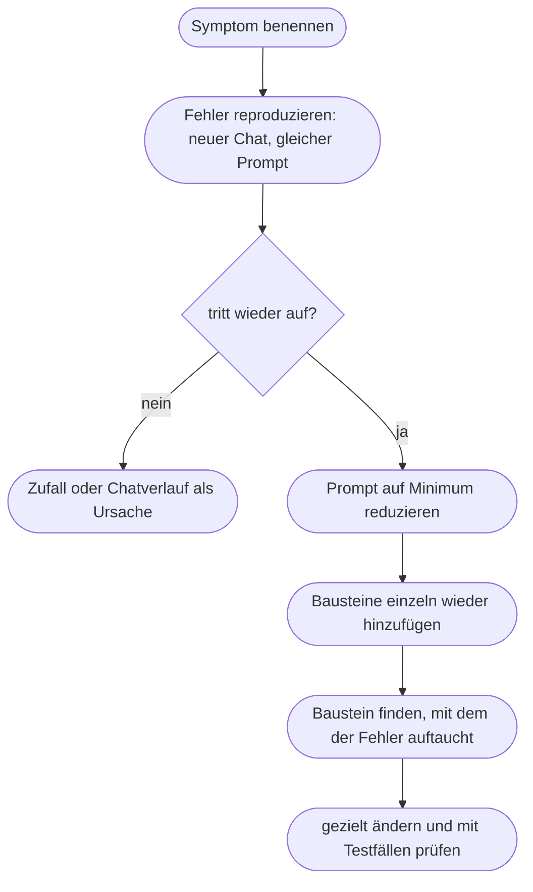

# Kapitel 9 – Fehleranalyse & Troubleshooting

{{ progress(9) }}

<div class="lernziele" markdown>
<h3>Was du in diesem Kapitel lernst</h3>

- Die **typischen Fehlerbilder** bei KI-Texten erkennen und benennen
- Mit einer **Diagnose-Matrix** vom Symptom über die Ursache zum passenden Gegenmittel kommen
- Fehler **systematisch eingrenzen**, statt den Prompt auf gut Glück umzuschreiben
- Verstehen, warum lange Chats an Qualität verlieren – **Kontextverlust** und **„Lost in the middle"**
- Begründet entscheiden: **neuer Chat oder weiterchatten**
- Einen **Faktencheck** durchführen, bevor ein KI-Text das Haus verlässt
</div>

---

## 9.1 Fehler sind Hinweise

Wenn ein KI-Ergebnis nicht passt, reagieren die meisten auf eine von zwei Arten: Sie klicken auf „Neu generieren" und hoffen, oder sie schreiben den ganzen Prompt neu. Beides ist Raten. Manchmal klappt es – aber du lernst nichts daraus, und beim nächsten Mal stehst du wieder am selben Punkt.

Besser ist die Haltung aus der IT-Fehlersuche: Ein schlechtes Ergebnis ist ein **Symptom**. Dahinter steckt fast immer eine von wenigen **Ursachen** – ein fehlender Baustein im Prompt, zu viel oder widersprüchlicher Kontext, ein zu langer Chatverlauf oder eine Aufgabe, die das Modell grundsätzlich nicht leisten kann (Kap. 2). Wer die Ursache findet, kann gezielt gegensteuern.

Dabei hilft dir das P.R.O.M.P.T.-Framework aus Kapitel 5 als Suchraster: Viele Fehlerbilder lassen sich direkt einem Baustein zuordnen. Ein Text, der nach Werbeagentur klingt, deutet auf Tone. Ein Text, der für die falschen Leute geschrieben ist, deutet auf Purpose. Ein Text, der zu lang ist, deutet auf Output.

!!! info "Merksatz"
    Erst **benennen**, dann **zuordnen**, dann **ändern**. Wer nicht sagen kann, was genau am Ergebnis falsch ist, kann den Prompt auch nicht gezielt verbessern.

---

## 9.2 Die typischen Fehlerbilder

Im Marketing-Alltag tauchen immer wieder dieselben Muster auf. Am Beispiel eines Newsletter-Teasers der Fjordlicht GmbH für die Regenjacke „Sølv":

| Fehlerbild | So sieht es aus |
|---|---|
| **Generisch** | „Entdecke unsere neue Jacke – perfekt für jedes Abenteuer!" – könnte von jeder Marke stammen |
| **Zu lang** | Gewünscht waren 60 Wörter, geliefert werden 180 mit drei Absätzen |
| **Falsche Fakten** | „Wassersäule 30.000 mm" oder „klimaneutral produziert", obwohl das nirgends stand |
| **Ton daneben** | „Mega-Deal! Nur heute!" statt ruhig und ehrlich |
| **Ignoriert Anweisungen** | trotz „keine Superlative" steht „die beste Regenjacke" im Text |
| **Kontextverlust** | nach 40 Nachrichten wechselt der Text plötzlich zur Sie-Ansprache |
| **„Lost in the middle"** | eine Vorgabe aus der Mitte eines langen Briefings fehlt im Ergebnis |
| **Wiederholungen** | jeder Entwurf beginnt mit „Wenn der Himmel grau wird …" |

Diese Fehlerbilder treten oft gemeinsam auf. Ein generischer Text ist meist auch zu lang, weil das Modell ohne klares Ziel „sicherheitshalber" alles sagt. Trotzdem lohnt es sich, sie einzeln zu benennen: Jedes hat eigene Ursachen.

Nicht jedes Fehlerbild lässt sich mit einem besseren Prompt beheben. Manche Aufgaben liegen grundsätzlich außerhalb dessen, was ein Sprachmodell verlässlich kann: exakt Zeichen zählen, aktuelle Preise oder Lagerbestände kennen, Suchvolumina nennen (Kap. 21) oder wissen, was in eurem Haus beschlossen wurde. Hier hilft kein Feinschliff, sondern ein anderer Weg – Daten mitliefern, ein Werkzeug mit Websuche oder Datenanalyse nutzen oder die Aufgabe außerhalb der KI erledigen. Bevor du also eine Stunde in Prompt-Varianten investierst, stell dir kurz die Frage: Kann das Modell das überhaupt wissen?

---

## 9.3 Die Diagnose-Matrix

Die folgende Matrix ist dein Werkzeug für die Fehlersuche. Lies sie von links nach rechts: Symptom erkennen, wahrscheinliche Ursache prüfen, Gegenmittel anwenden.

| Symptom | Wahrscheinliche Ursache | Baustein | Gegenmittel |
|---|---|---|---|
| Generisch, austauschbar | Ziel und Zielgruppe fehlen, keine Beispiele | Purpose, Modifier | Zielgruppe und Zweck nennen, zwei Beispieltexte mitgeben (Kap. 6) |
| Zu lang | keine Längenvorgabe oder nur „kurz" | Output | Wortzahl oder Zeichenzahl nennen, Struktur vorgeben |
| Falsche Fakten | Wissenslücke wird mit Wahrscheinlichem gefüllt | Modifier | Fakten mitliefern, „nur Angaben aus dem Material", Regel für Lücken, Faktencheck |
| Ton daneben | Tonvorgabe zu abstrakt („modern", „locker") | Tone | Markenstimme konkret beschreiben, Beispiele, Verbotsliste mit Alternativen |
| Ignoriert Anweisungen | Anweisung widerspricht einer anderen oder geht unter | Modifier | Widersprüche auflösen, Regel nach oben, positiv formulieren |
| Kontextverlust | Chat zu lang, frühe Vorgaben verlieren Gewicht | – | Zusammenfassung erstellen, neuer Chat, Vorgaben in Projekt-Anweisungen |
| „Lost in the middle" | wichtige Information in der Mitte langer Eingaben | Request, Output | Wichtiges an Anfang und Ende, klare Abschnitte, Material kürzen |
| Wiederholungen | gleicher Einstieg im Verlauf, Muster verfestigt sich | Modifier | neuer Chat, Varianten-Fächer anfordern (Kap. 7), Einstiege verbieten |
| Falsche Aufgabe erledigt | mehrere Aufträge in einem Prompt | Request | Aufgabe zerlegen, Prompt-Kette (Kap. 6) |

!!! example "Vorher/Nachher: Anweisung wird ignoriert"
    Der ursprüngliche Prompt enthielt ganz am Ende die Zeile „Keine Superlative". Davor stand: „Mach die Jacke richtig begehrenswert und hebe hervor, was sie besonders macht." Beide Anweisungen ziehen in entgegengesetzte Richtungen – das Modell löst den Konflikt zugunsten der ausführlicheren. Die Korrektur:

    ```text
    Tone: ruhig und ehrlich. Beschreibe, was die Jacke kann, statt sie
    zu bewerten. Statt "die beste Regenjacke" schreibst du, wofür sie
    gemacht ist, z. B. "für lange Tage im Regen auf dem Rad".
    ```

    Die Regel steht jetzt beim Ton, ist positiv formuliert und enthält ein Beispiel für die erwünschte Alternative.

!!! warning "Typische Falle"
    Bei hartnäckigen Fehlern wird gern die Anweisung verstärkt: „WICHTIG!!! KEINE SUPERLATIVE!!!" Das hilft selten und macht Prompts unübersichtlich. Fast immer liegt die Ursache in einem Widerspruch, in einer fehlenden Alternative oder darin, dass die Regel im Material untergeht. Großbuchstaben ersetzen keine Diagnose – sie gehören zu den Mythen aus Kapitel 7.

---

## 9.4 Systematisch eingrenzen

Wenn die Ursache nicht offensichtlich ist, gehst du vor wie bei jeder Fehlersuche: **eine Variable nach der anderen**.



1. **Reproduzieren.** Lass denselben Prompt in einem **neuen Chat** zwei- bis dreimal laufen. Tritt der Fehler nicht wieder auf, lag es am bisherigen Chatverlauf oder am Zufall.
2. **Reduzieren.** Kürze den Prompt auf Request und Output. Ist der Fehler weg, steckt die Ursache in einem der entfernten Teile.
3. **Schrittweise ergänzen.** Füge die Bausteine einzeln wieder hinzu – erst Purpose, dann Tone, dann Modifier, dann das Material. Mit welchem Baustein taucht der Fehler auf?
4. **Gezielt ändern.** Ändere nur diesen Baustein und prüfe mit deinen Testfällen (Kap. 8), ob das Problem behoben ist, ohne neue zu erzeugen.

Ein nützlicher Zwischenschritt ist die **Selbstauskunft**. Du fragst das Modell, wie es deinen Auftrag verstanden hat, bevor es schreibt:

```text
Bevor du schreibst: Fasse in fünf Stichpunkten zusammen, wie du meinen
Auftrag verstehst - Zielgruppe, Ziel, Länge, Ton und die drei wichtigsten
Regeln. Schreibe den Text erst, wenn ich bestätige.
```

Weicht die Zusammenfassung von deiner Absicht ab, hast du die Ursache gefunden, ohne einen einzigen Entwurf zu lesen. Vorsicht bei der Frage „Warum hast du das so gemacht?" nach einem Fehler: Die Antwort ist eine plausible Erklärung, keine verlässliche Auskunft über die tatsächliche Verarbeitung. Sie liefert Hinweise, aber keinen Beweis.

---

## 9.5 Lange Chats: Kontextverlust und „Lost in the middle"

Jedes Modell arbeitet mit einem begrenzten **Kontextfenster** (Kap. 1). Bei aktuellen Modellen ist es groß – trotzdem werden lange Chats schlechter. Zwei Effekte sind dafür verantwortlich.

**Kontextverlust.** Je länger ein Verlauf, desto mehr konkurrieren frühe Vorgaben mit späteren Nachrichten. Die Tonvorgabe aus Nachricht 1 hat in Nachricht 45 weniger Gewicht als die drei Korrekturwünsche dazwischen. Wird das Kontextfenster überschritten, fallen frühe Teile ganz heraus oder werden vom Werkzeug automatisch zusammengefasst.

**„Lost in the middle".** Studien haben gezeigt, dass Sprachmodelle Informationen am **Anfang** und am **Ende** einer langen Eingabe besser berücksichtigen als in der **Mitte**. Neuere Modelle sind darin deutlich besser geworden, aber das Muster tritt weiterhin auf. Steckt deine wichtigste Vorgabe in Absatz 7 eines zehnseitigen Briefings, kann sie übersehen werden.

| Situation | Weiterchatten | Neuer Chat |
|---|---|---|
| Kleine Korrekturen am selben Text | ja | – |
| Text wird über viele Runden „weichgespült" | – | ja, mit bestem Zwischenstand |
| Vorgaben werden zunehmend ignoriert | – | ja, mit Zusammenfassung |
| Neues Thema, neue Aufgabe | – | ja |
| Wiederholungen trotz Bitte um Abwechslung | – | ja |
| Aufbauende Prompt-Kette (Kap. 6) | ja, solange Zwischenstände geprüft werden | ab spürbarem Qualitätsverlust |
| Prompt-Test und A/B-Vergleich (Kap. 8) | – | immer |

Beim Wechsel nimmst du das Wichtige mit. Dafür eignet sich ein **Übergabe-Prompt** am Ende des alten Chats:

```text
Fasse für einen neuen Chat zusammen, was wir festgelegt haben:
Ziel, Zielgruppe, verbindliche Regeln, Tonvorgaben, die beste bisherige
Fassung des Textes und offene Punkte. Formuliere es so, dass ich es als
ersten Prompt in einen neuen Chat kopieren kann.
```

!!! tip "Dauerhafte Vorgaben gehören nicht in den Chat"
    Wenn du dieselben Vorgaben in jeden neuen Chat kopierst, gehören sie eine Ebene höher: in die benutzerdefinierten Anweisungen, in die Anweisungen eines **Projekts** in ChatGPT oder in vergleichbare Funktionen wie Claude Projects (Kap. 7). Dort wirken sie in jedem Chat, ohne im Verlauf unterzugehen. Prüfe aber auch das **Memory**: Eine dort gespeicherte, veraltete Vorgabe kann Fehler verursachen, die du im Prompt vergeblich suchst.

---

## 9.6 Faktencheck: bevor der Text das Haus verlässt

Falsche Fakten sind das gefährlichste Fehlerbild, weil man sie dem Text nicht ansieht. Ein Modell formuliert eine erfundene Wassersäule genauso selbstbewusst wie eine richtige (Kap. 2). Bei Fjordlicht kommt hinzu: Eine unbelegte Nachhaltigkeitsaussage ist nicht nur peinlich, sondern kann als Irreführung abgemahnt werden.

Der Faktencheck folgt drei Schritten:

1. **Prüfbare Aussagen markieren.** Lass dir alle überprüfbaren Behauptungen im Text auflisten – Zahlen, Materialien, Zertifikate, Vergleiche, Daten.
2. **Gegen Quellen prüfen.** Jede Aussage wird gegen eine verlässliche Quelle abgeglichen: Produktdatenblatt, Claim-Liste, Zertifikat, offizielle Statistik. Nicht gegen eine zweite KI-Antwort.
3. **Entscheiden.** Belegt – bleibt. Nicht belegt – raus oder umformulieren. Unklar – an die Fachabteilung.

```text
Liste alle überprüfbaren Aussagen im folgenden Text als Tabelle auf:
Aussage | Art (Zahl, Material, Zertifikat, Vergleich, Sonstiges) |
im Material belegt (ja/nein/teilweise) | Fundstelle im Material.
Bewerte nicht, ob die Aussage stimmt - prüfe nur, ob sie im
mitgelieferten Material steht.
Material: [Produktdatenblatt und Claim-Liste]
Text: [KI-Entwurf]
```

Mit Websuche (in ChatGPT, Perplexity, Gemini oder Copilot) kann die KI Quellen nennen. Das beschleunigt die Recherche, ersetzt aber nicht den Klick auf die Quelle: Auch mit Websuche werden Fundstellen falsch zusammengefasst oder Zahlen aus dem Zusammenhang gerissen. Prüfe, ob die Quelle existiert, ob sie die Aussage tatsächlich enthält und ob sie aktuell ist.

!!! warning "Typische Falle"
    Die Liste prüfbarer Aussagen stammt selbst von der KI – und ist nicht immer vollständig. Lies den Text deshalb trotzdem selbst Satz für Satz. Besonders tückisch sind **weiche Behauptungen** wie „besonders langlebig" oder „umweltschonend hergestellt", die nach Meinung klingen, aber als Tatsachenbehauptung verstanden werden.

!!! info "Merksatz"
    Die KI kann dir zeigen, **was** zu prüfen ist. **Ob** es stimmt, prüfst du an einer Quelle, die nicht von der KI stammt.

---

## Zusammenfassung

- Ein schlechtes Ergebnis ist ein **Symptom**: erst benennen, dann einer Ursache und einem P.R.O.M.P.T.-Baustein zuordnen, dann gezielt ändern.
- Typische Fehlerbilder sind **generisch, zu lang, falsche Fakten, Ton daneben, ignorierte Anweisungen, Kontextverlust, „Lost in the middle" und Wiederholungen**.
- Die **Diagnose-Matrix** führt vom Symptom zum Gegenmittel; Großbuchstaben und Ausrufezeichen ersetzen keine Diagnose.
- **Systematisch eingrenzen** heißt: reproduzieren im neuen Chat, Prompt reduzieren, Bausteine einzeln ergänzen.
- Lange Chats verlieren Qualität; ein **Übergabe-Prompt** und ein **neuer Chat** helfen, dauerhafte Vorgaben gehören in Projekte oder Anweisungen.
- Der **Faktencheck** markiert prüfbare Aussagen und gleicht sie mit Quellen ab, die nicht von der KI stammen.

---

## Kurzübungen

{{ task(file="tasks/k09_01.yaml") }}

{{ task(file="tasks/k09_02.yaml") }}

{{ task(file="tasks/k09_03.yaml") }}

---

## Workshop

{{ task(file="tasks/workshop_k09.yaml") }}
